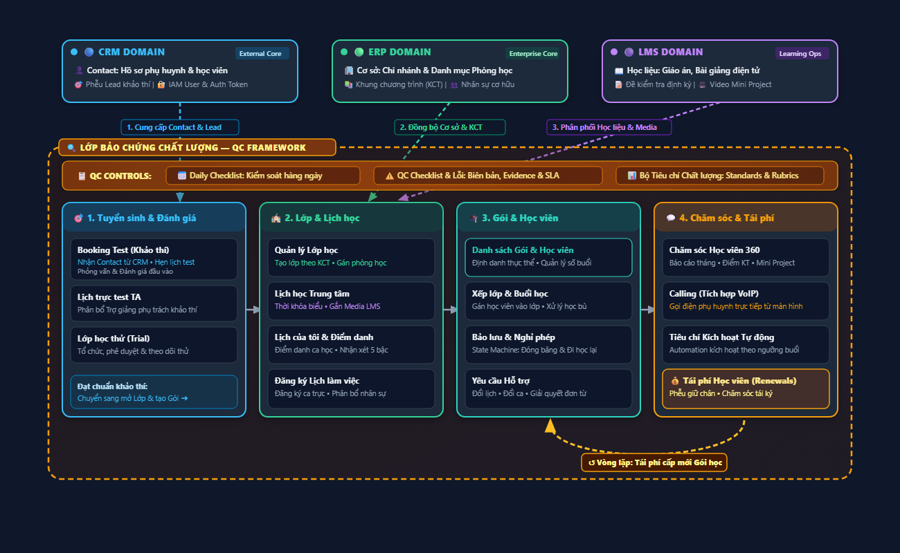
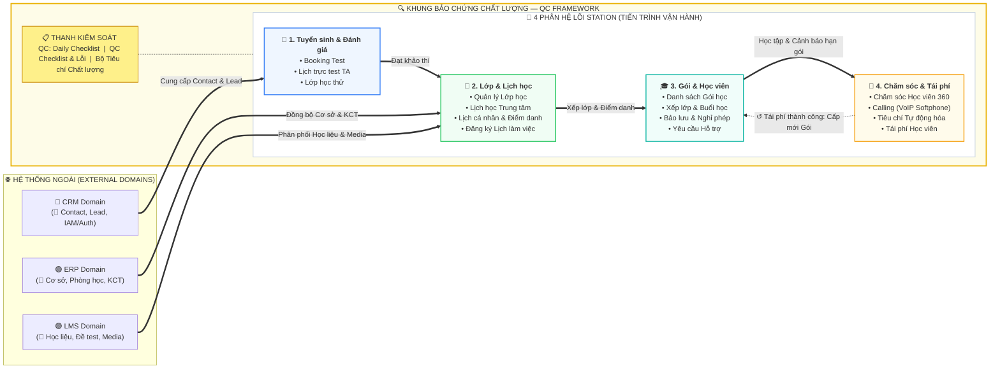

# Kiến trúc Tổng thể Hệ thống Station V2 (Station Architecture Overview)

> **Cập nhật:** 2026-11-09  
> **Trạng thái:** Bản thiết kế kiến trúc chuẩn hóa (Đã thẩm định 100% không đứt gãy)  
> **Tài liệu tham chiếu:** [Station V2 - Danh sách nghiệp vụ (Confluence)](https://rinoeduai.atlassian.net/wiki/x/SoCfCg)  
> **Vị trí tệp tin:** `docs/00-business/ARCHITECTURE-STATION-V2.md`

---

## 1. Sơ đồ Kiến trúc Tổng thể (Master Architecture Diagram)

<b>🔍 Bấm vào đây để xem trực tiếp mã Vector SVG chuẩn nét cao (Interactive SVG)</b>

<svg xmlns="http://www.w3.org/2000/svg" viewBox="0 0 1200 680" width="100%" height="100%" style="max-width: 1200px; font-family: system-ui, sans-serif;">
  <defs>
    <linearGradient id="qcGrad" x1="0%" y1="0%" x2="100%" y2="100%">
      <stop offset="0%" stop-color="#451a03" stop-opacity="0.3"/>
      <stop offset="100%" stop-color="#78350f" stop-opacity="0.15"/>
    </linearGradient>
    <linearGradient id="qcBarGrad" x1="0%" y1="0%" x2="100%" y2="0%">
      <stop offset="0%" stop-color="#78350f"/>
      <stop offset="50%" stop-color="#92400e"/>
      <stop offset="100%" stop-color="#78350f"/>
    </linearGradient>
    <marker id="arrow-crm" viewBox="0 0 10 10" refX="6" refY="5" markerWidth="6" markerHeight="6" orient="auto-start-reverse">
      <path d="M 0 1 L 10 5 L 0 9 z" fill="#38bdf8" />
    </marker>
    <marker id="arrow-erp" viewBox="0 0 10 10" refX="6" refY="5" markerWidth="6" markerHeight="6" orient="auto-start-reverse">
      <path d="M 0 1 L 10 5 L 0 9 z" fill="#34d399" />
    </marker>
    <marker id="arrow-lms" viewBox="0 0 10 10" refX="6" refY="5" markerWidth="6" markerHeight="6" orient="auto-start-reverse">
      <path d="M 0 1 L 10 5 L 0 9 z" fill="#c084fc" />
    </marker>
    <marker id="arrow-white" viewBox="0 0 10 10" refX="6" refY="5" markerWidth="6" markerHeight="6" orient="auto-start-reverse">
      <path d="M 0 1 L 10 5 L 0 9 z" fill="#94a3b8" />
    </marker>
    <marker id="arrow-gold" viewBox="0 0 10 10" refX="6" refY="5" markerWidth="7" markerHeight="7" orient="auto-start-reverse">
      <path d="M 0 1 L 10 5 L 0 9 z" fill="#fbbf24" />
    </marker>
  </defs>

  <!-- TẦNG 1: 3 EXTERNAL DOMAINS -->
  <g transform="translate(40, 20)">
    <rect width="340" height="90" rx="12" fill="#1e293b" stroke="#38bdf8" stroke-width="2"/>
    <rect x="12" y="12" width="10" height="10" rx="5" fill="#38bdf8"/>
    <text x="30" y="22" fill="#38bdf8" font-size="13" font-weight="800">🔵 CRM DOMAIN</text>
    <rect x="250" y="10" width="78" height="18" rx="4" fill="#0369a1" fill-opacity="0.4"/>
    <text x="256" y="23" fill="#bae6fd" font-size="10" font-weight="600">External Core</text>
    <text x="16" y="48" fill="#f1f5f9" font-size="12" font-weight="600">👤 Contact: Hồ sơ phụ huynh &amp; học viên</text>
    <text x="16" y="68" fill="#94a3b8" font-size="11">🎯 Phễu Lead khảo thí | 🔐 IAM User &amp; Auth Token</text>
  </g>

  <g transform="translate(430, 20)">
    <rect width="340" height="90" rx="12" fill="#1e293b" stroke="#34d399" stroke-width="2"/>
    <rect x="12" y="12" width="10" height="10" rx="5" fill="#34d399"/>
    <text x="30" y="22" fill="#34d399" font-size="13" font-weight="800">🟢 ERP DOMAIN</text>
    <rect x="250" y="10" width="78" height="18" rx="4" fill="#065f46" fill-opacity="0.4"/>
    <text x="256" y="23" fill="#a7f3d0" font-size="10" font-weight="600">Enterprise Core</text>
    <text x="16" y="48" fill="#f1f5f9" font-size="12" font-weight="600">🏢 Cơ sở: Chi nhánh &amp; Danh mục Phòng học</text>
    <text x="16" y="68" fill="#94a3b8" font-size="11">📚 Khung chương trình (KCT) | 👥 Nhân sự cơ hữu</text>
  </g>

  <g transform="translate(820, 20)">
    <rect width="340" height="90" rx="12" fill="#1e293b" stroke="#c084fc" stroke-width="2"/>
    <rect x="12" y="12" width="10" height="10" rx="5" fill="#c084fc"/>
    <text x="30" y="22" fill="#c084fc" font-size="13" font-weight="800">🟣 LMS DOMAIN</text>
    <rect x="250" y="10" width="78" height="18" rx="4" fill="#6b21a8" fill-opacity="0.4"/>
    <text x="256" y="23" fill="#e9d5ff" font-size="10" font-weight="600">Learning Ops</text>
    <text x="16" y="48" fill="#f1f5f9" font-size="12" font-weight="600">📖 Học liệu: Giáo án, Bài giảng điện tử</text>
    <text x="16" y="68" fill="#94a3b8" font-size="11">📝 Đề kiểm tra định kỳ | 🎥 Video Mini Project</text>
  </g>

  <!-- ĐƯỜNG NỐI TỪ NGOÀI VÀO STATION -->
  <path d="M 210 110 L 210 250" stroke="#38bdf8" stroke-width="2.5" stroke-dasharray="6 4" fill="none" marker-end="url(#arrow-crm)"/>
  <rect x="125" y="135" width="170" height="22" rx="4" fill="#0f172a" stroke="#0284c7" stroke-width="1"/>
  <text x="133" y="150" fill="#38bdf8" font-size="10.5" font-weight="700">1. Cung cấp Contact &amp; Lead</text>

  <path d="M 600 110 L 485 250" stroke="#34d399" stroke-width="2.5" stroke-dasharray="6 4" fill="none" marker-end="url(#arrow-erp)"/>
  <rect x="520" y="135" width="160" height="22" rx="4" fill="#0f172a" stroke="#059669" stroke-width="1"/>
  <text x="528" y="150" fill="#34d399" font-size="10.5" font-weight="700">2. Đồng bộ Cơ sở &amp; KCT</text>

  <path d="M 990 110 L 530 250" stroke="#c084fc" stroke-width="2.5" stroke-dasharray="6 4" fill="none" marker-end="url(#arrow-lms)"/>
  <rect x="740" y="135" width="180" height="22" rx="4" fill="#0f172a" stroke="#7e22ce" stroke-width="1"/>
  <text x="748" y="150" fill="#c084fc" font-size="10.5" font-weight="700">3. Phân phối Học liệu &amp; Media</text>

  <!-- TẦNG 2: QC HORIZONTAL WRAPPER -->
  <rect x="20" y="175" width="1160" height="480" rx="18" fill="url(#qcGrad)" stroke="#f59e0b" stroke-width="2.5" stroke-dasharray="8 5"/>

  <g transform="translate(35, 163)">
    <rect width="400" height="24" rx="6" fill="#78350f" stroke="#f59e0b" stroke-width="1.5"/>
    <text x="10" y="17" fill="#fef08a" font-size="12" font-weight="800">🔍 LỚP BẢO CHỨNG CHẤT LƯỢNG — QC FRAMEWORK</text>
  </g>

  <!-- THANH CÔNG CỤ QC -->
  <g transform="translate(40, 195)">
    <rect width="1120" height="42" rx="8" fill="url(#qcBarGrad)" stroke="#f59e0b" stroke-width="1.2"/>
    <text x="20" y="26" fill="#fef08a" font-size="12" font-weight="800">📋 QC CONTROLS:</text>
    <rect x="150" y="8" width="280" height="26" rx="6" fill="#451a03" fill-opacity="0.6" stroke="#d97706" stroke-width="1"/>
    <text x="165" y="25" fill="#fde68a" font-size="11.5" font-weight="600">📅 Daily Checklist: Kiểm soát hàng ngày</text>

    <rect x="450" y="8" width="330" height="26" rx="6" fill="#451a03" fill-opacity="0.6" stroke="#d97706" stroke-width="1"/>
    <text x="465" y="25" fill="#fde68a" font-size="11.5" font-weight="600">⚠️ QC Checklist &amp; Lỗi: Biên bản, Evidence &amp; SLA</text>

    <rect x="800" y="8" width="300" height="26" rx="6" fill="#451a03" fill-opacity="0.6" stroke="#d97706" stroke-width="1"/>
    <text x="815" y="25" fill="#fde68a" font-size="11.5" font-weight="600">📊 Bộ Tiêu chí Chất lượng: Standards &amp; Rubrics</text>
  </g>

  <!-- 4 MODULE LÕI XẾP NGANG -->
  <!-- 1. Tuyển sinh -->
  <g transform="translate(40, 255)">
    <rect width="265" height="310" rx="12" fill="#1e293b" stroke="#38bdf8" stroke-width="2"/>
    <rect x="0" y="0" width="265" height="42" rx="12" fill="#0369a1" fill-opacity="0.3"/>
    <text x="15" y="27" fill="#38bdf8" font-size="13" font-weight="800">🎯 1. Tuyển sinh &amp; Đánh giá</text>

    <rect x="12" y="52" width="241" height="60" rx="8" fill="#0f172a" stroke="#334155" stroke-width="1"/>
    <text x="22" y="73" fill="#f1f5f9" font-size="12" font-weight="700">Booking Test (Khảo thí)</text>
    <text x="22" y="90" fill="#38bdf8" font-size="10.5">Nhận Contact từ CRM • Hẹn lịch test</text>
    <text x="22" y="103" fill="#94a3b8" font-size="10">Phỏng vấn &amp; Đánh giá đầu vào</text>

    <rect x="12" y="120" width="241" height="52" rx="8" fill="#0f172a" stroke="#334155" stroke-width="1"/>
    <text x="22" y="141" fill="#f1f5f9" font-size="12" font-weight="700">Lịch trực test TA</text>
    <text x="22" y="159" fill="#94a3b8" font-size="10.5">Phân bổ Trợ giảng phụ trách khảo thí</text>

    <rect x="12" y="180" width="241" height="52" rx="8" fill="#0f172a" stroke="#334155" stroke-width="1"/>
    <text x="22" y="201" fill="#f1f5f9" font-size="12" font-weight="700">Lớp học thử (Trial)</text>
    <text x="22" y="219" fill="#94a3b8" font-size="10.5">Tổ chức, phê duyệt &amp; theo dõi thử</text>

    <rect x="12" y="250" width="241" height="48" rx="8" fill="#0369a1" fill-opacity="0.15" stroke="#0284c7" stroke-width="1"/>
    <text x="22" y="270" fill="#bae6fd" font-size="11" font-weight="700">Đạt chuẩn khảo thí:</text>
    <text x="22" y="287" fill="#38bdf8" font-size="10.5">Chuyển sang mở Lớp &amp; tạo Gói ➔</text>
  </g>

  <path d="M 305 410 L 325 410" stroke="#94a3b8" stroke-width="2.5" fill="none" marker-end="url(#arrow-white)"/>

  <!-- 2. Lớp & Lịch học -->
  <g transform="translate(325, 255)">
    <rect width="265" height="310" rx="12" fill="#1e293b" stroke="#34d399" stroke-width="2"/>
    <rect x="0" y="0" width="265" height="42" rx="12" fill="#065f46" fill-opacity="0.3"/>
    <text x="15" y="27" fill="#34d399" font-size="13" font-weight="800">🏫 2. Lớp &amp; Lịch học</text>

    <rect x="12" y="52" width="241" height="55" rx="8" fill="#0f172a" stroke="#334155" stroke-width="1"/>
    <text x="22" y="73" fill="#f1f5f9" font-size="12" font-weight="700">Quản lý Lớp học</text>
    <text x="22" y="91" fill="#34d399" font-size="10.5">Tạo lớp theo KCT • Gán phòng học</text>

    <rect x="12" y="115" width="241" height="55" rx="8" fill="#0f172a" stroke="#334155" stroke-width="1"/>
    <text x="22" y="136" fill="#f1f5f9" font-size="12" font-weight="700">Lịch học Trung tâm</text>
    <text x="22" y="154" fill="#c084fc" font-size="10.5">Thời khóa biểu • Gắn Media LMS</text>

    <rect x="12" y="178" width="241" height="55" rx="8" fill="#0f172a" stroke="#334155" stroke-width="1"/>
    <text x="22" y="199" fill="#f1f5f9" font-size="12" font-weight="700">Lịch của tôi &amp; Điểm danh</text>
    <text x="22" y="217" fill="#94a3b8" font-size="10.5">Điểm danh ca học • Nhận xét 5 bậc</text>

    <rect x="12" y="241" width="241" height="57" rx="8" fill="#0f172a" stroke="#334155" stroke-width="1"/>
    <text x="22" y="262" fill="#f1f5f9" font-size="12" font-weight="700">Đăng ký Lịch làm việc</text>
    <text x="22" y="280" fill="#94a3b8" font-size="10.5">Đăng ký ca trực • Phân bổ nhân sự</text>
  </g>

  <path d="M 590 410 L 610 410" stroke="#94a3b8" stroke-width="2.5" fill="none" marker-end="url(#arrow-white)"/>

  <!-- 3. Gói & Học viên -->
  <g transform="translate(610, 255)">
    <rect width="265" height="310" rx="12" fill="#1e293b" stroke="#2dd4bf" stroke-width="2"/>
    <rect x="0" y="0" width="265" height="42" rx="12" fill="#0f766e" fill-opacity="0.3"/>
    <text x="15" y="27" fill="#2dd4bf" font-size="13" font-weight="800">🎓 3. Gói &amp; Học viên</text>

    <rect x="12" y="52" width="241" height="55" rx="8" fill="#0f172a" stroke="#2dd4bf" stroke-width="1.2"/>
    <text x="22" y="73" fill="#2dd4bf" font-size="12" font-weight="700">Danh sách Gói &amp; Học viên</text>
    <text x="22" y="91" fill="#94a3b8" font-size="10.5">Định danh thực thể • Quản lý số buổi</text>

    <rect x="12" y="115" width="241" height="55" rx="8" fill="#0f172a" stroke="#334155" stroke-width="1"/>
    <text x="22" y="136" fill="#f1f5f9" font-size="12" font-weight="700">Xếp lớp &amp; Buổi học</text>
    <text x="22" y="154" fill="#94a3b8" font-size="10.5">Gán học viên vào lớp • Xử lý học bù</text>

    <rect x="12" y="178" width="241" height="55" rx="8" fill="#0f172a" stroke="#334155" stroke-width="1"/>
    <text x="22" y="199" fill="#f1f5f9" font-size="12" font-weight="700">Bảo lưu &amp; Nghỉ phép</text>
    <text x="22" y="217" fill="#94a3b8" font-size="10.5">State Machine: Đóng băng &amp; Đi học lại</text>

    <rect x="12" y="241" width="241" height="57" rx="8" fill="#0f172a" stroke="#334155" stroke-width="1"/>
    <text x="22" y="262" fill="#f1f5f9" font-size="12" font-weight="700">Yêu cầu Hỗ trợ</text>
    <text x="22" y="280" fill="#94a3b8" font-size="10.5">Đổi lịch • Đổi ca • Giải quyết đơn từ</text>
  </g>

  <path d="M 875 410 L 895 410" stroke="#94a3b8" stroke-width="2.5" fill="none" marker-end="url(#arrow-white)"/>

  <!-- 4. Chăm sóc & Tái phí -->
  <g transform="translate(895, 255)">
    <rect width="265" height="310" rx="12" fill="#1e293b" stroke="#f59e0b" stroke-width="2"/>
    <rect x="0" y="0" width="265" height="42" rx="12" fill="#b45309" fill-opacity="0.3"/>
    <text x="15" y="27" fill="#f59e0b" font-size="13" font-weight="800">💬 4. Chăm sóc &amp; Tái phí</text>

    <rect x="12" y="52" width="241" height="55" rx="8" fill="#0f172a" stroke="#334155" stroke-width="1"/>
    <text x="22" y="73" fill="#f1f5f9" font-size="12" font-weight="700">Chăm sóc Học viên 360</text>
    <text x="22" y="91" fill="#94a3b8" font-size="10.5">Báo cáo tháng • Điểm KT • Mini Project</text>

    <rect x="12" y="115" width="241" height="55" rx="8" fill="#0f172a" stroke="#334155" stroke-width="1"/>
    <text x="22" y="136" fill="#f1f5f9" font-size="12" font-weight="700">Calling (Tích hợp VoIP)</text>
    <text x="22" y="154" fill="#f59e0b" font-size="10.5">Gọi điện phụ huynh trực tiếp từ màn hình</text>

    <rect x="12" y="178" width="241" height="55" rx="8" fill="#0f172a" stroke="#334155" stroke-width="1"/>
    <text x="22" y="199" fill="#f1f5f9" font-size="12" font-weight="700">Tiêu chí Kích hoạt Tự động</text>
    <text x="22" y="217" fill="#94a3b8" font-size="10.5">Automation kích hoạt theo ngưỡng buổi</text>

    <rect x="12" y="241" width="241" height="57" rx="8" fill="#78350f" fill-opacity="0.4" stroke="#f59e0b" stroke-width="1.5"/>
    <text x="22" y="262" fill="#fde68a" font-size="12" font-weight="800">💰 Tái phí Học viên (Renewals)</text>
    <text x="22" y="280" fill="#fef08a" font-size="10.5">Phễu giữ chân • Chăm sóc tái ký</text>
  </g>

  <!-- VÒNG LẶP TÁI PHÍ: 4 -> 3 (FEEDBACK LOOP) -->
  <path d="M 1025 570 C 1025 635, 745 635, 745 575" stroke="#fbbf24" stroke-width="3" stroke-dasharray="7 4" fill="none" marker-end="url(#arrow-gold)"/>
  <rect x="790" y="618" width="210" height="26" rx="6" fill="#451a03" stroke="#f59e0b" stroke-width="1.5"/>
  <text x="800" y="635" fill="#fef08a" font-size="11" font-weight="800">↺ Vòng lặp: Tái phí cấp mới Gói học</text>
</svg>

---

## 2. Phiên bản Mermaid Tương thích (Left-to-Right Flat Layout)

Dành cho môi trường xem thuần văn bản không hỗ trợ nhúng hình ảnh/SVG:

---

## 3. Bản đồ Dữ liệu & Luồng Nghiệp vụ Chi tiết

### 3.1. Điểm đấu nối từ 3 External Domains
1. **🔵 CRM Domain (Contact, Lead & IAM Token):**
   * **Contact:** Single Source of Truth cho toàn bộ danh bạ liên hệ (Phụ huynh, người giám hộ, số điện thoại, email).
   * **Lead:** Các đăng ký khảo thí / hẹn kiểm tra trình độ được đẩy trực tiếp vào **Booking Test**.
   * **IAM Token:** Quản trị đăng nhập một lần (SSO) và phân quyền vai trò người dùng trong Station.
2. **🟢 ERP Domain (Cơ sở chi nhánh & Khung chương trình KCT):**
   * Danh mục cơ sở vật chất trung tâm, phòng học và trang thiết bị thực tế.
   * **Khung chương trình chuẩn (KCT):** Số lượng buổi, mục tiêu bài học chuẩn để khởi tạo lớp học tại **Quản lý Lớp học**.
3. **🟣 LMS Domain (Học liệu, Khảo thí số & Media):**
   * Kho giáo án điện tử, slide bài giảng số, đề kiểm tra định kỳ và bài học dự án (Mini Project) được gắn thẳng vào từng buổi trên **Lịch học Trung tâm**.

---

### 3.2. Khung QC bao trùm ngang (🔍 QC Horizontal Wrapper)
* **Vị trí kiến trúc:** Bao bọc ngang qua toàn bộ 4 module lõi, thể hiện vai trò giám sát độc lập và bảo chứng chất lượng dịch vụ.
* **Bộ ba công cụ kiểm soát chất lượng:**
  * **Daily Checklist:** Bộ danh mục kiểm tra định kỳ hàng ngày của nhân sự trung tâm (CSVC, chuẩn bị ca học, điểm danh đúng giờ).
  * **QC Checklist & Lỗi:** Ghi nhận lỗi vi phạm vận hành, gắn bằng chứng (Evidence) và theo dõi tiến độ khắc phục theo cam kết thời hạn (SLA).
  * **Bộ Tiêu chí Chất lượng:** Thiết lập tiêu chuẩn chấm điểm và barem kiểm soát dịch vụ.

---

### 3.3. Bốn Phân hệ Lõi Station & Vòng lặp Tái phí (Feedback Loop)
* **Tiến trình vận hành tuyến tính (Trái → Phải):**
  1. **Tuyển sinh & Đánh giá:** Nhận Contact từ CRM ➔ Đặt lịch Booking Test ➔ Phỏng vấn khảo thí & Học thử.
  2. **Lớp & Lịch học:** Mở lớp theo KCT từ ERP ➔ Lên thời khóa biểu ➔ Gắn học liệu LMS ➔ Điểm danh & Nhận xét 5 bậc.
  3. **Gói & Học viên:** Quản lý thực thể học viên & số buổi theo gói ➔ Xếp lớp & xử lý học bù ➔ Quản lý máy trạng thái Bảo lưu / Nghỉ phép.
  4. **Chăm sóc & Tái phí:** Hệ thống CRM 360 chăm sóc học tập ➔ Tổng đài gọi điện VoIP ➔ Tự động kích hoạt danh mục theo ngưỡng buổi ➔ Quản lý phễu Tái phí.
* **Vòng lặp khép kín Tái phí ↔ Gói học (Feedback Loop):**
  $$\text{Chăm sóc Học viên} \longrightarrow \text{Đạt ngưỡng Tái phí} \longrightarrow \text{Tái phí thành công} \overset{\text{Cấp mới / Gia hạn}}{\Longrightarrow} \text{Gói học mới (Module 3)}$$
  Học viên tái phí không phải quay lại quy trình phễu tuyển sinh ban đầu, tạo ra vòng đời khách hàng liên tục (Customer Lifetime Value).
