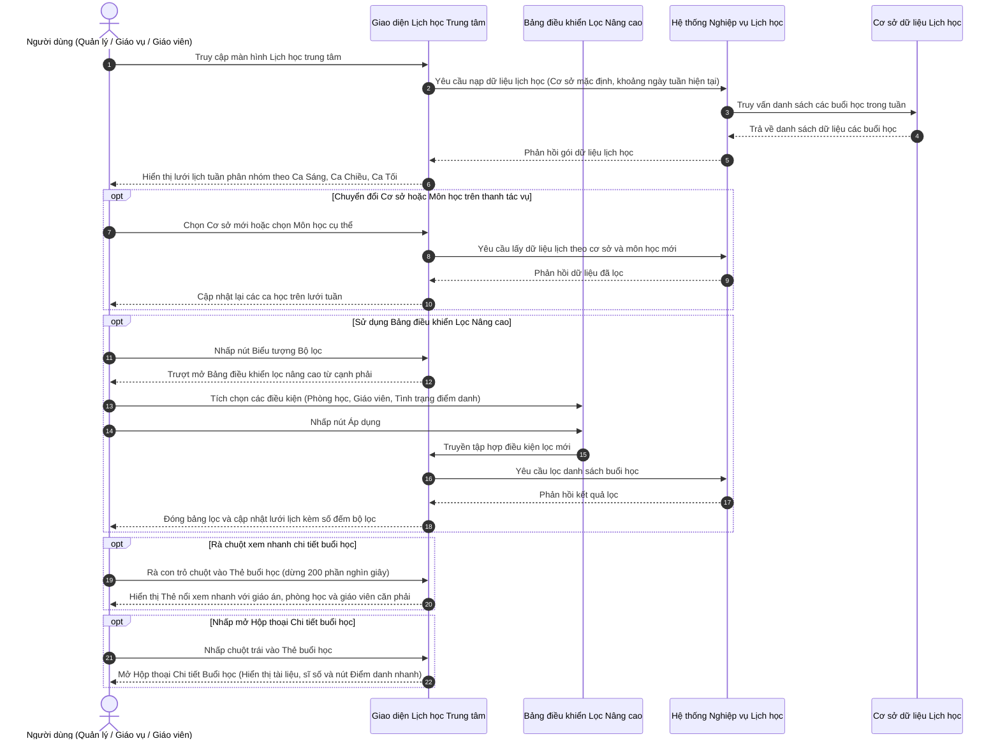

# US-CAL-02-05: Nâng cấp Giao diện Lịch học Trung tâm (Center Class Schedule Interface Update)

> **Tham chiếu:** `BF-CAL-02` · `SR-CSM-001` · Giao diện Mẫu §4.2 (Màn hình Danh sách dạng Lưới Thời gian & Lịch tuần)  
> **Đường dẫn màn hình & Trạng thái liên quan:**  
> - `Lịch học trung tâm (/app/calendar_class_schedule)` -> Chế độ xem: `Tuần`, `Ngày`  

---

## 1. NHẬT KÝ THAY ĐỔI & BỐI CẢNH (CHANGELOG & CONTEXT)

### Lịch sử cập nhật tài liệu (Changelog)

| Ngày cập nhật | Nội dung cập nhật | Lý do cập nhật |
|---|---|---|
| 22/10/2026 | Tinh giản và phân định rõ ràng 2 cột: Mô tả giao diện mới (biểu diễn trực quan kèm dữ liệu mẫu) và Nội dung điều chỉnh (phân loại rõ Thêm mới, Điều chỉnh, Lược bỏ) | Nâng cao độ mạch lạc, súc tích và trực quan theo góp ý của người dùng |

### Bối cảnh & Mục tiêu điều chỉnh (Context & Objectives)
* **Bối cảnh nghiệp vụ:** Màn hình Lịch học trung tâm là không gian làm việc đầu mối của Quản lý chi nhánh (`PERSONA-BRANCH-MANAGER`), Nhân viên giáo vụ (`PERSONA-CSM`) và Giáo viên (`PERSONA-TEACHER`) để theo dõi toàn bộ hoạt động giảng dạy, phòng học khả dụng, nhân sự đứng lớp và biến động sĩ số học viên theo thời gian thực tại cơ sở.
* **Mục tiêu điều chỉnh giao diện:**
  - Chuẩn hóa bố cục thời khóa biểu tuần theo cấu trúc 3 ca học lớn có khả năng gập mở: Ca Sáng (08:00 - 12:00), Ca Chiều (13:30 - 17:30) và Ca Tối (17:45 - 21:30).
  - Tối ưu hóa thanh công cụ tác vụ: Đưa bộ chọn Cơ sở và bộ chọn Môn học trực tiếp về phía bên trái; bố trí cụm chuyển tuần ngay cạnh; phía bên phải gồm nút "Hôm nay", bộ chuyển đổi chế độ xem Tuần/Ngày, ô tìm kiếm mở rộng và nút mở bảng lọc chuyên sâu.
  - Tái cấu trúc thẻ buổi học hiển thị đa sắc kèm vạch màu chỉ thị trạng thái ở cạnh trái, hiển thị đầy đủ họ tên giáo viên, khối cảnh báo chưa gán giáo viên, biểu tượng học sinh học thử/bù màu cam nổi bật và huy hiệu hết chỗ màu đỏ.
  - Bổ sung thẻ nổi xem nhanh khi rà chuột với độ trễ kích hoạt 200 phần nghìn giây để tra cứu giáo án, phòng học và nhân sự tức thì.
* **Chỉ số đo lường hiệu quả (KPI Target):**
  - Thời gian bao quát ca học và phát hiện buổi chưa gán giáo viên: Giảm từ 45 giây xuống dưới 5 giây.
  - Tỷ lệ nhận diện chính xác ca có học sinh học thử/học bù ngay trên màn hình tổng quan: Đạt 100%.
  - Thời gian tải dữ liệu lịch tuần: Dưới 500 phần nghìn giây đối với dữ liệu từ bộ nhớ đệm và dưới 1 giây đối với truy vấn hệ thống.

### Hiểu người dùng & Tình huống sử dụng (User Needs & Use Cases)
* **Người dùng chính (Persona):** Quản lý chi nhánh (`PERSONA-BRANCH-MANAGER`), Nhân viên giáo vụ / Chăm sóc học viên (`PERSONA-CSM`), Giáo viên (`PERSONA-TEACHER`).
* **Nhu cầu thực tế (Needs):**
  - Quản lý chi nhánh cần nhìn nhanh theo từng ca học trong ngày để điều phối phòng học trống và kiểm soát các ca học chưa có giáo viên đứng lớp.
  - Giáo vụ cần nhận biết ngay các ca học có học sinh học thử hoặc học bù để đón tiếp phụ huynh và học sinh chu đáo.
  - Giáo viên cần rà chuột vào ca dạy để xem nhanh từ vựng, mẫu câu và tài liệu bài giảng mà không cần chuyển màn hình.
* **Câu phát biểu nghiệp vụ:** **Là một** Quản lý chi nhánh hoặc Nhân viên giáo vụ, **tôi muốn** theo dõi thời khóa biểu lớp học được phân chia rõ theo từng ca học và thẻ buổi học thể hiện trực quan trạng thái nhân sự cùng sĩ số, **để** kiểm soát 100% tình hình vận hành cơ sở nhanh chóng và giảm thiểu sai sót lịch dạy.

### Biểu mẫu đặc tả chi tiết các đối tượng điều chỉnh (Adjustment Specification Form)

| Đối tượng giao diện | Mô tả giao diện mới | Nội dung điều chỉnh | Nguồn dữ liệu | Hành vi tương tác & Phản hồi |
|---|---|---|---|---|
| **Tiêu đề màn hình & Định vị phân hệ** | Thanh tiêu đề hiển thị dòng chữ `Lịch học trung tâm` in đậm màu đen nhánh, đặt ở góc trái trên cùng của khu vực nội dung, ngay dưới thanh điều hướng đỉnh trang. Thanh điều hướng dọc bên trái đồng thời làm sáng mục menu `Lịch học trung tâm`. | - **Điều chỉnh:** Đổi tên tiêu đề thành `Lịch học trung tâm` để phân định rõ ràng phân hệ quản lý lịch với thanh tiêu đề chung của hệ thống. - **Lược bỏ:** Lược bỏ các nút tác vụ phân hệ thừa thãi trên thanh đỉnh hệ thống chung, chuyển toàn bộ quyền kiểm soát về thanh công cụ chuyên biệt của lịch học. | Cấu hình danh mục chức năng trung tâm của hệ thống. | Hiển thị cố định tại thanh đỉnh trang; nhấp vào mục menu tương ứng ở thanh bên trái sẽ chuyển trang đến đúng đường dẫn lịch học. |
| **Bộ chọn Cơ sở đào tạo** | Hộp chọn thả xuống viền mảnh ở góc trái ngoài cùng thanh công cụ. Hiển thị nhãn cơ sở hiện tại (Ví dụ: `RinoEdu Nguyễn Tuân` hoặc `Tất cả cơ sở`) kèm biểu tượng tòa nhà và mũi tên chỉ xuống. Khi bấm, mở danh sách các cơ sở trực thuộc. | - **Điều chỉnh:** Di dời bộ chọn cơ sở từ góc phải màn hình về vị trí ưu tiên số 1 bên trái thanh công cụ để định hình phạm vi dữ liệu trước tiên. - **Thêm mới:** Tích hợp ô tìm kiếm chi nhánh nhanh ngay bên trong danh sách thả xuống khi danh sách dài. - **Lược bỏ:** Lược bỏ kiểu nút bấm dàn trải, thay thế bằng hộp thả xuống dạng viền nhấn tinh gọn. | Cơ sở dữ liệu danh mục chi nhánh toàn hệ thống; cơ sở mặc định lấy theo tài khoản công tác của người dùng. | Khi nhấp chọn chi nhánh mới, hệ thống lưu trạng thái chi nhánh được chọn, kích hoạt tải lại toàn bộ lịch học của cơ sở đó trong tuần và tự động tính toán lại số lượng buổi học trên từng ca học. |
| **Bộ chọn Môn học nhanh** | Hộp chọn thả xuống nằm liền kề bên phải bộ chọn cơ sở. Hiển thị tùy chọn mặc định `Tất cả các môn` hoặc tên môn học cụ thể (Ví dụ: `Tiếng Anh`, `Toán tư duy`, `Khoa học`) kèm mũi tên chỉ xuống. | - **Thêm mới:** Đưa bộ chọn môn học nhanh trực tiếp lên thanh công cụ chính, cho phép lọc 1 chạm. - **Điều chỉnh:** Danh sách môn học trong hộp chọn tự động trích xuất theo các môn học thực tế có phát sinh lớp trong tuần đang chọn. - **Lược bỏ:** Lược bỏ thao tác bắt buộc phải mở bảng lọc nâng cao khi chỉ cần lọc theo môn học. | Cơ sở dữ liệu môn học phát sinh từ các buổi học thực tế trong tuần đang chọn. | Nhấp chọn một môn học cụ thể sẽ lập tức lọc và chỉ hiển thị các lớp của môn đó trên bảng lịch tuần; chọn `Tất cả các môn` để khôi phục xem toàn bộ. |
| **Cụm điều hướng thời gian tuần** | Cụm điều hướng gồm nút mũi tên lùi `‹`, nhãn khoảng ngày tuần in đậm (Ví dụ: `06/10 - 12/10/2026`), và nút mũi tên tiến `›`. Đặt ngay cạnh bộ chọn môn học. | - **Điều chỉnh:** Gom cụm mũi tên lùi/tiến gắn liền sát với tiêu đề khoảng ngày tuần thay vì để tách rời; chuyển toàn bộ cụm về nửa bên trái thanh tác vụ. - **Lược bỏ:** Lược bỏ thanh trượt chọn ngày tuần phức tạp, thay bằng thao tác lùi/tiến 1 tuần trên từng lần bấm. | Lịch hệ thống theo thời gian thực và khoảng ngày tuần làm việc từ Thứ Hai đến Chủ Nhật. | Nhấp mũi tên trái để lùi 1 tuần; nhấp mũi tên phải để tiến 1 tuần; nhấp "Hôm nay" đưa mốc thời gian về tuần hoặc ngày hiện tại và tự động làm nổi bật cột hôm nay bằng màu nền xanh lá nhẹ. |
| **Nút "Hôm nay"** | Nút bấm chữ `Hôm nay` dạng viền nhấn tinh gọn, đặt ở góc phải thanh công cụ. | - **Điều chỉnh:** Tách nút `Hôm nay` thành nút độc lập nằm ở cụm tác vụ góc phải, tách biệt khỏi cụm chuyển tuần. - **Thêm mới:** Bổ sung cơ chế khi bấm thì ngoài việc đưa tuần về hiện tại, hệ thống tự động làm nổi bật cột ngày hôm nay bằng màu nền xanh lá nhạt. | Lịch hệ thống theo thời gian thực. | Nhấp nút để đưa thời gian về tuần/ngày hiện tại, đồng thời cuộn nhẹ và làm nổi bật cột ngày hôm nay. |
| **Bộ chuyển đổi Chế độ xem** | Thanh điều khiển phân đoạn gồm 2 nút liền khối: `Tuần` và `Ngày`. Nút đang chọn có nền trắng nổi khối và đổ bóng nhẹ, nút còn lại có nền xám chìm. Mặc định kích hoạt `Tuần`. | - **Điều chỉnh:** Thay thế các nút chuyển tab đơn lẻ bằng thanh điều khiển phân đoạn liền khối chuẩn thiết kế mới. - **Thêm mới:** Bổ sung chế độ xem `Ngày` chi tiết để phục vụ xem thời khóa biểu chuyên sâu trong một ngày bận rộn. - **Lược bỏ:** Lược bỏ chế độ xem danh sách phẳng cồng kềnh khó bao quát. | Trạng thái lựa chọn chế độ hiển thị thời khóa biểu (Tuần hoặc Ngày) của người dùng. | Nhấp `Tuần` hiển thị lưới 7 cột từ Thứ Hai đến Chủ Nhật; nhấp `Ngày` hiển thị chi tiết các ca học của một ngày duy nhất kèm tiêu đề ngày chi tiết. |
| **Ô tìm kiếm mở rộng** | Biểu tượng kính lúp tròn tinh gọn. Khi nhấp chuột, biểu tượng tự động trượt mở rộng theo chiều ngang thành ô nhập văn bản có dòng chữ mờ `Tìm lớp, GV, phòng...` kèm nút dấu nhân `×` ở đuôi để xóa nhanh. | - **Thêm mới:** Cơ chế bung rộng tự động theo chiều ngang khi nhấp chuột, tiết kiệm tối đa diện tích thanh công cụ khi chưa dùng. - **Thêm mới:** Nút xóa nhanh nội dung và cơ chế tự động tìm kiếm sau 300 phần nghìn giây khi dừng gõ. - **Lược bỏ:** Lược bỏ ô tìm kiếm cố định chiếm diện tích lớn trên thanh công cụ. | Dữ liệu tra cứu buổi học gồm: mã lớp học, tên lớp học, giáo viên giảng dạy, giáo viên dạy thay, phòng học và môn học. | Tự động lọc dữ liệu sau 300 phần nghìn giây khi người dùng dừng gõ phím; tự động hiển thị giao diện thông báo trạng thái rỗng nếu không tìm thấy bản ghi phù hợp. |
| **Nút mở Bảng lọc nâng cao** | Nút bấm vuông viền mỏng chứa biểu tượng phễu lọc. Góc trên hiển thị một chấm tròn huy hiệu màu nhấn chứa số lượng điều kiện lọc đang kích hoạt (Ví dụ: `2`, `3`). | - **Thêm mới:** Huy hiệu số đếm màu nhấn trực quan thể hiện rõ số lượng tiêu chí lọc đang được áp dụng. - **Điều chỉnh:** Thay thế bảng lọc dàn trải trên trang bằng nút kích hoạt bảng điều khiển lọc chuyên sâu dạng trượt từ cạnh phải màn hình. | Số lượng các tiêu chí lọc đang được người dùng áp dụng từ bảng điều khiển bộ lọc. | Nhấp để bật hoặc tắt bảng điều khiển lọc nâng cao trượt từ cạnh phải màn hình; không làm mất ngữ cảnh lưới lịch đang xem. |
| **Thanh tiêu đề Ca học gập mở** | Dải thanh ngang trải rộng 7 cột chia làm 3 ca: `Ca Sáng (08:00 - 12:00)` (vạch vàng), `Ca Chiều (13:30 - 17:30)` (vạch xanh), `Ca Tối (17:45 - 21:30)` (vạch tím). Đầu thanh có biểu tượng mũi tên chỉ hướng gập/mở, vạch màu nhận diện và số lượng buổi học bên phải (Ví dụ: `14 buổi`). | - **Thêm mới:** Phân tách toàn bộ thời khóa biểu tuần thành 3 khối ca học rõ ràng tương ứng với các khung giờ vận hành thực tế tại trung tâm. - **Thêm mới:** Tính năng nhấp tiêu đề để gập gọn hoặc mở rộng từng ca học độc lập giúp người dùng tập trung vào ca đang trực. - **Điều chỉnh:** Tự động ẩn hoàn toàn khối ca học nếu tuần đó không phát sinh buổi học nào. - **Lược bỏ:** Lược bỏ trục thời gian dọc trải dài từ 7h sáng đến 22h đêm gây cuộn trang quá dài và nhiều khoảng trống thừa. | Quy tắc phân loại ca học theo khung thời gian giảng dạy; tổng số buổi học được tính toán động theo tuần. | Nhấp vào thanh tiêu đề để thu gọn hoặc mở rộng toàn bộ lưới 7 cột của ca học đó; tự động ẩn hoàn toàn ca học nếu tuần đó không có buổi học nào phát sinh. |
| **Tiêu đề cột Ngày trong tuần** | Hàng tiêu đề 7 cột gồm tên Thứ (Ví dụ: `Thứ 2`, `Thứ 3`,..., `Chủ nhật`), ngày tháng bên dưới (Ví dụ: `06/10`) và tổng số buổi học trong ngày (Ví dụ: `6 buổi`). Cột ngày hôm nay có nền xanh lá nhạt và số ngày đóng trong vòng tròn màu nhấn. | - **Thêm mới:** Hiển thị tổng số buổi học phát sinh trong ngày ngay tại tiêu đề cột để tiện kiểm đếm nhanh. - **Thêm mới:** Hiệu ứng làm nổi bật cột ngày hiện tại bằng màu nền xanh lá và vòng tròn nhấn ngày. - **Điều chỉnh:** Số đếm buổi học tự động tính toán lại theo tất cả các bộ lọc đang chọn. | Lịch tuần theo ngày thực tế và tổng số buổi học được tính toán lại theo từng ngày. | Các cột ngày co giãn đều nhau; tự động cập nhật lại số lượng buổi học khi người dùng thay đổi bộ lọc. |
| **Thẻ Buổi học - Vạch màu & Nền trạng thái** | Khối thẻ hình chữ nhật bo tròn nhẹ. Mép trái có vạch màu đứng chỉ thị trạng thái: Xanh lá (Hôm nay), Xanh dương (Dạy thay), Đỏ (Khai giảng), Xám (Đã diễn ra). Nền thẻ đổi sắc nhẹ tương ứng. Ca đã hủy có nền xám mờ và nội dung có nét gạch ngang. | - **Thêm mới:** Vạch màu chỉ thị trạng thái ở cạnh trái thẻ giúp nhận diện tình trạng vận hành trong 1 giây mà không cần đọc chữ. - **Thêm mới:** Hiệu ứng nổi khối nhẹ và đổi viền sáng khi rà con trỏ chuột vào thẻ. - **Điều chỉnh:** Hiển thị buổi học đã hủy bằng hiệu ứng mờ kèm gạch ngang chữ trực quan. - **Lược bỏ:** Lược bỏ các nhãn trạng thái dạng chữ chiếm diện tích bên trong thẻ. | Trạng thái vận hành thực tế của buổi học (xác nhận, đã hủy, đã hoàn thành, dời lịch, khai giảng, có giáo viên dạy thay). | Hiển thị nổi bật trạng thái vận hành; rà chuột vào thẻ có hiệu ứng viền sáng nhẹ và nâng cao đổ bóng; nhấp chuột mở hộp thoại chi tiết. |
| **Thẻ Buổi học - Khung giờ & Cảnh báo nhanh** | Dòng trên cùng in đậm khung giờ học (Ví dụ: `18:00 - 19:30`). Góc phải hiển thị: Biểu tượng học sinh mới màu cam đậm khi lớp có học sinh học thử/bù; huy hiệu cảnh báo màu đỏ kèm chữ `Hết chỗ` khi lớp đã đạt trần sức chứa phòng. | - **Thêm mới:** Biểu tượng cảnh báo có học sinh học thử / học bù màu cam đậm ở vị trí đầu thẻ để giáo vụ phát hiện ngay. - **Thêm mới:** Huy hiệu cảnh báo `Hết chỗ` màu đỏ tự động hiển thị khi sĩ số chạm sức chứa tối đa của phòng học. - **Điều chỉnh:** Khung giờ được in đậm và đưa lên dòng ưu tiên số 1 của thẻ. | Khung thời gian buổi học, số lượng học sinh học thử/bù và sức chứa tối đa của phòng học. | Cảnh báo trực quan cho nhân viên giáo vụ; rà chuột vào biểu tượng thêm học sinh sẽ hiển thị chú thích chi tiết số lượng học thử hoặc học bù. |
| **Thẻ Buổi học - Tên bài, Mã lớp & Trình độ** | Dòng 2 hiển thị tên bài học in đậm (Ví dụ: `Unit 3: Colors & Shapes`), tự động cắt ngắn bằng dấu ba chấm nếu quá dài. Dòng 3 hiển thị mã lớp căn trái (Ví dụ: `ENG-K2-01`) và nhãn trình độ môn học căn phải (Ví dụ: `Kindy 2`). | - **Điều chỉnh:** Sắp xếp lại thứ tự: Tên bài học lên trên, mã lớp và trình độ xếp chung một dòng ngay bên dưới để bố cục chặt chẽ. - **Thêm mới:** Cơ chế tự cắt ngắn tên bài học bằng dấu ba chấm khi quá dài kèm thuộc tính xem trọn vẹn khi di chuột, tránh làm vỡ chiều cao thẻ. - **Lược bỏ:** Lược bỏ các trường thông tin rườm rà như ngày tạo, phân hệ nguồn để thẻ tinh gọn. | Thông tin lớp học gồm: tên bài học, mã lớp học và trình độ đào tạo. | Đảm bảo thẻ có chiều cao đồng nhất; gắn thuộc tính nhãn đầy đủ để người dùng di chuột xem trọn vẹn tên bài nếu bị cắt ngắn. |
| **Thẻ Buổi học - Sĩ số & Thông tin Giáo viên** | Dòng chân thẻ gồm 2 phần: • Bên trái: Biểu tượng người kèm tỷ lệ điểm danh / sĩ số (Ví dụ: `08/10`) và số lượng học sinh mới (Ví dụ: `+2`). • Bên phải: Vòng tròn viết tắt chữ cái tên kèm **Họ tên đầy đủ của Giáo viên** (Ví dụ: `[TH] Thu Hà`). Nếu là dạy thay thì ảnh đại diện có viền cam; nếu chưa phân công thì hiện nhãn cam `Chưa gán GV`. | - **Thêm mới:** Hiển thị họ tên đầy đủ của giáo viên trực tiếp trên thẻ thay vì chỉ hiện chữ cái viết tắt mơ hồ. - **Thêm mới:** Nhãn cảnh báo màu cam `Chưa gán GV` khi buổi học bị khuyết nhân sự đứng lớp. - **Thêm mới:** Viền cam quanh ảnh đại diện giáo viên để nhận diện ngay ca có người dạy thay. - **Điều chỉnh:** Tích hợp số lượng học sinh học thử/học bù hiển thị dạng `+X` ngay cạnh chỉ số sĩ số. | Cơ sở dữ liệu nhân sự giảng dạy và tình hình sĩ số điểm danh thực tế của lớp học. | Thể hiện chính xác nhân sự đứng lớp; rà chuột vào tên giáo viên hiển thị thẻ hồ sơ nhân sự (thư điện tử, số điện thoại được che dạng bảo mật `091****111`, chuyên môn). |
| **Thẻ nổi Xem nhanh khi rà chuột** | Khung thẻ nổi màu trắng bo góc có bóng đổ sâu, tự động bật lên sau 200 phần nghìn giây khi rà chuột vào thẻ buổi học. Hiển thị: Khung giờ, tên lộ trình, phòng học (Ví dụ: `Phòng Lab 01`), giáo viên chính và trợ giảng căn phải (Ví dụ: `GV: Thu Hà`, `TG: Minh Quân`), sĩ số chi tiết và tóm tắt giáo án bài dạy (từ vựng trọng tâm, mẫu câu). | - **Thêm mới:** Cơ chế hiển thị thẻ nổi tự động khi rà con trỏ chuột với độ trễ 200 phần nghìn giây, cho phép xem nhanh giáo án và nhân sự mà không phải chuyển trang. - **Thêm mới:** Thuật toán tự động đảo hướng hiển thị khi thẻ nằm sát mép phải hoặc mép dưới màn hình, tránh bị tràn vùng nhìn. - **Lược bỏ:** Lược bỏ việc bắt buộc người dùng phải nhấp mở cửa sổ lớn mới xem được giáo án hoặc phòng học. | Nghiệp vụ giáo án bài học, thông tin cơ cấu phòng học và hồ sơ nhân sự phân công. | Tự động tính toán vị trí hiển thị thông minh không tràn mép màn hình; tự đóng khi con trỏ chuột rời khỏi vùng thẻ. |
| **Bảng điều khiển Bộ lọc Nâng cao** | Bảng điều khiển trượt từ cạnh phải màn hình, gồm các nhóm lọc dạng cây: Cây Phòng học (Ví dụ: `Tầng 2 > Phòng Lab 01`), Cây Môn học - Trình độ (Ví dụ: `Tiếng Anh > Kindy`), Khung ca học (`Ca Sáng`, `Ca Chiều`, `Ca Tối`), Trạng thái buổi học, Giáo viên phụ trách, Tình trạng điểm danh. Chân bảng có 2 nút: `Đặt lại` và `Áp dụng`. | - **Thêm mới:** Bảng điều khiển lọc chuyên sâu dạng trượt từ cạnh phải, giữ nguyên tầm nhìn lịch tuần bên dưới. - **Thêm mới:** Cơ chế lọc nháp đa tầng: người dùng có thể chọn thoải mái nhiều điều kiện, chỉ khi bấm nút `Áp dụng` mới tiến hành lọc dữ liệu. - **Thêm mới:** Nút `Đặt lại` giúp xóa trắng toàn bộ điều kiện lọc nhanh chóng chỉ bằng 1 thao tác. - **Lược bỏ:** Lược bỏ các thanh lọc nằm ngang chiếm diện tích đỉnh bảng. | Cơ sở dữ liệu danh mục phòng học, cơ cấu trình độ môn học, danh sách giáo viên phụ trách tại chi nhánh. | Người dùng chọn nhiều điều kiện ở chế độ nháp; chỉ khi bấm nút `Áp dụng`, hệ thống mới thực hiện lọc lại dữ liệu và cập nhật số lượng trên huy hiệu nút lọc. |
| **Thanh Chú giải Trạng thái Chân trang** | Thanh dải hẹp nằm ngang ghim sát đáy bảng lịch, gồm nhãn `Chú giải màu:` và 6 chấm tròn màu sắc kèm tên gọi tương ứng: Buổi hôm nay (Xanh lá), Sắp diễn ra (Trắng viền xám), Đã diễn ra (Xám), Dạy thay (Xanh dương), Khai giảng (Đỏ), Đã hủy (Xám có nét gạch ngang chữ). | - **Thêm mới:** Bảng chỉ dẫn màu nhận diện trạng thái ghim cố định ở đáy trang, tạo chuẩn quy ước trực quan cho người dùng. - **Điều chỉnh:** Chuẩn hóa hệ thống mã màu nhận diện theo đúng bảng trạng thái vận hành của trung tâm. | Danh mục quy ước trạng thái buổi học của hệ thống. | Cung cấp bảng chỉ dẫn trực quan thường trực dưới đáy màn hình giúp đối chiếu nhận diện trạng thái các thẻ. |
| **Hộp thoại Chi tiết Buổi học & Thao tác** | Cửa sổ hộp thoại mở chính giữa màn hình với nền mờ phía sau. Bên trong gồm: Thanh tiêu đề kèm mã lớp và nút đóng `×`, thanh tiến trình lộ trình học tập (Ví dụ: `Buổi 12/24`), vùng danh sách tài liệu bài giảng đính kèm, bảng danh sách học sinh kèm trạng thái điểm danh và nút `Điểm danh nhanh` nổi bật bằng màu nhấn ở chân hộp thoại. | - **Thêm mới:** Nút hành động `Điểm danh nhanh` ngay trong hộp thoại chi tiết để kích hoạt nhanh bảng kiểm diện học sinh. - **Thêm mới:** Thanh tiến trình trực quan thể hiện tiến độ buổi học trên tổng số buổi của khóa học. - **Điều chỉnh:** Hiển thị số điện thoại học sinh và phụ huynh đầy đủ tại hộp thoại này đối với người dùng có thẩm quyền (trên bảng lịch đã bị che dạng `091****111`). | Cơ sở dữ liệu lớp học, tiến trình lộ trình đào tạo và danh sách kiểm diện học sinh. | Nhấp chuột trái vào thẻ buổi học để mở hộp thoại; nhấp `Điểm danh nhanh` sẽ đóng hộp thoại và kích hoạt mở bảng kiểm diện điểm danh tương ứng. |

### Phạm vi kiểm soát & Ràng buộc nghiệp vụ (Scope & Business Rules)
* **Phạm vi kiểm soát (Feature Scope):**

| Mã Yêu Cầu | Hạng mục chức năng | Mức ưu tiên | Phạm vi hiển thị | Mô tả chi tiết |
|---|---|---|---|---|
| **REQ-CAL-01** | Thanh công cụ chuyển cơ sở, môn học và điều hướng tuần | Bắt buộc (Must) | Thanh công cụ đỉnh màn hình | Cung cấp các ô thả xuống chọn cơ sở, chọn môn học, bộ điều hướng ngày tuần và nút Hôm nay |
| **REQ-CAL-02** | Lưới lịch tuần phân nhóm theo Ca Sáng, Chiều, Tối | Bắt buộc (Must) | Khu vực nội dung trung tâm | Hiển thị lưới 7 cột ngày theo 3 ca học chuyên biệt, hỗ trợ gập mở từng ca linh hoạt |
| **REQ-CAL-03** | Thẻ buổi học đa sắc kèm vạch màu chỉ thị trạng thái | Bắt buộc (Must) | Lưới thời khóa biểu | Hiển thị khung giờ, mã lớp, trình độ, sĩ số kèm vạch màu cạnh trái và tên giáo viên |
| **REQ-CAL-04** | Thẻ nổi xem nhanh khi rà chuột | Bắt buộc (Must) | Nổi phía trên thẻ buổi học | Bật tự động sau 200 phần nghìn giây hiển thị giáo án, phòng học, giáo viên và trợ giảng |
| **REQ-CAL-05** | Bảng điều khiển lọc chuyên sâu dạng trượt | Bắt buộc (Must) | Bảng trượt từ cạnh phải | Cung cấp cây phòng học, môn học - trình độ, ca học, tình trạng điểm danh theo chế độ nháp |
| **REQ-CAL-06** | Hộp thoại chi tiết buổi học và thao tác điểm danh | Bắt buộc (Must) | Hộp thoại nổi giữa màn hình | Mở màn hình chi tiết buổi học đầy đủ, lộ trình, tài liệu và nút điểm danh nhanh |

* **Ràng buộc nghiệp vụ toàn cục (Global Rules):**
  - **[RULE-CAL-01] Bảo toàn dữ liệu & Không thay đổi xử lý hệ thống:** Việc nâng cấp chỉ điều chỉnh cách thức hiển thị và tương tác trên giao diện, giữ nguyên các trường dữ liệu và logic xử lý hệ thống đã có.
  - **[RULE-CAL-02] Che số điện thoại chống sao chép hàng loạt:** Trong mọi thành phần hiển thị danh sách và thẻ nổi xem nhanh, số điện thoại của nhân sự hoặc phụ huynh (nếu có) phải được che ẩn ở giữa theo định dạng `091****111`. Chỉ người dùng có thẩm quyền mở hộp thoại chi tiết mới được xem số điện thoại đầy đủ.
  - **[RULE-CAL-03] Thẻ trạng thái và số đếm đi theo bộ lọc:** Tất cả số lượng đếm buổi học trên tiêu đề từng ngày và trên các thanh ca học phải tự động tính toán lại theo tổ hợp bộ lọc đang áp dụng (Cơ sở, Môn học, và các điều kiện lọc nâng cao).
  - **[RULE-CAL-04] Cơ chế Lọc Nháp trên Bảng điều khiển:** Việc chọn các tiêu chí lọc trong bảng điều khiển nâng cao ở chế độ nháp; chỉ khi người dùng nhấp nút "Áp dụng", hệ thống mới thực hiện lọc lại dữ liệu trên lưới lịch.

---

## 2. LUỒNG XỬ LÝ CHÍNH (MAIN FLOW - HAPPY PATH)

---

## 3. GIAO DIỆN & PHÂN QUYỀN VAI TRÒ (UI STATE & PERMISSION MATRIX)

### 3.1. Bảng mô tả chi tiết giao diện tĩnh (UI Structure Table)

| Thành phần giao diện | Loại hiển thị | Dữ liệu & Quy tắc | Diễn giải quy tắc | Co giãn giao diện (Mobile) |
|---|---|---|---|---|
| **Bộ chọn Cơ sở đào tạo** | Hộp chọn thả xuống | Danh sách các cơ sở trực thuộc hệ thống | Cho phép chọn 1 cơ sở duy nhất để xem lịch. Giá trị mặc định là cơ sở đang công tác của người dùng. | Tự động co giãn phù hợp chiều ngang màn hình hẹp |
| **Bộ chọn Môn học nhanh** | Hộp chọn thả xuống | `Tất cả các môn` hoặc tên môn cụ thể | Lọc nhanh các buổi học thuộc môn học đã chọn. Mặc định là `Tất cả các môn`. | Tự động co giãn theo tỷ lệ giao diện di động |
| **Cụm điều hướng thời gian tuần** | Nút bấm biểu tượng & Nhãn văn bản | Nút mũi tên trái, nhãn khoảng ngày tuần, nút mũi tên phải | Nhấp để tiến hoặc lùi 1 tuần (hoặc 1 ngày nếu ở chế độ ngày). Nhãn hiển thị ngày đầu tuần và ngày cuối tuần. | Nhãn ngày hiển thị dạng rút gọn |
| **Nút Hôm nay** | Nút bấm văn bản dạng viền nhấn | Nhãn `Hôm nay` | Nhấp để đưa mốc thời gian trở về tuần hoặc ngày hiện tại. | Giữ nguyên kích thước chuẩn |
| **Bộ chuyển đổi Chế độ xem** | Bộ nút điều khiển phân đoạn | Hai lựa chọn: `Tuần` và `Ngày` | Cho phép chuyển đổi nhanh giữa góc nhìn toàn tuần (7 cột) và góc nhìn chi tiết trong ngày. Mặc định: `Tuần`. | Giữ nguyên dạng nút chuyển phân đoạn |
| **Ô tìm kiếm mở rộng** | Ô nhập thông tin tự co giãn | Từ khóa tìm kiếm: Mã lớp, Tên lớp, Giáo viên, Phòng học | Tự động mở rộng khi nhấp chuột, lọc dữ liệu sau khi người dùng dừng gõ 300 phần nghìn giây. | Co giãn tự nhiên trên màn hình hẹp |
| **Nút mở Bảng lọc nâng cao** | Nút biểu tượng kèm huy hiệu số đếm | Biểu tượng cái phễu lọc kèm số lượng bộ lọc đang kích hoạt | Nhấp để trượt mở hoặc đóng Bảng điều khiển lọc nâng cao từ cạnh phải màn hình. | Cố định ở góc phải thanh công cụ |
| **Thanh tiêu đề Ca học gập mở** | Thanh tiêu đề gập mở kèm mũi tên | Nhãn ca học: `Ca Sáng (08:00 - 12:00)`, `Ca Chiều (13:30 - 17:30)`, `Ca Tối (17:45 - 21:30)` kèm tổng số buổi | Có biểu tượng mũi tên xoay khi mở, đường kẻ chỉ thị màu sắc nhận diện. Nhấp vào để gập gọn hoặc mở rộng toàn bộ ca học. Tự ẩn nếu ca có 0 buổi. | Chiếm toàn bộ chiều ngang màn hình |
| **Tiêu đề cột Ngày trong tuần** | Cột tiêu đề lịch | Tên Thứ (`Thứ 2` đến `Chủ nhật`), ngày trong tháng và số lượng buổi học trong ngày | Cột ngày hôm nay được làm nổi bật với màu nền xanh lá nhẹ và số ngày đóng trong vòng tròn màu nhấn. | Thu hẹp độ rộng cột theo tỷ lệ màn hình |
| **Thẻ Buổi học** | Khối thẻ tương tác hình chữ nhật | Vạch màu cạnh trái chỉ thị trạng thái, nền đổi màu nhẹ, khung giờ in đậm, tên bài học, mã lớp, trình độ | Thẻ được xếp vào đúng cột ngày và đúng ca học tương ứng. Có hiệu ứng nổi nhẹ và viền sáng khi rà chuột. | Tự co giãn theo độ rộng cột ngày |
| **Biểu tượng Học viên mới** | Biểu tượng người kèm dấu cộng | Biểu tượng màu cam đậm nét, xuất hiện ở góc phải dòng thời gian | Chỉ hiển thị khi buổi học có học sinh học thử hoặc học bù. Có chú thích hiển thị số lượng học sinh học thử/bù chi tiết. | Giữ nguyên kích thước nhỏ gọn |
| **Huy hiệu Cảnh báo Hết chỗ** | Huy hiệu cảnh báo màu đỏ | Biểu tượng tam giác cảnh báo kèm chữ `Hết chỗ` | Hiển thị khi sĩ số buổi học đạt tới hoặc vượt quá sức chứa tối đa của phòng học. | Tự ngắt dòng khi thiếu diện tích |
| **Thông tin Nhân sự & Giáo viên trên thẻ** | Dòng thông tin chân thẻ | Vòng tròn viết tắt chữ cái kèm họ tên đầy đủ của giáo viên. Nếu là dạy thay thì ảnh đại diện có viền cam; nếu thiếu thì hiện cảnh báo `Chưa gán GV` | Cung cấp thông tin nhân sự rõ ràng. Rà chuột vào tên giáo viên hiển thị thẻ hồ sơ nhân sự (thư điện tử, số điện thoại bảo mật, bộ môn). | Tự rút gọn chữ khi tên quá dài |
| **Thẻ nổi xem nhanh khi rà chuột** | Bảng thông tin nổi xem nhanh | Bảng nổi xuất hiện sau 200 phần nghìn giây gồm: Khung giờ, khung chương trình, phòng học, giáo viên/trợ giảng căn phải, sĩ số và nội dung bài học | Cho phép tra cứu nhanh giáo án và thông tin vận hành lớp học mà không làm gián đoạn màn hình làm việc. | Tự động ẩn trên thiết bị màn hình cảm ứng |
| **Bảng điều khiển Bộ lọc Nâng cao** | Bảng điều khiển trượt từ cạnh phải | Cây chọn Phòng học, Cây Môn học - Trình độ, Khung ca học, Trạng thái buổi học, Nhân sự giảng dạy, Sĩ số & Điểm danh | Chứa nút "Đặt lại" và nút "Áp dụng". Chỉ áp dụng lọc khi người dùng bấm nút xác nhận. | Chiếm toàn bộ chiều rộng màn hình hẹp |
| **Thanh Chú giải Chân trang** | Thanh dải màu dưới đáy màn hình | Chấm màu và tên trạng thái: Buổi hôm nay (Xanh lá), Sắp diễn ra (Trắng), Đã diễn ra (Xám), Dạy thay (Xanh dương), Khai giảng (Đỏ), Đã hủy (Xám gạch ngang) | Cố định ở chân lưới lịch, giúp người dùng dễ dàng đối chiếu nhận diện trạng thái các thẻ buổi học. | Tự động xuống dòng khi thiếu diện tích |

### 3.2. Bảng Phân quyền Năng lực Động (Permission Matrix)

Màn hình áp dụng cơ chế kiểm soát hiển thị theo **Mã Quyền Động (Atomic Permissions)** được định nghĩa tại `BF-CAL-02`:

| Vùng Giao diện / Nút Thao Tác | Loại Hiển Thị | Mã Quyền Yêu Cầu (Required Capability) | Xử Lý Khi Không Đủ Quyền |
|---|---|---|---|
| **Truy cập Màn hình Lịch học trung tâm** | Toàn bộ giao diện | `schedule.class.view` | Chặn truy cập, hiển thị thông báo không có quyền truy cập |
| **Chuyển đổi Chi nhánh / Cơ sở đào tạo** | Ô thả xuống chọn cơ sở | `schedule.branch.switch` | Cố định ở cơ sở hiện tại của người dùng, vô hiệu hóa danh sách chọn |
| **Lọc chuyên sâu qua Bảng điều khiển** | Nút mở bộ lọc nâng cao và bảng trượt | `schedule.class.filter_advanced` | Ẩn nút bộ lọc nâng cao trên thanh công cụ |
| **Mở Hộp thoại Chi tiết Buổi học** | Nhấp chuột vào Thẻ buổi học | `schedule.session.view_detail` | Chỉ cho phép xem thẻ nổi rà chuột, không kích hoạt mở hộp thoại lớn |
| **Thao tác Điểm danh Nhanh** | Nút trên Hộp thoại Chi tiết | `schedule.session.quick_attendance` | Ẩn nút Điểm danh nhanh, chỉ hiển thị thông tin ở chế độ xem |

---

## 4. KHỐI CHỨC NĂNG CHI TIẾT: ACTION & LUỒNG KÍCH HOẠT (ACTIONS & EVENTS)

### Khối chức năng 1: Điều hướng thời gian và Chọn cơ sở / Môn học

#### Action 1.1: Chuyển đổi Cơ sở và Môn học trên thanh công cụ
* **Luồng kích hoạt:** Người dùng nhấp chọn một cơ sở mới trên ô chọn cơ sở hoặc chọn một môn học trên ô chọn môn học.
* **Tiêu chí nghiệm thu (Acceptance Criteria):**
  - **AC-1 (Happy Path - Lọc dữ liệu theo cơ sở và môn học):**
    - **Giả sử:** Người dùng đang ở màn hình Lịch học trung tâm và có quyền xem nhiều cơ sở.
    - **Khi:** Người dùng chọn cơ sở "RinoEdu Nguyễn Tuân" và chọn môn học "Toán tư duy".
    - **Thì:** Lưới lịch tuần tự động làm mới, chỉ hiển thị các buổi học thuộc môn Toán tư duy diễn ra tại cơ sở Nguyễn Tuân trong tuần được chọn; số lượng buổi học trên từng ngày và trên các ca học được tính toán lại chính xác.

#### Action 1.2: Điều hướng thời gian Tuần và Nút Hôm nay
* **Luồng kích hoạt:** Người dùng nhấp nút mũi tên lùi, nút mũi tên tiến hoặc nút "Hôm nay".
* **Tiêu chí nghiệm thu:**
  - **AC-2 (Happy Path - Chuyển tuần và quay về Hôm nay):**
    - **Giả sử:** Màn hình đang hiển thị tuần làm việc bất kỳ.
    - **Khi:** Người dùng nhấp nút mũi tên tiến, nhãn thời gian chuyển sang tuần kế tiếp và dữ liệu buổi học của tuần đó được nạp hiển thị. Khi người dùng nhấp nút "Hôm nay", mốc thời gian ngay lập tức quay trở lại tuần hiện tại và cột ngày hôm nay được làm nổi bật với màu nền xanh lá nhẹ.
    - **Thì:** Giao diện hiển thị đúng các buổi học của tuần tương ứng mà không làm thay đổi các bộ lọc cơ sở hay môn học đang chọn.

#### Action 1.3: Chuyển đổi chế độ xem Tuần / Ngày
* **Luồng kích hoạt:** Người dùng nhấp vào nút "Ngày" hoặc "Tuần" trên bộ chuyển đổi phân đoạn.
* **Tiêu chí nghiệm thu:**
  - **AC-3 (Happy Path - Chuyển đổi linh hoạt giữa Tuần và Ngày):**
    - **Giả sử:** Người dùng đang xem lịch ở chế độ "Tuần".
    - **Khi:** Người dùng nhấp chọn "Ngày".
    - **Thì:** Giao diện chuyển sang hiển thị chi tiết các ca học của một ngày duy nhất; thanh tiêu đề chuyển sang định dạng ngày cụ thể (ví dụ: `22 tháng 10, 2026`). Khi người dùng nhấp lại "Tuần", giao diện quay trở lại lưới 7 cột của tuần làm việc.

---

### Khối chức năng 2: Tìm kiếm nhanh và Bảng điều khiển Bộ lọc Nâng cao

#### Action 2.1: Nhập từ khóa tìm kiếm nhanh
* **Luồng kích hoạt:** Người dùng nhập ký tự vào ô tìm kiếm nhanh.
* **Tiêu chí nghiệm thu:**
  - **AC-4 (Happy Path - Tìm kiếm nhanh có kết quả):**
    - **Giả sử:** Lưới lịch đang có các buổi học của lớp Tiếng Anh và giáo viên Thu Hà phụ trách.
    - **Khi:** Người dùng nhập từ khóa "Thu Hà" vào ô tìm kiếm và dừng gõ 300 phần nghìn giây.
    - **Thì:** Lưới lịch tuần tự động lọc và chỉ giữ lại các thẻ buổi học do giáo viên Thu Hà phụ trách (hoặc dạy thay); các ca học không có buổi nào thỏa mãn sẽ tự động ẩn đi.
  - **AC-5 (Alternate Path - Tìm kiếm không có kết quả):**
    - **Giả sử:** Lưới lịch đang hiển thị dữ liệu tuần.
    - **Khi:** Người dùng nhập từ khóa không khớp với bất kỳ lớp, giáo viên hay môn học nào.
    - **Thì:** Hệ thống hiển thị giao diện thông báo trạng thái rỗng với nội dung "Không tìm thấy lịch học nào trong tuần được chọn hoặc bộ lọc hiện tại".

#### Action 2.2: Lọc chuyên sâu qua Bảng điều khiển dạng trượt
* **Luồng kích hoạt:** Người dùng nhấp nút biểu tượng bộ lọc để mở bảng lọc, chọn các điều kiện và nhấp nút "Áp dụng".
* **Tiêu chí nghiệm thu:**
  - **AC-6 (Happy Path - Áp dụng tổ hợp bộ lọc nâng cao):**
    - **Giả sử:** Bảng điều khiển bộ lọc nâng cao đang mở.
    - **Khi:** Người dùng tích chọn điều kiện "Có giáo viên dạy thay" và chọn "Phòng 1", sau đó nhấp nút "Áp dụng".
    - **Thì:** Bảng lọc trượt đóng lại, nút phễu lọc hiển thị huy hiệu đếm số `2`, lưới lịch cập nhật chỉ hiển thị các buổi học diễn ra tại Phòng 1 có giáo viên dạy thay.
  - **AC-7 (Reset Path - Đặt lại bộ lọc về mặc định):**
    - **Giả sử:** Đang có 3 điều kiện lọc nâng cao được kích hoạt.
    - **Khi:** Người dùng mở bảng lọc và nhấp nút "Đặt lại".
    - **Thì:** Toàn bộ các hộp kiểm được bỏ chọn về trạng thái mặc định; sau khi nhấp "Áp dụng", lưới lịch phục hồi hiển thị đầy đủ các buổi học ban đầu.

---

### Khối chức năng 3: Tương tác Gập / Mở nhóm Ca học trên Lưới Tuần

#### Action 3.1: Nhấp tiêu đề Ca học để Thu gọn hoặc Mở rộng
* **Luồng kích hoạt:** Người dùng nhấp chuột vào thanh tiêu đề của một ca học bất kỳ (ví dụ: `Ca Sáng`).
* **Tiêu chí nghiệm thu:**
  - **AC-8 (Happy Path - Gập mở ca học để tối ưu không gian quan sát):**
    - **Giả sử:** Cả 3 ca học Sáng, Chiều, Tối đều đang mở rộng trên màn hình.
    - **Khi:** Người dùng nhấp vào thanh tiêu đề "Ca Sáng (08:00 - 12:00)".
    - **Thì:** Khối lưới 7 cột của Ca Sáng ngay lập tức thu gọn lại, biểu tượng mũi tên chuyển sang hướng ngang; các khối Ca Chiều và Ca Tối đẩy lên trên giúp người dùng tập trung quan sát khung giờ chiều và tối mà không cần cuộn trang nhiều.

---

### Khối chức năng 4: Tương tác trên Thẻ Buổi học

#### Action 4.1: Rê chuột xem Thẻ nổi chi tiết
* **Luồng kích hoạt:** Người dùng rà con trỏ chuột vào một thẻ buổi học trên lưới và dừng lại 200 phần nghìn giây.
* **Tiêu chí nghiệm thu:**
  - **AC-9 (Happy Path - Hiển thị thẻ nổi sau 200 phần nghìn giây):**
    - **Giả sử:** Con trỏ chuột dừng trên thẻ buổi học của lớp Tiếng Anh.
    - **Khi:** Thời gian dừng đạt 200 phần nghìn giây.
    - **Thì:** Hệ thống tự động mở thẻ nổi chi tiết hiển thị: Khung giờ, Biểu tượng học viên mới màu cam đậm nét (nếu có), Tên bài học in đậm đóng khung cam nhạt, Mã lớp, Tên khung chương trình, Phòng học, Đội ngũ giáo viên và trợ giảng căn phải, Sĩ số lớp và Khối nội dung bài học (Từ vựng, Mẫu câu, Phát âm); định vị thẻ nổi thông minh không tràn mép màn hình.

#### Action 4.2: Nhấp vào Thẻ Buổi học để mở Hộp thoại Chi tiết
* **Luồng kích hoạt:** Người dùng nhấp chuột trái trực tiếp vào một thẻ buổi học bất kỳ.
* **Tiêu chí nghiệm thu:**
  - **AC-10 (Happy Path - Mở hộp thoại chi tiết buổi học):**
    - **Giả sử:** Thẻ buổi học đang hiển thị trên lưới lịch và người dùng có quyền `schedule.session.view_detail`.
    - **Khi:** Người dùng nhấp chuột trái vào thẻ buổi học.
    - **Thì:** Hệ thống mở Hộp thoại Chi tiết Buổi học ở trung tâm màn hình, nạp đầy đủ thông tin: Tiến trình lộ trình học (Buổi hiện tại / Tổng số buổi), tài liệu bài giảng (bài trình chiếu, bài tập), danh sách học sinh tham gia và trạng thái điểm danh.

#### Action 4.3: Nhấp Điểm danh nhanh từ Hộp thoại chi tiết
* **Luồng kích hoạt:** Người dùng nhấp nút "Điểm danh nhanh" trong Hộp thoại Chi tiết.
* **Tiêu chí nghiệm thu:**
  - **AC-11 (Happy Path - Kích hoạt điểm danh nhanh thành công):**
    - **Giả sử:** Hộp thoại chi tiết buổi học đang mở và người dùng có quyền `schedule.session.quick_attendance`.
    - **Khi:** Người dùng nhấp nút "Điểm danh nhanh".
    - **Thì:** Hệ thống đóng hộp thoại chi tiết, hiển thị thông báo nổi thông báo thành công và điều hướng mở bảng kiểm diện điểm danh của buổi học tương ứng.

---

## 5. CÁC TRƯỜNG HỢP GÓC CẠNH & LUỒNG NGOẠI LỆ (CORNER CASES & EXCEPTION FLOWS)

- **[CASE-01] Buổi học chưa được gán giáo viên giảng dạy:**
  - *Tình huống:* Buổi học đã có lịch trong khung giờ nhưng quản lý cơ sở chưa phân công nhân sự đứng lớp.
  - *Cách xử lý:* Trên thẻ buổi học, thay vì hiển thị tên giáo viên, hệ thống hiển thị khối cảnh báo màu cam nổi bật gồm biểu tượng tam giác cảnh báo và nhãn `Chưa gán GV`. Đồng thời trong bộ lọc nâng cao, hỗ trợ tùy chọn lọc "Chưa gán giáo viên" để quản lý phát hiện và xử lý kịp thời.
- **[CASE-02] Buổi học có giáo viên dạy thay:**
  - *Tình huống:* Giáo viên chính báo bận và cơ sở đã phân công một giáo viên khác dạy thay.
  - *Cách xử lý:* Thẻ buổi học hiển thị vạch màu xanh dương ở cạnh trái và nền xanh dương nhạt. Tại góc chân thẻ, hiển thị họ tên giáo viên dạy thay kèm vòng tròn ảnh đại diện viền cam. Khi rà chuột vào thẻ hoặc ảnh đại diện, hiển thị chú thích chi tiết rõ ràng: `Dạy thay: [Tên GV dạy thay] (Chính: [Tên GV chính])`.
- **[CASE-03] Ca học có học sinh học thử hoặc học bù phát sinh:**
  - *Tình huống:* Ca học được tiếp nhận thêm học sinh mới đến học thử hoặc học sinh lớp khác sang học bù.
  - *Cách xử lý:* Ở góc phải dòng khung giờ trên thẻ, hiển thị biểu tượng thêm học sinh màu cam đậm nét trên nền cam nhạt. Tại dòng sĩ số chân thẻ, hiển thị số lượng học sinh bổ sung màu cam nổi bật dạng `(+1)`. Rà chuột vào biểu tượng sẽ hiển thị chú thích chi tiết (ví dụ: `Có 1 học sinh thêm mới (1 học thử)`).
- **[CASE-04] Ca học đạt trần sức chứa phòng học:**
  - *Tình huống:* Số lượng học viên đăng ký vào ca đạt bằng hoặc vượt quá sức chứa tối đa của phòng học (ví dụ: `15/15 chỗ`).
  - *Cách xử lý:* Hiển thị huy hiệu màu đỏ `Hết chỗ` kèm biểu tượng cảnh báo tam giác ở dải đầu thẻ. Dòng sĩ số chuyển sang màu đỏ in đậm để cảnh báo nhân viên tư vấn không được xếp thêm học viên vào ca này.
- **[CASE-05] Buổi học bị hủy:**
  - *Tình huống:* Buổi học bị hủy do nghỉ lễ đột xuất hoặc sự cố phòng học.
  - *Cách xử lý:* Thẻ buổi học chuyển sang tông màu xám mờ đi, dòng khung giờ và tên bài học có nét gạch ngang chữ. Khi nhấp chuột vào thẻ, hiển thị thông báo buổi học đã bị hủy kèm lý do và không cho phép thực hiện thao tác điểm danh.
- **[CASE-06] Buổi học đổi ngày hoặc dời lịch:**
  - *Tình huống:* Buổi học được chuyển sang một khung giờ hoặc ngày khác trong tuần.
  - *Cách xử lý:* Thẻ buổi học hiển thị nhãn trạng thái `Đổi ngày` màu hổ phách kèm biểu tượng đồng hồ lịch. Trong thẻ nổi xem nhanh, ghi nhận rõ ngày học cũ và ngày học mới được dời để học viên và giáo viên nắm rõ.
- **[CASE-07] Tên bài học hoặc tiêu đề quá dài làm tràn diện tích:**
  - *Tình huống:* Tên bài giảng chứa nhiều từ vựng và chủ đề dài (ví dụ: `Starters A - Unit 5A: My body - Lesson 3 - Topic and Talk 2 - Pronunciation Practice`).
  - *Cách xử lý:* Giao diện tự động cắt ngắn dòng chữ kèm dấu ba chấm để giữ nguyên chiều cao chuẩn của thẻ; đồng thời gắn thuộc tính nhãn tiêu đề đầy đủ để khi người dùng di chuột tới sẽ hiển thị trọn vẹn toàn bộ tên bài học.
- **[CASE-08] Khung ca học trong tuần hoàn toàn không có buổi học nào:**
  - *Tình huống:* Trong suốt tuần làm việc từ Thứ Hai đến Chủ Nhật, cơ sở không mở bất kỳ lớp nào vào Ca Sáng (08:00 - 12:00).
  - *Cách xử lý:* Hệ thống tự động ẩn hoàn toàn thanh tiêu đề và lưới 7 cột của Ca Sáng để tiết kiệm diện tích màn hình, chỉ hiển thị các ca học thực tế có phát sinh lớp (Ca Chiều và Ca Tối). Khi người dùng đổi tuần sang tuần có lớp ca sáng, thanh tiêu đề Ca Sáng sẽ tự động xuất hiện trở lại.
- **[CASE-09] Mất kết nối mạng hoặc hệ thống phản hồi chậm khi tải lịch:**
  - *Tình huống:* Đường truyền mạng bị gián đoạn trong lúc người dùng thực hiện chuyển tuần hoặc chuyển cơ sở.
  - *Cách xử lý:* Hệ thống hiển thị hộp cảnh báo trạng thái lỗi tải dữ liệu kèm nút "Thử lại"; giữ nguyên trạng thái các bộ lọc cơ sở và môn học đã chọn mà không làm trắng trang.

---

## 6. RÀNG BUỘC & QUY TẮC KIỂM SOÁT DỮ LIỆU (VALIDATION RULES)

| Thành phần nhập liệu / Bộ lọc | Điều kiện kiểm soát | Định dạng dữ liệu | Thông báo xử lý |
|---|---|---|---|
| **Ô tìm kiếm nhanh** | Chiều dài tối đa 100 ký tự | Ký tự chữ và số tự do | Tự động cắt chuỗi nếu vượt quá 100 ký tự |
| **Bộ chọn cơ sở đào tạo** | Bắt buộc chọn đúng 1 cơ sở | Mã định danh cơ sở hợp lệ | Khóa truy vấn nếu cơ sở không tồn tại |
| **Khoảng ngày điều hướng** | Thời gian hợp lệ theo lịch dương | Ngày/Tháng/Năm (`DD/MM/YYYY`) | Tự động định vị về ngày đầu tuần Thứ Hai |
| **Hộp kiểm bộ lọc nâng cao** | Lựa chọn đa điểm linh hoạt | Danh sách các giá trị hợp lệ | Không giới hạn số lượng mục được chọn |

---

## 7. YÊU CẦU PHI CHỨC NĂNG (NON-FUNCTIONAL REQUIREMENTS)

- **Hiệu năng hiển thị:** Thời gian hiển thị lưới lịch tuần khi chuyển tuần hoặc đổi cơ sở không vượt quá 500 phần nghìn giây với dữ liệu đệm và không vượt quá 1200 phần nghìn giây khi truy vấn từ hệ thống.
- **Độ trễ tương tác thẻ nổi:** Thẻ nổi chi tiết chỉ kích hoạt sau khi con trỏ chuột dừng đúng 200 phần nghìn giây trên thẻ buổi học, tự hủy nếu người dùng lướt chuột nhanh qua thẻ.
- **Bảo mật dữ liệu nhân sự:** Số điện thoại nhân viên và học sinh bắt buộc che ẩn ở giữa dạng `091****111` trên toàn bộ các thành phần hiển thị công cộng để chống sao chép dữ liệu hàng loạt.
- **Tương thích giao diện:** Giao diện tự động co giãn linh hoạt trên các độ phân giải màn hình từ máy tính để bàn, máy tính xách tay đến máy tính bảng và màn hình thu nhỏ.

---

## 8. GIAO THỨC TRUYỀN DỮ LIỆU & KẾT NỐI HỆ THỐNG (DATA CONNECTION)

- **Yêu cầu nạp dữ liệu lịch:** Gọi đến cơ sở dữ liệu lịch học với các tham số: mã chi nhánh, ngày bắt đầu, ngày kết thúc, mã môn học và các tiêu chí lọc nâng cao.
- **Dữ liệu phản hồi chuẩn:** Danh sách các bản ghi buổi học với cấu trúc nghiệp vụ gồm: mã buổi học, mã lớp, tên lớp, tên môn học, trình độ, ngày học, khung giờ bắt đầu và kết thúc, phòng học, giáo viên phụ trách, giáo viên dạy thay (nếu có), trợ giảng, sĩ số, số học sinh học thử/bù, trạng thái buổi học và nội dung bài học.
- **Xử lý trạng thái phản hồi:**
  - Thành công (200): Dữ liệu nạp thành công, lưới lịch hiển thị tương ứng.
  - Không có quyền truy cập (403): Người dùng không có quyền xem cơ sở được yêu cầu; giao diện hiển thị thông báo chặn quyền.
  - Lỗi hệ thống (500): Lỗi xử lý từ hệ thống; hiển thị giao diện báo lỗi kèm nút thử lại.
