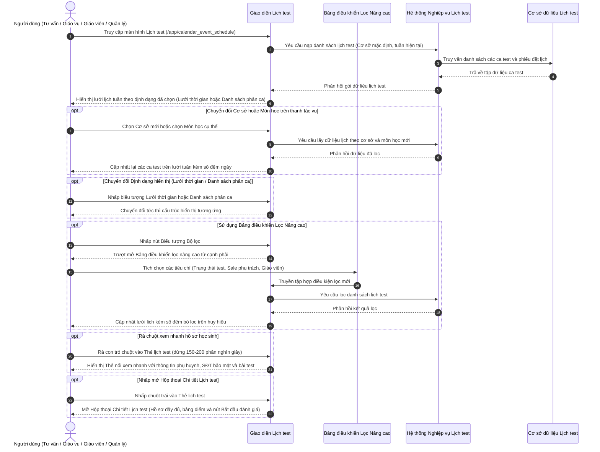

# US-CAL-03-01: Nâng cấp Giao diện Lịch test (Center Test Schedule Interface Update)

> **Tham chiếu:** `BF-CAL-02` · `SR-CSM-001` · Giao diện Mẫu §4.2 (Màn hình Danh sách dạng Lưới Thời gian & Lịch tuần)  
> **Đường dẫn màn hình & Trạng thái liên quan:**  
> - `Lịch test (/app/calendar_event_schedule)` -> Chế độ xem: `Tuần`, `Ngày` | Định dạng: `Lưới thời gian`, `Danh sách phân ca`  

---

## 1. NHẬT KÝ THAY ĐỔI & BỐI CẢNH (CHANGELOG & CONTEXT)

### Lịch sử cập nhật tài liệu (Changelog)

| Ngày cập nhật | Nội dung cập nhật | Lý do cập nhật |
|---|---|---|
| 22/10/2026 | Biên tập đặc tả điều chỉnh nâng cấp giao diện Màn hình Lịch test theo bản thiết kế chuẩn | Chuẩn hóa toàn diện giao diện thời khóa biểu đánh giá năng lực, tối ưu thanh công cụ, thẻ sự kiện và bộ lọc đa chiều |

### Bối cảnh & Mục tiêu điều chỉnh (Context & Objectives)
* **Bối cảnh nghiệp vụ:** Màn hình Lịch test là không gian làm việc đầu mối của Quản lý chi nhánh (`PERSONA-BRANCH-MANAGER`), Nhân viên giáo vụ (`PERSONA-CSM`), Nhân viên tư vấn tuyển sinh (`PERSONA-SALE`) và Giáo viên khảo sát (`PERSONA-TEACHER`) để theo dõi toàn bộ các ca đặt lịch kiểm tra năng lực, phỏng vấn xếp lớp và buổi học thử của học sinh tiềm năng tại từng cơ sở.
* **Mục tiêu điều chỉnh giao diện:**
  - Chuẩn hóa tên định danh màn hình thành **Lịch test** đồng bộ với hệ thống điều hướng trung tâm.
  - Tối ưu hóa thanh tác vụ đỉnh: Đưa bộ chọn Cơ sở đào tạo và bộ chọn Môn học nhanh về vị trí ưu tiên bên trái; bố trí cụm chuyển tuần gắn liền với khoảng ngày; đưa nút "Hôm nay", bộ chuyển chế độ xem Tuần/Ngày, bộ chuyển định dạng hiển thị Lưới/Danh sách, ô tìm kiếm tự bung rộng và nút lọc chuyên sâu về phía bên phải.
  - Cung cấp 2 định dạng hiển thị linh hoạt: **Lưới thời gian (Timeline Grid)** với đường chỉ thị giờ thực tế màu đỏ cập nhật tự động mỗi 30 giây, và **Danh sách phân ca (Shift List)** chia thành 3 ca học lớn có khả năng gập mở (Ca Sáng, Ca Chiều, Ca Tối).
  - Tái cấu trúc thẻ lịch test 4 dòng tinh gọn: Khung giờ & tên học sinh kèm nhãn loại sự kiện, cơ sở & tên giáo viên, môn học & chương trình, trạng thái & trình độ ban đầu/đánh giá.
  - Tích hợp thẻ nổi xem nhanh khi rà chuột với độ trễ 150-200 phần nghìn giây và hộp thoại chi tiết toàn diện hỗ trợ bắt đầu đánh giá năng lực trực tiếp.
* **Chỉ số đo lường hiệu quả (KPI Target):**
  - Thời gian bao quát ca test và phát hiện ca chưa gán giáo viên khảo sát: Giảm từ 40 giây xuống dưới 5 giây.
  - Tốc độ tra cứu thông tin phụ huynh và giáo án bài test qua thẻ nổi: Dưới 1 giây mà không cần rời trang.
  - Thời gian tải dữ liệu lịch tuần: Dưới 300 phần nghìn giây đối với bộ nhớ đệm và dưới 800 phần nghìn giây khi truy vấn hệ thống.

### Hiểu người dùng & Tình huống sử dụng (User Needs & Use Cases)
* **Người dùng chính (Persona):** Quản lý chi nhánh (`PERSONA-BRANCH-MANAGER`), Nhân viên giáo vụ (`PERSONA-CSM`), Nhân viên tư vấn (`PERSONA-SALE`), Giáo viên khảo sát (`PERSONA-TEACHER`).
* **Nhu cầu thực tế (Needs):**
  - Quản lý chi nhánh cần bao quát các khung giờ trống và phòng học khả dụng để bố trí giáo viên khảo sát kịp thời.
  - Nhân viên tư vấn cần theo dõi tiến độ check-in, đang test hoặc kết quả hoàn tất của học sinh do mình phụ trách để chăm sóc phụ huynh.
  - Giáo viên khảo sát cần nhấp vào ca test để xem thông tin trình độ đăng ký và bấm bắt đầu chấm điểm năng lực ngay tại chỗ.
* **Câu phát biểu nghiệp vụ:** **Là một** Nhân viên tư vấn hoặc Giáo vụ trung tâm, **tôi muốn** theo dõi lịch kiểm tra năng lực trên lưới thời gian trực quan và thẻ sự kiện thể hiện đầy đủ tên học sinh, môn học, giáo viên và kết quả đánh giá, **để** điều phối đón tiếp phụ huynh chu đáo và nâng cao tỷ lệ nhập học thành công.

### Biểu mẫu đặc tả chi tiết các đối tượng điều chỉnh (Adjustment Specification Form)

| Đối tượng giao diện | Mô tả giao diện mới | Nội dung điều chỉnh | Nguồn dữ liệu | Hành vi tương tác & Phản hồi |
|---|---|---|---|---|
| **Tiêu đề màn hình & Định vị phân hệ** | Thanh tiêu đề hiển thị dòng chữ `Lịch test` in đậm màu đen nhánh, đặt ở góc trái trên cùng của khu vực nội dung, ngay dưới thanh điều hướng đỉnh trang. Thanh điều hướng dọc bên trái đồng thời làm sáng mục menu `Lịch test`. | • **Điều chỉnh:** Đổi tên tiêu đề thành `Lịch test` để phân định rõ ràng phân hệ quản lý lịch với thanh tiêu đề chung của hệ thống. • **Lược bỏ:** Lược bỏ các nút tác vụ phân hệ thừa thãi trên thanh đỉnh hệ thống chung, chuyển toàn bộ quyền kiểm soát về thanh công cụ chuyên biệt của lịch test. | Cấu hình danh mục chức năng trung tâm của hệ thống. | Hiển thị cố định tại thanh đỉnh trang; nhấp vào mục menu tương ứng ở thanh bên trái sẽ chuyển trang đến đúng đường dẫn lịch test. |
| **Bộ chọn Cơ sở đào tạo** | Hộp chọn thả xuống viền mảnh ở góc trái ngoài cùng thanh công cụ. Hiển thị nhãn cơ sở hiện tại (Ví dụ: `RinoEdu Nguyễn Tuân` hoặc `Tất cả cơ sở`) kèm biểu tượng tòa nhà và mũi tên chỉ xuống. Khi bấm, mở danh sách các cơ sở trực thuộc. | • **Điều chỉnh:** Di dời bộ chọn cơ sở từ góc phải màn hình về vị trí ưu tiên số 1 bên trái thanh công cụ để định hình phạm vi dữ liệu trước tiên. • **Thêm mới:** Tích hợp ô tìm kiếm chi nhánh nhanh ngay bên trong danh sách thả xuống khi danh sách dài. • **Lược bỏ:** Lược bỏ kiểu nút bấm dàn trải, thay thế bằng hộp thả xuống dạng viền nhấn tinh gọn. | Cơ sở dữ liệu danh mục chi nhánh toàn hệ thống; cơ sở mặc định lấy theo tài khoản công tác của người dùng. | Khi nhấp chọn chi nhánh mới, hệ thống lưu trạng thái chi nhánh được chọn, kích hoạt tải lại toàn bộ lịch test của cơ sở đó trong tuần và tự động tính toán lại số lượng ca test trên từng ngày. |
| **Bộ chọn Môn học nhanh** | Hộp chọn thả xuống nằm liền kề bên phải bộ chọn cơ sở. Hiển thị tùy chọn mặc định `Tất cả các môn` hoặc tên môn học cụ thể (Ví dụ: `Tiếng Anh`, `Toán tư duy`) kèm mũi tên chỉ xuống. | • **Thêm mới:** Đưa bộ chọn môn học nhanh trực tiếp lên thanh công cụ chính, cho phép lọc 1 chạm. • **Điều chỉnh:** Danh sách môn học trong hộp chọn tự động trích xuất theo các môn học thực tế có phát sinh ca test trong tuần đang chọn. • **Lược bỏ:** Lược bỏ thao tác bắt buộc phải mở bảng lọc nâng cao khi chỉ cần lọc theo môn học. | Cơ sở dữ liệu môn học phát sinh từ các buổi test thực tế trong tuần đang chọn. | Nhấp chọn một môn học cụ thể sẽ lập tức lọc và chỉ hiển thị các ca test của môn đó trên bảng lịch; chọn `Tất cả các môn` để khôi phục xem toàn bộ. |
| **Nút "Hôm nay"** | Nút bấm chữ `Hôm nay` dạng viền nhấn tinh gọn, đặt liền kề sau bộ chọn môn học ở nửa bên trái thanh công cụ. | • **Điều chỉnh:** Bố trí nút `Hôm nay` trực tiếp ngay sau bộ chọn môn học, tạo sự liền mạch trong luồng thao tác thời gian. • **Thêm mới:** Khi bấm, hệ thống tự động đưa mốc thời gian về ngày/tuần hiện tại, đồng thời cuộn đến vị trí giờ hiện tại trên lưới thời gian và làm nổi bật cột ngày hôm nay. | Lịch hệ thống theo thời gian thực. | Nhấp nút đưa mốc lịch về ngày/tuần hiện tại và làm nổi bật cột hôm nay bằng màu nền xanh lá nhạt. |
| **Cụm điều hướng thời gian tuần** | Cụm điều hướng gồm nút mũi tên lùi `‹`, nút mũi tên tiến `›` dạng biểu tượng vuông bo góc nhỏ ôm lấy nhãn khoảng ngày tuần in đậm (Ví dụ: `19 thg 10 - 25 thg 10` hoặc ngày cụ thể ở chế độ Ngày). | • **Điều chỉnh:** Gom cụm mũi tên lùi/tiến gắn liền sát với tiêu đề khoảng ngày tuần thay vì để tách rời xa nhau; chuyển toàn bộ cụm về nửa bên trái thanh tác vụ. • **Lược bỏ:** Lược bỏ thanh trượt chọn ngày tuần phức tạp, thay bằng thao tác lùi/tiến 1 tuần trên từng lần bấm. | Lịch hệ thống theo thời gian thực và khoảng ngày tuần làm việc từ Thứ Hai đến Chủ Nhật. | Nhấp mũi tên trái để lùi 1 tuần; nhấp mũi tên phải để tiến 1 tuần; hệ thống nạp lại danh sách lịch test tương ứng. |
| **Bộ chuyển đổi Chế độ xem** | Thanh điều khiển phân đoạn gồm 2 nút liền khối: `Ngày` và `Tuần`. Nút đang chọn có nền trắng nổi khối và đổ bóng nhẹ, nút còn lại có nền xám chìm. Mặc định kích hoạt `Tuần`. | • **Điều chỉnh:** Chuyển bộ nút chọn Tuần/Ngày từ góc trái sang góc phải thanh công cụ để tách biệt giữa khu vực định danh dữ liệu và khu vực tùy biến hiển thị. • **Điều chỉnh:** Áp dụng kiểu dáng thanh phân đoạn liền khối chuẩn thiết kế mới. | Trạng thái lựa chọn chế độ hiển thị thời khóa biểu (Tuần hoặc Ngày) của người dùng. | Nhấp `Tuần` hiển thị lưới 7 cột từ Thứ Hai đến Chủ Nhật; nhấp `Ngày` hiển thị chi tiết các ca test của một ngày duy nhất. |
| **Bộ chuyển đổi Định dạng hiển thị** | Cụm 2 nút bấm biểu tượng nhỏ gọn: Biểu tượng lưới ô vuông (Lưới thời gian - Timeline) và biểu tượng 3 cột dọc (Danh sách phân ca - Shift List). Nút đang chọn có màu nhấn viền sáng. | • **Thêm mới:** Bổ sung tính năng chuyển đổi linh hoạt giữa góc nhìn Lưới thời gian liên tục (Timeline) và góc nhìn Danh sách phân nhóm theo 3 ca sáng/chiều/tối. • **Lược bỏ:** Lược bỏ giao diện bảng danh sách dòng phẳng nhàm chán và khó theo dõi lịch trống. | Trạng thái định dạng hiển thị được lưu trong phiên làm việc của người dùng. | Nhấp biểu tượng lưới để mở chế độ Lưới thời gian; nhấp biểu tượng cột để mở chế độ Danh sách phân ca gập mở. |
| **Ô tìm kiếm lịch test mở rộng** | Biểu tượng kính lúp tròn tinh gọn. Khi nhấp chuột, biểu tượng tự động trượt mở rộng theo chiều ngang thành ô nhập văn bản có dòng chữ mờ `Tìm lịch test...` kèm nút dấu nhân `×` ở đuôi để xóa nhanh. | • **Thêm mới:** Cơ chế bung rộng tự động theo chiều ngang khi nhấp chuột, tiết kiệm tối đa diện tích thanh công cụ khi chưa dùng. • **Thêm mới:** Nút xóa nhanh nội dung và cơ chế tự động tìm kiếm sau 300 phần nghìn giây khi dừng gõ phím. • **Lược bỏ:** Lược bỏ ô tìm kiếm cố định chiếm diện tích lớn trên thanh công cụ. | Dữ liệu tra cứu ca test gồm: tên học sinh, người liên hệ, cơ sở, người phụ trách và mã phiếu. | Tự động lọc dữ liệu sau 300 phần nghìn giây khi dừng gõ; hiển thị thông báo trạng thái rỗng nếu không tìm thấy bản ghi phù hợp. |
| **Nút mở Bảng lọc nâng cao** | Nút bấm vuông viền mỏng chứa biểu tượng phễu lọc. Góc trên hiển thị một chấm tròn huy hiệu màu nhấn chứa số lượng điều kiện lọc đang kích hoạt (Ví dụ: `2`, `4`). | • **Thêm mới:** Huy hiệu số đếm màu nhấn trực quan thể hiện rõ số lượng tiêu chí lọc đang được áp dụng. • **Điều chỉnh:** Thay thế bảng lọc dàn trải trên trang bằng nút kích hoạt bảng điều khiển lọc chuyên sâu dạng trượt từ cạnh phải màn hình. | Số lượng các tiêu chí lọc đang được người dùng áp dụng từ bảng điều khiển bộ lọc. | Nhấp để bật hoặc tắt bảng điều khiển lọc nâng cao trượt từ cạnh phải màn hình; không làm mất ngữ cảnh lưới lịch đang xem. |
| **Tiêu đề cột Ngày trong tuần** | Hàng tiêu đề 7 cột gồm tên Thứ (Ví dụ: `T2`, `T3`,..., `CN`), ngày tháng bên dưới (Ví dụ: `19`, `20`) và tổng số ca test trong ngày đóng ngoặc (Ví dụ: `(1)`, `(3)`). Cột ngày hôm nay có số ngày đóng trong vòng tròn màu nhấn đậm kèm bóng đổ. | • **Thêm mới:** Hiển thị tổng số ca test phát sinh trong ngày ngay tại tiêu đề cột để nhân viên bao quát khối lượng công việc. • **Thêm mới:** Hiệu ứng làm nổi bật cột ngày hiện tại bằng vòng tròn màu nhấn và màu nền phân biệt. • **Điều chỉnh:** Số đếm ca test tự động tính toán lại theo tất cả các bộ lọc đang chọn. | Lịch tuần theo ngày thực tế và tổng số ca test được tính toán lại theo từng ngày. | Các cột ngày co giãn đều nhau; tự động cập nhật lại số lượng ca test khi người dùng thay đổi bộ lọc. |
| **Lưới thời gian & Đường giờ thực tế** | Lưới chia các ô 30 phút theo trục thời gian dọc bên trái (từ 07:00 đến 21:00). Có đường kẻ ngang màu đỏ nổi bật (đường giờ thực tế) kèm chấm tròn đỏ ở đầu, tự động di chuyển theo thời gian thực và cập nhật vị trí mỗi 30 giây. | • **Thêm mới:** Cung cấp trục lưới thời gian 30 phút chuẩn xác, thể hiện chính xác vị trí và độ dài của từng ca test theo thời gian bắt đầu - kết thúc. • **Thêm mới:** Đường chỉ thị giờ thực tế màu đỏ tự động làm mới vị trí giúp nhân viên nhận biết ngay ca nào đang diễn ra, ca nào sắp tới. | Thời gian hệ thống thực tế và mốc thời gian bắt đầu/kết thúc của các buổi test. | Cuộn mượt mà theo trục dọc; rê chuột trên lưới thời gian thể hiện rõ các khoảng giờ trống có thể tiếp nhận đặt lịch mới. |
| **Danh sách phân ca gập mở** | Khi ở định dạng Danh sách phân ca, giao diện chia làm 3 khối ca: `Ca Sáng (08:00 - 12:00)`, `Ca Chiều (13:30 - 17:30)`, `Ca Tối (17:45 - 21:30)`. Đầu mỗi khối có mũi tên chỉ hướng gập/mở, nhãn ca học và tổng số ca test bên phải (Ví dụ: `8 ca test`). | • **Thêm mới:** Chế độ hiển thị danh sách theo 3 ca học lớn, cho phép gập gọn hoặc mở rộng từng ca để nhân viên tập trung làm việc theo ca trực của mình. • **Điều chỉnh:** Tự động ẩn hoàn toàn khối ca nếu không có buổi test nào phát sinh trong tuần. • **Lược bỏ:** Lược bỏ việc hiển thị dàn trải không phân ca gây rối mắt. | Phân loại ca học theo khung thời gian vận hành trung tâm. | Nhấp vào thanh tiêu đề để thu gọn hoặc mở rộng toàn bộ lưới 7 cột của ca học đó. |
| **Thẻ Lịch Test - Giờ, Tên & Loại sự kiện** | Dòng 1 của thẻ gồm: Khung giờ bắt đầu căn trái bằng chữ màu nhấn (Ví dụ: `17:00 -`), nhãn `Hv:` màu xám nhạt, **Tên học sinh in đậm** (Ví dụ: `Nguyễn Trúc Linh`), và góc phải là huy hiệu loại sự kiện `TN` (Trải nghiệm) màu xanh ngọc nổi bật. Ca hủy có nét gạch ngang xuyên suốt. | • **Điều chỉnh:** Bố trí khung giờ và tên học sinh trên cùng một dòng ngang tinh gọn; in đậm tên học sinh để nhận diện ngay lập tức. • **Thêm mới:** Huy hiệu rút gọn `TN` màu xanh ngọc thay vì nhãn chữ dài dòng, tiết kiệm không gian thẻ. • **Điều chỉnh:** Buổi test đã hủy được hiển thị bằng nét gạch ngang và tông màu mờ trực quan. | Dữ liệu đặt lịch kiểm tra năng lực gồm họ tên học sinh, giờ test và loại sự kiện. | Nhấp vào thẻ để mở hộp thoại chi tiết; rê chuột vào thẻ để mở thẻ nổi xem nhanh. |
| **Thẻ Lịch Test - Cơ sở & Giáo viên** | Dòng 2 của thẻ gồm: Tên cơ sở căn trái bằng chữ màu xám (Ví dụ: `RinoEdu Nguyễn Tuân`) và bên phải hiển thị ảnh đại diện tròn viết tắt kèm **Tên giáo viên phụ trách** (Ví dụ: `[RL] Robert L.` hoặc chữ `Chưa gán` màu cam). | • **Thêm mới:** Hiển thị tên giáo viên phụ trách khảo sát kèm ảnh đại diện thu nhỏ ngay trên thân thẻ. • **Thêm mới:** Cảnh báo chữ `Chưa gán` màu cam khi ca test chưa được phân công giáo viên chấm điểm. • **Điều chỉnh:** Hiển thị rõ cơ sở đào tạo tổ chức buổi test. | Cơ sở dữ liệu nhân sự phân công và cơ sở tổ chức lịch test. | Rê chuột vào tên giáo viên hiển thị thẻ thông tin nhân sự; nhấp mở hộp thoại chi tiết để đổi giáo viên. |
| **Thẻ Lịch Test - Môn học & Chương trình** | Dòng 3 của thẻ gồm: Tên môn học căn trái (Ví dụ: `Tiếng Anh`, `Toán tư duy`) và Tên chương trình đào tạo căn phải (Ví dụ: `Station Program`, `IELTS Foundation`). | • **Điều chỉnh:** Tách biệt rõ ràng giữa môn học và chương trình đào tạo trên hai đầu dòng giúp thông tin mạch lạc. • **Lược bỏ:** Lược bỏ các tiền tố dài dòng như "Môn:", "Chương trình:". | Thông tin môn học và chương trình đăng ký khảo sát của học sinh. | Tự động cắt ngắn bằng dấu ba chấm nếu tên chương trình quá dài; gắn thuộc tính xem đầy đủ khi di chuột. |
| **Thẻ Lịch Test - Trạng thái & Trình độ** | Dòng chân thẻ gồm: Nhãn `Trạng thái:` kèm tên trạng thái có màu nhận diện riêng (Ví dụ: `Hoàn tất`, `Đang đánh giá`, `Đã check-in`, `Chưa gán GV`, `Đổi ngày`), bên phải là **Trình độ ban đầu hoặc Trình độ đánh giá** (Ví dụ: `Pre-Starters (<=6)`, `Level 1A` in đậm). | • **Thêm mới:** Hiển thị trạng thái tiến trình kiểm tra năng lực với hệ thống màu sắc trực quan. • **Thêm mới:** Hiển thị trình độ ban đầu, và tự động chuyển sang Trình độ đánh giá in đậm khi đã có kết quả khảo sát. • **Lược bỏ:** Bỏ nền màu khối chữ trạng thái cũ, chuyển sang chữ màu tinh tế không làm nặng thẻ. | Trạng thái phiếu đặt lịch và kết quả đánh giá năng lực của học sinh. | Thể hiện chính xác kết quả khảo sát của học sinh; nhấp vào thẻ để xem bảng điểm chi tiết các kỹ năng. |
| **Thẻ nổi Xem nhanh khi rà chuột** | Khung thẻ nổi màu trắng bo góc có bóng đổ sâu, tự động bật lên sau 150-200 phần nghìn giây khi rà chuột vào thẻ lịch test. Hiển thị: Họ tên học sinh, Thông tin phụ huynh kèm số điện thoại bảo mật `091****111`, Khung giờ, Môn học & Chương trình, Trình độ đăng ký kèm liên kết bài test, Cơ sở, Giáo viên khảo sát và Kết quả trình độ đánh giá. | • **Thêm mới:** Cơ chế hiển thị thẻ nổi tự động khi rà con trỏ chuột, giúp nhân viên xem toàn diện hồ sơ học sinh và phụ huynh mà không cần rời trang. • **Thêm mới:** Thuật toán tự động đảo hướng hiển thị khi thẻ nằm sát mép phải hoặc mép dưới màn hình, tránh bị tràn vùng nhìn. • **Lược bỏ:** Lược bỏ thao tác bắt buộc phải nhấp mở cửa sổ lớn mới xem được thông tin liên hệ phụ huynh. | Nghiệp vụ đặt lịch kiểm tra năng lực, hồ sơ học sinh và kết quả chấm điểm. | Tự động tính toán vị trí hiển thị thông minh; tự đóng khi con trỏ chuột rời khỏi vùng thẻ. |
| **Bảng điều khiển Bộ lọc Nâng cao** | Bảng điều khiển dạng trượt từ mép phải màn hình, gồm các nhóm lọc đa tầng: Trạng thái lịch test (`Đã đặt lịch`, `Đã check-in`, `Đang đánh giá`, `Hoàn tất`, `Không đạt`, `Đã hủy`), Chương trình đào tạo, Nhân viên tư vấn phụ trách (kèm ô tìm kiếm và danh sách cuộn), Giáo viên khảo sát, Môn học, Khung ca học (`Sáng`, `Chiều`, `Tối`), Trạng thái sự kiện. Chân bảng có nút `Xóa tất cả` và nút `Đóng`. | • **Thêm mới:** Bảng điều khiển lọc chuyên sâu dạng trượt từ cạnh phải, giữ nguyên tầm nhìn lịch bên dưới. • **Thêm mới:** Cơ chế lọc đa tiêu chí kết hợp giữa tư vấn viên phụ trách, giáo viên chấm điểm, môn học và trạng thái lịch test. • **Thêm mới:** Nút `Xóa tất cả` giúp xóa trắng toàn bộ điều kiện lọc nhanh chóng chỉ bằng 1 thao tác. • **Lược bỏ:** Lược bỏ các thanh lọc nằm ngang chiếm diện tích đỉnh bảng. | Cơ sở dữ liệu phiếu đặt lịch test, danh mục nhân sự và chương trình đào tạo. | Người dùng chọn các điều kiện; dữ liệu trên lưới lịch tự động cập nhật ngay lập tức và số lượng bộ lọc hiển thị trên huy hiệu nút lọc. |
| **Hộp thoại Chi tiết Lịch Test & Thao tác** | Cửa sổ hộp thoại mở chính giữa màn hình với nền mờ phía sau. Hiển thị: Thông tin chi tiết học sinh, phụ huynh (số điện thoại đầy đủ cho người có quyền), chi tiết ca test, kết quả đánh giá năng lực các kỹ năng (Nghe, Nói, Đọc, Viết, Logic), lịch sử ghi chú tư vấn, khu vực nhập ghi chú mới và các nút hành động: `Cập nhật`, `Bắt đầu đánh giá`, `Gọi điện`, `Sao chép`. | • **Thêm mới:** Nút hành động `Bắt đầu đánh giá` để giáo viên mở trực tiếp giao diện chấm điểm năng lực học sinh. • **Thêm mới:** Bảng điểm chi tiết các kỹ năng thành phần và trình độ đề xuất xếp lớp. • **Thêm mới:** Lối tắt gọi điện thoại và sao chép thông tin nhanh cho nhân viên tư vấn. • **Điều chỉnh:** Hiển thị số điện thoại phụ huynh đầy đủ tại hộp thoại này đối với người dùng có thẩm quyền. | Cơ sở dữ liệu phiếu đặt lịch kiểm tra, hồ sơ phụ huynh và hệ thống chấm điểm năng lực. | Nhấp vào thẻ lịch test để mở hộp thoại; nhấp `Bắt đầu đánh giá` để chuyển tiếp sang màn hình chấm thi; nhấp `Cập nhật` để lưu thông tin. |
| **Thanh Chú giải Trạng thái Chân trang** | Thanh dải hẹp nằm ngang ghim sát đáy bảng lịch, gồm nhãn `Chú giải màu sắc:` và 4 chấm tròn màu sắc kèm tên gọi tương ứng: Sự kiện hôm nay (Trắng viền xám), Sự kiện sắp diễn ra (Xanh dương nhạt viền xanh đậm), Sự kiện đã diễn ra (Cam nhạt viền cam đậm), Sự kiện đã hủy (Xám viền xám kèm nét gạch ngang chữ). | • **Thêm mới:** Bảng chỉ dẫn màu nhận diện trạng thái ghim cố định ở đáy trang, tạo chuẩn quy ước trực quan cho người dùng. • **Điều chỉnh:** Chuẩn hóa hệ thống mã màu nhận diện theo đúng bảng trạng thái vận hành của trung tâm. | Danh mục quy ước trạng thái sự kiện của hệ thống. | Cung cấp bảng chỉ dẫn trực quan thường trực dưới đáy màn hình giúp đối chiếu nhận diện trạng thái các thẻ. |

### Phạm vi kiểm soát & Ràng buộc nghiệp vụ (Scope & Business Rules)
* **Phạm vi kiểm soát (Feature Scope):**

| Mã Yêu Cầu | Hạng mục chức năng | Mức ưu tiên | Phạm vi hiển thị | Mô tả chi tiết |
|---|---|---|---|---|
| **REQ-TST-01** | Thanh công cụ chọn cơ sở, môn học, điều hướng tuần và nút Hôm nay | Bắt buộc (Must) | Thanh công cụ đỉnh màn hình | Cung cấp các ô thả xuống chọn cơ sở, môn học, chuyển tuần và nút Hôm nay |
| **REQ-TST-02** | Chuyển đổi linh hoạt Chế độ xem (Tuần/Ngày) và Định dạng (Lưới/Phân ca) | Bắt buộc (Must) | Góc phải thanh công cụ | Cho phép chuyển xem Tuần hoặc Ngày và đổi giữa Lưới thời gian hoặc Danh sách phân ca |
| **REQ-TST-03** | Lưới thời gian liên tục kèm đường chỉ thị giờ thực tế màu đỏ | Bắt buộc (Must) | Khung nội dung chính | Lưới chia mốc 30 phút, đường giờ thực tế tự động cập nhật mỗi 30 giây |
| **REQ-TST-04** | Danh sách phân ca gập mở linh hoạt 3 ca học | Bắt buộc (Must) | Khung nội dung chính | Phân tách lịch thành Ca Sáng, Ca Chiều, Ca Tối kèm số lượng ca test và khả năng đóng mở |
| **REQ-TST-05** | Thẻ lịch test 4 dòng hiển thị đa sắc kèm huy hiệu rút gọn | Bắt buộc (Must) | Lưới thời khóa biểu | Hiển thị khung giờ, tên học sinh, huy hiệu loại sự kiện, giáo viên, môn học và trạng thái |
| **REQ-TST-06** | Thẻ nổi xem nhanh hồ sơ học sinh và phụ huynh khi rà chuột | Bắt buộc (Must) | Nổi phía trên thẻ lịch test | Bật tự động sau 150-200 phần nghìn giây hiển thị thông tin phụ huynh, bài test và trình độ |
| **REQ-TST-07** | Bảng điều khiển bộ lọc chuyên sâu dạng trượt | Bắt buộc (Must) | Bảng trượt từ cạnh phải | Cung cấp bộ lọc theo trạng thái test, chương trình, nhân viên tư vấn, giáo viên và ca học |
| **REQ-TST-08** | Hộp thoại chi tiết lịch test và thao tác bắt đầu đánh giá năng lực | Bắt buộc (Must) | Hộp thoại nổi giữa màn hình | Mở toàn bộ hồ sơ đánh giá, bảng điểm các kỹ năng, ghi chú tư vấn và nút chấm điểm |

* **Ràng buộc nghiệp vụ toàn cục (Global Rules):**
  - **[RULE-TST-01] Bảo toàn dữ liệu & Không thay đổi xử lý hệ thống:** Việc nâng cấp chỉ điều chỉnh cách thức hiển thị và tương tác trên giao diện, giữ nguyên các trường dữ liệu và logic xử lý hệ thống đã có trong cơ sở dữ liệu phiếu đặt lịch test.
  - **[RULE-TST-02] Che số điện thoại chống sao chép hàng loạt:** Trong mọi thành phần hiển thị danh sách và thẻ nổi xem nhanh, số điện thoại của phụ huynh hoặc nhân sự bắt buộc phải được che ẩn ở giữa theo định dạng `091****111`. Chỉ người dùng có thẩm quyền mở hộp thoại chi tiết mới được xem số điện thoại đầy đủ.
  - **[RULE-TST-03] Thẻ trạng thái và số đếm đi theo bộ lọc:** Tất cả số lượng đếm ca test trên tiêu đề từng ngày và trên các thanh ca học phải tự động tính toán lại theo tổ hợp bộ lọc đang áp dụng (Cơ sở, Môn học, và các điều kiện lọc nâng cao).
  - **[RULE-TST-04] Đồng bộ thời gian thực cho đường chỉ thị giờ:** Đường chỉ thị giờ thực tế màu đỏ trên lưới thời gian tự động đồng bộ theo đồng hồ thiết bị người dùng và tự động tính toán lại vị trí sau mỗi 30 giây mà không cần tải lại toàn bộ trang.

---

## 2. LUỒNG XỬ LÝ CHÍNH (MAIN FLOW - HAPPY PATH)

---

## 3. GIAO DIỆN & PHÂN QUYỀN VAI TRÒ (UI STATE & PERMISSION MATRIX)

### 3.1. Bảng mô tả chi tiết giao diện tĩnh (UI Structure Table)

| Thành phần giao diện | Loại hiển thị | Dữ liệu & Quy tắc | Diễn giải quy tắc | Co giãn giao diện (Mobile) |
|---|---|---|---|---|
| **Bộ chọn Cơ sở đào tạo** | Hộp chọn thả xuống | Danh sách các cơ sở trực thuộc hệ thống | Cho phép chọn 1 cơ sở duy nhất để xem lịch. Giá trị mặc định là cơ sở đang công tác của người dùng. | Tự động co giãn phù hợp chiều ngang màn hình hẹp |
| **Bộ chọn Môn học nhanh** | Hộp chọn thả xuống | `Tất cả các môn` hoặc tên môn cụ thể | Lọc nhanh các ca test thuộc môn học đã chọn. Mặc định là `Tất cả các môn`. | Tự động co giãn theo tỷ lệ giao diện di động |
| **Nút Hôm nay** | Nút bấm văn bản dạng viền nhấn | Nhãn `Hôm nay` | Nhấp để đưa mốc thời gian trở về tuần hoặc ngày hiện tại, đồng thời cuộn đến giờ hiện tại. | Giữ nguyên kích thước chuẩn |
| **Cụm điều hướng thời gian tuần** | Nút bấm biểu tượng & Nhãn văn bản | Nút mũi tên trái, nhãn khoảng ngày tuần, nút mũi tên phải | Nhấp để tiến hoặc lùi 1 tuần (hoặc 1 ngày nếu ở chế độ ngày). Nhãn hiển thị ngày đầu tuần và ngày cuối tuần. | Nhãn ngày hiển thị dạng rút gọn |
| **Bộ chuyển đổi Chế độ xem** | Bộ nút điều khiển phân đoạn | Hai lựa chọn: `Tuần` và `Ngày` | Cho phép chuyển đổi nhanh giữa góc nhìn toàn tuần (7 cột) và góc nhìn chi tiết trong ngày. Mặc định: `Tuần`. | Giữ nguyên dạng nút chuyển phân đoạn |
| **Bộ chuyển đổi Định dạng hiển thị** | Bộ nút điều khiển phân đoạn dạng biểu tượng | Biểu tượng Lưới thời gian (Grid) và Biểu tượng Danh sách phân ca (Columns) | Cho phép chuyển đổi giữa bố cục trục thời gian 30 phút và bố cục nhóm theo 3 ca sáng/chiều/tối. | Giữ nguyên dạng nút biểu tượng đôi |
| **Ô tìm kiếm lịch test mở rộng** | Ô nhập thông tin tự co giãn | Từ khóa tìm kiếm: Tên học sinh, Phụ huynh, Giáo viên, Mã phiếu | Tự động mở rộng khi nhấp chuột, lọc dữ liệu sau khi người dùng dừng gõ 300 phần nghìn giây. | Co giãn tự nhiên trên màn hình hẹp |
| **Nút mở Bảng lọc nâng cao** | Nút biểu tượng kèm huy hiệu số đếm | Biểu tượng cái phễu lọc kèm số lượng bộ lọc đang kích hoạt | Nhấp để trượt mở hoặc đóng Bảng điều khiển lọc nâng cao từ cạnh phải màn hình. | Cố định ở góc phải thanh công cụ |
| **Tiêu đề cột Ngày trong tuần** | Cột tiêu đề lịch | Tên Thứ (`T2` đến `CN`), ngày trong tháng và số lượng ca test trong ngày | Cột ngày hôm nay được làm nổi bật với màu nền xanh lá nhẹ và số ngày đóng trong vòng tròn màu nhấn. | Thu hẹp độ rộng cột theo tỷ lệ màn hình |
| **Đường chỉ thị giờ thực tế** | Đường kẻ ngang màu đỏ trên lưới | Mốc thời gian thực hiện tại của hệ thống | Tự động cập nhật vị trí sau mỗi 30 giây; chỉ xuất hiện trên cột ngày hôm nay. | Tự co giãn theo độ rộng cột ngày hôm nay |
| **Thanh tiêu đề Ca học gập mở** | Thanh tiêu đề gập mở kèm mũi tên | Nhãn ca học: `Ca Sáng (08:00 - 12:00)`, `Ca Chiều (13:30 - 17:30)`, `Ca Tối (17:45 - 21:30)` kèm tổng số ca | Có biểu tượng mũi tên xoay khi mở, đường kẻ chỉ thị màu nhận diện. Nhấp vào để gập gọn hoặc mở rộng toàn bộ ca học. | Chiếm toàn bộ chiều ngang màn hình |
| **Thẻ Lịch Test** | Khối thẻ tương tác hình chữ nhật | Khung giờ, Tên học sinh in đậm, Huy hiệu loại sự kiện, Cơ sở, Giáo viên, Môn học, Chương trình, Trạng thái, Trình độ | Thẻ được xếp vào đúng vị trí giờ và ngày tương ứng. Có hiệu ứng nổi nhẹ và viền sáng khi rà chuột. | Tự co giãn theo độ rộng cột ngày |
| **Huy hiệu Loại sự kiện** | Nhãn nhỏ bo góc | Ký hiệu `TN` (Trải nghiệm) màu xanh ngọc | Thể hiện loại hình sự kiện là đánh giá năng lực / học thử. | Giữ nguyên kích thước nhỏ gọn |
| **Thông tin Giáo viên trên thẻ** | Dòng thông tin phụ | Ảnh đại diện viết tắt kèm tên giáo viên khảo sát (hoặc nhãn `Chưa gán` màu cam) | Giúp nhân viên nhận biết ngay ca nào đã có người khảo sát, ca nào đang khuyết nhân sự. | Tự rút gọn chữ khi tên quá dài |
| **Thẻ nổi xem nhanh khi rà chuột** | Bảng thông tin nổi xem nhanh | Bảng nổi xuất hiện sau 150-200 phần nghìn giây gồm thông tin học sinh, phụ huynh, SĐT bảo mật, môn học, bài test | Cho phép tra cứu nhanh hồ sơ học sinh và phụ huynh mà không làm gián đoạn màn hình làm việc. | Tự động ẩn trên thiết bị màn hình cảm ứng |
| **Bảng điều khiển Bộ lọc Nâng cao** | Bảng điều khiển trượt từ cạnh phải | Nhóm lọc: Trạng thái lịch test, Chương trình, Nhân viên tư vấn, Giáo viên, Môn học, Khung ca học | Chứa nút `Xóa tất cả` và nút `Đóng`. Lọc dữ liệu ngay khi người dùng chọn tiêu chí. | Chiếm toàn bộ chiều rộng màn hình hẹp |
| **Thanh Chú giải Chân trang** | Thanh dải màu dưới đáy màn hình | Chấm màu và tên trạng thái: Sự kiện hôm nay (Trắng), Sắp diễn ra (Xanh dương), Đã diễn ra (Cam), Đã hủy (Xám) | Cố định ở chân lưới lịch, giúp người dùng dễ dàng đối chiếu nhận diện trạng thái các thẻ sự kiện. | Tự động xuống dòng khi thiếu diện tích |

### 3.2. Bảng Phân quyền Năng lực Động (Permission Matrix)

Màn hình áp dụng cơ chế kiểm soát hiển thị theo **Mã Quyền Động (Atomic Permissions)** được định nghĩa tại `BF-CAL-02`:

| Vùng Giao diện / Nút Thao Tác | Loại Hiển Thị | Mã Quyền Yêu Cầu (Required Capability) | Xử Lý Khi Không Đủ Quyền |
|---|---|---|---|
| **Truy cập Màn hình Lịch test** | Toàn bộ giao diện | `schedule.test.view` | Chặn truy cập, hiển thị thông báo không có quyền truy cập |
| **Chuyển đổi Chi nhánh / Cơ sở đào tạo** | Ô thả xuống chọn cơ sở | `schedule.test.branch_switch` | Cố định ở cơ sở hiện tại của người dùng, vô hiệu hóa danh sách chọn |
| **Lọc chuyên sâu qua Bảng điều khiển** | Nút mở bộ lọc nâng cao và bảng trượt | `schedule.test.filter_advanced` | Ẩn nút bộ lọc nâng cao trên thanh công cụ |
| **Mở Hộp thoại Chi tiết Lịch Test** | Nhấp chuột vào Thẻ lịch test | `schedule.test.view_detail` | Chỉ cho phép xem thẻ nổi rà chuột, không kích hoạt mở hộp thoại lớn |
| **Bắt đầu Đánh giá / Chấm điểm** | Nút trên Hộp thoại Chi tiết | `schedule.test.start_assessment` | Ẩn nút Bắt đầu đánh giá, chỉ hiển thị thông tin ở chế độ xem |
| **Cập nhật Phiếu Đặt lịch Test** | Nút Cập nhật trên Hộp thoại | `schedule.test.edit` | Khóa các trường dữ liệu ở chế độ chỉ đọc, ẩn nút Cập nhật |

---

## 4. KHỐI CHỨC NĂNG CHI TIẾT: ACTION & LUỒNG KÍCH HOẠT (ACTIONS & EVENTS)

### Khối chức năng 1: Điều hướng thời gian và Chọn cơ sở / Môn học

#### Action 1.1: Chuyển đổi Cơ sở và Môn học trên thanh công cụ
* **Luồng kích hoạt:** Người dùng nhấp chọn một cơ sở mới trên ô chọn cơ sở hoặc chọn một môn học trên ô chọn môn học.
* **Tiêu chí nghiệm thu (Acceptance Criteria):**
  - **AC-1 (Happy Path - Lọc dữ liệu theo cơ sở và môn học):**
    - **Giả sử:** Người dùng đang ở màn hình Lịch test và có quyền xem nhiều cơ sở.
    - **Khi:** Người dùng chọn cơ sở "RinoEdu Nguyễn Tuân" và chọn môn học "Tiếng Anh".
    - **Thì:** Bảng lịch tự động làm mới, chỉ hiển thị các ca test thuộc môn Tiếng Anh diễn ra tại cơ sở Nguyễn Tuân trong tuần được chọn; số lượng ca test trên từng tiêu đề ngày được tính toán lại chính xác.

#### Action 1.2: Điều hướng thời gian Tuần và Nút Hôm nay
* **Luồng kích hoạt:** Người dùng nhấp nút mũi tên lùi, nút mũi tên tiến hoặc nút "Hôm nay".
* **Tiêu chí nghiệm thu:**
  - **AC-2 (Happy Path - Chuyển tuần và quay về Hôm nay):**
    - **Giả sử:** Màn hình đang hiển thị tuần làm việc bất kỳ.
    - **Khi:** Người dùng nhấp nút mũi tên tiến, nhãn thời gian chuyển sang tuần kế tiếp và dữ liệu ca test của tuần đó được nạp hiển thị. Khi người dùng nhấp nút "Hôm nay", mốc thời gian ngay lập tức quay trở lại tuần hiện tại, cột ngày hôm nay được làm nổi bật với màu nền xanh lá nhẹ và lưới thời gian tự cuộn đến mốc giờ hiện tại.
    - **Thì:** Giao diện hiển thị đúng các ca test của tuần tương ứng mà không làm thay đổi các bộ lọc cơ sở hay môn học đang chọn.

#### Action 1.3: Chuyển đổi chế độ xem Tuần / Ngày
* **Luồng kích hoạt:** Người dùng nhấp vào nút "Ngày" hoặc "Tuần" trên bộ chuyển đổi phân đoạn.
* **Tiêu chí nghiệm thu:**
  - **AC-3 (Happy Path - Chuyển đổi linh hoạt giữa Tuần và Ngày):**
    - **Giả sử:** Người dùng đang xem lịch ở chế độ "Tuần".
    - **Khi:** Người dùng nhấp chọn "Ngày".
    - **Thì:** Giao diện chuyển sang hiển thị chi tiết các ca test của một ngày duy nhất; thanh tiêu đề chuyển sang định dạng ngày cụ thể (ví dụ: `22 tháng 10, 2026`). Khi người dùng nhấp lại "Tuần", giao diện quay trở lại lưới 7 cột của tuần làm việc.

---

### Khối chức năng 2: Chuyển đổi Định dạng hiển thị (Lưới thời gian vs Danh sách phân ca)

#### Action 2.1: Chuyển đổi giữa Lưới thời gian và Danh sách phân ca
* **Luồng kích hoạt:** Người dùng nhấp vào biểu tượng Lưới thời gian hoặc Danh sách phân ca trên bộ chuyển đổi phân đoạn.
* **Tiêu chí nghiệm thu:**
  - **AC-4 (Happy Path - Chuyển đổi định dạng hiển thị tức thì):**
    - **Giả sử:** Người dùng đang xem lịch ở định dạng "Lưới thời gian" (Timeline Grid).
    - **Khi:** Người dùng nhấp chọn biểu tượng "Danh sách phân ca" (Shift List).
    - **Thì:** Lưới thời gian chuyển đổi ngay lập tức thành 3 khối ca học gập mở: Ca Sáng, Ca Chiều và Ca Tối; các ca test được tự động gom nhóm vào đúng ca tương ứng; trạng thái lựa chọn định dạng được duy trì trong suốt phiên làm việc.

---

### Khối chức năng 3: Tìm kiếm nhanh và Bảng điều khiển Bộ lọc Nâng cao

#### Action 3.1: Nhập từ khóa tìm kiếm nhanh lịch test
* **Luồng kích hoạt:** Người dùng nhập ký tự vào ô tìm kiếm nhanh.
* **Tiêu chí nghiệm thu:**
  - **AC-5 (Happy Path - Tìm kiếm nhanh có kết quả):**
    - **Giả sử:** Lưới lịch đang có các ca test của học sinh Nguyễn Trúc Linh.
    - **Khi:** Người dùng nhập từ khóa "Trúc Linh" vào ô tìm kiếm và dừng gõ 300 phần nghìn giây.
    - **Thì:** Lưới lịch tự động lọc và chỉ giữ lại các thẻ ca test của học sinh Nguyễn Trúc Linh; các ngày không có ca test thỏa mãn sẽ hiển thị số đếm bằng 0.
  - **AC-6 (Unhappy Path - Tìm kiếm không tìm thấy kết quả):**
    - **Giả sử:** Người dùng đang tìm kiếm trên tuần hiện tại.
    - **Khi:** Người dùng nhập từ khóa "Học Sinh Ảo 999".
    - **Thì:** Lưới lịch hiển thị giao diện trạng thái rỗng thông báo: "Không tìm thấy lịch test phù hợp với từ khóa tìm kiếm" kèm nút "Đặt lại bộ lọc".

#### Action 3.2: Lọc chuyên sâu qua Bảng điều khiển trượt
* **Luồng kích hoạt:** Người dùng nhấp vào nút biểu tượng Bộ lọc trên thanh công cụ, chọn các tiêu chí trên bảng trượt.
* **Tiêu chí nghiệm thu:**
  - **AC-7 (Happy Path - Áp dụng tổ hợp điều kiện lọc nâng cao):**
    - **Giả sử:** Người dùng đã mở Bảng điều khiển Bộ lọc Nâng cao.
    - **Khi:** Người dùng tích chọn trạng thái "Đã đặt lịch test", chọn nhân viên tư vấn "Hung Dao" và chọn giáo viên "Robert L.".
    - **Thì:** Bảng lịch tự động lọc và chỉ hiển thị các ca test thỏa mãn đồng thời 3 tiêu chí trên; nút bộ lọc trên thanh công cụ hiển thị huy hiệu số `3` (tương ứng 3 điều kiện lọc đang kích hoạt).

---

### Khối chức năng 4: Tương tác trên Thẻ Lịch Test và Thao tác Chi tiết

#### Action 4.1: Rà chuột xem Thẻ nổi chi tiết hồ sơ học sinh
* **Luồng kích hoạt:** Người dùng di chuyển con trỏ chuột vào vùng thẻ lịch test và dừng lại tối thiểu 150-200 phần nghìn giây.
* **Tiêu chí nghiệm thu:**
  - **AC-8 (Happy Path - Hiển thị thẻ nổi thông tin chi tiết nhanh):**
    - **Giả sử:** Người dùng muốn xem nhanh thông tin phụ huynh và bài test mà không muốn rời khỏi trang.
    - **Khi:** Người dùng rà chuột vào thẻ ca test của học sinh "Nguyễn Trúc Linh".
    - **Thì:** Thẻ nổi tự động hiển thị mượt mà phía trên hoặc bên cạnh thẻ, bao gồm: Họ tên học sinh, Thông tin phụ huynh kèm số điện thoại được che bảo mật `091****111`, Khung giờ, Môn học, Chương trình, Trình độ đăng ký kèm đường dẫn mở bài test, Giáo viên khảo sát và Kết quả trình độ đánh giá; con trỏ chuột rời khỏi thẻ thì thẻ nổi tự động biến mất.

#### Action 4.2: Nhấp vào Thẻ Lịch Test để mở Hộp thoại Chi tiết
* **Luồng kích hoạt:** Người dùng nhấp chuột trái vào thân thẻ lịch test.
* **Tiêu chí nghiệm thu:**
  - **AC-9 (Happy Path - Mở hộp thoại chi tiết lịch test toàn diện):**
    - **Giả sử:** Người dùng có quyền xem chi tiết lịch test.
    - **Khi:** Người dùng nhấp chuột vào một thẻ lịch test trên lưới.
    - **Thì:** Hộp thoại chi tiết phiếu đặt lịch test mở lên giữa màn hình, hiển thị đầy đủ: Thông tin học sinh, phụ huynh (số điện thoại đầy đủ cho người có thẩm quyền), chi tiết ca test, bảng kết quả đánh giá các kỹ năng, lịch sử ghi chú và nút "Bắt đầu đánh giá".
  - **AC-10 (Unhappy Path - Người dùng không đủ quyền xem chi tiết):**
    - **Giả sử:** Người dùng thuộc nhóm vai trò chỉ có quyền xem thời khóa biểu tổng quát, không có quyền xem chi tiết phiếu đặt lịch.
    - **Khi:** Người dùng nhấp chuột vào thẻ lịch test.
    - **Thì:** Hệ thống không mở hộp thoại chi tiết và hiển thị thông báo dạng thanh nổi ngắn: "Bạn không có quyền xem chi tiết phiếu đặt lịch test này".

#### Action 4.3: Kích hoạt Bắt đầu đánh giá / Chấm điểm năng lực
* **Luồng kích hoạt:** Người dùng nhấp nút "Bắt đầu đánh giá" trong Hộp thoại Chi tiết Lịch Test.
* **Tiêu chí nghiệm thu:**
  - **AC-11 (Happy Path - Điều hướng vào giao diện chấm điểm khảo sát):**
    - **Giả sử:** Giáo viên có quyền chấm thi và đang mở hộp thoại chi tiết của một ca test ở trạng thái đã check-in.
    - **Khi:** Giáo viên nhấp nút "Bắt đầu đánh giá".
    - **Thì:** Hệ thống đóng hộp thoại và kích hoạt mở giao diện khảo sát năng lực trực tiếp trên máy tính bảng hoặc máy tính để giáo viên thực hiện nhập điểm các kỹ năng thành phần.

---

## 5. CÁC TRƯỜNG HỢP GÓC CẠNH & LUỒNG NGOẠI LỆ (CORNER CASES & EXCEPTION FLOWS)

- **[CASE-01] Ca test chưa được phân công giáo viên khảo sát:**
  - *Tình huống:* Phiếu đặt lịch test đã được xếp vào khung giờ nhưng quản lý cơ sở chưa gán giáo viên chấm thi.
  - *Hành vi giao diện & Quy tắc xử lý:* Tại dòng nhân sự trên thẻ lịch test, hệ thống hiển thị nhãn màu cam nổi bật với chữ `Chưa gán` kèm ảnh đại diện dấu hỏi chấm để quản lý cơ sở phát hiện và điều phối ngay lập tức.
- **[CASE-02] Buổi test đã bị hủy bỏ:**
  - *Tình huống:* Phụ huynh báo hủy hẹn hoặc lịch hẹn bị hủy từ phía trung tâm.
  - *Hành vi giao diện & Quy tắc xử lý:* Thẻ lịch test chuyển sang tông màu xám mờ, độ đậm chữ giảm đi, toàn bộ giờ học và tên học sinh có nét gạch ngang xuyên suốt để thể hiện trực quan ca test đã bị hủy.
- **[CASE-03] Buổi test đã đổi ngày hoặc dời lịch hẹn:**
  - *Tình huống:* Học sinh xin dời lịch đánh giá năng lực sang một ngày khác trong tuần hoặc tuần sau.
  - *Hành vi giao diện & Quy tắc xử lý:* Thẻ sự kiện mang nhãn trạng thái `Đổi ngày` màu cam và chỉ hiển thị ở mốc thời gian tuần mới; tại mốc thời gian cũ tự động giải phóng vị trí phòng học.
- **[CASE-04] Ca test đã hoàn tất và có kết quả đánh giá năng lực:**
  - *Tình huống:* Giáo viên đã hoàn thành chấm điểm các kỹ năng và chốt kết quả xếp lớp.
  - *Hành vi giao diện & Quy tắc xử lý:* Tại dòng chân thẻ, hệ thống tự động thay thế Trình độ ban đầu bằng Trình độ đánh giá in đậm (Ví dụ: `Level 1A`) và đổi chữ trạng thái sang màu xanh lục `Hoàn tất`.
- **[CASE-05] Nhiều học sinh test cùng một khung giờ tại cơ sở:**
  - *Tình huống:* Trong cùng một khung giờ 17:00 - 18:00 có từ 2 học sinh trở lên đến làm bài test.
  - *Hành vi giao diện & Quy tắc xử lý:* Trên lưới thời gian, các thẻ sự kiện tự động chia đôi hoặc chia ba độ rộng cột ngang, hiển thị song song nhau mà không bị đè khuất nội dung.
- **[CASE-06] Khung giờ hoặc ca học không có buổi test phát sinh:**
  - *Tình huống:* Cơ sở chưa có lịch đặt hẹn đánh giá trong một ca học hoặc một khung thời gian cụ thể.
  - *Hành vi giao diện & Quy tắc xử lý:* Trên lưới thời gian giữ khoảng trống sạch sẽ thể hiện phòng học khả dụng; trên chế độ danh sách phân ca thì khối ca trống tự động ẩn hoàn toàn.
- **[CASE-07] Thẻ nổi rà chuột nằm ở mép phải hoặc mép dưới màn hình:**
  - *Tình huống:* Người dùng rê chuột vào thẻ lịch test ở cột Chủ Nhật hoặc ca tối cuối màn hình.
  - *Hành vi giao diện & Quy tắc xử lý:* Hệ thống tự động tính toán tọa độ hiển thị, đảo ngược hướng bật sang bên trái hoặc hướng lên phía trên để thẻ nổi luôn hiển thị trọn vẹn trong vùng nhìn.
- **[CASE-08] Người dùng lọc kết hợp nhiều điều kiện không có ca test thỏa mãn:**
  - *Tình huống:* Bộ lọc kết hợp giữa giáo viên, chương trình và trạng thái không tìm thấy bản ghi nào.
  - *Hành vi giao diện & Quy tắc xử lý:* Lưới lịch hiển thị khối thông báo trạng thái rỗng gồm: biểu tượng lịch rỗng, thông báo "Không có lịch test nào phù hợp với bộ lọc đã chọn" kèm nút "Đặt lại bộ lọc" để xóa nhanh toàn bộ điều kiện.
- **[CASE-09] Mất kết nối mạng trong lúc chuyển tuần hoặc áp dụng bộ lọc:**
  - *Tình huống:* Đường truyền mạng bị gián đoạn khi người dùng đang thao tác.
  - *Hành vi giao diện & Quy tắc xử lý:* Giao diện giữ nguyên dữ liệu đã nạp gần nhất, hiển thị thanh thông báo lỗi màu vàng cam ở mép trên màn hình: "Mất kết nối mạng. Vui lòng kiểm tra đường truyền và thử lại" kèm nút "Thử lại".

---

## 6. RÀNG BUỘC & QUY TẮC KIỂM SOÁT DỮ LIỆU (VALIDATION RULES)

| Trường Dữ Liệu | Bắt Buộc | Kiểu Dữ Liệu | Quy Tắc Ràng Buộc (Validation Rules) | Thông Báo Lỗi Chuẩn |
|---|---|---|---|---|
| **Cơ sở đào tạo (Branch)** | Bắt buộc | Mã định danh | Phải là mã chi nhánh hợp lệ và người dùng có thẩm quyền truy cập cơ sở đó. | "Cơ sở không hợp lệ hoặc bạn không có quyền xem cơ sở này." |
| **Khoảng ngày tuần (Date Range)** | Bắt buộc | Ngày tháng | Ngày bắt đầu luôn là Thứ Hai và ngày kết thúc luôn là Chủ Nhật; không vượt quá phạm vi dữ liệu cho phép tra cứu. | "Khoảng thời gian tra cứu không hợp lệ." |
| **Từ khóa tìm kiếm (Search Query)** | Tùy chọn | Chuỗi ký tự | Độ dài tối đa 100 ký tự; tự động cắt bỏ khoảng trắng thừa đầu và cuối chuỗi. | "Từ khóa tìm kiếm không vượt quá 100 ký tự." |
| **Định dạng hiển thị (Display Format)** | Bắt buộc | Danh sách chọn | Chỉ chấp nhận 2 giá trị hợp lệ: `timeline` (Lưới thời gian) và `list` (Danh sách phân ca). | "Định dạng hiển thị không hợp lệ." |
| **Số điện thoại hiển thị** | Bắt buộc | Chuỗi ký tự | Bắt buộc che ẩn ở giữa dạng `091****111` trên toàn bộ bảng lịch và thẻ nổi; chỉ hiển thị đầy đủ khi người dùng có quyền và mở hộp thoại chi tiết. | "Dữ liệu bảo mật không thể hiển thị công khai." |

---

## 7. YÊU CẦU PHI CHỨC NĂNG (NON-FUNCTIONAL REQUIREMENTS)
* **Thời gian đáp ứng giao diện:**
  - Thời gian nạp và hiển thị lưới thời khóa biểu tuần từ bộ nhớ đệm: Dưới 300 phần nghìn giây.
  - Thời gian nạp dữ liệu khi chuyển tuần hoặc thay đổi cơ sở: Dưới 800 phần nghìn giây.
  - Thời gian phản hồi khi dừng gõ tìm kiếm: 300 phần nghìn giây.
  - Thời gian bật thẻ nổi khi rà chuột: 150-200 phần nghìn giây.
  - Chu kỳ làm mới đường chỉ thị giờ thực tế màu đỏ: 30 giây/lần.
* **Bảo mật thông tin:**
  - Số điện thoại nhân sự hoặc phụ huynh học sinh bắt buộc che dạng `091****111` trên mọi thành phần giao diện lưới và thẻ nổi để chống trích xuất dữ liệu hàng loạt trái phép.
* **Tương thích thiết bị:**
  - Hiển thị tối ưu trên máy tính để bàn và máy tính bảng với độ phân giải từ 1024 điểm ảnh trở lên.
  - Trên thiết bị di động, tự động co giãn thanh công cụ và cho phép cuộn ngang lưới 7 ngày hoặc chuyển sang chế độ xem "Ngày".

---

## 8. GIAO THỨC TRUYỀN DỮ LIỆU & KẾT NỐI HỆ THỐNG (DATA CONNECTION)
* **Cơ chế kết nối hệ thống:**
  - Khi người dùng thay đổi cơ sở hoặc khoảng thời gian, giao diện gửi yêu cầu đến **nghiệp vụ lịch học và sự kiện** để truy vấn danh sách ca test tương ứng.
  - Khi áp dụng bộ lọc nâng cao, các tiêu chí lọc được tổng hợp và gửi đến **nghiệp vụ kiểm tra năng lực và tuyển sinh** để lấy dữ liệu đã tinh chỉnh.
* **Mã phản hồi hệ thống:**
  - Thành công (200): Dữ liệu ca test trả về hợp lệ, lưới lịch tự động cập nhật.
  - Không có quyền (403): Người dùng không có quyền xem cơ sở được yêu cầu; giao diện hiển thị thông báo chặn quyền.
  - Lỗi hệ thống (500): Lỗi xử lý từ hệ thống; hiển thị giao diện báo lỗi kèm nút thử lại.
