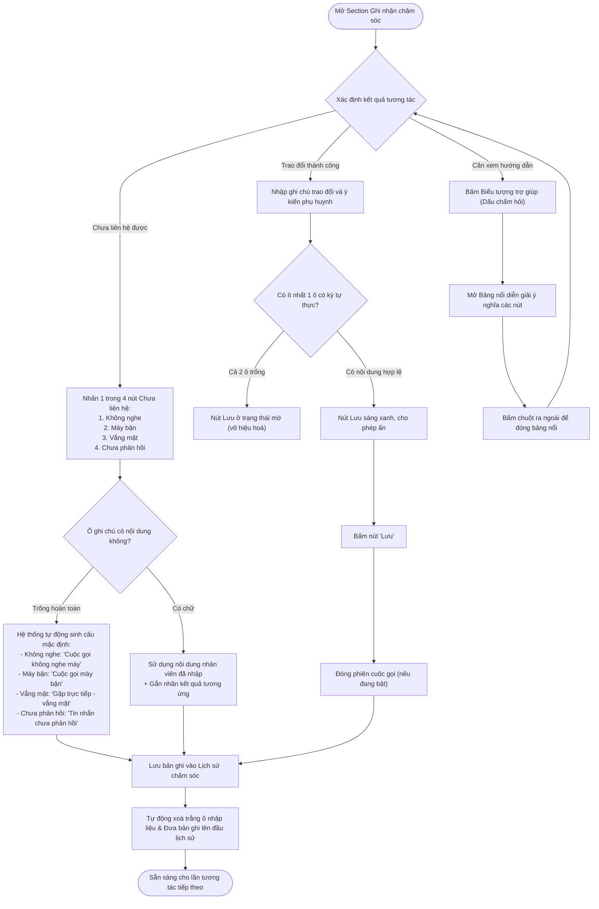

# US-CARE-01-08: Section Ghi nhận Chăm sóc - Nâng cấp Cụm nút Chưa liên hệ, Nút Lưu và Biểu tượng Diễn giải

> **Tham chiếu:** `BF-CARE-01` · `PERSONA-CSM` · `PERSONA-BRANCH-MANAGER`  
> **Màn hình đối chiếu:** Chi tiết chăm sóc học viên (`/app/student_operations_alert`)  
> **Vị trí cụ thể:** Hộp thoại Chi tiết chăm sóc học viên $\rightarrow$ Tab Chăm sóc $\rightarrow$ Section Ghi nhận chăm sóc  
> **Giới hạn phạm vi (Mandatory Scope Boundary):** Tài liệu này chỉ áp dụng duy nhất cho các thành phần nằm trong Section Ghi nhận chăm sóc. Các khối giao diện khác (như Thẻ mốc chăm sóc, Thẻ lớp học, Đơn hàng liên kết, Bảng danh sách ngoài) thuộc phạm vi các tài liệu khác.

---

## 1. NHẬT KÝ THAY ĐỔI & BỐI CẢNH (CHANGELOG & CONTEXT)

### Lịch sử cập nhật tài liệu (Changelog)

| Ngày cập nhật | Nội dung cập nhật | Lý do cập nhật |
|---|---|---|
| 09/10/2026 | Phát hành đặc tả cập nhật Section Ghi nhận chăm sóc tại Tab Chăm sóc: Đổi nút Lưu cũ thành Cụm nút Chưa liên hệ (Không nghe, Máy bận, Vắng mặt, Chưa phản hồi), sửa nút Lưu & Đóng thành nút Lưu duy nhất cho phiên thành công, bổ sung biểu tượng diễn giải trợ giúp. | Tối ưu hóa năng suất tác nghiệp hàng ngày của nhân viên chăm sóc, tự động hóa ghi nhận theo kênh/kết quả mà không bắt buộc gõ ghi chú, tinh gọn nút lưu và chống sai sót nhập liệu. |

### Bối cảnh & Vấn đề nghiệp vụ (Context & Problem)
* **Bối cảnh:** Tại hộp thoại Chi tiết chăm sóc học viên (`/app/student_operations_alert`), Section Ghi nhận chăm sóc là nơi nhân viên chăm sóc khách hàng (`PERSONA-CSM`) ghi nhận kết quả các cuộc gọi, tin nhắn hoặc gặp gỡ trực tiếp với phụ huynh học sinh.
* **Vấn đề trên giao diện trước đây:**
  1. *Thao tác thủ công khi chưa tiếp cận được phụ huynh:* Khi nhân viên gọi điện nhưng phụ huynh không nghe máy, máy bận hoặc nhắn tin chưa phản hồi, nhân viên vẫn phải tự gõ câu mô tả vào ô ghi chú rồi mới ấn nút lưu chung, gây tốn thời gian và làm giảm tốc độ xử lý các ca cảnh báo.
  2. *Nút thao tác gây hiểu lầm:* Nút `Lưu & Đóng` cũ gây nhầm lẫn giữa việc lưu phiên tương tác với việc đóng toàn bộ hộp thoại chi tiết hoặc kết thúc ca học viên.
  3. *Thiếu hướng dẫn trực quan:* Nhân viên mới khó phân biệt khi nào cần nhập ghi chú và khi nào có thể ghi nhận nhanh trạng thái chưa liên hệ.
* **Mục tiêu cải tiến:**
  - Chuyển đổi nút Lưu cũ thành Cụm 4 nút tác vụ nhanh **"Chưa liên hệ"** (giao diện hiển thị nhãn "Chưa liên lạc:"): `Không nghe`, `Máy bận`, `Vắng mặt`, `Chưa phản hồi`. Khi nhấn từng nút, hệ thống tự động lưu bản ghi theo từng loại mà không bắt buộc nhập ghi chú.
  - Sửa nút "Lưu & Đóng" cũ thành duy nhất nút **`Lưu`** (dành cho các phiên tương tác thành công), chỉ kích hoạt khi có nội dung nhập liệu.
  - Bổ sung **Biểu tượng diễn giải** (dấu chấm hỏi trợ giúp) mở bảng nổi giải thích ý nghĩa các nút thao tác.

### Đối tượng sử dụng & Tình huống nghiệp vụ (Persona & Use Cases)
* **Đối tượng sử dụng (Persona):** Chuyên viên chăm sóc khách hàng (`PERSONA-CSM`), Quản lý cơ sở (`PERSONA-BRANCH-MANAGER`).
* **Nhu cầu nghiệp vụ:** Cần ghi nhận nhanh chóng các tình huống chưa tiếp cận được phụ huynh với 1 cú nhấp chuột, đồng thời có nút lưu rõ ràng khi trao đổi thành công.
* **Tuyên bố giá trị:** **Là một** Chuyên viên chăm sóc khách hàng, **tôi muốn** bấm nút phân loại chưa liên hệ để hệ thống tự động ghi nhận nội dung chuẩn và bấm nút Lưu cho phiên thành công, **để** tôi tiết kiệm thời gian gõ văn bản lặp lại và đảm bảo dữ liệu chăm sóc luôn đầy đủ, chính xác.

### Danh mục yêu cầu chức năng (Feature Scope)

| Mã chức năng | Tên chức năng / Thành phần | Mức độ ưu tiên | Phạm vi áp dụng |
|---|---|---|---|
| `FEAT-REC-01` | Cụm nút tác vụ nhanh Chưa liên hệ (Không nghe, Máy bận, Vắng mặt, Chưa phản hồi) | Bắt buộc (Must) | Section Ghi nhận chăm sóc |
| `FEAT-REC-02` | Tự động sinh nội dung mặc định theo loại nút chưa liên hệ khi ô ghi chú để trống | Bắt buộc (Must) | Section Ghi nhận chăm sóc |
| `FEAT-REC-03` | Nút Lưu tương tác thành công kèm cơ chế kiểm soát dữ liệu bắt buộc | Bắt buộc (Must) | Section Ghi nhận chăm sóc |
| `FEAT-REC-04` | Biểu tượng diễn giải (Trợ giúp) kèm bảng nổi giải thích ý nghĩa nút | Bắt buộc (Must) | Section Ghi nhận chăm sóc |
| `FEAT-REC-05` | Tự động làm sạch dữ liệu biểu mẫu và cập nhật dòng thời gian lịch sử sau lưu | Bắt buộc (Must) | Section Ghi nhận chăm sóc |

### Quy tắc nghiệp vụ cốt lõi (Business Rules)
1. **[RULE-REC-01] Quy tắc độc lập của cụm Chưa liên hệ:** Cả 4 nút trong cụm Chưa liên hệ (`Không nghe`, `Máy bận`, `Vắng mặt`, `Chưa phản hồi`) không bị ràng buộc bởi độ dài văn bản trong ô ghi chú hay ô ý kiến phụ huynh. Người dùng có thể nhấn ghi nhận bất kỳ lúc nào.
2. **[RULE-REC-02] Quy tắc nội dung chuẩn hóa theo kênh:**
   - `Không nghe`: Kênh tự động gán là Cuộc gọi thoại, kết quả `Không nghe máy`, nhãn xác nhận là `KNM`, nội dung tự động nếu trống là `Cuộc gọi không nghe máy`.
   - `Máy bận`: Kênh tự động gán là Cuộc gọi thoại, kết quả `Máy bận`, nhãn xác nhận là `Đã gọi`, nội dung tự động nếu trống là `Cuộc gọi máy bận`.
   - `Vắng mặt`: Kênh tự động gán là Gặp trực tiếp, kết quả `Vắng mặt`, nhãn xác nhận là `Đã gặp trực tiếp`, nội dung tự động nếu trống là `Gặp trực tiếp - vắng mặt`.
   - `Chưa phản hồi`: Kênh tự động gán là Tin nhắn (Zalo), kết quả `Chưa phản hồi`, nhãn xác nhận là `Đã nhắn Zalo`, nội dung tự động nếu trống là `Tin nhắn chưa phản hồi`.
3. **[RULE-REC-03] Quy tắc kiểm soát nút Lưu thành công:** Nút `Lưu` chỉ được kích hoạt (sáng màu) khi có ít nhất một ký tự thực (khác khoảng trắng) tại ô Ghi chú tóm tắt trao đổi hoặc ô Ý kiến phụ huynh. Nếu cả hai ô đều rỗng, nút `Lưu` bắt buộc phải ở trạng thái vô hiệu hóa (mờ).
4. **[RULE-REC-04] Quy tắc bảo toàn ý kiến phụ huynh:** Nếu nhân viên có nhập nội dung vào ô Ý kiến phụ huynh, thông tin này luôn được gắn nhãn riêng biệt `[Ý kiến PH: ...]` trong bản ghi lịch sử, áp dụng cho cả thao tác bấm Lưu hoặc bấm các nút Chưa liên hệ.

---

## 2. QUY TRÌNH NGHIỆP VỤ & LUỒNG THAO TÁC (USER FLOW)

---

## 3. CẤU TRÚC GIAO DIỆN & THIẾT KẾ TRỰC QUAN (UI/UX DESIGN)

### 3.1. Vị trí và Bố cục Section Ghi nhận chăm sóc
Section Ghi nhận chăm sóc nằm ở phần trên của nội dung Tab Chăm sóc trong hộp thoại chi tiết học viên, có cấu trúc từ trên xuống dưới gồm 3 khối:
1. **Khối Thông tin người liên hệ (Đầu mục Section):**
   - Bộ chọn người liên hệ: Hiển thị mối quan hệ (Mẹ / Bố) và họ tên phụ huynh kèm mũi tên mở danh sách người thân trong gia đình.
   - Dãy số điện thoại kèm nút Sao chép và nút `Gọi` (màu đỏ).
   - Ô chọn lịch hẹn gọi lại kế tiếp (`AppointmentSchedulePicker`).
2. **Khối Ô nhập liệu tương tác:**
   - Ô văn bản nhiều dòng (Ghi chú trao đổi): Chiều cao tối thiểu 38 điểm ảnh, tối đa 120 điểm ảnh, tự động cuộn dọc, có chữ gợi ý: *"Nhập ghi chú tóm tắt nội dung đã trao đổi..."*. Hỗ trợ phím tắt `Ctrl + Enter` để lưu nhanh.
   - Ô văn bản một dòng (Ý kiến phụ huynh): Nằm ở khay xám bên dưới ô ghi chú, có chữ gợi ý: *"Nhập ý kiến / phản hồi của phụ huynh..."*.
3. **Khối Dòng tác vụ hành động (Hàng nút bấm dưới cùng):**
   - **Bên trái:** Nhãn chữ nhỏ *"Chưa liên lạc:"* đi kèm 4 nút bấm bo góc nhẹ:
     + Nút `Không nghe`: Viền xám mỏng, nền trắng.
     + Nút `Máy bận`: Viền xám mỏng, nền trắng.
     + Nút `Vắng mặt`: Viền xám mỏng, nền trắng.
     + Nút `Chưa phản hồi`: Viền xám mỏng, nền trắng.
   - **Bên phải:** Cụm thao tác lưu chính:
     + Nút `Lưu`: Nền màu xanh dương chủ đạo, chữ trắng, bo góc nhẹ. Khi chưa có nội dung, nút mờ đi với độ đậm 50%.
     + Biểu tượng trợ giúp (`HelpCircle`): Hình tròn nhỏ chứa dấu chấm hỏi xám nhạt, đặt liền kề sau nút `Lưu`. Khi bấm vào, mở một bảng nổi nhỏ hướng lên trên giải thích ý nghĩa các nút.

---

## 4. TIÊU CHÍ NGHIỆM THU (ACCEPTANCE CRITERIA)

### AC-01: Ghi nhận nhanh Chưa liên hệ khi ô nội dung để trống (Tự động sinh nội dung chuẩn)
* **Giả sử:** Nhân viên đang mở Section Ghi nhận chăm sóc tại Tab Chăm sóc, cả hai ô Ghi chú trao đổi và ô Ý kiến phụ huynh đều đang để trống.
* **Khi:** Nhân viên bấm vào một trong 4 nút thuộc cụm Chưa liên hệ:
  1. Bấm nút `Không nghe`.
  2. Bấm nút `Máy bận`.
  3. Bấm nút `Vắng mặt`.
  4. Bấm nút `Chưa phản hồi`.
* **Thì:**
  1. Hệ thống không bắt buộc nhập liệu và không hiển thị bất kỳ cảnh báo lỗi nào.
  2. Hệ thống tự động tạo bản ghi lịch sử tương tác mới với nội dung mặc định chuẩn hóa theo từng loại:
     - Bấm `Không nghe`: Kênh tự động nhận là Cuộc gọi, kết quả là `Không nghe máy`, nội dung ghi nhận là `Cuộc gọi không nghe máy`, mã xác nhận là `KNM`.
     - Bấm `Máy bận`: Kênh tự động nhận là Cuộc gọi, kết quả là `Máy bận`, nội dung ghi nhận là `Cuộc gọi máy bận`, mã xác nhận là `Đã gọi`.
     - Bấm `Vắng mặt`: Kênh tự động nhận là Gặp trực tiếp, kết quả là `Vắng mặt`, nội dung ghi nhận là `Gặp trực tiếp - vắng mặt`, mã xác nhận là `Đã gặp trực tiếp`.
     - Bấm `Chưa phản hồi`: Kênh tự động nhận là Zalo, kết quả là `Chưa phản hồi`, nội dung ghi nhận là `Tin nhắn chưa phản hồi`, mã xác nhận là `Đã nhắn Zalo`.
  3. Hệ thống hiển thị thông báo phản hồi: `Đã ghi nhận: [Tên kết quả]` (ví dụ: `Đã ghi nhận: Không nghe máy`).
  4. Bản ghi mới xuất hiện ngay trên đầu danh sách dòng thời gian Lịch sử chăm sóc với đầy đủ thông tin: người thực hiện, thời gian, người nhận, kênh, kết quả và nội dung chuẩn hóa.

---

### AC-02: Ghi nhận Chưa liên hệ khi nhân viên có nhập sẵn ghi chú hoặc ý kiến phụ huynh
* **Giả sử:** Nhân viên đã nhập văn bản vào ô Ghi chú trao đổi hoặc ô Ý kiến phụ huynh trước khi bấm nút.
* **Khi:** Nhân viên bấm vào một trong các nút Chưa liên hệ (`Không nghe`, `Máy bận`, `Vắng mặt`, `Chưa phản hồi`).
* **Thì:**
  1. Hệ thống sử dụng trực tiếp nội dung văn bản mà nhân viên đã gõ thay thế cho câu mặc định.
  2. Hệ thống vẫn tự động gắn đúng nhãn Kênh, nhãn Kết quả tương ứng của nút đã chọn vào bản ghi lịch sử.
  3. Nếu có nội dung trong ô Ý kiến phụ huynh, thông tin này được lưu kèm theo bản ghi với phần phân tách rõ ràng dạng `[Ý kiến PH: ...]`.
  4. Hệ thống hoàn tất lưu trữ, hiển thị thông báo thành công và xóa trắng toàn bộ dữ liệu trong các ô nhập để sẵn sàng cho lần tác nghiệp tiếp theo.

---

### AC-03: Ràng buộc trạng thái và hành vi của nút Lưu (Ghi nhận tương tác thành công)
* **Giả sử:** Nhân viên thực hiện phiên tương tác có trao đổi thực tế với phụ huynh.
* **Khi:** Quan sát và thao tác trên nút `Lưu`:
* **Thì:**
  1. **Khi cả 2 ô đều trống:** Nếu cả ô Ghi chú trao đổi và ô Ý kiến phụ huynh không có chữ (hoặc chỉ có khoảng trắng), nút `Lưu` ở trạng thái mờ (vô hiệu hóa), không thể nhấp chuột và con trỏ chuột hiển thị trạng thái cấm.
  2. **Khi có ít nhất 1 ô có chữ:** Chỉ cần một trong hai ô có nội dung hợp lệ, nút `Lưu` lập tức sáng lên với màu xanh dương chủ đạo, cho phép nhấp chuột để lưu.
  3. **Khi nhân viên bấm nút `Lưu`:**
     - Hệ thống ghi nhận toàn bộ nội dung đã nhập vào lịch sử chăm sóc của học viên.
     - Nếu đang có phiên cuộc gọi thoại mở trên giao diện, hệ thống tự động đóng banner cuộc gọi.
     - Bản ghi lịch sử được tạo mới kèm theo thông tin kênh liên hệ đang chọn, kết quả trao đổi, thời gian hẹn gọi lại (nếu có cài đặt) và người nhận liên hệ.
     - Hệ thống hiển thị thông báo thành công: `Đã ghi nhận chăm sóc thành công!`.

---

### AC-04: Hiển thị và tương tác với Biểu tượng diễn giải (Biểu tượng trợ giúp)
* **Giả sử:** Nhân viên đang làm việc tại Section Ghi nhận chăm sóc.
* **Khi:** Nhân viên bấm vào Biểu tượng trợ giúp (biểu tượng dấu chấm hỏi hình tròn nằm bên phải nút `Lưu`).
* **Thì:**
  1. Hệ thống mở một bảng nổi nhỏ gọn phía trên nút bấm mà không làm che khuất các ô nhập liệu quan trọng.
  2. Bảng nổi hiển thị tiêu đề `Ý nghĩa nút thao tác` đi kèm biểu tượng trợ giúp màu xanh.
  3. Nội dung bảng nổi mô tả rõ ràng hai nhóm hành động:
     - `Lưu`: Lưu nội dung trao đổi vào lịch sử chăm sóc (dành cho các phiên liên lạc có trao đổi thực tế).
     - `Không nghe / Máy bận / Vắng mặt / Chưa phản hồi`: Bấm để ghi nhận nhanh lịch sử chưa liên lạc được mà không cần nhập ghi chú.
  4. Khi nhân viên bấm chuột ra ngoài bảng nổi hoặc bấm lại vào biểu tượng trợ giúp, bảng nổi tự động đóng lại nhẹ nhàng.

---

### AC-05: Tự động dọn dẹp dữ liệu biểu mẫu và cập nhật nhật ký sau khi lưu
* **Giả sử:** Nhân viên vừa bấm thành công nút `Lưu` hoặc bất kỳ nút nào trong cụm `Chưa liên hệ`.
* **Khi:** Hệ thống xác nhận lưu bản ghi thành công vào cơ sở dữ liệu.
* **Thì:**
  1. Toàn bộ chữ trong ô Ghi chú trao đổi và ô Ý kiến phụ huynh tự động được làm rỗng.
  2. Chiều cao ô ghi chú tự động co về kích thước ban đầu (không bị kéo giãn bất thường).
  3. Nút `Lưu` tự động chuyển về trạng thái vô hiệu hóa (do biểu mẫu đã trống).
  4. Danh sách dòng thời gian Lịch sử chăm sóc ở phần dưới tự động làm mới và cập nhật bản ghi vừa tạo ở vị trí trên cùng mà không cần người dùng tải lại trang.

### AC-06: Thích ứng trạng thái biểu mẫu và nút bấm khi đang trong cuộc gọi thoại (Calling)
* **Giả sử:** Nhân viên bấm nút `Gọi` màu đỏ để thực hiện cuộc gọi viễn thông với phụ huynh học sinh.
* **Khi:** Cuộc gọi chuyển sang trạng thái đã kết nối thành công (`Connected`), đồng hồ đếm giây đàm thoại hoạt động.
* **Thì:**
  1. Cụm nút tác vụ nhanh Chưa liên hệ (`Không nghe`, `Máy bận`, `Vắng mặt`, `Chưa phản hồi`) tự động bị ẩn hoặc vô hiệu hóa hoàn toàn nhằm ngăn ngừa việc ghi nhận nhầm trạng thái không nghe máy khi đang đàm thoại thực tế.
  2. Kênh liên hệ của phiên tương tác được hệ thống tự động cố định là Cuộc gọi thoại (`telephone`).
  3. Các ô Ghi chú trao đổi và Ý kiến phụ huynh sẵn sàng nhận văn bản để nhân viên vừa đàm thoại vừa gõ tóm tắt nội dung.
  4. Nút `Lưu` sáng màu xanh khi có ít nhất một ô có nội dung; nếu nhân viên bấm `Lưu` ngay lúc này, hệ thống tự động gác máy cuộc gọi, chốt thời lượng đàm thoại thực tế và lưu bản ghi kèm vết file ghi âm vào lịch sử chăm sóc.

---

## 5. CÁC TRƯỜNG HỢP GÓC CẠNH (CORNER CASES)

*(Lưu ý: Mục này chỉ tập trung vào các tình huống biên, rìa dữ liệu, sự kiện xung đột và ngoại lệ kỹ thuật nghiệp vụ; tuyệt đối không lặp lại các kịch bản chuẩn đã nêu trong mục Tiêu chí nghiệm thu).*

* **[CASE-01] Bấm nút Chưa liên hệ khi đang trong phiên cuộc gọi đang kết nối:**
  - *Tình huống:* Nhân viên vừa bấm nút `Gọi`, banner kết nối cuộc gọi đang hiển thị đếm giây hoặc đổ chuông, nhưng chuông reo không có người nhấc máy hoặc nghe tín hiệu máy bận, nhân viên bấm luôn nút `Không nghe` hoặc `Máy bận`.
  - *Xử lý:* Hệ thống lập tức dừng trạng thái cuộc gọi hiện tại, tự động chuyển trạng thái kết nối về đã kết thúc, lưu đúng kết quả chưa liên lạc được vào lịch sử và đưa giao diện về trạng thái tĩnh bình thường, không để treo banner gọi.

* **[CASE-02] Nhập toàn bộ ký tự khoảng trắng (Space / Tab / Xuống dòng) vào ô nhập liệu:**
  - *Tình huống:* Nhân viên nhấn phím cách nhiều lần hoặc nhấn phím enter xuống dòng tạo các khoảng trống vô nghĩa trong ô Ghi chú hoặc ô Ý kiến phụ huynh.
  - *Xử lý:* Bộ kiểm tra dữ liệu của hệ thống tự động cắt bỏ khoảng trắng hai đầu khi đánh giá điều kiện. Do không có ký tự thực, nút `Lưu` vẫn tiếp tục duy trì trạng thái mờ (vô hiệu hóa), ngăn chặn nhân viên tạo các bản ghi rỗng vào lịch sử.

* **[CASE-03] Thao tác bấm nút liên tiếp nhiều lần trong tích tắc (Spam Double-click):**
  - *Tình huống:* Nhân viên nhấp chuột liên tục 2 đến 3 lần vào nút `Lưu` hoặc nút Chưa liên hệ do thói quen thao tác nhanh hoặc thiết bị chuột bị lỗi nút bấm.
  - *Xử lý:* Sau lần nhấp đầu tiên, nút bấm tự động kích hoạt cờ xử lý tạm thời và khóa nhận sự kiện nhấp tiếp theo trong chu kỳ ghi dữ liệu. Hệ thống chỉ ghi nhận duy nhất 1 bản ghi lịch sử tương tác, tuyệt đối không tạo ra các bản ghi trùng lặp nội dung và cùng mốc thời gian.

* **[CASE-04] Kích hoạt tổ hợp phím tắt Ctrl + Enter khi cả hai ô nội dung đều rỗng:**
  - *Tình huống:* Con trỏ chuột đang nằm trong ô Ghi chú hoặc ô Ý kiến phụ huynh nhưng không có chữ nào, nhân viên vô tình bấm tổ hợp phím `Ctrl + Enter` (hoặc `Cmd + Enter` trên hệ điều hành macOS).
  - *Xử lý:* Trình nhận phím tắt kiểm tra điều kiện dữ liệu trước khi gửi lệnh. Do nội dung đang rỗng, sự kiện phím tắt bị chặn đứng hoàn toàn, không thực thi lưu dữ liệu và không phát sinh thông báo lỗi.

* **[CASE-05] Số điện thoại người liên hệ không hợp lệ hoặc để trống khi thao tác:**
  - *Tình huống:* Học viên chưa được gán số điện thoại người liên hệ (hiển thị ký hiệu `--` hoặc ô trống).
  - *Xử lý:* Nút `Gọi` chính bị khóa và hiển thị cảnh báo yêu cầu cập nhật số điện thoại nếu bấm vào. Tuy nhiên, các nút trong cụm Chưa liên hệ (như `Không nghe`, `Máy bận`, `Vắng mặt`, `Chưa phản hồi`) **vẫn cho phép bấm hoạt động bình thường** nhằm giúp nhân viên ghi nhận nhật ký nghiệp vụ (ví dụ: đã cố gắng liên hệ theo kênh khác hoặc ghi nhận vắng mặt tại lớp).

* **[CASE-06] Nội dung ghi chú có độ dài lớn, chứa ký tự đặc biệt hoặc biểu tượng cảm xúc:**
  - *Tình huống:* Nhân viên dán một đoạn văn bản dài từ tin nhắn mạng xã hội có chứa nhiều biểu tượng cảm xúc (emoji), dấu ngắt dòng đặc biệt hoặc ký tự ngoặc vuông `[ ]`.
  - *Xử lý:* Ô ghi chú tự động co giãn thanh cuộn dọc mà không làm vỡ chiều rộng hay xô lệch các nút bên dưới. Khi lưu vào lịch sử, các ký tự ngoặc vuông được bảo toàn nguyên vẹn văn bản của nhân viên, không gây xung đột với các nhãn hệ thống như `[Kênh: ...]`, `[Đến: ...]`.

* **[CASE-07] Đang nhập dở dang thì mở và đóng Bảng nổi diễn giải:**
  - *Tình huống:* Nhân viên đã gõ dở một đoạn văn bản dài trong ô Ghi chú, sau đó bấm vào Biểu tượng trợ giúp để đọc ý nghĩa nút, rồi bấm ra ngoài để đóng lại.
  - *Xử lý:* Thao tác bật/tắt bảng nổi trợ giúp hoàn toàn độc lập, không kích hoạt sự kiện làm mới biểu mẫu. Toàn bộ nội dung văn bản nhân viên đang gõ dở được giữ nguyên vẹn 100%, con trỏ nhập liệu không bị mất hoặc reset.

* **[CASE-08] Hiển thị co giãn trên màn hình hẹp (Giao diện co nhỏ hoặc chia đôi cửa sổ):**
  - *Tình huống:* Người dùng thu nhỏ chiều rộng cửa sổ trình duyệt hoặc thao tác trên màn hình máy tính bảng có độ phân giải thấp.
  - *Xử lý:* Hàng nút tác vụ tự động kích hoạt cơ chế xuống dòng mềm mại: Cụm nhãn `Chưa liên lạc` và 4 nút hành động tự động xếp gọn sang dòng đầu, nút `Lưu` và biểu tượng trợ giúp dịch chuyển hợp lý xuống góc phải bên dưới. Các nút bấm duy trì khoảng cách lề tối thiểu, không bị chèn lấn và không làm xuất hiện thanh cuộn ngang cục bộ.

---

## 6. LUỒNG NGOẠI LỆ & XỬ LÝ LỖI (EXCEPTION FLOW)

1. **Mất kết nối máy chủ khi bấm lưu:** Khi nhân viên bấm Lưu hoặc bấm các nút Chưa liên hệ mà mất kết nối mạng hoặc máy chủ phản hồi lỗi, hệ thống giữ nguyên nội dung nhân viên vừa nhập trong ô ghi chú và hiển thị thông báo lỗi: `Có lỗi xảy ra khi lưu chăm sóc. Vui lòng thử lại!`. Tuyệt đối không xóa dữ liệu để tránh mất công gõ của nhân viên.
2. **Phiên làm việc hết hạn:** Nếu phiên đăng nhập của nhân viên hết hạn trong lúc đang gõ, hệ thống lưu tạm nội dung vào bộ nhớ trình duyệt cục bộ trước khi chuyển hướng sang màn hình đăng nhập lại.

---

## 7. QUY TẮC KIỂM SOÁT DỮ LIỆU (VALIDATION RULES)

| Tên trường dữ liệu | Bắt buộc | Kiểu dữ liệu | Ràng buộc kiểm soát | Ghi chú nghiệp vụ |
|---|---|---|---|---|
| **Người liên hệ** | Bắt buộc | Chuỗi danh mục | Phải chọn một người liên hệ hợp lệ trong danh sách gia đình | Mặc định chọn người liên hệ chính (Mẹ/Bố) |
| **Ghi chú trao đổi** | Bắt buộc với nút Lưu; Tùy chọn với Chưa liên hệ | Văn bản nhiều dòng | Tối đa 2.000 ký tự, không chấp nhận chuỗi toàn khoảng trắng đối với nút Lưu | Cho phép nhập emoji, xuống dòng |
| **Ý kiến phụ huynh** | Tùy chọn | Văn bản một dòng | Tối đa 500 ký tự | Tách riêng với ghi chú của nhân viên |
| **Lịch hẹn tiếp theo** | Tùy chọn | Ngày & giờ | Phải lớn hơn hoặc bằng thời điểm hiện tại nếu thiết lập | Lưu vào dòng tóm tắt tương tác |

---

## 8. PHÂN QUYỀN VAI TRÒ (PERMISSION MATRIX)

| Hành động tác nghiệp | Mã quyền nguyên tử | Quản lý cơ sở | Chuyên viên CSM | Giáo viên / Nhân sự khác |
|---|---|:---:|:---:|:---:|
| **Ghi nhận Chưa liên hệ (4 nút)** | `care.interaction.quick_log` | Cho phép | Cho phép | Chỉ xem lịch sử |
| **Lưu tương tác thành công** | `care.interaction.create` | Cho phép | Cho phép | Chỉ xem lịch sử |
| **Tra cứu biểu tượng diễn giải** | `care.interaction.view_help` | Cho phép | Cho phép | Cho phép |

---

## 9. YÊU CẦU PHI CHỨC NĂNG (NON-FUNCTIONAL REQUIREMENTS)

1. **Thời gian phản hồi:** Thời gian từ khi bấm nút Lưu hoặc nút Chưa liên hệ đến khi bản ghi xuất hiện trên dòng thời gian lịch sử không vượt quá 300 mili-giây.
2. **Khả năng tương thích:** Hoạt động ổn định trên các trình duyệt hiện đại (Chrome, Edge, Firefox, Safari) trên cả môi trường máy tính để bàn và máy tính bảng.

---

## 10. ĐẶC TẢ KẾT NỐI HỆ THỐNG

*Các yêu cầu về kết nối dữ liệu được kế thừa hoàn toàn từ chuẩn kiến trúc hệ thống hiện tại của phân hệ Chăm sóc học viên (`BF-CARE-01`).*

---

## 11. CÂU HỎI TỒN ĐỌNG & PHỤ THUỘC

Hiện tại không có câu hỏi nào cần làm rõ thêm; toàn bộ hành vi đã được kiểm chứng đối chiếu trực tiếp trên hệ thống thực tế.
Tính năng hoạt động độc lập và khép kín trong phạm vi Section Ghi nhận chăm sóc, không có vướng mắc kỹ thuật chưa được xử lý.
