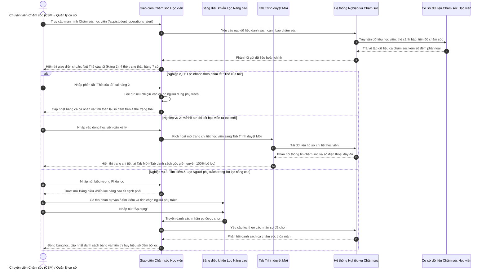

# US-CARE-01-09: Nâng cấp Giao diện Chăm sóc Học viên - Thẻ của tôi, Mở chi tiết Tab mới & Nhóm lọc Người phụ trách (Care Operations Alert Interface Upgrade)

> **Tham chiếu:** `BF-CARE-01` · `SR-PERSONA-CSM` · Giao diện Mẫu §4.2 (Màn hình Danh sách & Thanh công cụ chuẩn)  
> **Đường dẫn màn hình & Trạng thái liên quan:**  
> - `Lịch chăm sóc học viên (/app/student_operations_alert)` -> Trạng thái chăm sóc: `Chưa chăm sóc`, `Đang xử lý`, `Đã chăm sóc` | Trạng thái lớp học: `Đang học`, `Chờ chuyển lớp`, `Chờ xếp lớp`, `Bảo lưu`, `Hết buổi`  

---

## 1. NHẬT KÝ THAY ĐỔI & BỐI CẢNH (CHANGELOG & CONTEXT)

### Lịch sử cập nhật tài liệu (Changelog)

| Ngày cập nhật | Nội dung cập nhật | Lý do cập nhật |
|---|---|---|
| 23/10/2026 | Nâng cấp 3 nghiệp vụ trọng tâm: Khôi phục phím tắt "Thẻ của tôi" tại hàng 2 thanh công cụ; Bổ sung cơ chế mở trang chi tiết chăm sóc ra tab trình duyệt mới; Tích hợp nhóm lọc Người phụ trách kèm ô tìm kiếm trong Bảng điều khiển lọc nâng cao; lược bỏ ô chọn Người phụ trách tại hàng 1 | Tối ưu hóa năng lực tác nghiệp đa nhiệm cho Chuyên viên chăm sóc và Quản lý cơ sở, bảo toàn ngữ cảnh danh sách bộ lọc khi xử lý hồ sơ học viên |

### Bối cảnh & Mục tiêu điều chỉnh (Context & Objectives)
* **Bối cảnh nghiệp vụ:** Màn hình Chăm sóc học viên (`/app/student_operations_alert`) là không gian làm việc chính của Chuyên viên chăm sóc khách hàng (`PERSONA-CSM`), Quản lý chi nhánh (`PERSONA-BRANCH-MANAGER`) và Giáo viên (`PERSONA-TEACHER`).
* **Phạm vi nâng cấp (3 mục tiêu duy nhất):**
  1. **Khôi phục phím tắt "Thẻ của tôi":** Bố trí tại vị trí đầu hàng 2 thanh công cụ ngay trước nhóm thẻ trạng thái chăm sóc, có số đếm động ca cá nhân và hỗ trợ bật/tắt 1 chạm.
  2. **Cơ chế mở trang chi tiết ra tab mới:** Cho phép nhấp vào học viên để mở hồ sơ chi tiết sang một tab trình duyệt mới độc lập (`_blank`), bảo toàn toàn bộ bộ lọc và vị trí phân trang ở tab danh sách ban đầu.
  3. **Nhóm lọc Người phụ trách có ô tìm kiếm trong Bộ lọc nâng cao:** Đưa danh sách lọc Chuyên viên CS và Giáo viên vào Bảng điều khiển lọc nâng cao, tích hợp ô tìm kiếm nhân sự theo tên và cơ chế chọn nhiều nhân sự cùng lúc.
* **Chỉ số đo lường hiệu quả (KPI Target):**
  - Thời gian lọc nhanh danh sách ca cá nhân: Dưới 1 giây (1 cú nhấp chuột).
  - Tỷ lệ bảo toàn ngữ cảnh bộ lọc khi mở xem chi tiết học viên: Đạt 100% nhờ cơ chế mở tab mới.
  - Tốc độ tìm kiếm và áp dụng lọc theo nhân sự phụ trách: Dưới 300 phần nghìn giây.

### Ràng buộc nghiệp vụ toàn cục (Global Rules):

* **[RULE-OA-01] Bảo toàn dữ liệu & Không thay đổi xử lý hệ thống:** Việc nâng cấp chỉ điều chỉnh hiển thị và tương tác trên giao diện, giữ nguyên logic xử lý hệ thống và cơ sở dữ liệu đã có.
* **[RULE-OA-02] Che số điện thoại bảo mật chống sao chép hàng loạt:** Toàn bộ số điện thoại hiển thị trên bảng danh sách chính bắt buộc phải che các chữ số ở giữa dạng `xxxxxxx001` hoặc `091****111`. Chỉ khi mở trang chi tiết học viên mới hiển thị số điện thoại đầy đủ.
* **[RULE-OA-03] Số đếm động đi theo toàn bộ bộ lọc:** Số lượng đếm trên phím tắt "Thẻ của tôi", 4 thẻ trạng thái chăm sóc (`Tất cả`, `Chưa chăm sóc`, `Đang xử lý`, `Đã chăm sóc`) và phân trang chân bảng tự động tính toán lại theo tất cả các bộ lọc đang áp dụng.
* **[RULE-OA-04] Cơ chế lọc nháp đa tầng trên Bảng điều khiển nâng cao:** Việc chọn các tiêu chí lọc trong bảng điều khiển nâng cao (bao gồm nhóm lọc Người phụ trách) thực hiện ở chế độ nháp; chỉ khi người dùng nhấp nút "Áp dụng", hệ thống mới thực hiện lọc lại dữ liệu.

---

## 2. LUỒNG XỬ LÝ CHÍNH (MAIN FLOW - HAPPY PATH)

---

## 3. MÔ TẢ GIAO DIỆN (UI DESCRIPTION & ADJUSTMENT MATRIX)

### Giao diện: [https://www.figma.com/design/frct7JUaJQBN2uOSyfMqcL/Rinoedu?node-id=9210-28780](https://www.figma.com/design/frct7JUaJQBN2uOSyfMqcL/Rinoedu?node-id=9210-28780)

### 3.1 Thanh công cụ & Cụm phím tắt "Thẻ của tôi" (Hàng 2) - Các điều chỉnh

| Thành phần giao diện | Loại hiển thị | Dữ liệu & Quy tắc | Diễn giải quy tắc | Nội dung điều chỉnh |
|---|---|---|---|---|
| **Phím tắt "Thẻ của tôi" (Hàng 2 bên trái)** | Nút bấm chuyển đổi nhanh dạng viên nang bo tròn | Số lượng ca chăm sóc do cá nhân phụ trách (`myAlertsCount`) | Đặt tại đầu hàng 2 ngay trước dải thẻ trạng thái chăm sóc; hiển thị biểu tượng người phụ trách, nhãn văn bản và số đếm động. Bấm để bật/tắt lọc nhanh các ca cá nhân. | **Bổ sung:** Khôi phục phím tắt "Thẻ của tôi" tại vị trí đầu hàng 2 thanh công cụ kèm số đếm động. |
| **Thanh chọn "Tất cả người phụ trách" (Hàng 1)** | Hộp chọn thả xuống | Danh sách nhân sự phụ trách | Ô chọn người phụ trách trên thanh công cụ đỉnh làm chật chội hàng 1 và trùng lặp với phím tắt cá nhân. | **Lược bỏ:** Gỡ bỏ hoàn toàn ô chọn Người phụ trách tại Hàng 1, chuyển tính năng lọc danh sách nhân sự vào Bảng điều khiển lọc nâng cao. |
| **Thanh công cụ Hàng 1 - Cụm 4 ô lọc danh mục** | Dãy 4 hộp chọn thả xuống | Danh mục Cơ sở, Môn học, Loại thẻ CS, Hạn xử lý | Gồm 4 ô chọn thả xuống tinh gọn: `Tất cả cơ sở`, `Tất cả môn học`, `Tất cả Loại thẻ CS`, `Tất cả hạn xử lý`. Phía bên phải là nút Tìm kiếm, Phễu lọc và Xuất dữ liệu. | **Điều chỉnh:** Giữ nguyên quy chuẩn 4 ô chọn danh mục phân loại chính ở hàng đỉnh, gom toàn bộ phạm vi lọc vĩ mô lên hàng trên cùng. |
| **Cụm thẻ Trạng thái chăm sóc (Status Tiles)** | Dải 4 thẻ trạng thái dạng viên | Số lượng ca theo từng trạng thái vòng đời | Gồm 4 thẻ: `Tất cả`, `Chưa chăm sóc`, `Đang xử lý`, `Đã chăm sóc`. Đặt liền sau vạch phân cách cạnh phím tắt "Thẻ của tôi"; số đếm cập nhật tự động theo các bộ lọc. | **Điều chỉnh:** Bố trí tiếp nối ngay sau phím tắt "Thẻ của tôi", số đếm tự động cập nhật đồng bộ khi bật hoặc tắt xem ca cá nhân. |

### 3.2 Bảng danh sách & Cơ chế mở chi tiết ra Tab mới - Các điều chỉnh

| Thành phần giao diện | Loại hiển thị | Dữ liệu & Quy tắc | Diễn giải quy tắc | Nội dung điều chỉnh |
|---|---|---|---|---|
| **Tương tác mở trang Chi tiết học viên** | Nhấp chuột vào dòng hoặc Tên học viên | Mã định danh học viên (`studentId`) | Nhấp chuột trái vào dòng học viên hoặc tên học viên để tra cứu hồ sơ chi tiết. Hệ thống kích hoạt mở trang chi tiết sang tab trình duyệt mới (`_blank`). | **Bổ sung:** Cơ chế mở trang chi tiết chăm sóc học viên sang tab trình duyệt mới, giữ nguyên 100% ngữ cảnh danh sách và bộ lọc ở tab gốc. |
| **Bảng danh sách chính (7 cột chuẩn hóa)** | Bảng dữ liệu 7 cột | Thông tin học viên, liên hệ, người chăm sóc, thẻ CS, nội dung, trạng thái, lớp học | Bảng duy trì 7 cột dữ liệu trọng tâm; số điện thoại của phụ huynh tại cột Liên hệ bắt buộc được che các chữ số ở giữa dạng `xxxxxxx001` chống sao chép dữ liệu. | **Điều chỉnh:** Bảo toàn cấu trúc 7 cột chuẩn hóa; đảm bảo an toàn thông tin số điện thoại khách hàng trên giao diện danh sách chính. |

### 3.3 Bộ lọc nâng cao - Nhóm lọc Người phụ trách có ô tìm kiếm - Các điều chỉnh

| Thành phần giao diện | Loại hiển thị | Dữ liệu & Quy tắc | Diễn giải quy tắc | Nội dung điều chỉnh |
|---|---|---|---|---|
| **Nhóm lọc Người phụ trách** | Khối nhóm lọc dạng gập mở | Danh mục nhân sự chăm sóc và giáo viên của cơ sở | Nằm trong bảng điều khiển lọc nâng cao trượt từ cạnh phải. Cho phép chọn đồng thời nhiều nhân sự để lọc danh sách ca chăm sóc thuộc trách nhiệm của các nhân sự đó. | **Bổ sung:** Bổ sung nhóm lọc Người phụ trách vào bảng điều khiển lọc nâng cao, hỗ trợ lọc đa điểm theo chế độ lọc nháp. |
| **Ô tìm kiếm nhanh nhân sự** | Ô nhập văn bản kèm biểu tượng kính lúp | Tên nhân sự phụ trách | Đặt ở đầu nhóm lọc Người phụ trách. Khi nhập từ khóa, danh sách nhân sự bên dưới tự động lọc theo thời gian thực sau 200 phần nghìn giây. | **Bổ sung:** Ô tìm kiếm nhân sự nhanh bên trong nhóm lọc, giúp tra cứu thuận tiện khi danh sách nhân sự dài. |
| **Danh sách hộp kiểm nhân sự** | Danh sách hộp kiểm (Checkbox) | Tên nhân sự phân rõ tiền tố `CS:` hoặc `GV:` | Mỗi nhân sự hiển thị trên một dòng độc lập kèm hộp kiểm. Người dùng tích chọn nhiều người và bấm nút "Áp dụng" để thực hiện lọc. | **Điều chỉnh:** Bố trí danh sách hộp kiểm tinh gọn, mỗi nhân sự 1 dòng; lược bỏ các con số thống kê rườm rà phía sau tên nhân sự. |

---

## 4. KHỐI CHỨC NĂNG CHI TIẾT: ACTION & LUỒNG KÍCH HOẠT (ACTIONS & EVENTS)

### Khối chức năng 1: Thao tác phím tắt "Thẻ của tôi" trên thanh công cụ

#### Action 1.1: Kích hoạt phím tắt "Thẻ của tôi"
* **Luồng kích hoạt:** Người dùng nhấp vào nút "Thẻ của tôi" tại hàng 2 của thanh công cụ.
* **Tiêu chí nghiệm thu (Acceptance Criteria):**
  - **AC-1 (Happy Path - Kích hoạt lọc thẻ cá nhân):**
    - **Giả sử:** Người dùng đang đăng nhập với tài khoản Chuyên viên chăm sóc hoặc Giáo viên và phím tắt "Thẻ của tôi" đang ở trạng thái tắt.
    - **Khi:** Người dùng nhấp chuột vào nút "Thẻ của tôi".
    - **Thì:** Nút "Thẻ của tôi" chuyển sang trạng thái kích hoạt với màu nhấn nổi bật; bảng danh sách lập tức lọc chỉ hiển thị các ca học viên do chính người dùng phụ trách; đồng thời số lượng đếm trên 4 thẻ trạng thái chăm sóc tự động tính toán lại theo số ca cá nhân.
  - **AC-2 (Happy Path - Hủy kích hoạt để xem toàn bộ danh sách):**
    - **Giả sử:** Phím tắt "Thẻ của tôi" đang được kích hoạt.
    - **Khi:** Người dùng nhấp lại vào nút "Thẻ của tôi".
    - **Thì:** Nút "Thẻ của tôi" trở về trạng thái bình thường; bảng danh sách khôi phục hiển thị toàn bộ các ca chăm sóc của chi nhánh; số lượng đếm trên các thẻ trạng thái chăm sóc tự động tính toán lại theo toàn bộ danh sách.

---

### Khối chức năng 2: Mở hồ sơ chi tiết chăm sóc học viên sang tab mới

#### Action 2.1: Nhấp mở chi tiết học viên ra tab trình duyệt mới
* **Luồng kích hoạt:** Người dùng nhấp chuột vào dòng học viên hoặc tên học viên trên bảng danh sách.
* **Tiêu chí nghiệm thu:**
  - **AC-3 (Happy Path - Mở trang chi tiết sang tab mới):**
    - **Giả sử:** Người dùng đang xem danh sách học viên tại màn hình `/app/student_operations_alert` và đã áp dụng một số bộ lọc (ví dụ: Cơ sở Nguyễn Tuân, Thẻ chưa chăm sóc).
    - **Khi:** Người dùng nhấp chuột vào một dòng học viên bất kỳ.
    - **Thì:** Trình duyệt tự động mở một tab mới tải trang chi tiết chăm sóc của học viên đó với đầy đủ thông tin (lịch sử chăm sóc, số điện thoại đầy đủ, thông tin lớp học); tab danh sách ban đầu được giữ nguyên 100% trạng thái bộ lọc và vị trí trang hiện tại mà không bị tải lại.

---

### Khối chức năng 3: Lọc theo Người phụ trách trong Bảng điều khiển lọc nâng cao

#### Action 3.1: Tìm kiếm và lọc theo nhân sự phụ trách
* **Luồng kích hoạt:** Người dùng mở bảng điều khiển lọc nâng cao, gõ tên nhân sự vào ô tìm kiếm và tích chọn nhân sự.
* **Tiêu chí nghiệm thu:**
  - **AC-4 (Happy Path - Tìm kiếm và chọn người phụ trách):**
    - **Giả sử:** Bảng điều khiển lọc nâng cao đang mở và nhóm "Người phụ trách" đang mở rộng.
    - **Khi:** Người dùng gõ từ khóa "Hoàng Long" vào ô tìm kiếm nhân sự và tích chọn hộp kiểm "CS: Lê Hoàng Long", sau đó nhấp nút "Áp dụng".
    - **Thì:** Bảng lọc nâng cao đóng lại, nút phễu lọc hiển thị huy hiệu đếm số điều kiện lọc, bảng danh sách chỉ hiển thị các ca do CS Lê Hoàng Long phụ trách.
  - **AC-5 (Happy Path - Lọc kết hợp nhiều người phụ trách):**
    - **Giả sử:** Người dùng muốn theo dõi công việc của một nhóm nhân sự.
    - **Khi:** Người dùng tích chọn đồng thời 2 nhân sự phụ trách và nhấp nút "Áp dụng".
    - **Thì:** Bảng danh sách hiển thị tất cả các ca chăm sóc do một trong hai nhân sự đó phụ trách; số lượng ca trên các thẻ trạng thái chăm sóc tự động cập nhật khớp với kết quả lọc kết hợp.

---

## 5. CÁC TRƯỜNG HỢP GÓC CẠNH & LUỒNG NGOẠI LỆ (CORNER CASES & EXCEPTION FLOWS)

### **Nhóm 1: Phím tắt Thẻ của tôi & Thanh công cụ**
* **[CASE-01] Người dùng chưa được phân công phụ trách ca nào (số đếm = 0):**
  * **Tình huống:** Người dùng mới vào trung tâm hoặc chưa được gán ca học viên nào, số đếm trên phím tắt "Thẻ của tôi" hiển thị là `0`.
  * **Xử lý:** Khi người dùng nhấp vào nút "Thẻ của tôi", bảng danh sách hiển thị khung trạng thái rỗng thân thiện: "Không có ca chăm sóc nào do bạn phụ trách", đồng thời các thẻ trạng thái chăm sóc cập nhật số đếm về `0` mà không gây lỗi giao diện.
* **[CASE-02] Đổi cơ sở hoặc môn học khi đang bật "Thẻ của tôi":**
  * **Tình huống:** Người dùng đang kích hoạt "Thẻ của tôi" và thực hiện chọn cơ sở khác trên thanh công cụ.
  * **Xử lý:** Giao diện giữ nguyên trạng thái kích hoạt "Thẻ của tôi", tự động tính toán lại số lượng ca của người dùng tại cơ sở mới; nếu ở cơ sở mới người dùng không có ca nào, hiển thị số đếm `0` và thông báo trạng thái rỗng.

---

### **Nhóm 2: Mở chi tiết học viên sang tab mới**
* **[CASE-03] Trình duyệt chặn mở cửa sổ / tab mới (Popup Blocker):**
  * **Tình huống:** Thiết lập bảo mật trình duyệt của người dùng chặn tự động bật tab mới.
  * **Xử lý:** Hệ thống kích hoạt mở qua liên kết chuẩn với thuộc tính bảo mật; nếu vẫn bị chặn, hiển thị thanh thông báo nhỏ phía trên bảng danh sách gợi ý người dùng cho phép mở tab mới hoặc nhấp liên kết trực tiếp.
* **[CASE-04] Người dùng mở liên tiếp nhiều học viên sang nhiều tab:**
  * **Tình huống:** Chuyên viên CS nhấp mở 5 học viên liên tiếp để chuẩn bị gọi điện cho phụ huynh.
  * **Xử lý:** Mỗi học viên được mở độc lập tại một tab riêng biệt; tab danh sách gốc hoàn toàn ổn định, không bị tiêu tốn tài nguyên tải lại dữ liệu.

---

### **Nhóm 3: Bảng điều khiển lọc nâng cao & Tìm kiếm nhân sự**
* **[CASE-05] Tìm kiếm người phụ trách không có kết quả phù hợp:**
  * **Tình huống:** Người dùng gõ tên nhân sự không có trong danh sách phân công tại cơ sở.
  * **Xử lý:** Danh sách nhân sự bên dưới hiển thị thông báo "Không tìm thấy người phụ trách phù hợp", các hộp kiểm của những nhân sự đã chọn trước đó vẫn được bảo lưu ở phần đầu danh sách.
* **[CASE-06] Xóa trắng điều kiện lọc (Đặt lại bộ lọc):**
  * **Tình huống:** Người dùng đang lọc theo người phụ trách và nhấp nút "Đặt lại" trong bảng lọc nâng cao.
  * **Xử lý:** Toàn bộ các hộp kiểm người phụ trách được bỏ chọn, ô tìm kiếm nhân sự được xóa trắng; sau khi bấm "Áp dụng", bảng danh sách phục hồi hiển thị đầy đủ các ca chăm sóc ban đầu.

---

## 6. RÀNG BUỘC & QUY TẮC KIỂM SOÁT DỮ LIỆU (VALIDATION RULES)

| Thành phần giao diện / Bộ lọc | Điều kiện kiểm soát | Định dạng dữ liệu | Thông báo xử lý |
|---|---|---|---|
| **Nút "Thẻ của tôi"** | Tự động xác định theo tài khoản đăng nhập | Giá trị nhị phân (Bật / Tắt) | Tự động tính toán số lượng ca thuộc trách nhiệm cá nhân |
| **Ô tìm kiếm nhân sự** | Độ dài tối đa 50 ký tự | Chuỗi văn bản tiếng Việt có dấu hoặc không dấu | Tự động lọc danh sách sau 200 phần nghìn giây khi dừng gõ |
| **Hộp kiểm Người phụ trách** | Cho phép chọn đa điểm | Danh sách mã định danh nhân sự hợp lệ | Hỗ trợ chọn nhiều người phụ trách đồng thời |
| **Cơ chế mở tab mới** | Đường dẫn học viên hợp lệ | Định dạng URL `/app/students/[id]` | Mở tab mới với cờ bảo mật tránh can thiệp ngược |

---

## 7. YÊU CẦU PHI CHỨC NĂNG & PHÂN QUYỀN (NON-FUNCTIONAL & PERMISSION)

* **Ma trận Phân quyền (Permission Matrix):**
  - Quyền xem danh sách cảnh báo chăm sóc: Yêu cầu quyền `care.operations_alert.view`.
  - Quyền mở xem hồ sơ chi tiết học viên: Yêu cầu quyền `care.operations_alert.view_detail`.
  - Quyền lọc theo nhân sự khác: Chỉ Quản lý chi nhánh (`PERSONA-BRANCH-MANAGER`) hoặc Trưởng nhóm CS mới được chọn xem toàn bộ nhân sự khác; nhân viên thông thường chỉ xem ca thuộc chi nhánh được gán.
* **Hiệu năng & An toàn thông tin (Non-Functional Requirements):**
  - **Thời gian phản hồi:** Tốc độ lọc danh sách khi chuyển đổi giữa chế độ "Thẻ của tôi" và tất cả đạt dưới 200 phần nghìn giây.
  - **Độc lập phiên làm việc:** Tab mới mở ra chạy hoàn toàn độc lập, khi thao tác ghi nhận chăm sóc ở tab chi tiết không làm gián đoạn trạng thái phân trang hoặc bộ lọc đang mở ở tab danh sách gốc.
  - **Bảo mật thông tin:** Tuyệt đối không để lộ số điện thoại đầy đủ ở tab danh sách chính.

---

## 8. GIAO THỨC TRUYỀN DỮ LIỆU & KẾT NỐI HỆ THỐNG (DATA CONNECTION)

* **Yêu cầu nạp dữ liệu:** Gọi đến cơ sở dữ liệu chăm sóc học viên với các tham số: mã chi nhánh, môn học, người phụ trách (nếu có), trạng thái ca và hạn xử lý.
* **Dữ liệu phản hồi chuẩn:** Danh sách các bản ghi ca chăm sóc gồm: mã học viên, tên học viên, số điện thoại bảo mật, tên nhân viên CS, tên giáo viên, danh sách thẻ cảnh báo, ngày tương tác gần nhất và mã lớp.
* **Xử lý trạng thái phản hồi:**
  - Thành công (200): Danh sách nạp thành công, các thẻ trạng thái và nút "Thẻ của tôi" cập nhật số đếm chính xác.
  - Không có dữ liệu: Hiển thị giao diện trạng thái rỗng thân thiện kèm hướng dẫn điều chỉnh bộ lọc.
  - Lỗi máy chủ (500): Hiển thị thông báo gián đoạn kết nối kèm nút thử lại.
