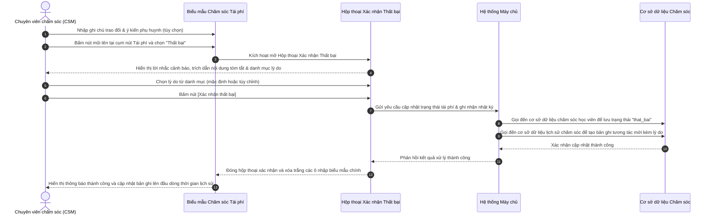

# US-CARE-02-04: Hộp thoại Xác nhận Thất bại Tái phí và Ghi nhận Lý do

> **Tham chiếu:** `BF-CARE-01` · `PERSONA-CSM` · `PERSONA-BRANCH-MANAGER`  
> **Đường dẫn màn hình & Trạng thái liên quan:**  
> - `/app/student_operations_alert` $\rightarrow$ Hộp thoại Chi tiết chăm sóc học viên $\rightarrow$ Tab Tái phí $\rightarrow$ Trình đơn chọn trạng thái $\rightarrow$ Mục "Thất bại"  
> - **Mã phân hệ:** `CAP-CARE` (Chăm sóc & Duy trì Học viên)  
> - **Giới hạn phạm vi (Scope Boundary):** Đặc tả này áp dụng duy nhất cho Hộp thoại xác nhận thất bại tái phí và luồng ghi nhận lý do vào nhật ký lịch sử chăm sóc. Các khối giao diện khác (như Thẻ chăm sóc, Bảng danh sách ngoài, Đơn hàng liên kết) tuân thủ tài liệu tương ứng.

---

## 1. NHẬT KÝ THAY ĐỔI & BỐI CẢNH (CHANGELOG & CONTEXT)

### Lịch sử cập nhật tài liệu (Changelog)

| Ngày cập nhật | Nội dung cập nhật | Lý do cập nhật |
|---|---|---|
| 13/10/2026 | Khởi tạo tài liệu đặc tả Hộp thoại Xác nhận thất bại tái phí và ghi nhận lý do chuẩn hóa vào lịch sử chăm sóc. | Chuẩn hóa quy trình chốt ca tái phí không thành công, ngăn ngừa thao tác nhầm lẫn, thu thập nguyên nhân rời bỏ học của học viên phục vụ thống kê phân tích đào tạo. |

### Bối cảnh & Vấn đề nghiệp vụ (Context & Problem)
* **Bối cảnh:** Tại phân hệ Chăm sóc học viên, khi học viên bước vào giai đoạn sắp hết khóa học (còn dưới 8 buổi), chuyên viên chăm sóc khách hàng (`PERSONA-CSM`) sẽ thực hiện chuỗi tương tác tư vấn gia hạn gói học mới tại Tab Tái phí.
* **Vấn đề trên giao diện trước đây:**
  1. *Nguy cơ bấm nhầm mất cơ hội tái phí:* Nhân viên khi mở danh sách trạng thái nếu bấm nhầm vào mục "Thất bại", hệ thống lập tức đóng ca hoặc chuyển trạng thái mà không có bước xác nhận kiểm tra lại.
  2. *Thiếu chuẩn hóa lý do rời bỏ học:* Khi ca tái phí thất bại, nhân viên ghi chú tự do, thiếu sự phân loại nguyên nhân cốt lõi (do tài chính, do trùng lịch, do chuyển nhà, hay do dịch vụ đào tạo), gây khó khăn cho việc thống kê báo cáo tỷ lệ tái tục của trung tâm.
  3. *Trùng lặp thao tác nhập liệu:* Các thiết kế hộp thoại cũ thường bắt nhân viên gõ lại toàn bộ nội dung ghi chú và ý kiến phụ huynh trong hộp thoại xác nhận dù trên biểu mẫu chính bên ngoài nhân viên đã vừa nhập xong.
* **Mục tiêu cải tiến:**
  - Cung cấp hộp thoại xác nhận tinh gọn (`RenewalFailureModal`), cảnh báo rõ ràng trước khi đóng ca tái phí là Thất bại.
  - Tự động hiển thị tóm tắt nội dung ghi chú và ý kiến phụ huynh đã nhập ở biểu mẫu chính để nhân viên đối soát, không bắt nhập lại.
  - Cung cấp danh mục lý do thất bại chuẩn hóa, kèm tùy chọn nhập lý do chi tiết khi cần thiết.
  - Ghi nhận vào nhật ký chăm sóc theo quy chuẩn hiển thị tinh tế: hiển thị dòng "Lý do: [Tên lý do]" riêng biệt, dòng ghi chú và phản hồi của phụ huynh nằm liền mạch trên một dòng, gắn thẻ `CGH` trang nhã không có từ ngữ tiêu cực.

### Hiểu người dùng & Tình huống sử dụng (User Needs & Use Cases)
* **Đối tượng sử dụng chính (Persona):** Chuyên viên chăm sóc khách hàng (`PERSONA-CSM`), Quản lý cơ sở (`PERSONA-BRANCH-MANAGER`).
* **Nhu cầu thực tế (Needs):** Cần một thao tác xác nhận an toàn trước khi chuyển trạng thái ca tái phí sang Thất bại, đồng thời chọn nhanh lý do chính xác chỉ với 1-2 thao tác nhấp chuột.
* **Tuyên bố giá trị:** **Là một** Chuyên viên chăm sóc khách hàng, **tôi muốn** có hộp thoại xác nhận kèm danh mục lý do khi chọn kết thúc thất bại ca tái phí, **để** tôi tránh bấm nhầm và đảm bảo dữ liệu lý do phụ huynh dừng học được lưu trữ đầy đủ, phục vụ cho công tác quản trị vận hành trung tâm.

---

## 2. LUỒNG XỬ LÝ CHÍNH (MAIN FLOW - HAPPY PATH)

---

## 3. CẤU TRÚC GIAO DIỆN & THÀNH PHẦN HỘP THOẠI (UI/UX DESIGN & DATA STRUCTURE)

### 3.1. Bố cục không gian của Hộp thoại (Visual Layout)
Hộp thoại có kích thước nhỏ gọn dạng nổi giữa màn hình, chiều rộng tối đa khoảng 448 điểm ảnh, có lớp nền mờ phủ phía sau. Cấu trúc gồm 4 phần:
1. **Đầu mục hộp thoại (Header):**
   - Biểu tượng cảnh báo hình tam giác màu đỏ cam đặt trong khung vuông bo tròn nhẹ.
   - Tiêu đề văn bản: `Xác nhận thất bại tái phí` chữ đậm màu tối.
2. **Khối Lời nhắc & Tóm tắt nội dung (Context Prompt & Summary):**
   - Đoạn văn bản cảnh báo: *"Bạn có chắc chắn muốn ghi nhận ca tái phí cho học viên [Tên học viên] là Thất bại và lưu vào lịch sử chăm sóc?"*.
   - Khối tóm tắt nội dung (chỉ xuất hiện nếu nhân viên đã nhập chữ ở biểu mẫu bên ngoài):
     + Dòng 1: Nhãn `Ghi chú đã nhập:` kèm nội dung tóm tắt (tối đa 2 dòng, cắt ngắn nếu dài).
     + Dòng 2: Nhãn `Ý kiến PH:` kèm nội dung phản hồi trong dấu ngoặc kép dạng chữ nghiêng.
3. **Khối Lựa chọn lý do thất bại (Reason Selection Area):**
   - Nhãn trường: `Lý do thất bại` kèm dấu sao đỏ bắt buộc `*`.
   - Ô chọn thả xuống: Chứa 7 lý do chuẩn hóa. Mặc định chọn sẵn lý do đầu tiên.
   - Ô nhập chi tiết bổ sung (chỉ hiển thị khi chọn `Lý do khác`): Ô nhập chữ 1 dòng có chữ gợi ý *"Nhập cụ thể nguyên nhân dừng học..."*.
4. **Chân mục hộp thoại (Footer Action Bar):**
   - Nút `Hủy`: Viền xám mỏng, chữ màu tối, nằm bên trái.
   - Nút `Xác nhận thất bại`: Nền màu đỏ nổi bật, chữ trắng đậm, nằm bên phải.

### 3.2. Bảng Tổng hợp Đặc tả Thành phần & Nút tác vụ trong Hộp thoại (Unified Component & Action Specification)

| STT | Thành phần / Phần tử | Phân loại | Bắt buộc | Kiểu hiển thị & Định dạng | Quy tắc hiển thị, kiểm duyệt & Xử lý nghiệp vụ | Mã Quyền Yêu Cầu |
|:---:|---|---|:---:|---|---|---|
| 1 | **Tiêu đề hộp thoại** | Nhãn cố định | Không | Biểu tượng cảnh báo tam giác đỏ cam kèm chữ `Xác nhận thất bại tái phí` | Nằm cố định ở đầu hộp thoại, nhận diện rõ thao tác quan trọng mang tính kết thúc ca | `care.renewal.view` |
| 2 | **Lời nhắc xác nhận** | Thông điệp ngữ cảnh | Không | Đoạn văn bản cảnh báo, in đậm tên học viên và chữ `Thất bại` màu đỏ | Cảnh báo rõ ràng hành động sẽ ghi nhận trạng thái Thất bại vào lịch sử chăm sóc | `care.renewal.view` |
| 3 | **Ghi chú đã nhập (Kế thừa)** | Dữ liệu tham chiếu | Không | Khung xám nhạt bo góc, chữ thường, tối đa 2 dòng hiển thị | Kế thừa từ ô ghi chú ngoài biểu mẫu chính; tự động ẩn hoàn toàn nếu bên ngoài để trống | `care.renewal.view` |
| 4 | **Ý kiến phụ huynh (Kế thừa)** | Dữ liệu tham chiếu | Không | Dòng trích dẫn chữ nghiêng đặt trong dấu ngoặc kép | Kế thừa từ ô ý kiến phụ huynh ngoài biểu mẫu chính; tự động ẩn hoàn toàn nếu để trống | `care.renewal.view` |
| 5 | **Lý do thất bại** | Trường dữ liệu nhập | **Có (*)** | Ô chọn thả xuống, danh sách 7 lý do chuẩn hóa | Bắt buộc chọn 1 lý do hợp lệ; mặc định chọn sẵn lý do đầu tiên (`relocation`) | `care.renewal.mark_failed` |
| 6 | **Chi tiết lý do khác** | Trường dữ liệu nhập | **Có (*)** *(khi chọn Lý do khác)* | Ô nhập chữ một dòng, tối đa 200 ký tự | Tự động mở và bắt buộc nhập khi lý do chọn là "Lý do khác"; tự động cắt khoảng trắng thừa | `care.renewal.mark_failed` |
| 7 | **Nút Hủy** | Nút tác vụ điều hướng | Không | Nút viền xám mỏng, chữ màu tối | Đóng hộp thoại ngay lập tức, không lưu dữ liệu, giữ nguyên trạng thái ca và nội dung biểu mẫu | `care.renewal.view` |
| 8 | **Nút Xác nhận thất bại** | Nút tác vụ thực thi | Không | Nút nền đỏ nổi bật, chữ trắng đậm | Bị vô hiệu hóa khi chọn "Lý do khác" mà ô chi tiết trống; khi bấm: chuyển trạng thái ca sang thất bại, lưu lịch sử kèm lý do, đóng hộp thoại, xóa biểu mẫu cha, thông báo thành công | `care.renewal.mark_failed` |

### 3.3. Danh sách 7 Lý do Thất bại Chuẩn hóa (Danh mục lựa chọn)

1. **Chuyển nơi sinh sống / Đi định cư nước ngoài (`relocation`):** Gia đình chuyển nhà, chuyển trường, chuyển tỉnh thành hoặc ra nước ngoài định cư $\rightarrow$ Không có nhu cầu tiếp tục theo học tại cơ sở. *(Ẩn ô nhập chi tiết)*.
2. **Trùng lịch học văn hóa / Không thu xếp được lịch (`schedule_conflict`):** Học viên vướng lịch học thêm văn hóa ở trường chính khóa, lịch ôn thi học kỳ, thi chuyển cấp $\rightarrow$ Tạm thời không sắp xếp được thời gian học ca tối/cuối tuần. *(Ẩn ô nhập chi tiết)*.
3. **Học phí / Điều kiện tài chính gia đình chưa phù hợp (`financial`):** Gia đình gặp khó khăn hoặc chưa thu xếp được ngân sách đóng học phí cho khóa học tiếp theo. *(Ẩn ô nhập chi tiết)*.
4. **Chuyển sang trung tâm khác / Học kèm gia sư (`competitor`):** Gia đình lựa chọn đổi phương pháp học tập hoặc chuyển sang học tại đơn vị đào tạo khác. *(Ẩn ô nhập chi tiết)*.
5. **Học viên tạm dừng học / Đã hoàn thành mục tiêu (`pause_study`):** Học viên đã đạt chứng chỉ đầu ra mong muốn hoặc gia đình cho con tạm nghỉ ngơi xả hơi sau kỳ học. *(Ẩn ô nhập chi tiết)*.
6. **Không liên lạc được phụ huynh sau nhiều lần liên hệ (`unreachable`):** Chuyên viên đã gọi điện nhiều lần không nhấc máy, nhắn tin Zalo không nhận được phản hồi. *(Ẩn ô nhập chi tiết)*.
7. **Lý do khác (Nhập chi tiết) (`other`):** Các nguyên nhân đặc thù khác ngoài 6 lý do chuẩn trên $\rightarrow$ **Tự động mở ô nhập chi tiết và bắt buộc chuyên viên phải điền cụ thể**.

---

## 4. KHỐI CHỨC NĂNG VÀ TIÊU CHÍ NGHIỆM THU (ACCEPTANCE CRITERIA)

### AC-01: Hiển thị hộp thoại và kiểm soát nhập lý do thất bại
* **Giả sử:** Chuyên viên chăm sóc đang ở Tab Tái phí, đã mở trình đơn trạng thái và nhấp chọn mục `Thất bại`.
* **Khi:** Hộp thoại xuất hiện và chuyên viên thực hiện chọn lý do.
* **Thì:**
  1. Hộp thoại mở ra dạng nổi kèm nền mờ, hiển thị câu nhắc xác nhận nêu rõ họ tên học viên và nội dung tóm tắt từ biểu mẫu chính (nếu có).
  2. Trường `Lý do thất bại` được chọn sẵn mục đầu tiên (`relocation`). Nếu chuyên viên chọn 1 trong 6 lý do chuẩn, ô nhập chi tiết được ẩn đi và nút `Xác nhận thất bại` luôn sẵn sàng bấm.
  3. Nếu chọn `Lý do khác (Nhập chi tiết)`, ô nhập chữ một dòng tự động mở ra kèm dấu sao đỏ bắt buộc; nút `Xác nhận thất bại` bị khóa mờ khi ô này trống và chỉ kích hoạt trở lại khi có ký tự thực.

---

### AC-02: Xác nhận thất bại thành công và cập nhật Lịch sử chăm sóc chuẩn hóa
* **Giả sử:** Chuyên viên đã có lý do hợp lệ và nhấp nút `Xác nhận thất bại`.
* **Khi:** Hệ thống hoàn tất ghi nhận vào cơ sở dữ liệu.
* **Thì:**
  1. Phân loại tái phí của học viên được cập nhật sang `that_bai`.
  2. Tạo bản ghi mới trên đầu dòng thời gian Lịch sử chăm sóc với thẻ `CGH` (không chứa chữ thất bại): Dòng 1 hiển thị riêng `Lý do: [Tên lý do đã chọn]`; Dòng 2 hiển thị nội dung ghi chú và ý kiến phụ huynh phản hồi trên cùng 1 dòng liền mạch.
  3. Hộp thoại tự động đóng lại, toàn bộ chữ trong ô ghi chú và ô ý kiến phụ huynh ở biểu mẫu cha được dọn sạch, hệ thống hiển thị thông báo thành công: `Đã xác nhận thất bại và ghi nhận vào lịch sử chăm sóc!`.

---

### AC-03: Hủy bỏ thao tác xác nhận thất bại
* **Giả sử:** Hộp thoại Xác nhận Thất bại đang mở trên màn hình.
* **Khi:** Chuyên viên nhấp nút `Hủy`, hoặc bấm phím `Esc`, hoặc nhấp chuột vào vùng nền mờ bên ngoài.
* **Thì:**
  1. Hộp thoại đóng lại ngay lập tức mà không gửi bất kỳ yêu cầu lưu nào đến máy chủ.
  2. Toàn bộ trạng thái ca tái phí và nội dung văn bản chuyên viên đang soạn thảo dở dang ở biểu mẫu chính được giữ nguyên vẹn 100%.

---

## 5. CÁC TRƯỜNG HỢP GÓC CẠNH (CORNER CASES)

*(Lưu ý: Chỉ bao gồm các tình huống rìa dữ liệu, sự kiện xung đột và ngoại lệ kỹ thuật, không lặp lại các quy tắc đã có trong tiêu chí nghiệm thu).*

* **[CASE-01] Biểu mẫu cha để trống khi chọn Thất bại:**
  - *Tình huống:* Chuyên viên không nhập bất kỳ câu chữ nào ở ô ghi chú hay ý kiến phụ huynh mà mở ngay trình đơn chọn `Thất bại`.
  - *Cách xử lý:* Hộp thoại tự động ẩn khung tóm tắt văn bản. Khi xác nhận, hệ thống tự động sinh câu ghi chú mặc định chuẩn hóa: *"Ghi nhận dừng học sau khi kết thúc khóa này."* đi kèm thẻ `[Lý do: ...]` để lưu lịch sử, đảm bảo bản ghi không bị rỗng.

* **[CASE-02] Bấm nút "Xác nhận thất bại" liên tiếp nhiều lần (Spam Click / Double-click):**
  - *Tình huống:* Chuyên viên nhấp chuột liên tục 2-3 lần vào nút `Xác nhận thất bại` do mạng chập chờn hoặc thói quen nhấp đúp.
  - *Cách xử lý:* Ngay sau cú nhấp đầu tiên, nút kích hoạt cờ khóa xử lý (`isSubmitting = true`), vô hiệu hóa mọi cú nhấp tiếp theo trong lúc máy chủ đang xử lý, đảm bảo chỉ tạo duy nhất 1 bản ghi lịch sử.

* **[CASE-03] Đang trong phiên cuộc gọi thoại mà bấm xác nhận thất bại:**
  - *Tình huống:* Phụ huynh từ chối ngay trong cuộc gọi thoại, chuyên viên mở hộp thoại xác nhận khi banner cuộc gọi vẫn đang kết nối đếm giây.
  - *Cách xử lý:* Khi xác nhận thất bại thành công, hệ thống tự động ngắt kết nối cuộc gọi, ẩn banner cuộc gọi và ghi nhận đúng kênh tương tác của bản ghi lịch sử là `Đã gọi`.

* **[CASE-04] Học viên đang có đơn hàng liên kết chưa thanh toán khi đóng ca thất bại:**
  - *Tình huống:* Trước đó chuyên viên đã liên kết một đơn hàng dự kiến tái phí vào học viên, nhưng phụ huynh từ chối tiếp tục khóa học.
  - *Cách xử lý:* Ca chăm sóc chuyển sang thất bại kèm lý do; bản ghi lịch sử thất bại không tự động gắn trạng thái hoàn tất đơn hàng, đồng thời hệ thống giữ đơn hàng ở trạng thái chưa hoàn thành hoặc ngắt liên kết theo quy tắc vận hành tái phí.

* **[CASE-05] Chuyển đổi qua lại giữa "Lý do khác" và các lý do chuẩn:**
  - *Tình huống:* Chuyên viên đã nhập văn bản vào ô "Chi tiết lý do khác", sau đó đổi ý chọn sang một lý do chuẩn trong danh mục.
  - *Cách xử lý:* Hệ thống ẩn ngay ô nhập chi tiết và tạm thời xóa sạch chuỗi văn bản đã gõ; khi gửi lưu hệ thống chỉ dùng đúng lý do chuẩn đã chọn mà không gửi kèm chuỗi văn bản thừa trước đó.

---

## 6. QUY TẮC PHÂN QUYỀN VÀ TRUY CẬP (AUTHORIZATION RULES)

- Phân quyền theo Năng lực nguyên tử (Capability-based Gating):
  + Quyền mở xem hộp thoại: `care.renewal.view`
  + Quyền xác nhận đóng ca thất bại và lưu lý do: `care.renewal.mark_failed`
  + Quyền ghi bản ghi tương tác vào nhật ký: `care.interaction.create`
- Không gán cứng vai trò quản trị viên hay nhân viên trong mã nguồn; việc ai được thao tác phụ thuộc hoàn toàn vào cấu hình phân quyền năng lực động của hệ thống.
