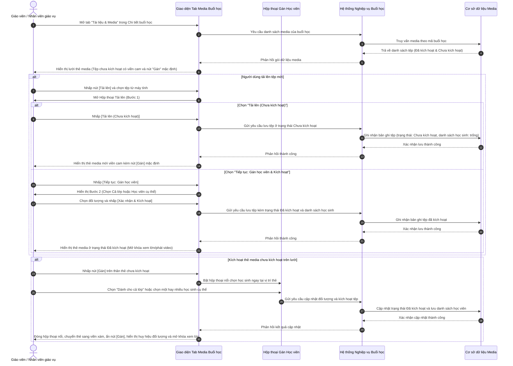

# US-CLS05-12: Nâng cấp Cơ chế Gán và Kích hoạt Media Buổi học (Class Session Media Assignment & Activation Update)

> **Tham chiếu:** `BF-CLS-05` · `US-CLS05-07` · `US-CLS05-11` · `SR-CLS-005` · `ENTERPRISE_STANDARDS.md` · Giao diện Mẫu §4.3 (Hộp thoại Chi tiết & Danh sách tư liệu đa phương tiện)  
> **Đường dẫn màn hình & Trạng thái liên quan:**  
> - `Lịch học trung tâm (/app/calendar_class_schedule)` -> Nhấp vào ca học lớp -> Mở Hộp thoại Chi tiết buổi học -> Chuyển sang thẻ tab `Tài liệu & Media`  
> - `Danh sách lớp học (/app/classes)` -> Mở Chi tiết lớp học -> Lịch trình buổi học -> Thẻ tab `Tài liệu & Media`  

---

## 1. NHẬT KÝ THAY ĐỔI & BỐI CẢNH (CHANGELOG & CONTEXT)

### Lịch sử cập nhật tài liệu (Changelog)

| Ngày cập nhật | Nội dung cập nhật | Lý do cập nhật |
|---|---|---|
| 22/10/2026 | Biên tập đặc tả nâng cấp cơ chế gán và kích hoạt media buổi học: Ảnh/video sau khi tải lên ở trạng thái Chưa kích hoạt, hiển thị nút Gán mặc định, khóa thao tác mở xem cho đến khi được gán cho Cả lớp hoặc Học viên cụ thể | Chuẩn hóa quy trình kiểm soát tư liệu buổi học, đảm bảo tư liệu được gắn đúng đối tượng trước khi kích hoạt hiển thị công khai |

### Bối cảnh & Mục tiêu điều chỉnh (Context & Objectives)
* **Bối cảnh nghiệp vụ:** Trong phân hệ Lịch học trung tâm, giáo viên (`PERSONA-TEACHER`) và nhân viên giáo vụ (`PERSONA-CSM`) thường xuyên tải ảnh và video hoạt động lớp học lên tab `Tài liệu & Media`. Trước đây, ảnh/video tải lên được tự động gán mặc định cho cả lớp và cho phép mở xem ngay, dẫn đến tình trạng các tư liệu riêng tư của từng học sinh bị hiển thị tràn lan hoặc giáo viên quên phân loại đối tượng thụ hưởng.
* **Mục tiêu điều chỉnh giao diện & tương tác:**
  - **Trạng thái Chưa kích hoạt (Inactive):** Toàn bộ hình ảnh/video sau khi tải lên (nếu chưa hoàn tất bước gán) sẽ nằm ở trạng thái Chưa kích hoạt. Thẻ media có viền cảnh báo màu cam nổi bật và bị khóa tính năng mở xem/phóng to/phát video.
  - **Nút "Gán" mặc định thường trực:** Trên thân thẻ chưa kích hoạt, luôn luôn hiển thị nút bấm `[Gán]` màu cam ở chính giữa mà không cần người dùng phải rê chuột.
  - **Cơ chế Kích hoạt có điều kiện:** Chỉ khi người dùng nhấp `[Gán]` và hoàn thành việc gán đối tượng (chọn `Dành cho cả lớp` hoặc chọn `Học viên cụ thể`), tệp mới chuyển sang trạng thái Đã kích hoạt, mở khóa xem ảnh lớn, phát video và hiển thị huy hiệu đối tượng tương ứng.
  - **Hộp thoại tải lên 2 bước:** Bổ sung tùy chọn tải lên lưu tạm ở trạng thái chưa kích hoạt hoặc chuyển tiếp ngay sang bước gán học viên để kích hoạt trực tiếp.
  - **Bộ lọc & Thao tác hàng loạt:** Hỗ trợ lọc riêng các tệp chưa kích hoạt và kích hoạt hàng loạt cho nhiều tệp cùng lúc.
* **Chỉ số đo lường hiệu quả (KPI Target):**
  - Tỷ lệ ảnh/video được gắn đúng đối tượng thụ hưởng trước khi công bố: Đạt 100%.
  - Thời gian thao tác gán học viên cho 1 tệp: Dưới 3 giây.
  - Khắc phục 100% tình trạng nhầm lẫn tư liệu giữa học sinh cá nhân và cả lớp.

### Hiểu người dùng & Tình huống sử dụng (User Needs & Use Cases)
* **Người dùng chính (Persona):** Giáo viên (`PERSONA-TEACHER`), Nhân viên giáo vụ / Chăm sóc học viên (`PERSONA-CSM`), Quản lý chi nhánh (`PERSONA-BRANCH-MANAGER`).
* **Nhu cầu thực tế (Needs):**
  - Giáo viên chụp nhiều ảnh hoạt động nhóm và ảnh bài làm cá nhân, muốn tải toàn bộ lên trước rồi phân loại gán cho từng em sau mà không lo ảnh bị lộ ngay cho cả lớp.
  - Giáo vụ cần lọc nhanh các ảnh chưa gán để hoàn tất kích hoạt trước khi gửi báo cáo học tập tháng cho phụ huynh.
* **Câu phát biểu nghiệp vụ:** **Là một** Giáo viên hoặc Nhân viên giáo vụ, **tôi muốn** các hình ảnh và video tải lên phải qua bước gán cho cả lớp hoặc cho học viên cụ thể thì mới kích hoạt mở xem được, **để** đảm bảo tư liệu học tập được phân bổ chính xác và an toàn thông tin cho học viên.

### Biểu mẫu đặc tả chi tiết các đối tượng điều chỉnh (Adjustment Specification Form)

| Đối tượng giao diện | Mô tả giao diện mới | Nội dung điều chỉnh | Nguồn dữ liệu | Hành vi tương tác & Phản hồi |
|---|---|---|---|---|
| **Thẻ Media ở trạng thái Chưa kích hoạt** | Thẻ media tỷ lệ 16:9 bo góc, viền ngoài màu cam nổi bật có quầng sáng nhẹ. Khung hiển thị ảnh/video bị làm mờ nhẹ. Ở chính giữa thân thẻ hiển thị thường trực một nút bấm tròn dẹt màu cam rực rỡ có dòng chữ `Gán` kèm biểu tượng thêm học sinh. Góc trên bên phải vẫn hiển thị nhãn loại tệp (`Ảnh`, `Video`). | • **Thêm mới:** Trạng thái Chưa kích hoạt với viền cảnh báo màu cam và nút `Gán` hiển thị mặc định thường trực tại trung tâm thẻ mà không cần rê chuột. • **Điều chỉnh:** Khóa toàn bộ thao tác mở xem ảnh phóng to hoặc phát video khi thẻ đang ở trạng thái này. • **Lược bỏ:** Lược bỏ cơ chế tự động kích hoạt và tự động gán cho cả lớp ngay sau khi tải lên của bản cũ. | Cơ sở dữ liệu tư liệu buổi học; trạng thái kích hoạt tệp được đánh dấu chưa kích hoạt khi mới tải lên. | Nhấp vào nút `Gán` hoặc nhấp vào bất kỳ vị trí nào trên thân thẻ sẽ mở hộp thoại nổi chọn học sinh; không cho phép mở xem phóng to hay phát video. |
| **Hộp thoại nổi Gán học viên đơn lẻ** | Hộp thoại nổi bo góc xuất hiện ngay dưới nút `Gán`. Đầu hộp thoại có tiêu đề `Gán học viên` kèm dòng phụ chú tên lớp học. Phía dưới là ô tìm kiếm học viên và danh sách cuộn gồm: dòng đầu tiên là `Dành cho cả lớp` kèm biểu tượng toàn cầu; tiếp theo là danh sách từng học sinh trong lớp (ảnh đại diện/chữ viết tắt, họ tên, mã học viên và ô chọn đánh dấu). | • **Thêm mới:** Hộp thoại nổi gán học viên nhanh trực tiếp ngay tại vị trí thẻ, thao tác tức thì không cần rời trang. • **Thêm mới:** Tách biệt rõ ràng giữa tùy chọn gán `Dành cho cả lớp` và gán cho từng `Học viên cụ thể`. • **Thêm mới:** Ô tìm kiếm học viên nhanh trong danh sách lớp. | Danh sách học viên chính thức trong danh sách lớp học của buổi học đang chọn. | Người dùng tích chọn `Dành cho cả lớp` hoặc chọn một hay nhiều học sinh; hệ thống lưu thiết lập, lập tức chuyển thẻ sang trạng thái Đã kích hoạt và tự động đóng hộp thoại nổi. |
| **Thẻ Media ở trạng thái Đã kích hoạt** | Thẻ media trở về viền xám tiêu chuẩn, độ sáng hình ảnh rõ nét. Nút `Gán` ở giữa biến mất. Góc dưới bên trái hiển thị huy hiệu đối tượng: Nếu gán cả lớp thì hiện huy hiệu `Cả lớp`; nếu gán học sinh thì hiện các chấm tròn viết tắt tên học sinh (`HA`, `NM`, `KN`) kèm nút gỡ nhanh `×`. Khi rê chuột vào thẻ, xuất hiện dải tác vụ gồm: nút Xem lớn/Phát video, nút Sao chép liên kết, nút Tải về, và nút Gắn thêm học viên. | • **Thêm mới:** Mở khóa toàn diện tính năng tương tác đa phương tiện: nhấp vào thẻ để mở hộp thoại xem ảnh lớn, phát video trực tiếp hoặc mở liên kết. • **Thêm mới:** Hiển thị trực quan các huy hiệu học sinh được gán ở góc dưới thẻ kèm nút gỡ nhanh `×`. • **Thêm mới:** Dải công cụ tác vụ nhanh xuất hiện khi rê chuột (Xem, Chia sẻ, Tải về, Gắn thêm). | Cơ sở dữ liệu tư liệu buổi học và danh sách học viên được gắn nhãn trên từng tệp. | Nhấp vào thân thẻ để mở xem phóng to / phát video; nhấp nút gỡ `×` trên huy hiệu để xóa gán học sinh; nhấp nút gắn thêm để bổ sung học viên. |
| **Hộp thoại Tải lên tư liệu đa phương tiện** | Cửa sổ hộp thoại 2 bước quy chuẩn: Bước 1 cho phép kéo thả hoặc chọn tệp từ thiết bị (tối đa 10 tệp/lần, ảnh/tài liệu tối đa 25MB, video tối đa 100MB), có 2 nút hành động ở chân: `Tải lên (Chưa kích hoạt)` và `Tiếp tục: Gán học viên & Kích hoạt`. Bước 2 hiển thị bảng chọn đối tượng (`Dành cho cả lớp` hoặc chọn danh sách học sinh) và nút `Xác nhận & Kích hoạt`. | • **Thêm mới:** Quy trình tải lên 2 bước có phân định rõ ràng giữa việc tải lưu tạm chưa kích hoạt và tải kèm kích hoạt ngay. • **Thêm mới:** Nút hành động `Tải lên (Chưa kích hoạt)` cho phép giáo viên tải nhanh nhiều ảnh lên trước rồi phân loại sau. • **Điều chỉnh:** Bước 2 cho phép gán đồng loạt toàn bộ tệp vừa tải lên cho cả lớp hoặc cho nhóm học viên chỉ bằng 1 thao tác. | Tệp dữ liệu chọn từ máy tính người dùng và danh sách học viên của lớp. | Nhấp `Tải lên (Chưa kích hoạt)` đưa các tệp lên thư viện ở trạng thái chưa kích hoạt; nhấp `Xác nhận & Kích hoạt` ở Bước 2 đưa tệp lên ở trạng thái đã kích hoạt. |
| **Bộ lọc theo Trạng thái & Học viên** | Hộp chọn thả xuống trên thanh công cụ tab Media. Danh sách lọc gồm: `Tất cả tệp`, tùy chọn nổi bật `Chưa kích hoạt (X)` hiển thị chấm tròn màu cam kèm số lượng tệp chưa gán, tùy chọn `Dành cho cả lớp`, và danh sách từng học sinh trong lớp. | • **Thêm mới:** Tùy chọn lọc chuyên biệt `Chưa kích hoạt (X)` trên thanh công cụ giúp gom nhanh toàn bộ các tệp cần xử lý gán đối tượng. • **Thêm mới:** Số lượng đếm tệp chưa kích hoạt hiển thị trực tiếp ngay trên dòng tùy chọn lọc. • **Điều chỉnh:** Hỗ trợ lọc đồng thời theo từng học sinh hoặc xem riêng tệp của cả lớp. | Tổng hợp số lượng tệp media của buổi học phân theo trạng thái và đối tượng được gắn. | Nhấp chọn `Chưa kích hoạt` chỉ hiển thị các thẻ media có viền cam đang chờ gán; chọn `Tất cả tệp` để khôi phục hiển thị toàn bộ danh sách. |
| **Thanh công cụ Kích hoạt hàng loạt** | Khi người dùng tích chọn ô vuông trên 1 hoặc nhiều thẻ media (hoặc nhấp ô Chọn tất cả), thanh công cụ tự động xuất hiện cụm nút tác vụ: Nút `Xóa` và nút `Kích hoạt` (hoặc `Gắn HV`). Nếu trong các tệp được chọn có ít nhất 1 tệp chưa kích hoạt, nút hiển thị chữ `Kích hoạt` màu cam nổi bật; nhấp vào sẽ mở hộp thoại gán học viên hàng loạt. | • **Thêm mới:** Cơ chế nhận diện thông minh: tự động đổi nút tác vụ thành `Kích hoạt` màu cam khi có tệp chưa kích hoạt được chọn. • **Thêm mới:** Hộp thoại gán học viên hàng loạt cho phép kích hoạt cùng lúc nhiều hình ảnh/video chỉ trong 1 lần thao tác. • **Điều chỉnh:** Tự động cập nhật số lượng tệp đang thao tác trên tiêu đề hộp thoại nổi. | Danh sách các tệp media đang được người dùng tích chọn trên màn hình. | Nhấp nút `Kích hoạt`, chọn `Dành cho cả lớp` hoặc nhóm học sinh, hệ thống chuyển toàn bộ các tệp đã chọn sang trạng thái đã kích hoạt cùng lúc. |

### Phạm vi kiểm soát & Ràng buộc nghiệp vụ (Scope & Business Rules)
* **Phạm vi kiểm soát (Feature Scope):**

| Mã Yêu Cầu | Hạng mục chức năng | Mức ưu tiên | Phạm vi hiển thị | Mô tả chi tiết |
|---|---|---|---|---|
| **REQ-MED-01** | Trạng thái Chưa kích hoạt và nút Gán mặc định | Bắt buộc (Must) | Lưới thẻ Media | Ảnh/video mới tải lên ở trạng thái chưa kích hoạt, hiển thị nút Gán mặc định, khóa mở xem |
| **REQ-MED-02** | Hộp thoại nổi gán học viên và cơ chế chuyển đổi kích hoạt | Bắt buộc (Must) | Nổi tại thẻ Media | Cho phép chọn Cả lớp hoặc Học viên cụ thể; hoàn tất gán sẽ chuyển tệp sang Đã kích hoạt |
| **REQ-MED-03** | Thẻ media đã kích hoạt kèm huy hiệu và dải tác vụ | Bắt buộc (Must) | Lưới thẻ Media | Mở khóa xem/phát media; hiển thị huy hiệu Cả lớp hoặc chữ cái học sinh kèm nút gỡ nhanh |
| **REQ-MED-04** | Hộp thoại tải lên 2 bước hỗ trợ lưu chưa kích hoạt | Bắt buộc (Must) | Hộp thoại nổi giữa màn hình | Hỗ trợ tải nhanh chưa kích hoạt hoặc chuyển sang Bước 2 gán đối tượng để kích hoạt ngay |
| **REQ-MED-05** | Bộ lọc tệp chưa kích hoạt và kích hoạt hàng loạt | Bắt buộc (Must) | Thanh công cụ tab Media | Cung cấp tùy chọn lọc tệp chưa kích hoạt và nút kích hoạt hàng loạt khi chọn nhiều tệp |

* **Ràng buộc nghiệp vụ toàn cục (Global Rules):**
  - **[RULE-MED-01] Khóa quyền truy cập đối với tệp chưa kích hoạt:** Tệp ở trạng thái chưa kích hoạt tuyệt đối không được phép mở xem phóng to, không phát video và không chia sẻ liên kết ra bên ngoài. Chỉ người có thẩm quyền quản lý lớp mới nhìn thấy nút `[Gán]` để thao tác.
  - **[RULE-MED-02] Điều kiện tiên quyết để kích hoạt:** Một tệp media chỉ được chuyển sang trạng thái Đã kích hoạt khi thỏa mãn một trong hai điều kiện: (1) Được gán cho `Dành cho cả lớp`, HOẶC (2) Được gán cho ít nhất một học sinh có tên trong danh sách lớp.
  - **[RULE-MED-03] Chuyển đổi trạng thái khi gỡ hết học sinh:** Nếu một tệp đang gán cho học sinh cụ thể và người dùng thao tác gỡ bỏ toàn bộ các học sinh đó khỏi tệp, tệp sẽ tự động quay trở về trạng thái Chưa kích hoạt, hiển thị lại viền cam và nút `[Gán]` mặc định.
  - **[RULE-MED-04] Giới hạn tệp tải lên:** Mỗi lượt tải lên cho phép tối đa 10 tệp; dung lượng hình ảnh và tài liệu tối đa 25MB/tệp; dung lượng video tối đa 100MB/tệp.
  - **[RULE-MED-05] Không áp dụng cho buổi học chưa diễn ra:** Các buổi học có trạng thái chờ diễn ra hoặc lớp học chưa khai giảng không cho phép tải ảnh/video thực tế.

---

## 2. LUỒNG XỬ LÝ CHÍNH (MAIN FLOW - HAPPY PATH)

---

## 3. CẤU TRÚC GIAO DIỆN & TRƯỜNG THÔNG TIN (UI STRUCTURE & VALIDATION RULES)

### 3.1. Bảng mô tả trường thông tin giao diện (Fields & Controls Specification)

| Tên trường / Thành phần | Loại điều khiển | Bắt buộc | Nguồn dữ liệu | Quy tắc kiểm tra & Ràng buộc hiển thị |
|---|---|:---:|---|---|
| **Thẻ Media chưa kích hoạt** | Thẻ bao ngoài đa phương tiện | Có | Cơ sở dữ liệu media | Hiển thị viền cam nổi bật, khóa sự kiện mở xem ảnh/video, hiển thị nút `Gán` ở chính giữa. |
| **Nút "Gán" mặc định** | Nút hành động nổi | Có | Trạng thái tệp | Nền màu cam, chữ trắng in đậm kèm biểu tượng thêm học sinh; hiển thị thường trực tại tâm thẻ. |
| **Tùy chọn "Dành cho cả lớp"** | Dòng chọn đánh dấu trong hộp thoại nổi | Không | Danh mục lớp học | Đặt ở đầu danh sách; chọn mục này sẽ gán tệp cho toàn thể học viên và xóa các lựa chọn cá nhân. |
| **Danh sách học sinh lớp** | Danh sách chọn kèm ô đánh dấu | Không | Danh sách học viên của lớp | Cho phép chọn một hoặc nhiều học sinh; có ô tìm kiếm lọc nhanh theo tên hoặc mã học viên. |
| **Huy hiệu đối tượng đã gán** | Huy hiệu hiển thị chân thẻ | Có | Danh sách học sinh được gắn | Hiển thị nhãn `Cả lớp` hoặc chuỗi chấm tròn viết tắt tên học sinh (`HA`, `NM`) kèm nút gỡ nhanh `×`. |
| **Dải tác vụ khi rê chuột** | Cụm nút hành động nổi | Không | Phân quyền người dùng | Xuất hiện khi rê chuột vào thẻ đã kích hoạt: Xem lớn/Phát video, Sao chép liên kết, Tải về, Gắn thêm. |
| **Bộ lọc tệp chưa kích hoạt** | Mục chọn trong danh sách thả xuống | Không | Thống kê tệp buổi học | Hiển thị chấm tròn cam kèm số lượng tệp chưa kích hoạt; nhấp vào để lọc danh sách tương ứng. |
| **Nút "Kích hoạt" hàng loạt** | Nút bấm trên thanh công cụ | Không | Danh sách tệp được chọn | Tự động xuất hiện và đổi màu cam khi có ít nhất 1 tệp chưa kích hoạt được tích chọn. |

---

## 4. KHỐI CHỨC NĂNG & TIÊU CHÍ NGHIỆM THU (ACCEPTANCE CRITERIA)

#### AC-01: Hiển thị thẻ media ở trạng thái Chưa kích hoạt và khóa mở xem
* **Giả sử:** Buổi học có hình ảnh hoặc video mới tải lên chưa qua bước gán đối tượng.
* **Khi:** Giáo viên hoặc nhân viên giáo vụ truy cập vào tab `Tài liệu & Media`.
* **Thì:** Thẻ media hiển thị với viền cảnh báo màu cam nổi bật, ở chính giữa thân thẻ hiển thị thường trực nút bấm `[Gán]` màu cam; khi người dùng nhấp vào thân thẻ hoặc vùng xem trước thì hệ thống không mở xem phóng to hay phát video mà tự động mở hộp thoại nổi gán học viên.

#### AC-02: Gán đối tượng cho cả lớp để kích hoạt thẻ media
* **Giả sử:** Thẻ media đang ở trạng thái Chưa kích hoạt (viền cam, có nút `Gán`).
* **Khi:** Người dùng nhấp vào nút `[Gán]`, hộp thoại nổi mở ra và người dùng nhấp chọn mục `Dành cho cả lớp`.
* **Thì:** Hệ thống lưu trạng thái Đã kích hoạt cho tệp, viền thẻ chuyển về viền xám tiêu chuẩn, nút `[Gán]` ở giữa biến mất, góc dưới thẻ hiển thị huy hiệu `Cả lớp` kèm biểu tượng toàn cầu; người dùng có thể nhấp vào thẻ để mở xem ảnh lớn hoặc phát video bình thường.

#### AC-03: Gán đối tượng cho học sinh cụ thể để kích hoạt thẻ media
* **Giả sử:** Thẻ media đang ở trạng thái Chưa kích hoạt.
* **Khi:** Người dùng nhấp vào nút `[Gán]`, tìm kiếm và tích chọn 1 hoặc nhiều học sinh trong danh sách (Ví dụ: `Alex Nguyễn An`, `Phạm Dũng`).
* **Thì:** Hệ thống lưu danh sách học viên được gắn, chuyển thẻ sang trạng thái Đã kích hoạt; góc dưới thẻ hiển thị các chấm huy hiệu viết tắt tên học sinh (`A`, `PD`) kèm nút gỡ nhanh `×`; người dùng có thể mở xem ảnh phóng to hoặc phát video.

#### AC-04: Tải lên tư liệu qua tùy chọn "Tải lên (Chưa kích hoạt)"
* **Giả sử:** Người dùng đang mở Hộp thoại Tải lên tư liệu tại Bước 1 và đã chọn 3 tệp ảnh từ thiết bị.
* **Khi:** Người dùng nhấn nút `[Tải lên (Chưa kích hoạt)]`.
* **Thì:** Hệ thống tải 3 tệp lên và đưa vào thư viện ở trạng thái Chưa kích hoạt, hiển thị viền cam và nút `[Gán]` mặc định trên cả 3 thẻ; hiển thị thông báo hướng dẫn người dùng có thể gán học viên để kích hoạt sau.

#### AC-05: Tải lên tư liệu qua Bước 2 để gán đối tượng và kích hoạt ngay
* **Giả sử:** Người dùng đã chọn tệp tại Bước 1 của Hộp thoại Tải lên.
* **Khi:** Người dùng nhấp `[Tiếp tục: Gán học viên & Kích hoạt]`, chuyển sang Bước 2, chọn đối tượng thụ hưởng và nhấn `[Xác nhận & Kích hoạt]`.
* **Thì:** Hệ thống tải tệp lên và đưa thẳng vào danh sách ở trạng thái Đã kích hoạt, hiển thị đầy đủ huy hiệu đối tượng và mở khóa tính năng xem/phát ngay lập tức.

#### AC-06: Tự động chuyển về trạng thái Chưa kích hoạt khi gỡ toàn bộ học sinh
* **Giả sử:** Thẻ media đang ở trạng thái Đã kích hoạt và được gán cho 2 học sinh.
* **Khi:** Người dùng lần lượt nhấn nút gỡ `×` trên tất cả các huy hiệu học sinh của thẻ đó (hoặc mở hộp thoại gán và bỏ chọn hết học sinh).
* **Thì:** Hệ thống tự động chuyển thẻ media quay trở lại trạng thái Chưa kích hoạt, hiển thị lại viền cam và nút `[Gán]` mặc định, đồng thời khóa lại thao tác mở xem phóng to/phát video.

#### AC-07: Lọc danh sách tệp chưa kích hoạt trên thanh công cụ
* **Giả sử:** Trong buổi học có cả tệp đã kích hoạt và tệp chưa kích hoạt.
* **Khi:** Người dùng nhấp vào hộp chọn bộ lọc trên thanh công cụ và chọn mục `Chưa kích hoạt (X)`.
* **Thì:** Danh sách trên màn hình chỉ hiển thị các thẻ media đang ở trạng thái Chưa kích hoạt; số lượng đếm trên nhãn bộ lọc khớp chính xác với số thẻ hiển thị trên lưới.

#### AC-08: Kích hoạt hàng loạt cho nhiều tệp cùng lúc
* **Giả sử:** Người dùng tích chọn 3 thẻ media, trong đó có 2 thẻ đang ở trạng thái Chưa kích hoạt.
* **Khi:** Người dùng nhấp vào nút `[Kích hoạt]` màu cam trên thanh công cụ, chọn `Dành cho cả lớp` và nhấn xác nhận.
* **Thì:** Toàn bộ các thẻ được chọn lập tức chuyển sang trạng thái Đã kích hoạt, viền đổi về tiêu chuẩn và mở khóa xem lớn cho tất cả các tệp.

---

## 5. CÁC TRƯỜNG HỢP GÓC CẠNH & LUỒNG NGOẠI LỆ (CORNER CASES & EXCEPTION FLOWS)

- **[CASE-01] Nhấp vào thẻ media chưa kích hoạt để xem ảnh hoặc phát video:** Hệ thống chặn hành động mở khung xem phóng to hoặc phát video; thay vào đó, hệ thống tự động kích hoạt mở hộp thoại nổi gán học viên ngay tại vị trí thẻ để nhắc nhở người dùng hoàn thành bước gán.
- **[CASE-02] Buổi học chưa diễn ra hoặc lớp học chưa khai giảng:** Hệ thống làm mờ nút tải lên, hiển thị thông báo chỉ cho phép tải ảnh/video đối với các buổi học đã diễn ra hoặc đang diễn ra trong ngày; không phát sinh tệp chưa kích hoạt ở các buổi học tương lai.
- **[CASE-03] Đang mở hộp thoại nổi gán học viên nhưng nhấp chuột ra ngoài vùng hiển thị:** Hệ thống tự động đóng hộp thoại nổi, giữ nguyên trạng thái Chưa kích hoạt của thẻ mà không làm mất dữ liệu.
- **[CASE-04] Người dùng gỡ bỏ học sinh cuối cùng khỏi thẻ:** Hệ thống lập tức thu hồi trạng thái Đã kích hoạt, chuyển thẻ về trạng thái Chưa kích hoạt, bật lại viền cam và hiển thị nút `[Gán]` mặc định.
- **[CASE-05] Chọn cùng lúc nhiều tệp gồm cả tệp đã kích hoạt và tệp chưa kích hoạt:** Nút trên thanh công cụ tự động hiển thị chữ `Kích hoạt` màu cam; khi người dùng hoàn tất bước gán đối tượng trong hộp thoại nổi, toàn bộ các tệp được chọn đều được đồng bộ danh sách học sinh mới và các tệp chưa kích hoạt được chuyển sang trạng thái đã kích hoạt.
- **[CASE-06] Tải lên tệp vượt quá kích thước quy định (Ảnh/Tài liệu > 25MB hoặc Video > 100MB):** Hệ thống từ chối nhận tệp, hiển thị thông báo lỗi nêu rõ tên tệp và giới hạn dung lượng tương ứng, không đưa tệp lỗi vào danh sách.
- **[CASE-07] Học sinh trong lớp bị xóa hoặc chuyển lớp sau khi đã được gắn thẻ media:** Hệ thống vẫn bảo toàn hình ảnh trong buổi học lịch sử; tại vị trí huy hiệu học sinh hiển thị mã học viên kèm ghi chú học sinh đã chuyển lớp mà không làm mất liên kết tư liệu.

---

## 6. QUY CHUẨN PHI CHỨC NĂNG, MA TRẬN PHÂN QUYỀN & KẾT NỐI HỆ THỐNG (NON-FUNCTIONAL, PERMISSION & SYSTEM INTEGRATION)

### 6.1. Ma trận Phân quyền & An toàn thông tin (Permission & Security Matrix)
* **Bảo vệ quyền riêng tư học viên:** Việc khóa mở xem tệp chưa kích hoạt ngăn chặn nguy cơ nhân sự trung tâm vô tình trình chiếu hoặc chia sẻ các hình ảnh cá nhân nhạy cảm của học viên khi chưa được định danh rõ ràng.
* **Phân quyền thao tác:** Chỉ tài khoản có vai trò Quản lý chi nhánh, Giáo vụ hoặc Giáo viên được phân công giảng dạy buổi học mới có quyền thực hiện tải lên, gán học viên và xóa tệp media.

### 6.2. Kết nối dữ liệu & Hiệu năng hệ thống
* **Kết nối cơ sở dữ liệu:** Thao tác gán và kích hoạt gọi đến cơ sở dữ liệu tư liệu buổi học và danh sách phân bổ học viên; không thực hiện đồng bộ chéo sang các phân hệ không liên quan.
* **Thời gian đáp ứng:** Thao tác chuyển đổi trạng thái kích hoạt và cập nhật huy hiệu học sinh hoàn tất tức thì trên giao diện trong vòng dưới 150 phần nghìn giây.
