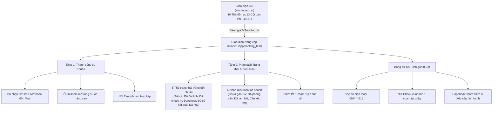

# US-ENR-01-07: Nâng cấp / Điều chỉnh Giao diện Danh sách Booking Test (Booking Test List Interface Upgrade)

> **Tham chiếu:** `BF-ENR-01` · `SR-PERSONA-STAFF` · Giao diện Mẫu §4.2 (Màn hình Danh sách & Thanh công cụ chuẩn theo mẫu TEMPLATE-US-UPGRADE)  
> **Đường dẫn màn hình & Trạng thái liên quan:**  
> - `Quản lý Đặt lịch (/app/booking_test)` -> Trạng thái chính: `Tất cả`, `Đã đặt lịch`, `Đã check-in`, `Đang test`, `Đã có kết quả`, `Đã hủy` | Điều kiện lọc phụ: `Chưa gán GV`, `Đã phỏng vấn`, `Đã làm bài`, `Cần xếp lớp`

---

## 1. NHẬT KÝ THAY ĐỔI & BỐI CẢNH (CHANGELOG & CONTEXT)

### Lịch sử cập nhật tài liệu (Changelog)

| Ngày cập nhật | Nội dung cập nhật | Lý do cập nhật |
|---|---|---|
| 05/11/2026 | **Phiên bản phát hành lần đầu (v1.0.0):** Biên tập tài liệu đặc tả các nội dung nâng cấp và điều chỉnh giao diện Danh sách Booking Test (/app/booking_test) theo mẫu TEMPLATE-US-UPGRADE: Đối chiếu toàn diện giữa hệ thống đang vận hành (sta.rinoedu.ai/booking-test) và phiên bản nâng cấp (Rinov5). Tái cấu trúc thanh công cụ 2 tầng; tách biệt dải thẻ trạng thái vòng đời (5 thẻ) và điều kiện lọc phụ (4 chip); tinh giản bảng dữ liệu từ 13 cột xuống 8 cột tích hợp; che số điện thoại bảo mật `091****111`; tích hợp thao tác 1 chạm Check-in và Hộp thoại Chấm điểm đánh giá năng lực. | Khắc phục tồn tại của màn hình cũ (dàn trải 13 cột gây cuộn ngang, gom lẫn trạng thái tiến trình và điều kiện lọc, lộ số điện thoại khách hàng và thiếu thao tác nhanh tại quầy). |

### Bối cảnh & Vấn đề nghiệp vụ (Context & Problem)

* **Bối cảnh vận hành:** Màn hình Danh sách Đặt lịch Đánh giá Năng lực (Booking Test) tại đường dẫn `/app/booking_test` là đầu mối vận hành quan trọng bậc nhất của bộ phận Tuyển sinh, Quản lý học vụ (CS/CSM), Quản lý giáo viên và Giáo viên khảo thí tại các trung tâm. Đây là nơi tiếp nhận thông tin học sinh đăng ký trải nghiệm/khảo thí từ hệ thống quản lý khách hàng (CRM), phân bổ giáo viên phỏng vấn, thực hiện check-in khi học sinh đến trung tâm, ghi nhận kết quả bài thi trên máy tính bảng cùng điểm số phỏng vấn để xếp cấp độ học tập phù hợp.
* **Tồn tại trên giao diện hệ thống hiện tại (sta.rinoedu.ai/booking-test):**
  1. *Thanh trạng thái dồn ứ và nhầm lẫn khái niệm:* Hệ thống cũ bố trí 10 thẻ trạng thái nằm phẳng trên cùng một hàng ngang, gom lẫn giữa **Trạng thái tiến trình vòng đời** (`Đã đặt lịch test`, `Đang đánh giá`, `Hoàn tất`) và **Điều kiện nghiệp vụ / Trạng thái ảo** (`Chưa gán GV`, `Đã check-in`, `Đã phỏng vấn`, `Đã làm bài`, `Không đạt`). Điều này gây nhầm lẫn nghiêm trọng cho nhân viên khi theo dõi luồng xử lý của ca khảo thí.
  2. *Bảng dữ liệu dàn trải 13 cột gây quá tải thị giác:* Bảng cũ tách rời quá nhiều cột dữ liệu: `Booking Trải nghiệm`, `Học viên`, `Liên hệ`, `Cơ sở`, `Giờ test`, `Trình độ`, `Nhánh TĐ`, `Speaking`, `LWR`, `Kết quả`, `Nhân sự`, `Ghi chú`, `Trạng thái`. Người dùng trên màn hình tiêu chuẩn liên tục phải cuộn ngang để xem hết thông tin.
  3. *Lỗ hổng bảo mật thông tin liên hệ:* Số điện thoại phụ huynh hiển thị công khai hoặc che sơ sài kèm nút gọi trần trụi, tiềm ẩn nguy cơ sao chép hàng loạt dữ liệu khách hàng ra bên ngoài.
  4. *Khóa cứng môn Toán học:* Nút chọn môn Toán trên hệ thống cũ bị vô hiệu hóa hoàn toàn, chưa hỗ trợ quy trình khảo thí môn Toán (chỉ làm bài trên máy tính bảng, không có phỏng vấn).
  5. *Thiếu công cụ tạo mới và lọc ca cá nhân:* Nhân viên vận hành tại trung tâm không thể bấm tạo nhanh lịch khảo thí trực tiếp trên giao diện mà phải chuyển sang hệ thống quản lý khách hàng; giáo viên cũng không có nút lọc nhanh các ca mình trực tiếp phụ trách.
  6. *Thiếu thao tác tiếp đón nhanh tại quầy:* Không có nút Check-in trực tiếp trên dòng danh sách, buộc nhân viên phải mở hộp thoại chi tiết rườm rà.

* **Giải pháp chuẩn hóa trên phiên bản nâng cấp (Rinov5 - /app/booking_test):**
  1. *Tái cấu trúc thanh công cụ 2 tầng trực quan:* Tách biệt các bộ lọc phạm vi (Cơ sở, Môn học, Tìm kiếm, Lọc nâng cao, Tạo mới) ở Tầng 1 và Dải trạng thái/điều kiện ở Tầng 2.
  2. *Phân tách rạch ròi Vòng đời và Điều kiện lọc:* Tách 10 thẻ cũ thành 5 Thẻ trạng thái tiến trình chính (`Tất cả`, `Đã đặt lịch`, `Đã check-in`, `Đang test`, `Đã có kết quả`, `Đã hủy`) và Cụm điều kiện lọc nhanh (`Chưa gán GV`, `Đã phỏng vấn`, `Đã làm bài`, `Cần xếp lớp`).
  3. *Tinh giản bảng dữ liệu từ 13 cột xuống 8 cột chuẩn hóa:* Gom các trường liên quan thành các cột tích hợp đa tầng thông tin (Học viên & Mã test, Phụ huynh & Liên hệ, Lịch hẹn & Cơ sở, Giáo viên phụ trách, Tiến độ, Điểm số & Cấp độ, Trạng thái, Thao tác nhanh).
  4. *Bảo mật thông tin khách hàng:* Tự động che số điện thoại dạng `091****111` trên toàn bộ bảng danh sách, chỉ cho phép xem đầy đủ khi có quyền mở màn hình chi tiết.
  5. *Tích hợp Check-in nhanh 1 chạm và Hộp thoại Chấm điểm 4 kỹ năng:* Giúp nhân viên tiếp đón học sinh chỉ trong 1 giây tại quầy và giáo viên nhập điểm tức thì.
  6. *Mở khóa khảo thí môn Toán học:* Hỗ trợ đầy đủ luồng thi môn Toán (tự động ẩn cột Speaking, chỉ lấy điểm máy tính bảng).
  7. *Tiếp nhận tự động ca test liên thông từ CRM:* Đồng bộ tức thì với nút `+ TRẢI NGHIỆM` trên tab VẬN HÀNH của hệ thống CRM (US-ENR-01-08).

### Mục tiêu & Giá trị mang lại (Goals & Value)

* Rút ngắn thời gian thao tác check-in tại quầy lễ tân từ 45 giây xuống dưới 2 giây nhờ nút thao tác 1 chạm.
* Giảm 60% thời gian xử lý và tìm kiếm ca test nhờ thanh công cụ 2 tầng và phím tắt cá nhân "Lịch của tôi".
* Triệt tiêu hoàn toàn tình trạng phải cuộn ngang màn hình trên máy tính xách tay tiêu chuẩn (1366x768 trở lên) nhờ tinh giản 13 cột xuống 8 cột.
* Bảo mật 100% dữ liệu số điện thoại phụ huynh, ngăn ngừa hành vi sao chép danh sách khách hàng trái phép.

### Chỉ số đo lường hiệu quả (KPI Target)

| Chỉ số KPI | Hiện trạng (sta.rinoedu.ai) | Mục tiêu sau nâng cấp (Rinov5) | Phương pháp đo lường |
|---|---|---|---|
| **Thời gian Check-in tại quầy** | 45 giây / lượt (phải mở popup) | &le; 2 giây / lượt | Bấm nút Check-in trực tiếp trên dòng danh sách |
| **Số cột hiển thị trên bảng** | 13 cột (bị cuộn ngang) | 8 cột chuẩn hóa | Đếm trực tiếp trên giao diện danh sách |
| **Tỷ lệ che bảo mật số điện thoại** | 0% (hiển thị trần trụi) | 100% dạng `091****111` | Kiểm thử dữ liệu trên toàn bộ các dòng bảng |
| **Thời gian nạp dữ liệu ban đầu** | ~2.5 giây | &le; 0.8 giây | Đo lường thời gian hiển thị 20 dòng đầu tiên |

### Hiểu người dùng & Tình huống sử dụng (User Needs & Use Cases)

* **Người dùng chính (Persona):**
  * `PERSONA-BRANCH-MANAGER` (Quản lý Cơ sở / Giám đốc chi nhánh): Nắm bắt tổng số lượng ca test trong ngày của cơ sở, phát hiện các ca chưa gán giáo viên để phân bổ kịp thời.
  * `PERSONA-CSM` (Quản lý Học vụ / Nhân viên Lễ tân): Tiếp đón học sinh tại quầy, bấm Check-in 1 chạm và hướng dẫn vào phòng thi.
  * `PERSONA-TEACHER` (Giáo viên Khảo thí): Sử dụng phím tắt "Lịch của tôi" để lọc danh sách các ca mình phụ trách, thực hiện phỏng vấn và nhập điểm xếp cấp độ.
* **Câu phát biểu nghiệp vụ (User Story):** **Là một** Quản lý Học vụ kiêm Lễ tân tại cơ sở, **tôi muốn** giao diện Danh sách Booking Test được tinh gọn thành 8 cột rõ ràng, tách bạch thẻ trạng thái tiến trình với bộ lọc điều kiện, có nút Check-in nhanh 1 chạm và tự động che số điện thoại phụ huynh, **để** tôi tiếp đón học sinh nhanh chóng trong 2 giây, không bị nhầm lẫn trạng thái và bảo vệ tuyệt đối thông tin khách hàng.

### Phạm vi kiểm soát (Feature Scope)

| Mã Yêu Cầu | Hạng mục nâng cấp | Mức ưu tiên | Phạm vi hiển thị | Mô tả chi tiết điều chỉnh |
|---|---|---|---|---|
| **REQ-UPG-01** | Tái cấu trúc thanh công cụ 2 tầng | Bắt buộc (Must) | Thanh công cụ | Tách bộ chọn Cơ sở, Môn học, Ô tìm kiếm lên Tầng 1; Dải trạng thái xuống Tầng 2 |
| **REQ-UPG-02** | Mở khóa khảo thí môn Toán học | Bắt buộc (Must) | Bộ chọn môn học | Cho phép chọn môn Toán; tự động ẩn điểm Speaking và chuyển sang quy trình thi máy tính bảng |
| **REQ-UPG-03** | Bổ sung phím tắt "Lịch của tôi" | Bắt buộc (Must) | Tầng 2 thanh công cụ | Nút bấm 1 chạm giúp giáo viên và nhân sự lọc nhanh các ca mình trực tiếp phụ trách |
| **REQ-UPG-04** | Phân tách Thẻ trạng thái & Điều kiện lọc | Bắt buộc (Must) | Tầng 2 thanh công cụ | Tách 10 thẻ cũ thành 5 thẻ tiến trình vòng đời và cụm điều kiện lọc phụ |
| **REQ-UPG-05** | Tinh giản bảng dữ liệu từ 13 cột xuống 8 cột | Bắt buộc (Must) | Bảng dữ liệu chính | Tích hợp các trường liên quan, loại bỏ các cột rườm rà, chống cuộn ngang màn hình |
| **REQ-UPG-06** | Che bảo mật số điện thoại phụ huynh | Bắt buộc (Must) | Cột 2 của bảng | Hiển thị dạng `091****111` kèm nút sao chép bảo mật, bỏ nút gọi điện thoại lộ liễu |
| **REQ-UPG-07** | Tích hợp nút Check-in 1 chạm tại dòng | Bắt buộc (Must) | Cột 8 của bảng | Cho phép bấm Check-in trực tiếp tại quầy trong 1 giây mà không cần mở hộp thoại |
| **REQ-UPG-08** | Hộp thoại Chấm điểm & Xếp cấp độ nhanh | Bắt buộc (Must) | Hộp thoại thao tác | Nhập điểm 4 kỹ năng, hệ thống tự động gợi ý cấp độ và ghi nhận nhận xét giáo viên |

### Ràng buộc nghiệp vụ toàn cục (Global Rules)

* **[RULE-BT-01] Bảo toàn dữ liệu & Không thay đổi xử lý hệ thống:** Việc nâng cấp chỉ điều chỉnh cấu trúc hiển thị, cách thức gom cột và thao tác tương tác trên giao diện, giữ nguyên các trường dữ liệu và cơ chế xử lý cốt lõi của hệ thống.
* **[RULE-BT-02] Che số điện thoại chống sao chép dữ liệu khách hàng:** Trên toàn bộ bảng danh sách, số điện thoại phụ huynh bắt buộc phải che 4 chữ số ở giữa theo định dạng `091****111`. Chỉ người dùng có thẩm quyền mở màn hình chi tiết mới được xem số điện thoại đầy đủ.
* **[RULE-BT-03] Thẻ trạng thái và số đếm đi theo toàn bộ bộ lọc:** Tất cả số lượng đếm trên 5 thẻ trạng thái vòng đời và các nhãn điều kiện phụ phải tự động tính toán lại theo tổ hợp bộ lọc đang áp dụng (Cơ sở, Môn học, Thời gian, Tìm kiếm).
* **[RULE-BT-04] Khóa cứng thời lượng ca khảo thí 30 phút:** Mỗi ca đánh giá năng lực được ấn định cố định thời lượng 30 phút (08:00 - 08:30, 08:30 - 09:00...). Không cho phép tùy biến thời lượng để tránh xô lệch lịch trực ca của giáo viên tại cơ sở.
* **[RULE-BT-05] Quy trình đặc thù theo môn học:**
  * Môn Tiếng Anh: Bao gồm bài thi trên máy tính bảng (LWR) và phỏng vấn trực tiếp với giáo viên (Speaking).
  * Môn Toán học: Chỉ làm bài thi trên máy tính bảng (LWR); tự động ẩn cột Speaking và thay bằng dấu `-`; tự động ẩn điều kiện lọc "Đã phỏng vấn".
* **[RULE-BT-06] Tiếp nhận ca test liên thông từ CRM:** Tự động hiển thị các ca khảo thí mới được đặt từ nút `+ TRẢI NGHIỆM` tại tab VẬN HÀNH của hệ thống CRM (US-ENR-01-08) ở trạng thái `Đã đặt lịch`.

---

## 2. LUỒNG XỬ LÝ & MÔ TẢ GIAO DIỆN ĐIỀU CHỈNH (PROCESS FLOW & UI ADJUSTMENT MATRIX)

### Giao diện tham chiếu: [http://localhost:3001/app/booking_test](http://localhost:3001/app/booking_test) (Đối chiếu với hệ thống cũ sta.rinoedu.ai/booking-test)

### Sơ đồ luồng xử lý nâng cấp:

### 2.1 Thanh công cụ & Bộ lọc nhanh (Toolbar & Filters) - Các điều chỉnh

| Thành phần giao diện | Loại hiển thị | Dữ liệu & Quy tắc | Diễn giải quy tắc | Nội dung điều chỉnh |
|---|---|---|---|---|
| **Bộ chọn Cơ sở** | Hộp chọn thả xuống chuẩn hóa | Danh sách cơ sở được phân quyền | Cho phép chọn 1 cơ sở hoặc `Tất cả cơ sở`. Đặt ở vị trí đầu tiên thanh công cụ. | **Điều chỉnh:** Đồng bộ hóa thành phần chọn cơ sở theo chuẩn giao diện mới, đặt ở vị trí ưu tiên đầu tiên của thanh công cụ. |
| **Bộ chọn Môn học** | Hộp chọn thả xuống | `Tất cả các môn`, `Tiếng Anh`, `Toán học` | Cho phép chuyển đổi môn học khảo thí. Mặc định là `Tiếng Anh`. Khi chọn `Toán học`, bảng tự động chuyển sang giao diện đặc thù cho môn Toán. | **Bổ sung:** Mở khóa hoàn toàn môn Toán học (hệ thống cũ bị khóa cứng), cho phép lọc và xử lý ca test môn Toán. |
| **Ô tìm kiếm mở rộng** | Ô nhập văn bản có nút co giãn | Từ khóa tìm kiếm tự do | Tìm kiếm tức thời khi nhập theo 6 trường: Tên học sinh, Tên phụ huynh, Số điện thoại, Mã ca test, Trường, Phòng học. | **Điều chỉnh:** Tích hợp ô tìm kiếm mở rộng có nút xóa nhanh, tự động dãn rộng mượt mà khi nhấp chuột. |
| **Nút Mở bộ lọc nâng cao** | Nút biểu tượng kèm huy hiệu số đếm | Số lượng tiêu chí lọc đang chọn | Nhấp để mở Bảng điều khiển lọc nâng cao trượt từ cạnh phải. Huy hiệu hiển thị tổng số tiêu chí đang kích hoạt. | **Điều chỉnh:** Hiển thị rõ số lượng điều kiện đang lọc giúp người dùng kiểm soát trạng thái dữ liệu. |
| **Nút "Tạo lịch test"** | Nút hành động chính màu xanh nổi bật | Nút bấm mở điều hướng hoặc hộp thoại | Đặt ở góc phải thanh công cụ. Nhấp để mở màn hình/hộp thoại đặt lịch khảo thí. | **Bổ sung:** Đưa nút tạo mới ca test trực tiếp lên giao diện trung tâm thay vì bắt buộc phải thao tác từ hệ thống CRM. |
| **Nút Tìm kiếm & Làm mới riêng lẻ** | Nút bấm cơ bản | Hành động kích hoạt lại | Hệ thống cũ yêu cầu bấm nút tìm kiếm sau khi nhập liệu. | **Lược bỏ:** Gỡ bỏ các nút bấm rườm rà; hệ thống tự động tìm kiếm tức thời và cập nhật tự động. |

### 2.2 Dải thẻ trạng thái & Điều kiện lọc - Các điều chỉnh

| Thành phần giao diện | Loại hiển thị | Dữ liệu & Quy tắc | Diễn giải quy tắc | Nội dung điều chỉnh |
|---|---|---|---|---|
| **Phím tắt "Lịch của tôi"** | Nút bấm dạng viên thuốc bo tròn | Số lượng ca test cá nhân phụ trách | Nhấp để bật/tắt lọc nhanh các ca do người dùng hiện tại phụ trách hoặc chấm điểm. Kèm số đếm động. | **Bổ sung:** Phím tắt 1 chạm giúp giáo viên và nhân viên khảo thí lọc việc cá nhân ngay lập tức. |
| **Dải 5 thẻ trạng thái tiến trình cốt lõi** | Khối thẻ tương tác hình chữ nhật bo góc | 5 trạng thái vòng đời chuẩn | Gồm: `Tất cả`, `Đã đặt lịch`, `Đã check-in`, `Đang test`, `Đã có kết quả`, `Đã hủy`. Nhấp thẻ để lọc; số đếm tự động cập nhật theo bộ lọc. | **Điều chỉnh:** Tách riêng 5 trạng thái vòng đời ra khỏi các điều kiện lọc phụ, chuẩn hóa màu sắc và số lượng đếm động theo bảng màu trung tâm. |
| **Dải điều kiện lọc phụ (Filter Chips)** | Dãy nhãn văn bản có thể nhấp chọn | 4 điều kiện nghiệp vụ can thiệp | Gồm: `Chưa gán GV`, `Đã phỏng vấn` (ẩn với môn Toán), `Đã làm bài`, `Cần xếp lớp`. Nhấp để lọc nhanh các ca cần can thiệp xử lý. | **Điều chỉnh:** Tách biệt thành cụm điều kiện lọc phụ riêng biệt, tự động ẩn điều kiện "Đã phỏng vấn" đối với môn Toán học. |
| **Dải 10 thẻ trạng thái dồn ứ phẳng** | Thanh hàng ngang 10 nút phẳng | Gom lẫn vòng đời và điều kiện ảo | Hệ thống cũ bố trí 10 nút nằm lẫn lộn gây hiểu lầm nghiêm trọng về quy trình. | **Lược bỏ:** Xóa bỏ hoàn toàn thanh 10 nút phẳng cũ, thay thế bằng mô hình 2 tầng thẻ chuẩn hóa. |

### 2.3 Bảng dữ liệu danh sách Booking Test (Tinh giản 8 cột chuẩn hóa) - Các điều chỉnh

| Cột dữ liệu mới | Loại hiển thị | Dữ liệu thành phần | Diễn giải quy tắc hiển thị | Nội dung điều chỉnh |
|---|---|---|---|---|
| **Cột 1: Học viên & Mã test** | Khối thông tin 2 dòng kèm ảnh đại diện | Avatar, Họ tên học sinh, Tuổi, Mã ca test, Huy hiệu môn | Dòng 1: Ảnh đại diện đa sắc, Họ tên học sinh (in đậm), tuổi/giới tính. Dòng 2: Mã ca test (ví dụ: `#BT-1024`) kèm huy hiệu môn học. | **Điều chỉnh:** Gom 2 cột `Booking Trải nghiệm` và `Học viên` của bản cũ thành 1 cột tích hợp đa tầng thông tin định danh. |
| **Cột 2: Phụ huynh & Liên hệ** | Khối thông tin 2 dòng kèm nút sao chép | Họ tên phụ huynh, Vai trò, Số điện thoại đã che bảo mật | Dòng 1: Tên phụ huynh kèm quan hệ trong ngoặc (Bố/Mẹ). Dòng 2: Số điện thoại che 4 số giữa dạng `091****111` kèm nút sao chép nhanh 1 chạm. | **Điều chỉnh:** Che số điện thoại bảo mật tuyệt đối, bỏ nút gọi điện thoại lộ liễu trần trụi, chống sao chép dữ liệu hàng loạt. |
| **Cột 3: Lịch hẹn & Cơ sở** | Khối thông tin 2 dòng có liên kết | Ngày thi, Khung giờ 30 phút, Tên cơ sở | Dòng 1: Thứ, Ngày/Tháng, Khung giờ thi (09:00 - 09:30). Dòng 2: Tên chi nhánh cơ sở nơi tổ chức đánh giá năng lực. | **Điều chỉnh:** Gom cột `Cơ sở` và `Giờ test` của bản cũ thành 1 cột thời gian - địa điểm trực quan. |
| **Cột 4: Giáo viên phụ trách** | Thẻ thông tin nhân sự có thể nhấp chọn | Họ tên giáo viên, Nhãn trạng thái phân công | Hiển thị họ tên đầy đủ của giáo viên khảo thí. Kèm nhãn `(bạn)` nếu trùng tài khoản đăng nhập. Nếu chưa gán: hiển thị nhãn cam nổi bật `Chưa gán`. Nhấp vào để mở hộp thoại đổi giáo viên. | **Điều chỉnh:** Hiển thị rõ ràng họ tên giáo viên thay vì chữ viết tắt mơ hồ; bổ sung nhãn cảnh báo `Chưa gán` giúp tránh bỏ quên. |
| **Cột 5: Tiến độ đánh giá** | Huy hiệu tiến trình 3 bước | Trạng thái tiếp đón, phỏng vấn và làm bài test | Hiển thị 3 mốc: Đã đến quầy (Check-in), Đã phỏng vấn Speaking, Đã làm bài test trên máy tính bảng LWR. Môn Toán tự động ẩn mốc Speaking. | **Điều chỉnh:** Thay thế việc phân tán thông tin sang nhiều cột thành 1 cụm tiến độ trực quan giúp nhân viên nắm bắt ca test đang ở khâu nào. |
| **Cột 6: Điểm số & Cấp độ** | Khối điểm tích hợp kèm nút mở xem | Điểm Speaking, Điểm LWR, Cấp độ đề xuất | Hiển thị điểm số phỏng vấn Speaking và điểm bài thi máy tính bảng LWR. Kèm cấp độ xếp lớp đề xuất. Nhấp để mở Hộp thoại Chấm điểm. | **Điều chỉnh:** Gom 3 cột riêng lẻ `Speaking`, `LWR`, `Kết quả` của bản cũ thành 1 cột điểm số & cấp độ đồng bộ. |
| **Cột 7: Trạng thái** | Huy hiệu trạng thái đơn lẻ | Trạng thái vòng đời chuẩn | Hiển thị 1 huy hiệu duy nhất với màu sắc chuẩn hệ thống: `Đã đặt lịch` (xanh dương), `Đã check-in` (xanh ngọc), `Đang test` (cam), `Đã có kết quả` (xanh lục), `Đã hủy` (đỏ/xám). | **Điều chỉnh:** Chuẩn hóa bảng màu trạng thái đơn nhất, loại bỏ nhãn văn bản thô sơ. |
| **Cột 8: Thao tác** | Cụm nút hành động nhanh | Nút Check-in, Nút Chấm điểm, Nút Thao tác thêm | Khi học sinh chưa check-in: hiển thị nút `Check-in` màu xanh ngọc nổi bật. Khi đã check-in: hiển thị nút `Chấm điểm`. Kèm menu 3 chấm chứa: Đổi lịch, Đổi giáo viên, Hủy ca test. | **Bổ sung:** Đưa nút bấm Check-in và Chấm điểm trực tiếp lên bảng giúp thao tác 1 chạm trong 1-2 giây. |
| **Các cột cũ bị lược bỏ** | Cột bảng riêng lẻ | Cột `Nhánh TĐ`, `Nhân sự 2`, `Ghi chú` dài | Các cột gây dàn trải và cuộn ngang màn hình trên hệ thống cũ. | **Lược bỏ:** Gỡ bỏ các cột riêng lẻ này; thông tin nhánh trình độ và ghi chú được xem qua hộp thoại chi tiết. |

### 2.4 Hộp thoại Chấm điểm & Thao tác nhanh - Các điều chỉnh

| Thành phần giao diện | Loại hiển thị | Dữ liệu & Quy tắc | Diễn giải quy tắc | Nội dung điều chỉnh |
|---|---|---|---|---|
| **Hộp thoại Check-in nhanh 1 chạm** | Nút bấm trên bảng + Thông báo nổi | Ghi nhận thời điểm học sinh đến quầy | Bấm trực tiếp trên cột Thao tác, không cần mở hộp thoại lớn, hệ thống tự động đổi trạng thái sang `Đã check-in`. | **Bổ sung:** Thao tác tiếp đón học sinh siêu tốc trong 1 giây tại quầy lễ tân. |
| **Hộp thoại Chấm điểm & Xếp cấp độ** | Hộp thoại tương tác popover/modal | Điểm 4 kỹ năng, Cấp độ đề xuất, Nhận xét | Cho phép giáo viên nhập điểm Speaking trực tiếp, xem điểm máy tính bảng LWR, hệ thống tự động gợi ý cấp độ phù hợp và lưu nhận xét. | **Điều chỉnh:** Tích hợp trực tiếp trên danh sách thay vì phải chuyển màn hình sang phân hệ học vụ khác. |
| **Hộp thoại Hủy ca khảo thí có lý do** | Hộp thoại xác nhận hành động | Danh mục lý do hủy + Ghi chú hủy | Bắt buộc nhập lý do khi hủy ca test để lưu vết kiểm soát. Hệ thống cập nhật trạng thái `Đã hủy`. | **Điều chỉnh:** Bổ sung cơ chế xác nhận có lý do rõ ràng trước khi hủy ca test để tránh hủy nhầm. |

---

## 3. MA TRẬN PHÂN QUYỀN NĂNG LỰC ĐỘNG (PERMISSION MATRIX)

| Vùng Giao diện / Nút Thao Tác | Loại Hiển Thị | Mã Quyền Yêu Cầu (Required Capability) | Xử Lý Khi Không Đủ Quyền |
|---|---|---|---|
| **Xem Danh sách ca khảo thí** | Toàn bộ bảng danh sách | `admissions.booking_test.view` | Chặn truy cập màn hình, hiển thị thông báo từ chối quyền |
| **Bộ chọn Cơ sở trung tâm** | Hộp chọn Cơ sở | `admissions.branch.switch` | Cố định ở cơ sở người dùng trực thuộc, khóa chọn cơ sở khác |
| **Nút Tạo lịch test trực tiếp** | Nút "Tạo lịch test" trên thanh công cụ | `admissions.booking_test.create` | Ẩn nút Tạo lịch test khỏi thanh công cụ |
| **Thực hiện Check-in tại quầy** | Nút Check-in tại cột Thao tác | `admissions.booking_test.checkin` | Vô hiệu hóa nút Check-in, hiển thị dạng văn bản chỉ đọc |
| **Chấm điểm & Xếp cấp độ** | Nút Chấm điểm và Hộp thoại nhập điểm | `admissions.booking_test.grade` | Chỉ cho phép xem điểm, khóa các ô nhập điểm và chọn cấp độ |
| **Phân bổ / Đổi Giáo viên** | Ô nhấp chọn tại cột Giáo viên | `admissions.booking_test.assign` | Khóa thao tác nhấp đổi giáo viên, chỉ hiển thị thông tin tĩnh |
| **Hủy ca khảo thí** | Tùy chọn Hủy ca trong menu thao tác | `admissions.booking_test.cancel` | Ẩn tùy chọn Hủy ca khỏi menu thao tác |

---

## 4. KHỐI CHỨC NĂNG CHI TIẾT: ACTION & TIÊU CHÍ NGHIỆM THU (ACTIONS & ACCEPTANCE CRITERIA)

### Khối chức năng 1: Thanh công cụ & Chuyển đổi bộ lọc nhanh

#### Action 1.1: Chuyển đổi Môn học từ Tiếng Anh sang Toán học
* **Luồng kích hoạt:** Người dùng nhấp vào ô chọn Môn học trên thanh công cụ và chọn `Toán học`.
* **Tiêu chí nghiệm thu (Acceptance Criteria):**
  - **AC-1 (Happy Path - Chuyển sang chế độ xem môn Toán học):**
    - **Giả sử:** Danh sách đang hiển thị các ca khảo thí môn Tiếng Anh với đầy đủ cột Speaking và LWR.
    - **Khi:** Người dùng nhấp chọn môn `Toán học`.
    - **Thì:** Bảng dữ liệu tự động làm mới, chỉ tải các ca khảo thí môn Toán; tại Cột 5 (Điểm số), mục điểm Speaking tự động thay bằng dấu `-`; dải điều kiện lọc phụ tự động ẩn mục "Đã phỏng vấn"; số đếm trên 5 thẻ trạng thái tự động cập nhật lại theo môn Toán.
  - **AC-2 (Happy Path - Khôi phục hiển thị môn Tiếng Anh):**
    - **Giả sử:** Danh sách đang ở chế độ xem môn Toán học.
    - **Khi:** Người dùng chọn lại `Tiếng Anh`.
    - **Thì:** Hệ thống khôi phục hiển thị đầy đủ điểm Speaking, điểm phỏng vấn giáo viên và hiển thị lại mục "Đã phỏng vấn" trên dải điều kiện lọc.

#### Action 1.2: Sử dụng phím tắt "Lịch của tôi"
* **Luồng kích hoạt:** Giáo viên hoặc nhân viên khảo thí nhấp vào nút "Lịch của tôi" trên thanh công cụ Tầng 2.
* **Tiêu chí nghiệm thu (Acceptance Criteria):**
  - **AC-3 (Happy Path - Lọc tức thì các ca cá nhân phụ trách):**
    - **Giả sử:** Người dùng đang đăng nhập với tài khoản giáo viên `Nguyễn Văn A`.
    - **Khi:** Người dùng nhấp nút "Lịch của tôi".
    - **Thì:** Nút nhận trạng thái kích hoạt (viền sáng nổi bật), bảng danh sách lập tức lọc và chỉ hiển thị các ca test mà giáo viên phụ trách chính là `Nguyễn Văn A` (các dòng có nhãn `(bạn)`); số lượng đếm trên nút khớp chính xác với số dòng hiển thị; khi nhấp lại lần nữa, hệ thống hủy lọc cá nhân và quay về danh sách chung.

---

### Khối chức năng 2: Thao tác Check-in nhanh 1 chạm tại quầy

#### Action 2.1: Nhấp nút Check-in trực tiếp tại Cột 8 (Thao tác)
* **Luồng kích hoạt:** Nhân viên lễ tân/CSM nhấp nút `Check-in` màu xanh ngọc trên dòng của học sinh vừa có mặt tại trung tâm.
* **Tiêu chí nghiệm thu (Acceptance Criteria):**
  - **AC-4 (Happy Path - Check-in thành công siêu tốc):**
    - **Giả sử:** Ca khảo thí đang ở trạng thái `Đã đặt lịch` và học sinh vừa có mặt tại quầy lễ tân.
    - **Khi:** Người dùng nhấp nút `Check-in` tại cột Thao tác của học sinh đó.
    - **Thì:** Hệ thống cập nhật trạng thái ca test sang `Đã check-in` trong vòng &le; 300 phần nghìn giây; huy hiệu trạng thái tại Cột 7 đổi sang màu xanh ngọc; nút thao tác tại Cột 8 tự động chuyển từ `Check-in` sang `Chấm điểm`; số đếm trên thẻ `Đã check-in` tự động tăng thêm 1 và hiển thị thông báo thành công ở góc màn hình.
  - **AC-5 (Luồng lỗi - Chặn check-in khi ca test đã bị hủy):**
    - **Giả sử:** Ca test đã bị phụ huynh báo hủy trước đó vài phút từ màn hình khác.
    - **Khi:** Người dùng bấm nút Check-in.
    - **Thì:** Hệ thống hiển thị thông báo cảnh báo: "Ca khảo thí này đã bị hủy, không thể thực hiện Check-in" và tự động tải lại dòng dữ liệu tương ứng.

---

### Khối chức năng 3: Phân bổ & Đổi Giáo viên phụ trách kèm kiểm tra trùng lịch

#### Action 3.1: Nhấp vào ô Giáo viên để gán hoặc đổi nhân sự
* **Luồng kích hoạt:** Người dùng nhấp vào tên giáo viên hoặc nhãn `Chưa gán` tại Cột 4.
* **Tiêu chí nghiệm thu (Acceptance Criteria):**
  - **AC-6 (Happy Path - Hiển thị danh sách giáo viên rảnh không trùng lịch):**
    - **Giả sử:** Ca khảo thí diễn ra vào khung giờ 09:00 - 09:30 ngày hôm nay tại Cơ sở Võ Thị Sáu.
    - **Khi:** Người dùng nhấp vào ô Giáo viên để mở hộp thoại chọn nhân sự.
    - **Thì:** Hộp thoại hiển thị danh sách giáo viên đang có lịch trực rảnh tại cơ sở đó; các giáo viên đang có lịch dạy lớp hoặc có ca test khác trùng khung giờ 09:00 - 09:30 tự động bị ẩn khỏi danh sách gợi ý đầu tiên.
  - **AC-7 (Happy Path - Cảnh báo khi tìm kiếm đích danh giáo viên bị trùng lịch):**
    - **Giả sử:** Giáo viên B đang có ca dạy lớp chính khóa trong khung giờ 09:00 - 09:30.
    - **Khi:** Người dùng nhập tìm kiếm tên "Giáo viên B" trong ô tìm kiếm của hộp thoại gán nhân sự.
    - **Thì:** Dòng tên Giáo viên B hiển thị ở trạng thái mờ (vô hiệu hóa) kèm nhãn đỏ cảnh báo: `Trùng ca dạy: [Tên lớp]`; hệ thống ngăn chặn không cho người dùng chọn giáo viên này.
  - **AC-8 (Happy Path - Gán nhân sự thành công):**
    - **Giả sử:** Người dùng nhấp chọn một giáo viên đang rảnh trong danh sách.
    - **Khi:** Người dùng xác nhận chọn.
    - **Thì:** Tên giáo viên lập tức được cập nhật vào Cột 4 của dòng bảng; ca test tự động thoát khỏi điều kiện lọc "Chưa gán GV"; số đếm của mục "Chưa gán GV" giảm đi 1.

---

### Khối chức năng 4: Chấm điểm & Xếp cấp độ nhanh

#### Action 4.1: Mở Hộp thoại Chấm điểm và nhập kết quả đánh giá
* **Luồng kích hoạt:** Giáo viên nhấp vào nút `Chấm điểm` tại Cột 8 hoặc nhấp vào ô điểm tại Cột 6.
* **Tiêu chí nghiệm thu (Acceptance Criteria):**
  - **AC-9 (Happy Path - Nhập điểm Speaking và lưu cấp độ thành công):**
    - **Giả sử:** Học sinh đã hoàn tất bài thi máy tính bảng (có điểm LWR) và vừa phỏng vấn xong với giáo viên.
    - **Khi:** Giáo viên mở hộp thoại Chấm điểm, nhập điểm Speaking (thang điểm 0.0 - 10.0), hệ thống tự động gợi ý cấp độ tương ứng (ví dụ: `Cambridge Flyers 1`); giáo viên chọn cấp độ và bấm "Lưu kết quả".
    - **Thì:** Hệ thống lưu điểm số và cấp độ thành công, cập nhật trạng thái ca test sang `Đã có kết quả` (màu xanh lục); điểm số và cấp độ hiển thị ngay tại Cột 6; ca test tự động chuyển sang điều kiện "Cần xếp lớp".
  - **AC-10 (Luồng lỗi - Chặn nhập điểm vượt quá thang điểm):**
    - **Giả sử:** Giáo viên nhập điểm Speaking là 12.5 hoặc số âm.
    - **Khi:** Người dùng rời khỏi ô nhập điểm hoặc bấm lưu.
    - **Thì:** Hệ thống báo lỗi: "Điểm số kỹ năng phải nằm trong khoảng từ 0.0 đến 10.0" và ngăn chặn lưu dữ liệu sai.

---

### Khối chức năng 5: Tiếp nhận Ca test Liên thông từ Nút Trải nghiệm CRM

#### Action 5.1: Tiếp nhận dữ liệu ca test mới được tạo từ CRM
* **Luồng kích hoạt:** Tư vấn viên tuyển sinh vừa hoàn tất tạo lịch khảo thí từ nút `+ TRẢI NGHIỆM` trên tab VẬN HÀNH của hệ thống CRM (US-ENR-01-08).
* **Tiêu chí nghiệm thu (Acceptance Criteria):**
  - **AC-11 (Happy Path - Ca test mới xuất hiện ngay trên danh sách):**
    - **Giả sử:** Chuyên viên tư vấn vừa bấm lưu thành công ca test cho học sinh `Bé Hà` từ đường dẫn `/booking-test?leadId=lead-010`.
    - **Khi:** Người dùng tại trung tâm mở hoặc làm mới màn hình Danh sách Booking Test (`/app/booking_test`).
    - **Thì:** Bản ghi ca test của `Bé Hà` hiển thị ngay ở đầu danh sách ở trạng thái `Đã đặt lịch`; đầy đủ thông tin tên học sinh, số điện thoại phụ huynh được che dạng `095****322`, môn học, khung giờ thi và tên cơ sở; số lượng đếm trên thẻ `Đã đặt lịch` tự động tăng thêm 1.

---

## 5. CÁC TRƯỜNG HỢP GÓC CẠNH & LUỒNG NGOẠI LỆ (CORNER CASES & EXCEPTION FLOWS)

### Nhóm 1: Khung hiển thị & Điều hướng dữ liệu
* **[CASE-01] Danh sách rỗng sau khi áp dụng tổ hợp bộ lọc:**
  * **Tình huống:** Người dùng chọn kết hợp nhiều điều kiện lọc hoặc nhập từ khóa tìm kiếm không khớp với bất kỳ ca test nào.
  * **Xử lý:** Bảng dữ liệu hiển thị thành phần trạng thái rỗng chuẩn với biểu tượng lịch biểu, tiêu đề `Không tìm thấy dữ liệu` và hướng dẫn người dùng điều chỉnh từ khóa tìm kiếm hoặc xóa bớt tiêu chí lọc.
* **[CASE-02] Số điện thoại phụ huynh bị khuyết hoặc có nhiều người thân liên hệ:**
  * **Tình huống:** Hồ sơ học sinh trên hệ thống chưa có số điện thoại phụ huynh hoặc có nhiều số liên lạc của cả bố và mẹ.
  * **Xử lý:** Nếu không có số, hiển thị dấu gạch ngang `-`; nếu có nhiều người thân, hiển thị tên người liên hệ chính và số điện thoại đã che, đồng thời hỗ trợ xem danh sách các thành viên gia đình khác trong màn hình chi tiết.
* **[CASE-03] Tiêu đề hoặc tên học sinh có độ dài vượt khung cột:**
  * **Tình huống:** Tên học sinh hoặc tên trường học quá dài vượt quá độ rộng thiết kế của cột bảng.
  * **Xử lý:** Dòng hiển thị tự động cắt bớt văn bản và hiển thị dấu ba chấm (`...`) ở cuối để không làm vỡ chiều cao dòng bảng; tên đầy đủ sẽ hiển thị trọn vẹn khi người dùng rê chuột vào tên học sinh.

### Nhóm 2: Ràng buộc Quy trình & Môn học đặc thù
* **[CASE-04] Ca test môn Toán học không có điểm phỏng vấn Speaking:**
  * **Tình huống:** Ca khảo thí được tạo cho môn Toán học, quy trình chuẩn chỉ bao gồm bài làm trên máy tính bảng.
  * **Xử lý:** Giao diện dòng bảng tự động ẩn component điểm Speaking và thay bằng ký tự `-`; dải điều kiện lọc phụ tự động ẩn mục "Đã phỏng vấn"; hộp thoại chi tiết chỉ hiển thị khối điểm máy tính bảng LWR và nút bấm xác nhận hoàn thành dành cho chuyên viên vận hành.
* **[CASE-05] Học sinh bắt đầu làm bài test trên máy tính bảng trước khi được bấm Check-in:**
  * **Tình huống:** Học sinh vào thẳng phòng khảo thí và mở bài làm trên máy tính bảng trong khi nhân viên lễ tân chưa kịp bấm nút Check-in trên máy tính.
  * **Xử lý:** Hệ thống máy chủ tự động ghi nhận tiếp đón và chuyển trạng thái ca test từ `Đã đặt lịch` sang `Đang test`; biểu tượng check-in tự động hiển thị cạnh tên học sinh trên bảng danh sách mà không cần nhân viên bấm thủ công.
* **[CASE-06] Ca test không gán giáo viên phụ trách tại thời điểm tạo:**
  * **Tình huống:** Ca test được tạo từ CRM ở chế độ `Chưa gán Phụ trách (Phân công sau)` để trung tâm điều phối sau.
  * **Xử lý:** Tại Cột 4, hệ thống hiển thị nhãn màu cam nổi bật `Chưa gán`; ca test tự động được gộp vào bộ lọc điều kiện "Chưa gán GV" để quản lý cơ sở lọc nhanh và chỉ định giáo viên trước ngày diễn ra ca test.

### Nhóm 3: Kiểm tra Trùng lịch & Ngoại lệ hệ thống
* **[CASE-07] Khung giờ kết thúc ca test chạm sát ca tiếp theo:**
  * **Tình huống:** Ca test kết thúc lúc 09:30 và giáo viên có một lớp học chính khóa bắt đầu lúc 09:30.
  * **Xử lý:** Thuật toán kiểm tra trùng lịch xác định giáo viên hoàn toàn khả dụng cho khung giờ từ 09:30 trở đi, không báo trùng lịch nhầm lẫn.
* **[CASE-08] Mất kết nối mạng khi đang thực hiện thao tác Check-in hoặc Chấm điểm:**
  * **Tình huống:** Người dùng bấm nút Check-in hoặc bấm lưu điểm đúng thời điểm đường truyền mạng bị gián đoạn.
  * **Xử lý:** Giao diện hiển thị thông báo lỗi kết nối tạm thời kèm nút "Thử lại"; toàn bộ dữ liệu điểm số giáo viên vừa nhập trong hộp thoại được giữ nguyên vẹn trên màn hình mà không bị xóa trắng.

---

## 6. RÀNG BUỘC & QUY TẮC KIỂM SOÁT DỮ LIỆU (VALIDATION RULES)

| Thành phần nhập liệu / Bộ lọc | Điều kiện kiểm soát | Định dạng dữ liệu | Thông báo xử lý khi sai phạm |
|---|---|---|---|
| **Bộ chọn Cơ sở** | Bắt buộc chọn đúng 1 cơ sở hoặc Tất cả cơ sở | Mã chi nhánh cơ sở hợp lệ | Cố định cơ sở nếu người dùng không có quyền xem liên chi nhánh |
| **Bộ chọn Môn học** | Bắt buộc chọn 1 môn học | Mã môn học trong danh mục hệ thống | Mặc định là Tiếng Anh nếu dữ liệu bị lỗi |
| **Từ khóa tìm kiếm** | Chiều dài tối đa 100 ký tự | Ký tự văn bản tự do | Bỏ qua các ký tự đặc biệt nguy hiểm |
| **Điểm số kỹ năng (Khi chấm điểm)** | Thang điểm từ 0.0 đến 10.0 (bước nhảy 0.5) | Số thực có 1 chữ số thập phân | Báo lỗi nếu nhập điểm âm hoặc vượt quá 10.0 |
| **Lý do hủy lịch** | Bắt buộc nhập khi hủy ca test | Văn bản tối thiểu 5 ký tự, tối đa 255 ký tự | Cảnh báo: "Vui lòng nhập lý do hủy ca test" |

---

## 7. YÊU CẦU PHI CHỨC NĂNG (NON-FUNCTIONAL REQUIREMENTS)

* **Hiệu năng hiển thị:** Thời gian nạp danh sách 20 bản ghi đầu tiên và thống kê số đếm thẻ &le; 0.8 giây trên đường truyền tiêu chuẩn.
* **Tốc độ phản hồi Check-in:** Thao tác nhấp nút Check-in và cập nhật giao diện hoàn tất trong &le; 300 phần nghìn giây.
* **Bảo mật dữ liệu cá nhân:** Số điện thoại phụ huynh trên bảng danh sách phải luôn được che ẩn ở giữa dạng `091****111` để ngăn ngừa rò rỉ hoặc sao chép hàng loạt.
* **Khả năng tương thích:** Tương thích tối ưu trên các trình duyệt máy tính phổ thông (Chrome, Edge, Safari, Firefox) với độ phân giải tối thiểu từ 1280px trở lên.

---

## 8. GIAO THỨC TRUYỀN DỮ LIỆU & KẾT NỐI HỆ THỐNG (DATA CONNECTION)

* **Yêu cầu nạp danh sách ca khảo thí:** Gọi đến cơ sở dữ liệu khảo thí với các tham số lọc: mã cơ sở, môn học, ngày khảo thí, trạng thái ca test, từ khóa tìm kiếm và số trang phân trang.
* **Yêu cầu cập nhật Check-in nhanh:** Gọi đến nghiệp vụ khảo thí để cập nhật trạng thái ca test sang `checked_in`, lưu vết thời điểm học sinh đến quầy và định danh nhân viên thực hiện.
* **Yêu cầu lưu điểm số đánh giá:** Gọi đến cơ sở dữ liệu kết quả khảo thí với gói dữ liệu: mã ca test, điểm từng kỹ năng, điểm tổng, nhận xét giáo viên và cấp độ học tập đề xuất.
* **Yêu cầu phân bổ giáo viên phụ trách:** Gọi đến cơ sở dữ liệu phân công khảo thí để cập nhật mã giáo viên kèm kiểm tra chéo không có xung đột lịch trực.
* **Yêu cầu hủy lịch ca test:** Gọi đến nghiệp vụ khảo thí để cập nhật trạng thái sang `cancelled` kèm lý do hủy và lưu vết người hủy.
* **Xử lý trạng thái phản hồi máy chủ:**
  * Thành công (200): Ghi nhận thành công, giao diện tự động cập nhật dòng dữ liệu và tính toán lại số đếm trên dải thẻ trạng thái.
  * Lỗi dữ liệu không hợp lệ (400): Dữ liệu gửi lên thiếu trường bắt buộc hoặc sai định dạng; hiển thị thông báo lỗi cụ thể.
  * Từ chối quyền truy cập (403): Người dùng không đủ thẩm quyền thực hiện thao tác; hiển thị thông báo cảnh báo không có quyền.
  * Lỗi máy chủ (500): Sự cố kết nối máy chủ; hiển thị thông báo lỗi hệ thống kèm nút thử lại mà không làm mất trạng thái lọc.
