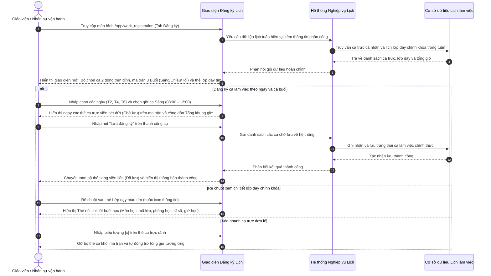

# US-HR-02-05: Nâng cấp Giao diện Đăng ký Lịch Làm việc - Bộ chọn ca theo buổi, Bỏ Khung giờ vàng & Hover xem chi tiết lớp dạy (Work Registration Interface Upgrade)

> **Tham chiếu:** `BF-HR-02` · `SR-PERSONA-STAFF` · Giao diện Mẫu §4.2 (Màn hình Danh sách & Thanh công cụ chuẩn)  
> **Đường dẫn màn hình & Trạng thái liên quan:**  
> - `Đăng ký lịch làm việc (/app/work_registration)` (Tab Đăng ký) -> Trạng thái ca làm việc: `Chờ lưu`, `Đã lưu`, `Lớp dạy` | Trạng thái tuần: `Chưa đăng ký`, `Có thay đổi chưa lưu`, `Đã lưu đăng ký`

---

## 1. NHẬT KÝ THAY ĐỔI & BỐI CẢNH (CHANGELOG & CONTEXT)

### Lịch sử cập nhật tài liệu (Changelog)

| Ngày cập nhật | Nội dung cập nhật | Lý do cập nhật |
|---|---|---|
| 23/10/2026 | Nâng cấp toàn diện cách đăng ký và lưu lịch tuần: Thay thế ma trận 30 phút dàn trải bằng Bộ chọn ca theo buổi (Sáng, Chiều, Tối); Bỏ hoàn toàn Khung giờ vàng; Tích hợp hiển thị thẻ Lớp dạy cố định kèm tính năng Rê chuột (Hover) xem chi tiết buổi học theo tuần hiện tại; Đưa nút Lưu đăng ký lên thanh công cụ phía trên | Khắc phục tình trạng thao tác thủ công tốn thời gian, loại bỏ nguy cơ giáo viên đăng ký ca trực đè lên lịch dạy lớp chính khóa, tối ưu hóa giao diện trực quan và giảm áp lực chỉ số |

### Bối cảnh & Mục tiêu điều chỉnh (Context & Objectives)

* **Bối cảnh nghiệp vụ:** Màn hình Đăng ký lịch làm việc (`/app/work_registration`, Tab Đăng ký) là nơi Giáo viên (`PERSONA-TEACHER`), Trợ giảng và Nhân viên vận hành chủ động đăng ký quỹ thời gian rảnh và ca trực khả dụng của mình trong từng tuần.
* **Tồn tại ở bản cũ:**
  1. *Thao tác thủ công, phân mảnh:* Ma trận thời gian bị xé nhỏ thành các ô rời rạc 30 phút (hơn 30 dòng từ 08:00 đến 22:00). Muốn đăng ký ca 4 tiếng (08:00 - 12:00), nhân sự phải nhấp chọn 8 ô riêng lẻ hoặc tích chọn thủ công từng ô kiểm, rất dễ nhầm lẫn.
  2. *Thiếu thông tin lịch dạy chính khóa:* Giao diện cũ không hiển thị lịch lớp dạy thực tế đã được giáo vụ xếp lịch, khiến giáo viên dễ bị "mù thông tin" và vô tình đăng ký ca trực trùng vào khung giờ mình đang đứng lớp.
  3. *Áp lực từ Khung giờ vàng:* Quy định về "Khung giờ vàng" (tỷ lệ bắt buộc theo giờ cao điểm) gây gò bó, không phản ánh đúng nhu cầu trực thực tế tại từng cơ sở.
  4. *Nút hành động chìm dưới chân trang:* Nút "Cập nhật đăng ký" nằm ở thanh nổi dưới đáy màn hình, dễ bị che khuất và tách rời khỏi khu vực thao tác chọn ca.
* **Mục tiêu nâng cấp trọng tâm (Phạm vi điều chỉnh):**
  1. **Thay đổi cách đăng ký và lưu lịch:**
     - Cung cấp cụm chọn ngày theo lô ở Dòng 1 (`T2` đến `CN`, `Cả tuần`).
     - Cung cấp cụm chọn ca làm việc ở Dòng 2 chia rõ 3 buổi: `Sáng` (chọn từ giờ đến giờ), `Chiều` (chọn từ giờ đến giờ), `Tối` (chọn từ giờ đến giờ) và nút `+ Thêm khung giờ`.
     - Chuyển ma trận lịch tuần thành 3 khối Buổi lớn: `BUỔI SÁNG (08:00 - 12:00)`, `BUỔI CHIỀU (13:00 - 17:30)`, `BUỔI TỐI (17:30 - 22:00)` kèm số lượng ca tuần trên từng buổi.
     - Ca làm việc hiển thị dưới dạng thẻ khối thời gian liên tục (`08:00 - 11:00`, `Cả buổi`), có nút `×` xóa nhanh.
     - Đưa nút `[Lưu đăng ký]` màu xanh và chỉ số `Tổng khung giờ` lên thanh công cụ trên cùng; lược bỏ hoàn toàn thanh chân trang nổi dưới đáy.
  2. **Bỏ Khung giờ vàng:** Lược bỏ toàn bộ khái niệm, biểu tượng sao và các chỉ số ràng buộc liên quan đến "Khung giờ vàng".
  3. **Hover xem thông tin buổi học theo lịch tuần hiện tại:**
     - Tích hợp trực tiếp thẻ Lớp dạy chính khóa màu tím cố định (khóa xóa, không có nút `×`).
     - Khi người dùng rê chuột (Hover) vào thẻ lớp dạy hoặc biểu tượng `(i)`: Hiển thị Thẻ nổi chi tiết buổi học (Tên lớp, mã lớp, môn học, phòng học, sĩ số, giờ học chuẩn xác).
* **Chỉ số đo lường hiệu quả (KPI Target):**
  - Thời gian hoàn tất đăng ký lịch tuần: Giảm từ 3.5 phút xuống dưới 40 giây (dưới 5 thao tác nhấp chuột).
  - Tỷ lệ trùng lấn giữa ca trực và lịch lớp dạy chính khóa: Đưa về 0%.
  - Tỷ lệ lỗi thao tác nhầm ô 30 phút: Giảm 100%.

### Ràng buộc nghiệp vụ toàn cục (Global Rules):

* **[RULE-WR-01] Bảo vệ tuyệt đối lịch lớp dạy chính khóa:** Lịch lớp dạy được đồng bộ tự động từ cơ sở dữ liệu xếp lớp của trung tâm và hiển thị ở chế độ chỉ đọc (Read-only). Người dùng không thể chỉnh sửa hoặc xóa lịch lớp dạy từ màn hình này.
* **[RULE-WR-02] Phân định rõ ràng trạng thái ca:** Thẻ ca trực mới chọn hiển thị viền nét đứt màu xanh lá (`Chờ lưu`). Chỉ khi người dùng bấm nút `Lưu đăng ký`, ca mới chuyển sang trạng thái `Đã lưu` chính thức với viền liền màu pastel.
* **[RULE-WR-03] Tính toán chỉ số thời gian thực:** Chỉ số `Tổng khung giờ` trên thanh công cụ và tổng số giờ trên đầu mỗi Thứ tự động tính toán lại tức thì khi người dùng chọn thêm ca mới hoặc xóa ca trực.
* **[RULE-WR-04] Tự động khấu trừ trùng giờ lớp dạy:** Nếu ca đăng ký mới chồng lấn một phần vào khung giờ lớp dạy chính khóa, hệ thống tự động khấu trừ phần giờ trùng và chỉ tạo ca trực cho khoảng thời gian còn trống, không cho phép hai ca đè lên nhau.
* **[RULE-WR-05] Khóa lịch sau thời hạn chốt tuần:** Sau thời điểm chốt lịch tuần của trung tâm (23:59 Chủ nhật), ma trận lịch chuyển sang trạng thái chỉ đọc, nút Lưu đăng ký bị vô hiệu hóa để bảo đảm tính ổn định vận hành.

---

## 2. LUỒNG XỬ LÝ CHÍNH (MAIN FLOW - HAPPY PATH)

---

## 3. MÔ TẢ GIAO DIỆN (UI DESCRIPTION & ADJUSTMENT MATRIX)

### Giao diện: Màn hình Đăng ký Lịch (`/app/work_registration`, Tab Đăng ký)

### 3.1 Bảng đặc tả chi tiết các đối tượng điều chỉnh

| Thành phần giao diện | Loại hiển thị | Dữ liệu & Quy tắc | Diễn giải quy tắc | Nội dung điều chỉnh |
|---|---|---|---|---|
| **Cụm chọn ngày trong tuần (Dòng 1)** | Dãy nút bấm độc lập dạng viên tròn | Danh sách 7 ngày trong tuần | Gồm các nút độc lập `T2`, `T3`, `T4`, `T5`, `T6`, `T7`, `CN` và nút `Cả tuần`. Bấm để bật/tắt chọn ngày áp dụng ca làm việc. | **Bổ sung:** Thay thế hoàn toàn việc tích chọn ô kiểm từng cột ở bản cũ bằng dãy nút chọn ngày nhanh theo lô. |
| **Chỉ số Tổng khung giờ (Dòng 1 bên phải)** | Nhãn văn bản kèm biểu tượng đồng hồ | Tổng thời lượng ca trong tuần (`totalMinutes`) | Đặt ở góc phải Dòng 1, hiển thị tổng thời gian định dạng `Tổng khung giờ: X giờ Y phút`. Tự động tính toán lại theo thời gian thực khi thêm hoặc xóa ca. | **Điều chỉnh:** Đưa từ thanh chân trang đáy màn hình lên thanh công cụ trên cùng giúp quan sát liên tục. |
| **Cụm chọn ca Sáng / Chiều / Tối (Dòng 2)** | Dãy 3 cặp hộp chọn giờ thả xuống | Khung giờ chuẩn theo từng buổi | Phân rõ 3 ca: `Sáng` (08:00 - 12:00), `Chiều` (13:00 - 17:30), `Tối` (17:30 - 22:00); có nút `+ Thêm khung giờ`. Bấm vào nhãn tên ca để bật nhanh trọn ca. | **Bổ sung:** Công cụ chọn giờ nhanh theo 3 buổi làm việc thay cho việc phải nhấp chọn thủ công từng ô 30 phút. |
| **Nút "Lưu đăng ký" (Dòng 2 bên phải)** | Nút hành động chính màu xanh nổi bật | Trạng thái có ca chờ lưu hay không | Đặt cạnh cụm chọn ca ở Dòng 2. Khi có ca chờ lưu, nút sáng rõ; nhấp để gửi toàn bộ dữ liệu đăng ký tuần về hệ thống. | **Điều chỉnh:** Chuyển từ thanh chân trang đáy màn hình lên thanh công cụ, đồng bộ ngay cạnh khu vực thao tác chọn giờ. |
| **Thanh chân trang đáy màn hình (Bản cũ)** | Thanh nổi màu trắng cố định chân trang | Tổng giờ và nút Cập nhật đăng ký | Ở bản cũ, thanh này chứa nút "Xóa tuần" và "Cập nhật đăng ký", chiếm diện tích và dễ bị che khuất. | **Lược bỏ:** Gỡ bỏ hoàn toàn thanh chân trang nổi dưới đáy; giao diện phẳng, thoáng đãng. |
| **Quy định "Khung giờ vàng" (Bản cũ)** | Biểu tượng ngôi sao và viền vàng ưu tiên | Chỉ số tỷ lệ ca cao điểm | Khái niệm khung giờ vàng gây gò bó và không cần thiết trong quy trình phân ca trực cá nhân. | **Lược bỏ:** Loại bỏ hoàn toàn Khung giờ vàng, không còn đánh dấu sao hay tính điểm ưu tiên giờ vàng. |
| **Ma trận phân nhóm 3 Buổi làm việc** | Khung bảng 7 cột chia 3 hàng buổi | Cấu hình ca làm việc của trung tâm | Bảng chia 3 khối lớn: `BUỔI SÁNG (08:00 - 12:00)`, `BUỔI CHIỀU (13:00 - 17:30)`, `BUỔI TỐI (17:30 - 22:00)`. Mỗi buổi có thống kê `Tổng ca tuần: X buổi (Yh)`. | **Bổ sung:** Thay thế hơn 30 dòng giờ rời rạc bằng 3 khối buổi làm việc gọn gàng, bao quát toàn diện. |
| **Thẻ Lớp dạy chính khóa (Màu tím)** | Thẻ thông tin cố định màu tím có biểu tượng sách | Dữ liệu thời khóa biểu xếp lớp | Hiển thị mã lớp (VD: `CLS-IELTS-031`), tên môn học, nhãn `Lớp dạy` và biểu tượng thông tin `(i)`. Khóa chỉ đọc, không có nút xóa. | **Bổ sung:** Hiển thị trực quan lịch lớp dạy trong tuần để giáo viên không bị đăng ký trùng giờ. |
| **Thẻ nổi chi tiết buổi học (Hover Card)** | Hộp thoại thông tin nổi khi rê chuột | Chi tiết buổi học trong tuần hiện tại | Xuất hiện khi rê chuột vào thẻ Lớp dạy tím hoặc biểu tượng `(i)`: Hiển thị tên lớp, môn học, trình độ, phòng học, chi nhánh, sĩ số và giờ dạy. | **Bổ sung:** Tính năng rê chuột xem thông tin chi tiết buổi học của tuần hiện tại giúp nắm bắt lịch trình giảng dạy. |
| **Thẻ Ca trực rảnh cá nhân** | Thẻ màu pastel bo góc theo buổi | Dữ liệu ca trực rảnh của nhân sự | Hiển thị khung giờ (VD: `08:00 - 11:00`, `Cả buổi`), nhãn `Trực ca` và biểu tượng `×` xóa nhanh ở góc trên bên phải. Phân biệt: viền nét đứt (Chờ lưu), viền liền (Đã lưu). | **Bổ sung:** Hiển thị ca trực dạng thẻ khối liên tục thay cho các ô nút bấm 30 phút rời rạc. |

---

## 4. KHỐI CHỨC NĂNG CHI TIẾT: ACTION & LUỒNG KÍCH HOẠT (ACTIONS & EVENTS)

### Khối chức năng 1: Đăng ký ca làm việc theo ngày và ca buổi

#### Action 1.1: Chọn ngày và chọn khung giờ ca làm việc
* **Luồng kích hoạt:** Người dùng nhấp chọn một hoặc nhiều ngày trong tuần (hoặc bấm `Cả tuần`), sau đó chọn giờ bắt đầu và kết thúc tại ca Sáng, Chiều hoặc Tối.
* **Tiêu chí nghiệm thu (Acceptance Criteria):**
  - **AC-1 (Happy Path - Chọn ngày và áp dụng ca theo buổi):**
    - **Giả sử:** Người dùng đang ở tab Đăng ký của màn hình Đăng ký lịch làm việc.
    - **Khi:** Người dùng nhấp chọn các nút `T2`, `T4`, `T6` và chọn khung giờ ca Sáng từ `08:00` đến `12:00`.
    - **Thì:** Các nút ngày chuyển sang trạng thái được chọn màu xanh, khung giờ ca Sáng được kích hoạt; các thẻ ca trực xuất hiện tức thì trên bảng ma trận tại Thứ 2, Thứ 4, Thứ 6 với đường viền nét đứt màu xanh lá thể hiện trạng thái `Chờ lưu`.
  - **AC-2 (Happy Path - Tính toán cộng dồn thời gian thời gian thực):**
    - **Giả sử:** Người dùng thay đổi lựa chọn ngày hoặc điều chỉnh giờ bắt đầu - kết thúc của một ca làm việc.
    - **Khi:** Thao tác chọn thay đổi hoàn tất.
    - **Thì:** Nhãn `Tổng khung giờ` trên thanh công cụ và tổng số giờ trên đầu mỗi cột Thứ tự động tính toán cộng dồn lại ngay lập tức, hiển thị chính xác tổng thời lượng dự kiến.
  - **AC-3 (Happy Path - Bỏ chọn nhanh cả tuần):**
    - **Giả sử:** Toàn bộ các ngày trong tuần đang được chọn ở Dòng 1.
    - **Khi:** Người dùng nhấp vào nút `Cả tuần` (đang ở trạng thái đã chọn).
    - **Thì:** Hệ thống bỏ chọn toàn bộ các ngày, đưa các nút ngày về trạng thái bình thường và ẩn các thẻ chờ lưu chưa được xác nhận trên ma trận.

---

### Khối chức năng 2: Lưu và gửi dữ liệu đăng ký tuần

#### Action 2.1: Nhấp nút Lưu đăng ký trên thanh công cụ
* **Luồng kích hoạt:** Người dùng nhấp chuột vào nút `[Lưu đăng ký]` màu xanh trên thanh công cụ phía trên.
* **Tiêu chí nghiệm thu:**
  - **AC-4 (Happy Path - Lưu đăng ký tuần thành công):**
    - **Giả sử:** Trên ma trận lịch có ít nhất một ca làm việc ở trạng thái `Chờ lưu` (viền nét đứt màu xanh lá).
    - **Khi:** Người dùng bấm nút `[Lưu đăng ký]`.
    - **Thì:** Hệ thống gửi dữ liệu đến cơ sở dữ liệu lịch làm việc, chuyển đổi toàn bộ các thẻ viền nét đứt sang viền liền màu pastel thể hiện trạng thái `Đã lưu`, hiển thị thông báo thành công và đặt lại bộ chọn ca về trạng thái sẵn sàng cho lượt tiếp theo.
  - **AC-5 (Unhappy Path - Chặn lưu khi không có ca mới):**
    - **Giả sử:** Người dùng chưa chọn bất kỳ ca làm việc mới nào và không có ca nào ở trạng thái chờ lưu.
    - **Khi:** Người dùng quan sát nút `[Lưu đăng ký]`.
    - **Thì:** Nút này ở trạng thái vô hiệu hóa (disabled) để ngăn chặn việc gửi yêu cầu rỗng đến hệ thống.

---

### Khối chức năng 3: Rê chuột xem thông tin chi tiết lớp học theo lịch tuần hiện tại

#### Action 3.1: Rê chuột vào thẻ Lớp dạy chính khóa
* **Luồng kích hoạt:** Người dùng di chuyển con trỏ chuột vào thẻ Lớp dạy màu tím hoặc biểu tượng thông tin `(i)` cạnh mã lớp.
* **Tiêu chí nghiệm thu:**
  - **AC-6 (Happy Path - Hiển thị Thẻ nổi chi tiết buổi học):**
    - **Giả sử:** Trên ma trận có một thẻ Lớp dạy màu tím (ví dụ: `CLS-IELTS-031 IELTS Intensive`).
    - **Khi:** Người dùng rê chuột vào thẻ này hoặc biểu tượng `(i)` và dừng lại trên 150 phần nghìn giây.
    - **Thì:** Hệ thống hiển thị mượt mà một Thẻ nổi (Hover Card) chứa đầy đủ thông tin buổi học theo lịch tuần hiện tại: Tên môn học, cấp độ đào tạo, phòng học tại cơ sở, sĩ số học viên và khung giờ giảng dạy chính thức; khi con trỏ chuột rời khỏi thẻ thì Thẻ nổi tự động ẩn đi.

---

### Khối chức năng 4: Xóa nhanh ca trực rảnh đơn lẻ

#### Action 4.1: Nhấp nút xóa trên thẻ ca trực
* **Luồng kích hoạt:** Người dùng nhấp vào biểu tượng `×` ở góc trên bên phải của một thẻ ca trực rảnh.
* **Tiêu chí nghiệm thu:**
  - **AC-7 (Happy Path - Xóa ca trực rảnh đơn lẻ):**
    - **Giả sử:** Trên ô lịch có một thẻ ca trực rảnh (trạng thái Chờ lưu hoặc Đã lưu).
    - **Khi:** Người dùng nhấp vào biểu tượng `×` trên thẻ đó.
    - **Thì:** Thẻ ca trực lập tức biến mất khỏi ma trận, chỉ số `Tổng khung giờ` tuần và tổng giờ của ngày đó tự động trừ đi thời lượng của ca vừa xóa.
  - **AC-8 (Happy Path - Bảo vệ thẻ Lớp dạy không bị xóa nhầm):**
    - **Giả sử:** Trên ma trận hiển thị thẻ Lớp dạy màu tím chính khóa.
    - **Khi:** Người dùng quan sát hoặc rê chuột vào thẻ lớp dạy này.
    - **Thì:** Thẻ hoàn toàn không có biểu tượng `×` xóa nhanh, con trỏ chuột không hiển thị dạng xóa, bảo vệ tuyệt đối lịch giảng dạy đã được phân công.

---

## 5. CÁC TRƯỜNG HỢP GÓC CẠNH & LUỒNG NGOẠI LỆ (CORNER CASES & EXCEPTION FLOWS)
*(Các tình huống phát sinh thực tế – Tuyệt đối không lặp lại các kịch bản chuẩn của AC)*

### **Nhóm 1: Xung đột thời gian & Tự động khấu trừ lịch dạy**
* **[CASE-01] Ca đăng ký mới chồng lấn một phần vào lịch lớp dạy đã được phân công:**
  * **Tình huống:** Người dùng chọn áp dụng ca Sáng `08:00 - 12:00` cho Thứ 2, nhưng sáng Thứ 2 đã có lớp học chính khóa được phân công từ `08:00 - 10:00`.
  * **Xử lý:** Hệ thống tự động phát hiện xung đột, giữ nguyên thẻ Lớp dạy `08:00 - 10:00`, và tự động cắt ngắn ca đăng ký mới thành `10:00 - 12:00` gắn nhãn `Trực ca` cho khoảng thời gian còn trống, tuyệt đối không tạo ca trực đè lên giờ dạy lớp.
* **[CASE-02] Đăng ký ca trực liền kề hoặc ca trực xuyên suốt giữa các buổi:**
  * **Tình huống:** Người dùng sử dụng nút `+ Thêm khung giờ` để đăng ký ca trực kéo dài từ `11:00` đến `14:00` (vừa thuộc cuối buổi Sáng, vừa thuộc đầu buổi Chiều).
  * **Xử lý:** Hệ thống tự động phân tách hiển thị thẻ theo đúng ranh giới của 2 buổi: phần `11:00 - 12:00` hiển thị ở khối Buổi Sáng, phần `13:00 - 14:00` hiển thị ở khối Buổi Chiều; tổng thời lượng được tính đúng 3 giờ mà không tạo ra bản ghi rác.
* **[CASE-03] Chọn giờ kết thúc nhỏ hơn hoặc bằng giờ bắt đầu:**
  * **Tình huống:** Tại ô chọn ca, người dùng chọn giờ bắt đầu là `10:30` nhưng ô giờ kết thúc đang là `09:00` hoặc người dùng cố tình chọn giờ kết thúc sớm hơn.
  * **Xử lý:** Hệ thống tự động điều chỉnh giờ kết thúc nhảy về mốc thời gian hợp lệ tối thiểu liền kề (ví dụ: `11:00`, cách 30 phút) để đảm bảo thời lượng ca luôn là số dương.

---

### **Nhóm 2: Biến động lịch xếp lớp từ bên ngoài & Đồng bộ dữ liệu**
* **[CASE-04] Lịch dạy của lớp bị đổi giờ hoặc hủy đột xuất ở hệ thống xếp lớp khi đang mở màn hình:**
  * **Tình huống:** Giáo vụ ở phân hệ xếp lớp thực hiện đổi lịch ca dạy của giáo viên từ sáng sang chiều trong khi giáo viên đang mở sẵn màn hình Đăng ký lịch làm việc.
  * **Xử lý:** Khi giáo viên thực hiện thao tác bất kỳ (chọn ngày hoặc bấm lưu), hệ thống tự động kiểm tra lại thời khóa biểu mới nhất: thẻ lớp dạy cũ được dời sang vị trí mới, khung giờ cũ được giải phóng thành ô trống để giáo viên có thể đăng ký ca trực nếu muốn.
* **[CASE-05] Thao tác lưu đăng ký khi tuần làm việc đã đến hạn chốt sổ của cơ sở:**
  * **Tình huống:** Giáo viên mở màn hình lúc 23:58 Chủ nhật, chọn các ca nhưng đến 00:02 Thứ 2 mới bấm nút `Lưu đăng ký` (đã quá thời hạn chốt tuần).
  * **Xử lý:** Hệ thống từ chối ghi nhận lưu trực tiếp, hiển thị thông báo "Tuần làm việc đã được chốt sổ vận hành. Vui lòng gửi yêu cầu điều chỉnh lịch đến Quản lý cơ sở", chuyển toàn bộ ma trận sang chế độ chỉ đọc và giữ lại các ca nháp để giáo viên tiện sao chép nội dung giải trình.

---

### **Nhóm 3: Tương tác hiển thị & Ngoại lệ đường truyền**
* **[CASE-06] Rê chuột lướt nhanh qua nhiều thẻ lớp dạy liên tiếp:**
  * **Tình huống:** Người dùng di chuyển con trỏ chuột nhanh qua lại giữa nhiều thẻ lớp dạy trong cùng một buổi.
  * **Xử lý:** Hệ thống áp dụng độ trễ kích hoạt 150 phần nghìn giây (debounce); Thẻ nổi chỉ xuất hiện khi con trỏ chuột dừng lại cố định tại một thẻ lớp học, ngăn chặn hiện tượng nhấp nháy liên tục nhiều bảng nổi gây khó chịu thị giác.
* **[CASE-07] Xóa nhầm ca trực và thực hiện hoàn tác tức thì:**
  * **Tình huống:** Người dùng vô tình nhấp nhầm biểu tượng `×` trên một ca trực đã lưu từ trước.
  * **Xử lý:** Hệ thống hiển thị thanh thông báo nhỏ ở góc dưới màn hình: "Đã xóa ca trực 08:00 - 11:00 [Hoàn tác]" trong vòng 5 giây; nếu người dùng nhấp `Hoàn tác`, ca trực được khôi phục nguyên vẹn ngay lập tức mà không cần phải chọn lại giờ.
* **[CASE-08] Gián đoạn kết nối mạng trong quá trình bấm "Lưu đăng ký":**
  * **Tình huống:** Người dùng bấm nút `Lưu đăng ký` đúng lúc đường truyền Internet bị ngắt.
  * **Xử lý:** Hệ thống hiển thị thông báo lỗi mạng kèm nút "Thử lại", giữ nguyên toàn bộ các thẻ ở trạng thái `Chờ lưu` trên giao diện, tuyệt đối không xóa mất các khung giờ người dùng vừa mất công thiết lập.

---

## 6. RÀNG BUỘC & QUY TẮC KIỂM SOÁT DỮ LIỆU (VALIDATION RULES)

| Thành phần giao diện / Bộ chọn | Điều kiện kiểm soát | Định dạng dữ liệu | Thông báo xử lý khi vi phạm |
|---|---|---|---|
| **Giờ bắt đầu & kết thúc ca** | Giờ kết thúc phải lớn hơn giờ bắt đầu tối thiểu 30 phút | Định dạng giờ `HH:mm` bước nhảy 30 phút | Tự động điều chỉnh giờ kết thúc về mốc liền kề hợp lệ |
| **Khung giờ ca chuẩn** | Sáng: `08:00 - 12:00` Chiều: `13:00 - 17:30` Tối: `17:30 - 22:00` | Thuộc danh mục khung giờ chuẩn của trung tâm | Giới hạn danh sách chọn theo từng buổi làm việc |
| **Bảo vệ thẻ Lớp dạy** | Không cho phép xóa hoặc sửa lịch lớp dạy chính khóa | Thẻ chỉ đọc (Read-only) | Khóa hoàn toàn, không hiển thị nút xóa `×` |
| **Trạng thái lưu lịch tuần** | Chỉ gửi dữ liệu khi có ít nhất 1 ca ở trạng thái Chờ lưu | Giá trị số lượng ca chờ lưu `> 0` | Vô hiệu hóa nút `Lưu đăng ký` khi danh sách trống |

---

## 7. YÊU CẦU PHI CHỨC NĂNG & PHÂN QUYỀN (NON-FUNCTIONAL & PERMISSION)

* **Ma trận Phân quyền theo Năng lực Nguyên tử (Atomic Capability Gating):**
  - Xem màn hình và lịch làm việc tuần: Yêu cầu quyền `hr.work_registration.view`.
  - Chọn ca và tạo ca trực mới: Yêu cầu quyền `hr.work_registration.create`.
  - Lưu và gửi dữ liệu đăng ký tuần: Yêu cầu quyền `hr.work_registration.submit`.
  - Xóa ca trực rảnh cá nhân: Yêu cầu quyền `hr.work_registration.delete`.
* **Hiệu năng & Trải nghiệm người dùng (Non-Functional Requirements):**
  - **Tốc độ phản hồi:** Thao tác chọn ngày, bật/tắt ca hoặc cộng dồn thời gian hoàn tất tức thì trong vòng dưới 100 phần nghìn giây trên giao diện.
  - **Tối ưu hiển thị:** Bảng ma trận 3 buổi vừa vặn trong màn hình máy tính chuẩn không cần cuộn dọc; trên màn hình nhỏ cho phép cuộn ngang mượt mà.
  - **Bảo toàn dữ liệu:** Không làm mất ca nháp khi người dùng thao tác chuyển đổi qua lại giữa các thứ trong cùng một phiên làm việc.

---

## 8. GIAO THỨC TRUYỀN DỮ LIỆU & KẾT NỐI HỆ THỐNG (DATA CONNECTION)

* **Yêu cầu nạp dữ liệu:** Gọi đến cơ sở dữ liệu lịch làm việc và cơ sở dữ liệu xếp lớp với các tham số: mã nhân viên, ngày bắt đầu tuần, ngày kết thúc tuần và mã chi nhánh.
* **Dữ liệu phản hồi chuẩn:**
  - Danh sách ca trực cá nhân: mã ca, ngày làm việc, giờ bắt đầu, giờ kết thúc, trạng thái ca (`draft` hoặc `registered`), nhãn ca (`Trực ca`).
  - Danh sách lớp học chính khóa: mã lớp, tên môn học, cấp độ, phòng học, giờ bắt đầu, giờ kết thúc, sĩ số học viên.
* **Xử lý trạng thái phản hồi:**
  - Thành công (200): Nạp lịch tuần thành công, hiển thị các khối buổi, thẻ lớp dạy tím và các thẻ ca trực chuẩn xác.
  - Không có lịch đăng ký: Hiển thị ma trận trống với các dấu gạch ngang `—` mờ tinh gọn.
  - Lỗi máy chủ (500): Hiển thị thông báo gián đoạn kết nối kèm nút tải lại trang.
