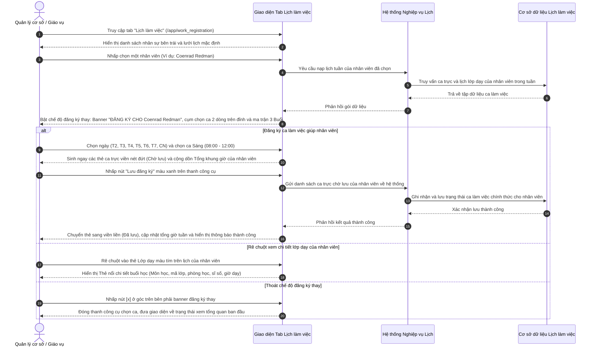

# US-HR-02-06: Nâng cấp Giao diện Đăng ký Lịch thay Nhân viên - Chế độ Đăng ký giúp, Bộ chọn ca theo buổi & Bỏ Khung giờ vàng (Staff Delegate Work Registration Upgrade)

> **Tham chiếu:** `BF-HR-02` · `US-HR-02-05` · `SR-PERSONA-STAFF` · Giao diện Mẫu §4.2 (Màn hình Danh sách & Thanh công cụ chuẩn)  
> **Đường dẫn màn hình & Trạng thái liên quan:**  
> - `Đăng ký lịch làm việc (/app/work_registration)` (Tab Lịch làm việc) -> Chọn nhân viên từ danh sách -> Chế độ Đăng ký thay -> Trạng thái ca: `Chờ lưu`, `Đã lưu`, `Lớp dạy` | Trạng thái tuần: `Chưa đăng ký`, `Có thay đổi chưa lưu`, `Đã lưu đăng ký`

---

## 1. NHẬT KÝ THAY ĐỔI & BỐI CẢNH (CHANGELOG & CONTEXT)

### Lịch sử cập nhật tài liệu (Changelog)

| Ngày cập nhật | Nội dung cập nhật | Lý do cập nhật |
|---|---|---|
| 23/10/2026 | Nâng cấp toàn diện chế độ đăng ký lịch giúp nhân viên: Chuyển đổi từ ma trận ô 30 phút dàn trải sang Bộ chọn ca theo buổi (Sáng, Chiều, Tối) tích hợp ngay trên banner đăng ký thay; Bỏ hoàn toàn Khung giờ vàng; Tích hợp hiển thị thẻ Lớp dạy cố định kèm tính năng Rê chuột (Hover) xem chi tiết buổi học của nhân viên; Đưa nút Lưu đăng ký lên thanh công cụ trên cùng | Tối ưu hóa năng lực điều phối của Quản lý cơ sở và Giáo vụ, rút ngắn 80% thời gian đăng ký lịch giúp nhân viên, loại bỏ hoàn toàn nguy cơ xếp ca trực đè lên lịch dạy chính khóa của giáo viên |

### Bối cảnh & Mục tiêu điều chỉnh (Context & Objectives)

* **Bối cảnh nghiệp vụ:** Trong phân hệ Quản lý nhân sự, Quản lý chi nhánh (`PERSONA-BRANCH-MANAGER`) và Nhân viên giáo vụ (`PERSONA-CSM`) thường xuyên phải thao tác đăng ký lịch làm việc, xếp ca trực bù hoặc điều chỉnh ca rảnh thay cho nhân viên (khi giáo viên báo lịch qua điện thoại/tin nhắn, hoặc quản lý cần chủ động bố trí nhân sự cho cơ sở).
* **Tồn tại ở bản cũ (Ảnh 2):**
  1. *Thao tác thủ công trên ma trận ô rời rạc:* Giao diện cũ hiển thị một bảng khổng lồ hơn 20 dòng chia theo các ca học 30-50 phút (`08:00 - 08:50`, `08:00 - 10:00 [GH]`, ...). Muốn đăng ký ca trực 4 tiếng cho nhân viên, quản lý phải nhấp chọn từng ô xanh riêng lẻ rất tốn thời gian.
  2. *Ràng buộc Khung giờ vàng gây phiền toái:* Biểu tượng `[GH]` (Giờ hoàng đạo / Khung giờ vàng) áp đặt tỷ lệ giờ cao điểm cứng nhắc, không phù hợp khi quản lý cần linh hoạt điều phối ca trực theo nhu cầu phát sinh thực tế.
  3. *Thiếu thông tin lịch lớp dạy thực tế:* Quản lý không nhìn thấy lịch giảng dạy chính khóa của nhân viên ngay trên ma trận, dễ dẫn đến việc xếp ca trực trùng vào khung giờ giáo viên đang đứng lớp.
  4. *Nút hành động chìm dưới đáy chân trang:* Nút `Cập nhật đăng ký` và `Xóa tuần` nằm ở thanh chân trang cố định dưới cùng, tách rời khỏi khu vực chọn ca và dễ bị khuất tầm nhìn.
* **Mục tiêu nâng cấp trọng tâm (Phạm vi điều chỉnh chế độ chọn và đăng ký cho nhân viên):**
  1. **Khối công cụ Đăng ký thay chuyên biệt trên đỉnh:**
     - Khi chọn một nhân sự từ danh sách, xuất hiện banner nổi bật: `ĐĂNG KÝ CHO [Tên nhân sự]` (Ví dụ: `ĐĂNG KÝ CHO Coenrad Redman`) kèm nút thoát nhanh `[×]`.
     - Dòng 1: Chọn ngày theo lô (`T2` đến `CN`, `Cả tuần`), góc phải hiển thị `Tổng khung giờ: XX giờ` của nhân viên đó.
     - Dòng 2: Cụm chọn ca 3 buổi gồm `Sáng` (chọn từ giờ đến giờ), `Chiều` (chọn từ giờ đến giờ), `Tối` (chọn từ giờ đến giờ) và nút `+ Thêm khung giờ`.
     - Nút hành động chính: Đưa nút `[Lưu đăng ký]` màu xanh lên bên phải Dòng 2; **lược bỏ hoàn toàn** thanh chân trang nổi dưới đáy màn hình.
  2. **Ma trận lịch tuần phân nhóm theo 3 Buổi trực quan:**
     - Ma trận chia 3 khối Buổi lớn: `BUỔI SÁNG (08:00 - 12:00)`, `BUỔI CHIỀU (13:00 - 17:30)`, `BUỔI TỐI (17:30 - 22:00)` kèm thống kê tổng ca tuần theo từng buổi của nhân viên.
     - Ca trực hiển thị dạng **thẻ khối thời gian liên tục** (`08:00 - 11:00`, `Cả buổi`, nhãn `Trực ca`), có nút `×` để quản lý xóa nhanh từng ca trực đơn lẻ.
  3. **Bỏ hoàn toàn Khung giờ vàng:** Lược bỏ toàn bộ ký hiệu `[GH]`, biểu tượng ngôi sao và các ràng buộc về giờ vàng.
  4. **Hover xem chi tiết lớp dạy chính khóa của nhân viên:**
     - Tích hợp thẻ Lớp dạy màu tím cố định (khóa xóa, không có nút `×`).
     - Rê chuột (Hover) vào thẻ lớp dạy hiển thị Thẻ nổi (Hover Card) chi tiết buổi học trong tuần hiện tại của nhân viên (Môn học, mã lớp, phòng học, sĩ số, giờ dạy).
* **Giới hạn phạm vi (Scope Boundary):** Tài liệu này chỉ đặc tả phần thay đổi ở **chế độ chọn và đăng ký cho nhân viên**. Các thay đổi ở danh sách tổng hợp nhân sự bên trái (tìm kiếm nhân viên, phân trang danh sách tổng) không thuộc phạm vi tài liệu này.
* **Chỉ số đo lường hiệu quả (KPI Target):**
  - Thời gian quản lý hoàn tất đăng ký lịch tuần cho 1 nhân viên: Dưới 30 giây (giảm 85%).
  - Tỷ lệ xếp trùng ca trực vào giờ dạy chính khóa của giáo viên: Đưa về 0%.
  - Tỷ lệ lỗi thao tác nhầm ô 30 phút: Giảm 100%.

### Ràng buộc nghiệp vụ toàn cục (Global Rules):

* **[RULE-DEL-01] Quyền hạn điều phối của cấp Quản lý:** Chỉ người dùng có thẩm quyền Quản lý chi nhánh hoặc Giáo vụ mới được phép kích hoạt chế độ đăng ký thay và lưu lịch làm việc cho nhân sự trực thuộc cơ sở.
* **[RULE-DEL-02] Bảo vệ tuyệt đối lịch lớp dạy chính khóa:** Lịch lớp dạy của nhân viên được lấy từ cơ sở dữ liệu xếp lớp và khóa chỉ đọc. Quản lý không thể xóa hoặc sửa lịch lớp dạy từ màn hình đăng ký lịch này.
* **[RULE-DEL-03] Tự động khấu trừ trùng giờ lớp dạy:** Nếu quản lý chọn khung giờ ca trực trùng một phần vào giờ lớp dạy của nhân viên, hệ thống tự động khấu trừ phần giờ trùng và chỉ tạo ca trực cho khoảng thời gian còn trống.
* **[RULE-DEL-04] Phân định trạng thái ca làm việc:** Thẻ ca mới chọn hiển thị viền nét đứt màu xanh lá (`Chờ lưu`). Chỉ khi quản lý bấm nút `Lưu đăng ký`, ca mới chuyển sang trạng thái `Đã lưu` chính thức với viền liền màu pastel.
* **[RULE-DEL-05] Quyền ghi đè vượt thời hạn chốt tuần:** Cấp quản lý được phép đăng ký bổ sung hoặc điều chỉnh ca trực cho nhân viên ngay cả sau thời điểm chốt tuần tự động (23:59 Chủ nhật), phục vụ công tác điều động nhân sự đột xuất.

---

## 2. LUỒNG XỬ LÝ CHÍNH (MAIN FLOW - HAPPY PATH)

---

## 3. MÔ TẢ GIAO DIỆN (UI DESCRIPTION & ADJUSTMENT MATRIX)

### Giao diện: Màn hình Đăng ký Lịch - Tab Lịch làm việc (`/app/work_registration`)

### 3.1 Bảng đặc tả chi tiết các đối tượng điều chỉnh trong chế độ Đăng ký thay

| Thành phần giao diện | Loại hiển thị | Dữ liệu & Quy tắc | Diễn giải quy tắc | Nội dung điều chỉnh |
|---|---|---|---|---|
| **Banner định danh Đăng ký thay** | Khối thông tin tiêu đề ở góc trái thanh công cụ | Tên nhân viên được chọn (`activeEmployeeName`) | Hiển thị nhãn in hoa `ĐĂNG KÝ CHO` và tên nhân viên in đậm màu xanh nhấn (VD: `ĐĂNG KÝ CHO Coenrad Redman`). Kèm nút `×` để thoát chế độ đăng ký thay. | **Bổ sung:** Thanh định danh trực quan giúp quản lý nhận biết chính xác nhân sự đang được thao tác, thay cho dòng chữ nhỏ ở bản cũ. |
| **Nút Thoát chế độ đăng ký thay (×)** | Nút bấm biểu tượng thu nhỏ | Kích hoạt | Nằm ở góc trên bên phải khối công cụ đăng ký thay; nhấp để đóng thanh chọn ca và thoát chế độ chọn nhân sự. | **Bổ sung:** Nút thoát nhanh giúp chuyển đổi mượt mà giữa các nhân sự hoặc quay về chế độ xem tổng quan. |
| **Cụm chọn ngày theo lô (Dòng 1)** | Dãy nút bấm độc lập dạng viên tròn | Danh sách 7 ngày trong tuần | Gồm các nút độc lập `T2`, `T3`, `T4`, `T5`, `T6`, `T7`, `CN` và nút `Cả tuần`. Bấm để chọn các ngày áp dụng ca làm việc cho nhân viên. | **Bổ sung:** Cho phép quản lý chọn nhanh các ngày trong tuần thay vì phải nhấp thủ công từng cột ở bản cũ. |
| **Chỉ số Tổng khung giờ nhân viên (Dòng 1 bên phải)** | Nhãn văn bản kèm biểu tượng đồng hồ | Tổng thời lượng ca tuần của nhân viên (`totalMinutes`) | Đặt ở bên phải Dòng 1; hiển thị tổng giờ tuần định dạng `Tổng khung giờ: X giờ Y phút`. Tự động tính toán lại tức thì khi thêm hoặc xóa ca. | **Điều chỉnh:** Đưa từ thanh chân trang đáy màn hình lên thanh công cụ trên cùng giúp quan sát liên tục. |
| **Cụm chọn ca Sáng / Chiều / Tối (Dòng 2)** | Dãy 3 cặp hộp chọn giờ thả xuống | Khung giờ chuẩn theo từng buổi | Phân rõ 3 ca: `Sáng` (08:00 - 12:00), `Chiều` (13:00 - 17:30), `Tối` (17:30 - 22:00); có nút `+ Thêm khung giờ`. Bấm vào nhãn ca để chọn nhanh trọn ca. | **Bổ sung:** Công cụ chọn giờ nhanh theo buổi giúp quản lý đăng ký ca cho nhân viên chỉ với 2 lần nhấp chuột. |
| **Nút "Lưu đăng ký" (Dòng 2 bên phải)** | Nút hành động chính màu xanh nổi bật | Trạng thái có ca chờ lưu hay không | Đặt cạnh cụm chọn ca ở Dòng 2. Khi có ca chờ lưu của nhân viên, nút sáng rõ; nhấp để gửi toàn bộ dữ liệu đăng ký tuần về hệ thống. | **Điều chỉnh:** Chuyển từ thanh chân trang đáy màn hình lên thanh công cụ trên cùng, thao tác thuận tiện ngay cạnh ô chọn giờ. |
| **Thanh chân trang đáy màn hình (Bản cũ)** | Thanh nổi màu trắng cố định chân trang | Tổng giờ và nút Cập nhật đăng ký | Ở bản cũ, thanh này chứa nút "Xóa tuần" và "Cập nhật đăng ký", chiếm diện tích và dễ bị che khuất. | **Lược bỏ:** Gỡ bỏ hoàn toàn thanh chân trang nổi dưới đáy; giao diện phẳng, thoáng đãng. |
| **Ký hiệu Khung giờ vàng [GH] (Bản cũ)** | Nhãn [GH] màu vàng cam tại từng dòng ca | Chỉ số tỷ lệ ca cao điểm | Khái niệm khung giờ vàng gây gò bó, không cần thiết cho quy trình phân công ca trực của quản lý. | **Lược bỏ:** Loại bỏ hoàn toàn ký hiệu [GH] và các chỉ số ràng buộc liên quan đến Khung giờ vàng. |
| **Ma trận phân nhóm 3 Buổi của nhân viên** | Khung bảng 7 cột chia 3 hàng buổi | Ca làm việc của nhân viên được chọn | Bảng chia 3 khối lớn: `BUỔI SÁNG (08:00 - 12:00)`, `BUỔI CHIỀU (13:00 - 17:30)`, `BUỔI TỐI (17:30 - 22:00)`. Mỗi buổi có thống kê `Tổng ca tuần: X buổi (Yh)`. | **Bổ sung:** Thay thế hơn 20 dòng ca rời rạc bằng 3 khối buổi gọn gàng, thể hiện toàn diện lịch tuần của nhân viên. |
| **Thẻ Lớp dạy chính khóa của nhân viên (Màu tím)** | Thẻ thông tin cố định màu tím có biểu tượng sách | Dữ liệu thời khóa biểu xếp lớp của nhân viên | Hiển thị mã lớp (VD: `CLS-IELTS-031`), tên môn học, nhãn `Lớp dạy` và biểu tượng thông tin `(i)`. Khóa chỉ đọc, không có nút xóa. | **Bổ sung:** Hiển thị trực quan lịch lớp dạy trong tuần của nhân viên giúp quản lý không xếp trùng ca trực. |
| **Thẻ nổi chi tiết buổi học (Hover Card)** | Hộp thoại thông tin nổi khi rê chuột | Chi tiết buổi học trong tuần hiện tại | Xuất hiện khi rê chuột vào thẻ Lớp dạy tím hoặc biểu tượng `(i)`: Hiển thị tên lớp, môn học, trình độ, phòng học, chi nhánh, sĩ số và giờ dạy. | **Bổ sung:** Tính năng rê chuột xem thông tin chi tiết buổi học giúp quản lý nắm rõ lịch trình giảng dạy của nhân sự. |
| **Thẻ Ca trực rảnh cá nhân** | Thẻ màu pastel bo góc theo buổi | Dữ liệu ca trực rảnh của nhân sự | Hiển thị khung giờ (VD: `08:00 - 11:00`, `Cả buổi`), nhãn `Trực ca` và biểu tượng `×` xóa nhanh ở góc trên bên phải. Phân biệt: viền nét đứt (Chờ lưu), viền liền (Đã lưu). | **Bổ sung:** Thẻ khối thời gian liên tục giúp quản lý dễ dàng bao quát và xóa nhanh từng ca trực khi cần điều phối lại. |

---

## 4. KHỐI CHỨC NĂNG CHI TIẾT: ACTION & LUỒNG KÍCH HOẠT (ACTIONS & EVENTS)

### Khối chức năng 1: Kích hoạt chế độ Đăng ký thay & Điều khiển thanh công cụ

#### Action 1.1: Bật chế độ đăng ký thay khi chọn nhân viên
* **Luồng kích hoạt:** Quản lý nhấp chuột vào một nhân viên bất kỳ trên danh sách nhân sự bên trái.
* **Tiêu chí nghiệm thu (Acceptance Criteria):**
  - **AC-1 (Happy Path - Kích hoạt chế độ đăng ký thay):**
    - **Giả sử:** Quản lý đang ở tab Lịch làm việc và danh sách nhân sự bên trái đang hiển thị.
    - **Khi:** Quản lý nhấp chọn nhân viên `Coenrad Redman`.
    - **Thì:** Dòng nhân viên được tô màu nền làm nổi bật; phía trên xuất hiện khối công cụ đóng khung chứa banner `ĐĂNG KÝ CHO Coenrad Redman` và nút `×` thoát; ma trận lịch bên phải tải lại toàn bộ ca trực và lớp dạy của Coenrad Redman theo 3 buổi làm việc.
  - **AC-2 (Happy Path - Thoát chế độ đăng ký thay):**
    - **Giả sử:** Chế độ đăng ký thay đang mở cho nhân viên `Coenrad Redman`.
    - **Khi:** Quản lý nhấp vào nút `[×]` ở góc trên bên phải khối công cụ đăng ký thay.
    - **Thì:** Khối công cụ chọn ca đóng lại, dòng nhân viên trở về trạng thái bình thường, ma trận lịch bên phải chuyển về trạng thái xem tổng quan ban đầu.

---

### Khối chức năng 2: Đăng ký ca làm việc giúp nhân viên theo ngày và ca buổi

#### Action 2.1: Chọn ngày và chọn khung giờ ca buổi cho nhân viên
* **Luồng kích hoạt:** Quản lý chọn các ngày trong tuần và chọn giờ bắt đầu - kết thúc tại ca Sáng, Chiều hoặc Tối.
* **Tiêu chí nghiệm thu:**
  - **AC-3 (Happy Path - Chọn ngày và áp dụng ca buổi cho nhân viên):**
    - **Giả sử:** Chế độ đăng ký thay đang kích hoạt cho nhân viên được chọn.
    - **Khi:** Quản lý nhấp chọn các nút ngày `T2`, `T4`, `T6` và chọn ca Sáng từ `08:00` đến `12:00`.
    - **Thì:** Các nút ngày chuyển sang trạng thái chọn màu xanh, khung giờ ca Sáng được kích hoạt; các thẻ ca trực xuất hiện tức thì trên ma trận lịch của nhân viên tại Thứ 2, Thứ 4, Thứ 6 với viền nét đứt màu xanh lá (`Chờ lưu`).
  - **AC-4 (Happy Path - Cập nhật tổng khung giờ của nhân viên theo thời gian thực):**
    - **Giả sử:** Quản lý thêm hoặc bớt ca làm việc cho nhân viên.
    - **Khi:** Thao tác chọn thay đổi hoàn tất.
    - **Thì:** Chỉ số `Tổng khung giờ` bên phải Dòng 1 và tổng giờ trên đầu mỗi Thứ của nhân viên tự động tính toán lại ngay lập tức theo thời gian thực.
  - **AC-5 (Happy Path - Bỏ chọn nhanh cả tuần):**
    - **Giả sử:** Toàn bộ 7 ngày trong tuần đang được chọn ở Dòng 1.
    - **Khi:** Quản lý nhấp vào nút `Cả tuần` (đang ở trạng thái đã chọn).
    - **Thì:** Hệ thống bỏ chọn toàn bộ các ngày, đưa các nút ngày về bình thường và ẩn các thẻ chờ lưu chưa xác nhận của nhân viên trên ma trận.

---

### Khối chức năng 3: Lưu dữ liệu đăng ký thay trên thanh công cụ

#### Action 3.1: Nhấp nút Lưu đăng ký trên thanh công cụ
* **Luồng kích hoạt:** Quản lý nhấp chuột vào nút `[Lưu đăng ký]` màu xanh bên phải Dòng 2.
* **Tiêu chí nghiệm thu:**
  - **AC-6 (Happy Path - Lưu đăng ký thay thành công):**
    - **Giả sử:** Trên ma trận lịch của nhân viên có ít nhất một ca ở trạng thái `Chờ lưu` (viền nét đứt màu xanh lá).
    - **Khi:** Quản lý bấm nút `[Lưu đăng ký]`.
    - **Thì:** Hệ thống gửi dữ liệu lưu vào cơ sở dữ liệu lịch làm việc của nhân viên đó, chuyển đổi toàn bộ thẻ viền nét đứt sang viền liền màu pastel (`Đã lưu`), cập nhật tổng số giờ tuần của nhân viên và hiển thị thông báo thành công.
  - **AC-7 (Unhappy Path - Chặn lưu khi không có ca mới):**
    - **Giả sử:** Quản lý chưa chọn thêm ca làm việc mới nào cho nhân viên và không có ca nào ở trạng thái chờ lưu.
    - **Khi:** Quản lý quan sát nút `[Lưu đăng ký]`.
    - **Thì:** Nút này ở trạng thái vô hiệu hóa (disabled) để ngăn chặn việc gửi yêu cầu rỗng đến hệ thống.

---

### Khối chức năng 4: Rê chuột xem chi tiết lớp học theo lịch tuần hiện tại của nhân viên

#### Action 4.1: Rê chuột vào thẻ Lớp dạy của nhân viên
* **Luồng kích hoạt:** Quản lý di chuyển con trỏ chuột vào thẻ Lớp dạy màu tím hoặc biểu tượng thông tin `(i)` cạnh mã lớp.
* **Tiêu chí nghiệm thu:**
  - **AC-8 (Happy Path - Hiển thị Thẻ nổi chi tiết buổi học):**
    - **Giả sử:** Trên lịch tuần của nhân viên có thẻ Lớp dạy màu tím (ví dụ: `CLS-IELTS-031 IELTS Intensive`).
    - **Khi:** Quản lý rê chuột vào thẻ này hoặc biểu tượng `(i)` và dừng lại trên 150 phần nghìn giây.
    - **Thì:** Hệ thống hiển thị mượt mà Thẻ nổi (Hover Card) chứa đầy đủ thông tin buổi học trong tuần hiện tại của nhân viên: Tên môn học, cấp độ đào tạo, phòng học tại cơ sở, sĩ số học viên và khung giờ giảng dạy chính thức; khi con trỏ chuột rời khỏi thẻ thì Thẻ nổi tự động ẩn đi.

---

### Khối chức năng 5: Xóa nhanh ca trực rảnh hộ nhân viên

#### Action 5.1: Nhấp nút xóa trên thẻ ca trực của nhân viên
* **Luồng kích hoạt:** Quản lý nhấp vào biểu tượng `×` ở góc trên bên phải của một thẻ ca trực rảnh.
* **Tiêu chí nghiệm thu:**
  - **AC-9 (Happy Path - Xóa ca trực rảnh hộ nhân viên):**
    - **Giả sử:** Trên ô lịch của nhân viên có một thẻ ca trực rảnh (trạng thái Chờ lưu hoặc Đã lưu).
    - **Khi:** Quản lý nhấp vào biểu tượng `×` trên thẻ đó.
    - **Thì:** Thẻ ca trực lập tức biến mất khỏi ma trận, chỉ số `Tổng khung giờ` tuần và tổng giờ của ngày đó tự động trừ đi thời lượng của ca vừa xóa.
  - **AC-10 (Happy Path - Bảo vệ lịch dạy chính khóa của giáo viên):**
    - **Giả sử:** Trên ma trận hiển thị thẻ Lớp dạy màu tím chính khóa của giáo viên.
    - **Khi:** Quản lý quan sát hoặc rê chuột vào thẻ này.
    - **Thì:** Thẻ hoàn toàn không có biểu tượng `×` xóa nhanh, con trỏ chuột không hiển thị dạng xóa, bảo vệ tuyệt đối lịch giảng dạy đã được phân công.

---

## 5. CÁC TRƯỜNG HỢP GÓC CẠNH & LUỒNG NGOẠI LỆ (CORNER CASES & EXCEPTION FLOWS)
*(Các tình huống phát sinh thực tế – Tuyệt đối không lặp lại các kịch bản chuẩn của AC)*

### **Nhóm 1: Xung đột lịch & Quyền hạn ghi đè của Quản lý**
* **[CASE-01] Quản lý đăng ký ca trực hộ trùng vào khung giờ lớp dạy chính khóa của nhân viên:**
  * **Tình huống:** Giáo viên A đã có lịch lớp dạy chính khóa từ `08:00 - 10:00`. Quản lý chọn ca sáng `08:00 - 12:00` để đăng ký hộ cho giáo viên A.
  * **Xử lý:** Hệ thống tự động nhận diện xung đột và ưu tiên bảo vệ lịch dạy chính khóa: giữ nguyên thẻ Lớp dạy tím `08:00 - 10:00`, tự động cắt ngắn ca trực đăng ký hộ thành `10:00 - 12:00` gắn nhãn `Trực ca` cho khoảng thời gian còn trống, tuyệt đối không tạo ca trực đè lên lịch đứng lớp.
* **[CASE-02] Quản lý đăng ký ca thay khi tuần làm việc đã qua thời hạn tự đăng ký của nhân viên:**
  * **Tình huống:** Nhân viên đã bị khóa quyền tự đăng ký sau 23:59 Chủ nhật, nhưng Quản lý cơ sở cần bổ sung ca trực gấp cho nhân viên vào sáng Thứ 2.
  * **Xử lý:** Hệ thống nhận diện quyền Quản lý cơ sở, cho phép Quản lý tiếp tục chọn ca và bấm `Lưu đăng ký` bình thường mà không bị chặn khóa sổ như tài khoản nhân viên thông thường.
* **[CASE-03] Nhân viên tự chỉnh sửa lịch cùng lúc Quản lý đang đăng ký thay (Xung đột đồng thời):**
  * **Tình huống:** Nhân viên đang tự chỉnh sửa ca làm việc tại màn hình cá nhân; cùng thời điểm đó Quản lý ở máy khác cũng đang chỉnh sửa lịch cho nhân viên này.
  * **Xử lý:** Khi Quản lý bấm `Lưu đăng ký`, hệ thống áp dụng cơ chế ưu tiên quyết định của cấp quản lý; nếu phía nhân viên bấm lưu sau đó, hệ thống hiển thị thông báo: "Lịch tuần của bạn vừa được Quản lý cơ sở cập nhật. Vui lòng tải lại dữ liệu để xem thời khóa biểu mới nhất".

---

### **Nhóm 2: Chuyển đổi đối tượng nhân viên & Bảo toàn dữ liệu nháp**
* **[CASE-04] Đang chọn dở ca trực chưa lưu cho nhân viên A nhưng nhấp chuyển sang nhân viên B:**
  * **Tình huống:** Quản lý đã chọn các ngày và khung giờ ca sáng cho nhân viên A (thẻ đang ở viền nét đứt Chờ lưu), nhưng vô tình nhấp chọn nhân viên B ở danh sách bên trái trước khi bấm Lưu.
  * **Xử lý:** Hệ thống hiển thị hộp thoại cảnh báo: "Bạn có các ca làm việc chưa lưu cho [Tên NV A]. Bạn có muốn lưu trước khi chuyển sang nhân viên khác không?" với 3 lựa chọn: "Lưu & Tiếp tục", "Bỏ thay đổi" hoặc "Ở lại".
* **[CASE-05] Nhân viên được đăng ký thay bị chuyển chi nhánh hoặc nghỉ việc trong lúc thao tác:**
  * **Tình huống:** Quản lý đang mở chế độ đăng ký thay cho nhân viên C thì nhân viên C bị quản trị viên nhân sự vô hiệu hóa tài khoản hoặc điều chuyển sang chi nhánh khác.
  * **Xử lý:** Khi Quản lý bấm `Lưu đăng ký`, hệ thống hiển thị thông báo "Nhân viên không còn thuộc cơ sở công tác hiện tại", tự động đóng chế độ đăng ký thay và cập nhật lại danh sách nhân sự hợp lệ.

---

### **Nhóm 3: Hiển thị Thẻ nổi (Hover Card) & Ngoại lệ đường truyền**
* **[CASE-06] Rê chuột xem chi tiết lớp dạy khi nhân viên dạy kiêm nhiệm tại cơ sở khác:**
  * **Tình huống:** Nhân viên có một ca dạy lớp thuộc chi nhánh khác được hiển thị trên lịch tuần.
  * **Xử lý:** Thẻ nổi (Hover Card) hiển thị dòng ghi chú nổi bật màu cam `Tại cơ sở: [Tên cơ sở khác]` để Quản lý nắm rõ thời gian di chuyển giữa hai cơ sở, tránh xếp ca trực quá sát giờ dạy.
* **[CASE-07] Mất kết nối mạng khi Quản lý đang bấm "Lưu đăng ký" cho nhân viên:**
  * **Tình huống:** Đường truyền Internet bị ngắt đúng thời điểm Quản lý bấm nút `Lưu đăng ký`.
  * **Xử lý:** Hệ thống hiển thị thông báo lỗi mạng kèm nút "Thử lại", duy trì nguyên vẹn chế độ đăng ký thay cho nhân viên đó và giữ lại các thẻ ca ở trạng thái Chờ lưu, không làm mất công chọn giờ của Quản lý.

---

## 6. RÀNG BUỘC & QUY TẮC KIỂM SOÁT DỮ LIỆU (VALIDATION RULES)

| Thành phần giao diện / Bộ chọn | Điều kiện kiểm soát | Định dạng dữ liệu | Thông báo xử lý khi vi phạm |
|---|---|---|---|
| **Giờ bắt đầu & kết thúc ca** | Giờ kết thúc phải lớn hơn giờ bắt đầu tối thiểu 30 phút | Định dạng giờ `HH:mm` bước nhảy 30 phút | Tự động điều chỉnh giờ kết thúc về mốc liền kề hợp lệ |
| **Khung giờ ca chuẩn** | Sáng: `08:00 - 12:00` Chiều: `13:00 - 17:30` Tối: `17:30 - 22:00` | Thuộc danh mục khung giờ chuẩn của trung tâm | Giới hạn danh sách chọn theo từng buổi làm việc |
| **Bảo vệ thẻ Lớp dạy của nhân viên** | Không cho phép xóa hoặc sửa lịch lớp dạy chính khóa | Thẻ chỉ đọc (Read-only) | Khóa hoàn toàn, không hiển thị nút xóa `×` |
| **Trạng thái lưu lịch tuần thay** | Chỉ gửi dữ liệu khi có ít nhất 1 ca ở trạng thái Chờ lưu | Giá trị số lượng ca chờ lưu `> 0` | Vô hiệu hóa nút `Lưu đăng ký` khi danh sách trống |

---

## 7. YÊU CẦU PHI CHỨC NĂNG & PHÂN QUYỀN (NON-FUNCTIONAL & PERMISSION)

* **Ma trận Phân quyền theo Năng lực Nguyên tử (Atomic Capability Gating):**
  - Xem màn hình và lịch làm việc của nhân sự: Yêu cầu quyền `hr.work_registration.view_staff`.
  - Đăng ký ca làm việc thay cho nhân viên: Yêu cầu quyền `hr.work_registration.delegate_create`.
  - Lưu và gửi dữ liệu đăng ký thay: Yêu cầu quyền `hr.work_registration.delegate_submit`.
  - Xóa ca trực rảnh của nhân viên: Yêu cầu quyền `hr.work_registration.delegate_delete`.
  - Quyền ghi đè sau thời hạn chốt tuần: Yêu cầu quyền `hr.work_registration.override`.
* **Hiệu năng & Trải nghiệm người dùng (Non-Functional Requirements):**
  - **Tốc độ phản hồi:** Thao tác chọn nhân viên, bật thanh công cụ đăng ký thay hoặc cộng dồn thời gian hoàn tất tức thì trong vòng dưới 100 phần nghìn giây trên giao diện.
  - **Tối ưu hiển thị:** Bảng ma trận 3 buổi vừa vặn trong màn hình máy tính chuẩn không cần cuộn dọc; trên màn hình nhỏ cho phép cuộn ngang mượt mà.
  - **Bảo toàn dữ liệu nháp:** Hiển thị cảnh báo xác nhận nếu quản lý chuyển sang nhân viên khác khi chưa lưu ca hiện tại.

---

## 8. GIAO THỨC TRUYỀN DỮ LIỆU & KẾT NỐI HỆ THỐNG (DATA CONNECTION)

* **Yêu cầu nạp dữ liệu:** Gọi đến cơ sở dữ liệu lịch làm việc và cơ sở dữ liệu xếp lớp với các tham số: mã nhân viên được chọn (`employeeId`), ngày bắt đầu tuần, ngày kết thúc tuần và mã chi nhánh.
* **Dữ liệu phản hồi chuẩn:**
  - Danh sách ca trực cá nhân của nhân viên: mã ca, ngày làm việc, giờ bắt đầu, giờ kết thúc, trạng thái ca (`draft` hoặc `registered`), nhãn ca (`Trực ca`).
  - Danh sách lớp học chính khóa của nhân viên: mã lớp, tên môn học, cấp độ, phòng học, giờ bắt đầu, giờ kết thúc, sĩ số học viên.
* **Xử lý trạng thái phản hồi:**
  - Thành công (200): Nạp lịch tuần của nhân viên thành công, hiển thị các khối buổi, thẻ lớp dạy tím và các thẻ ca trực chuẩn xác.
  - Không có lịch đăng ký: Hiển thị ma trận trống với các dấu gạch ngang `—` mờ tinh gọn.
  - Lỗi máy chủ (500): Hiển thị thông báo gián đoạn kết nối kèm nút tải lại trang.
