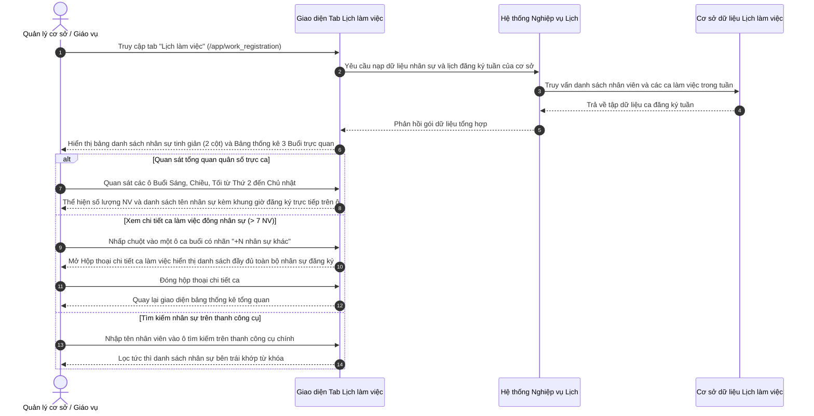

# US-HR-02-07: Nâng cấp Giao diện Danh sách & Bảng Thống kê Lịch Đăng ký (Giản lược Cột Trạng thái, Giản lược Tab Lọc & Điều chỉnh Bảng Thống kê Lịch Đăng ký)

> **Tham chiếu:** `BF-HR-02` · `US-HR-02-05` · `US-HR-02-06` · `SR-PERSONA-STAFF` · Giao diện Mẫu §4.2 (Màn hình Danh sách & Bảng Thống kê chuẩn)  
> **Đường dẫn màn hình & Trạng thái liên quan:**  
> - `Đăng ký lịch làm việc (/app/work_registration)` (Tab Lịch làm việc) -> Chế độ xem tổng quan toàn cơ sở (Aggregate Overview) | Trạng thái hiển thị: `X NV đăng ký`, `Trống`, `Full ca`, `Chi tiết ca làm việc`

---

## 1. NHẬT KÝ THAY ĐỔI & BỐI CẢNH (CHANGELOG & CONTEXT)

### Lịch sử cập nhật tài liệu (Changelog)

| Ngày cập nhật | Nội dung cập nhật | Lý do cập nhật |
|---|---|---|
| 23/10/2026 | Nâng cấp tinh gọn danh sách nhân sự và tái cấu trúc bảng thống kê lịch đăng ký: Giản lược hoàn toàn cột Trạng thái trên bảng danh sách nhân viên bên trái; Giản lược cụm tab lọc con (Tất cả / Chưa đăng ký / Đã đăng ký); Tái cơ cấu bảng thống kê lịch đăng ký từ 20+ dòng ca 30 phút vụn vặt sang 3 khối Buổi làm việc trực quan (Sáng, Chiều, Tối), hiển thị trực tiếp danh sách tên nhân sự trong từng ca buổi và bỏ hoàn toàn Khung giờ vàng. | Khắc phục tình trạng giao diện bị phân mảnh, quá tải thị giác bởi các hàng ca học rời rạc và các nhãn trạng thái lặp lại dư thừa; giúp Quản lý cơ sở nắm bắt toàn diện quân số và nhân sự làm việc trong tuần chỉ trong một ánh nhìn. |

### Bối cảnh & Mục tiêu điều chỉnh (Context & Objectives)

* **Bối cảnh nghiệp vụ:** Phân hệ Lịch làm việc (`/app/work_registration`) tại tab **Lịch làm việc** là nơi Quản lý chi nhánh (`PERSONA-BRANCH-MANAGER`) và Giáo vụ cơ sở (`PERSONA-CSM`) theo dõi bức tranh tổng thể về tình hình đăng ký ca trực và ca dạy của toàn bộ đội ngũ nhân sự trong tuần.
* **Tồn tại ở bản cũ (Theo hình ảnh giao diện cũ):**
  1. *Cột Trạng thái dư thừa gây chật chội:* Bảng danh sách nhân sự bên trái dành riêng một cột thứ 3 cho `Trạng thái`, hiển thị hàng loạt nhãn `Đã đăng ký` màu xanh lá lặp đi lặp lại ở mọi dòng. Điều này chiếm dụng chiều ngang quý giá, khiến thông tin tên và chức danh nhân sự bị co cụm.
  2. *Cụm tab lọc con gây rối tầng điều hướng:* Ngay phía trên bảng nhân sự có cụm 3 tab nhỏ `[Tất cả]`, `[Chưa đăng ký]`, `[Đã đăng ký]` và ô tìm kiếm cục bộ `Tìm giáo viên...`. Bố cục tab lồng trong tab khiến không gian danh sách nhân sự bị ép hẹp về chiều cao, giảm số lượng nhân sự hiển thị trên một trang.
  3. *Bảng thống kê lịch bên phải quá dài và thiếu thông tin nhân sự:* Phía bên phải là một ma trận hơn 20 dòng chia theo các khung giờ học 30-50 phút (`08:00 - 08:50`, `08:00 - 10:00 [GH]`, `08:00 - 09:30`, `08:15 - 09:45`, v.v.). Mỗi ô giao giữa Thứ và Ca học chỉ hiển thị một con số đếm vô hồn (`4`, `9`, `8`, `10`, `11`) hoặc gạch ngang `—`. Quản lý không thể biết cụ thể những ai đang làm việc tại ca đó nếu không bấm vào từng ô, đồng thời phải cuộn chuột liên tục qua hơn 20 hàng.
  4. *Ràng buộc Khung giờ vàng `[GH]` không cần thiết:* Ký hiệu `[GH]` xuất hiện ở cột ca học tạo áp lực kiểm soát tỷ lệ không phù hợp với nhu cầu điều phối thực tế của trung tâm.
* **Mục tiêu nâng cấp trọng tâm (Phạm vi điều chỉnh danh sách & bảng thống kê):**
  1. **Giản lược cột Trạng thái:** Loại bỏ hoàn toàn cột `Trạng thái` khỏi bảng danh sách nhân viên bên trái. Bảng chỉ còn 2 cột tinh gọn: `Nhân viên` (Tên, mã nhân viên, chức danh) và `Giờ` (Tổng thời lượng đăng ký trong tuần).
  2. **Giản lược tab lọc:** Lược bỏ 3 tab con `[Tất cả]`, `[Chưa đăng ký]`, `[Đã đăng ký]` khỏi đỉnh bảng danh sách nhân sự. Đưa tính năng tìm kiếm nhân sự lên thanh công cụ chung (`WorkRegistrationToolbar`) đồng bộ; gom các tiêu chí lọc nâng cao vào bảng trượt khi cần.
  3. **Tái cấu trúc Bảng thống kê lịch đăng ký:**
     - Thay thế 20+ dòng ca học vụn vặt bằng **3 khối Buổi làm việc trực quan**: `BUỔI SÁNG (08:00 - 12:00)`, `BUỔI CHIỀU (13:00 - 17:30)`, `BUỔI TỐI (17:30 - 22:00)` với dải màu nhận diện riêng biệt.
     - Trong từng ô ca buổi theo từng Thứ: Hiển thị dòng số lượng tổng quát (`X NV đăng ký`) kèm danh sách **tên nhân sự và khung giờ cụ thể** (tối đa 7 nhân sự phẳng, ví dụ: `Coenrad Redman • Full ca`).
     - Khi số lượng nhân sự vượt quá 7, hiển thị `+N nhân sự khác` và cho phép nhấp vào ô để mở **Hộp thoại chi tiết ca làm việc** xem toàn bộ danh sách phân công.
     - **Bỏ hoàn toàn Khung giờ vàng `[GH]`.**
* **Giới hạn phạm vi (Scope Boundary):** Tài liệu này chỉ đặc tả phần thay đổi ở **giản lược cột trạng thái**, **giản lược tab lọc** và **điều chỉnh bảng thống kê lịch đăng ký**. Các phần nghiệp vụ đăng ký thay cho cá nhân từng nhân viên hoặc chuyển sang tab khác không thuộc phạm vi tài liệu này.
* **Chỉ số đo lường hiệu quả (KPI Target):**
  - Thời gian bao quát quân số làm việc của toàn cơ sở: Giảm từ 3 phút xuống dưới 15 giây.
  - Tỷ lệ cuộn dọc để xem hết lịch trong ngày: Giảm 100% (bảng 3 buổi vừa vặn trong một màn hình máy tính).
  - Tỷ lệ nhầm lẫn danh tính nhân sự trực ca: Giảm 90% nhờ hiển thị trực tiếp tên trên ô ca.

### Ràng buộc nghiệp vụ toàn cục (Global Rules):

* **[RULE-ROST-01] Bảo toàn dữ liệu đăng ký gốc:** Việc tinh giản cột và gộp hiển thị theo 3 khối buổi không làm thay đổi hay làm tròn dữ liệu khung giờ thực tế đã đăng ký của nhân viên trong cơ sở dữ liệu.
* **[RULE-ROST-02] Thống kê nhân sự theo thời gian thực:** Số lượng nhân sự hiển thị trên mỗi ô ca buổi và tổng giờ đăng ký của từng nhân sự phải tự động tính toán lại tức thì theo bộ lọc cơ sở và bộ lọc môn học đang kích hoạt.
* **[RULE-ROST-03] Ngưỡng hiển thị danh sách phẳng trong ô:** Mỗi ô ca buổi chỉ hiển thị tối đa 7 nhân sự theo dạng danh sách phẳng để bảo đảm chiều cao ô không bị tràn; vượt quá 7 nhân sự sẽ tự động gom phần dư vào nhãn `+N nhân sự khác` và kích hoạt chế độ xem chi tiết qua hộp thoại.
* **[RULE-ROST-04] Đồng bộ tìm kiếm nhân sự:** Tìm kiếm nhân sự tại thanh công cụ chung sẽ tự động lọc danh sách nhân sự bên trái và đồng thời làm nổi bật các ca làm việc của nhân sự đó trên bảng thống kê bên phải.

---

## 2. LUỒNG XỬ LÝ CHÍNH (MAIN FLOW - HAPPY PATH)

---

## 3. MÔ TẢ GIAO DIỆN (UI DESCRIPTION & ADJUSTMENT MATRIX)

### Giao diện: Màn hình Đăng ký Lịch - Tab Lịch làm việc (`/app/work_registration`)

### 3.1 Bảng đặc tả chi tiết các đối tượng điều chỉnh

| Thành phần giao diện | Loại hiển thị | Dữ liệu & Quy tắc | Diễn giải quy tắc | Nội dung điều chỉnh |
|---|---|---|---|---|
| **Cột "Trạng thái" (Bản cũ)** | Cột bảng chứa nhãn badge | Danh mục trạng thái (`Đã đăng ký`) | Ở bản cũ, cột này hiển thị hàng loạt nhãn badge màu xanh lặp lại ở mọi dòng nhân viên, chiếm nhiều chiều ngang. | **Lược bỏ:** Loại bỏ hoàn toàn cột Trạng thái khỏi bảng nhân sự bên trái để tinh giản diện tích. |
| **Cột "Nhân viên" (Bảng bên trái)** | Cột bảng danh sách thông tin | Họ tên, Mã nhân viên và Chức danh | Dòng 1: Họ tên in đậm rõ nét. Dòng 2: Mã định danh và chức danh viết tắt (VD: `NEWWAYS · staff`). | **Điều chỉnh:** Mở rộng độ rộng khả dụng, giúp thông tin tên và chức danh hiển thị trọn vẹn, không bị cắt ngắn. |
| **Cột "Giờ" (Bảng bên trái)** | Cột bảng số liệu canh phải | Tổng số giờ đăng ký tuần (VD: `8h`, `26h`, `79.3h`) | Hiển thị tổng thời lượng tuần định dạng số kèm đơn vị `h`. Nếu chưa có giờ đăng ký thì hiển thị `0:00` mờ. | **Điều chỉnh:** Đổi tên tiêu đề từ `Giờ/tuần` thành `Giờ` súc tích; hiển thị số liệu nổi bật màu xanh nhấn. |
| **Cụm Tab lọc con (Bản cũ)** | Cụm 3 nút chuyển tab nhỏ | `[Tất cả]`, `[Chưa đăng ký]`, `[Đã đăng ký]` | Nằm chen chúc phía trên bảng nhân viên, gây rối cấu trúc điều hướng và chiếm chiều cao hiển thị. | **Lược bỏ:** Gỡ bỏ 3 tab con khỏi đỉnh bảng nhân sự; chuyển các tiêu chí lọc sâu vào bảng lọc nâng cao khi cần. |
| **Ô tìm kiếm cục bộ (Bản cũ)** | Hộp nhập văn bản trên bảng | Từ khóa tìm kiếm `Tìm giáo viên...` | Đặt cục bộ ngay trên đầu bảng nhân sự, tách biệt với thanh công cụ chung. | **Lược bỏ:** Di chuyển tính năng tìm kiếm lên thanh công cụ chung (`ExpandableSearch`) với placeholder `Tìm nhân viên...`. |
| **Chân trang phân trang nhân viên** | Thanh phân trang thu nhỏ | Số bản ghi hiện tại và tổng số nhân sự | Hiển thị dạng `1–50 / X NV` kèm 2 nút chuyển trang `<` và `>` tinh gọn dưới chân bảng nhân viên. | **Bổ sung:** Thanh điều hướng phân trang tinh gọn giúp quản lý duyệt danh sách nhân sự mượt mà. |
| **Hàng ca học 30 phút (Bản cũ)** | Hơn 20 dòng bảng ma trận | Các mốc giờ rời rạc (`08:00 - 08:50`, `08:00 - 09:30`, ...) | Bảng quá dài khiến người dùng phải cuộn chuột mỏi mắt; mỗi ô chỉ hiện số đếm khô khan (`4`, `9`, `8`). | **Lược bỏ:** Xóa bỏ hoàn toàn cơ chế chia 20+ dòng ca học 30 phút rời rạc. |
| **Ký hiệu Khung giờ vàng [GH] (Bản cũ)** | Nhãn màu vàng cam trên dòng ca | Chỉ báo giờ cao điểm | Khái niệm khung giờ vàng gây gò bó không cần thiết trong việc theo dõi quân số trực ca. | **Lược bỏ:** Loại bỏ hoàn toàn ký hiệu `[GH]` và các quy tắc ràng buộc liên quan. |
| **3 Khối Buổi làm việc (Bảng bên phải)** | 3 hàng khối lớn chia 7 cột Thứ | Danh mục buổi chuẩn: Sáng, Chiều, Tối | Gồm `BUỔI SÁNG (08:00 - 12:00)` nền vàng cam nhạt, `BUỔI CHIỀU (13:00 - 17:30)` nền xanh da trời nhạt, `BUỔI TỐI (17:30 - 22:00)` nền tím nhạt. | **Bổ sung:** Gom toàn bộ lưới tuần vào 3 khối buổi lớn trực quan, vừa vặn khung hình không cần cuộn dọc. |
| **Dòng thống kê số lượng nhân sự trong ô** | Nhãn văn bản ở đầu mỗi ô ca | Số lượng nhân viên đăng ký trong ca | Hiển thị `X NV đăng ký` màu cam nổi bật; nếu không có ai đăng ký thì hiển thị `Trống` màu xám mờ. | **Bổ sung:** Cung cấp ngay chỉ số quân số tổng quan của từng ca trực trong ngày. |
| **Danh sách tên nhân sự trong ô ca buổi** | Danh sách dòng văn bản phẳng | Tên nhân sự và khung giờ đăng ký | Hiển thị tối đa 7 nhân sự theo định dạng `[Tên nhân viên] • [Full ca / Giờ cụ thể]` (VD: `Coenrad Redman • Full ca`). | **Bổ sung:** Hiển thị trực tiếp danh tính nhân sự làm việc trong ca mà không cần nhấp chuột dò tìm. |
| **Nhãn mở rộng ca đông (+N nhân sự khác)** | Nhãn văn bản tương tác | Số nhân sự vượt quá giới hạn 7 | Khi có trên 7 nhân sự đăng ký trong 1 ca, hiển thị nhãn `+N nhân sự khác` và cho phép nhấp để mở hộp thoại chi tiết. | **Bổ sung:** Cơ chế thu gọn thông minh chống vỡ khung ô ca khi số lượng nhân sự đăng ký quá đông. |
| **Hộp thoại chi tiết ca làm việc** | Cửa sổ bảng nổi thông tin | Toàn bộ danh sách nhân viên trong ca đã chọn | Bật lên khi nhấp vào ô ca có trên 7 nhân sự; hiển thị đầy đủ danh sách nhân viên, chức danh, chi nhánh và giờ làm việc cụ thể. | **Bổ sung:** Cho phép tra cứu chi tiết danh sách nhân sự của các ca cao điểm một cách đầy đủ. |

---

## 4. KHỐI CHỨC NĂNG CHI TIẾT: ACTION & LUỒNG KÍCH HOẠT (ACTIONS & EVENTS)

### Khối chức năng 1: Hiển thị Bảng danh sách nhân sự tinh giản

#### Action 1.1: Quan sát danh sách nhân sự và tổng giờ tuần
* **Luồng kích hoạt:** Quản lý truy cập tab Lịch làm việc và theo dõi bảng danh sách bên trái.
* **Tiêu chí nghiệm thu (Acceptance Criteria):**
  - **AC-1 (Happy Path - Hiển thị bảng nhân sự 2 cột tinh giản):**
    - **Giả sử:** Quản lý đang ở tab Lịch làm việc của cơ sở.
    - **Khi:** Bảng danh sách nhân sự bên trái được tải xong.
    - **Thì:** Bảng chỉ hiển thị 2 cột duy nhất là `Nhân viên` (tên, mã, chức danh) và `Giờ` (tổng thời lượng đăng ký); hoàn toàn không xuất hiện cột `Trạng thái` hay các nhãn badge lặp lại; phía trên bảng không còn cụm 3 tab con `Tất cả / Chưa đăng ký / Đã đăng ký`.
  - **AC-2 (Happy Path - Phân trang danh sách nhân sự):**
    - **Giả sử:** Danh sách cơ sở có trên 50 nhân viên.
    - **Khi:** Quản lý nhấp nút chuyển trang `>` ở thanh chân trang danh sách nhân sự.
    - **Thì:** Bảng chuyển sang trang tiếp theo hiển thị các nhân sự từ 51 đến 100; bảng thống kê lịch tuần 3 buổi bên phải vẫn duy trì hiển thị số liệu tổng quan toàn cơ sở bình thường.

---

### Khối chức năng 2: Tìm kiếm nhân sự từ Thanh công cụ chung

#### Action 2.1: Nhập từ khóa tìm kiếm nhân viên trên thanh công cụ
* **Luồng kích hoạt:** Quản lý nhấp vào ô tìm kiếm trên thanh công cụ chung và gõ tên nhân viên cần tìm.
* **Tiêu chí nghiệm thu:**
  - **AC-3 (Happy Path - Lọc tức thì danh sách nhân sự bên trái):**
    - **Giả sử:** Danh sách nhân sự đang hiển thị đầy đủ các nhân sự của cơ sở.
    - **Khi:** Quản lý nhập từ khóa `"Linh Chi"` vào ô tìm kiếm trên thanh công cụ chính.
    - **Thì:** Bảng danh sách nhân sự bên trái lập tức lọc và chỉ hiển thị các dòng nhân viên có tên hoặc mã chứa `"Linh Chi"`, đồng thời chỉ số đếm phân trang cập nhật lại tương ứng.
  - **AC-4 (Happy Path - Xóa từ khóa tìm kiếm khôi phục danh sách):**
    - **Giả sử:** Danh sách nhân sự đang bị lọc theo từ khóa.
    - **Khi:** Quản lý xóa trắng ô tìm kiếm hoặc nhấp biểu tượng xóa `×`.
    - **Thì:** Bảng danh sách nhân sự tự động khôi phục hiển thị toàn bộ nhân sự ban đầu của cơ sở.

---

### Khối chức năng 3: Hiển thị Bảng thống kê lịch tuần theo 3 Khối Buổi

#### Action 3.1: Quan sát tổng quan quân số và danh sách nhân sự theo Buổi
* **Luồng kích hoạt:** Quản lý quan sát lưới lịch tuần bên phải trong chế độ tổng quan cơ sở.
* **Tiêu chí nghiệm thu:**
  - **AC-5 (Happy Path - Hiển thị 3 khối Buổi với dải màu nhận diện):**
    - **Giả sử:** Quản lý đang theo dõi bảng thống kê lịch làm việc toàn cơ sở trong tuần.
    - **Khi:** Lưới lịch được hiển thị.
    - **Thì:** Lưới lịch phân chia rõ ràng thành 3 khối Buổi lớn: `BUỔI SÁNG (08:00 - 12:00)` nền vàng cam, `BUỔI CHIỀU (13:00 - 17:30)` nền xanh da trời và `BUỔI TỐI (17:30 - 22:00)` nền tím; không còn bất kỳ dòng ca học 30 phút vụn vặt hay nhãn `[GH]` nào.
  - **AC-6 (Happy Path - Hiển thị trực tiếp danh sách nhân sự trong ô ca):**
    - **Giả sử:** Tại Buổi sáng Thứ 2 có 4 nhân viên đăng ký làm việc.
    - **Khi:** Quản lý quan sát ô giao giữa Thứ 2 và Buổi sáng.
    - **Thì:** Dòng đầu tiên hiển thị `4 NV đăng ký`, bên dưới liệt kê trực tiếp tên của cả 4 nhân viên kèm khung giờ tương ứng (VD: `Nguyễn Linh Chi • 08:30 - 10:00`, `Trần Văn Vương • Full ca`).
  - **AC-7 (Happy Path - Hiển thị ô ca trống khi không có người đăng ký):**
    - **Giả sử:** Tại Buổi chiều Chủ nhật chưa có nhân viên nào đăng ký ca làm việc.
    - **Khi:** Quản lý quan sát ô ca đó.
    - **Thì:** Dòng tiêu đề ô hiển thị chữ `Trống` màu xám mờ và phần thân ô có dấu gạch ngang `—` tinh gọn.

---

### Khối chức năng 4: Xem chi tiết ca làm việc đông nhân sự qua Hộp thoại

#### Action 4.1: Nhấp vào ô ca có trên 7 nhân sự đăng ký
* **Luồng kích hoạt:** Quản lý nhấp chuột vào một ô ca buổi có nhãn `+N nhân sự khác`.
* **Tiêu chí nghiệm thu:**
  - **AC-8 (Happy Path - Mở Hộp thoại chi tiết ca làm việc):**
    - **Giả sử:** Tại một ô ca buổi có 12 nhân viên đăng ký làm việc (hiển thị 7 tên đầu và nhãn `+5 nhân sự khác`).
    - **Khi:** Quản lý nhấp chuột vào ô ca buổi đó.
    - **Thì:** Hệ thống bật mở Hộp thoại chi tiết ca làm việc, hiển thị tiêu đề gồm Thứ, ngày, buổi và danh sách đầy đủ 12 nhân viên với họ tên, chức vụ và khung giờ chi tiết từng người.
  - **AC-9 (Happy Path - Đóng Hộp thoại chi tiết ca):**
    - **Giả sử:** Hộp thoại chi tiết ca làm việc đang mở.
    - **Khi:** Quản lý bấm nút `Đóng` hoặc nhấp vào vùng ngoài hộp thoại.
    - **Thì:** Hộp thoại đóng lại mượt mà, màn hình quay về trạng thái bảng thống kê tổng quan ban đầu.

---

## 5. CÁC TRƯỜNG HỢP GÓC CẠNH & LUỒNG NGOẠI LỆ (CORNER CASES & EXCEPTION FLOWS)

*(Các tình huống phát sinh thực tế – Tuyệt đối không lặp lại các kịch bản chuẩn của AC)*

### **Nhóm 1: Mật độ nhân sự & Hiển thị ô ca đặc biệt**

* **[CASE-01] Ca làm việc có số lượng nhân sự đăng ký đột biến (> 20 nhân viên):**
  * **Tình huống:** Vào ngày hội thảo hoặc ca trực trọng điểm, có tới hơn 20 nhân sự cùng đăng ký trực tại một buổi.
  * **Xử lý:** Ô ca vẫn duy trì kích thước chuẩn, hiển thị `20+ NV đăng ký`, 7 dòng tên đầu tiên và nhãn `+13 nhân sự khác`. Khi mở Hộp thoại chi tiết ca, bảng bên trong hộp thoại tự động kích hoạt thanh cuộn dọc mượt mà để quản lý duyệt toàn bộ danh sách mà không bị tràn màn hình.
* **[CASE-02] Nhân viên đăng ký khung giờ lẻ vắt ngang ranh giới giữa 2 buổi làm việc (VD: 11:00 - 14:00):**
  * **Tình huống:** Một nhân viên đăng ký ca trực từ `11:00` đến `14:00`, vắt qua ranh giới giữa Buổi sáng (kết thúc lúc 12:00) và Buổi chiều (bắt đầu lúc 13:00).
  * **Xử lý:** Hệ thống phân tách hiển thị thông minh: Tại ô Buổi sáng hiển thị tên nhân viên kèm nhãn giờ `11:00 - 12:00`; tại ô Buổi chiều hiển thị tên nhân viên kèm nhãn giờ `13:00 - 14:00`. Tổng giờ tuần của nhân viên vẫn được cộng đúng 3 giờ.
* **[CASE-03] Nhân viên có họ tên rất dài kèm chức danh phức tạp trong ô ca:**
  * **Tình huống:** Tên nhân viên có độ dài lớn (ví dụ: `Nguyễn Hoàng Đình Bảo Trâm`) khi hiển thị trong ô ca hẹp của màn hình nhỏ.
  * **Xử lý:** Tên nhân viên tự động cắt bớt và hiển thị dấu ba chấm (`...`) ở cuối dòng; khi quản lý rê chuột vào dòng tên sẽ xuất hiện thẻ nổi chú thích hiển thị đầy đủ họ tên và khung giờ đăng ký.

---

### **Nhóm 2: Lọc dữ liệu & Trạng thái rỗng**

* **[CASE-04] Tìm kiếm nhân sự không có kết quả trùng khớp:**
  * **Tình huống:** Quản lý nhập từ khóa tìm kiếm nhân viên không tồn tại trong danh sách cơ sở (ví dụ: `"XYZ"`).
  * **Xử lý:** Bảng danh sách bên trái hiển thị trạng thái rỗng tinh gọn: *"Không tìm thấy nhân viên phù hợp"*, đồng thời bảng thống kê lịch tuần 3 buổi bên phải hiển thị trạng thái mờ với các dấu gạch ngang `—` thông báo không có lịch phù hợp với từ khóa tìm kiếm.
* **[CASE-05] Đổi cơ sở công tác khiến toàn bộ lưới lịch của tuần mới hoàn toàn trống:**
  * **Tình huống:** Quản lý chuyển sang một cơ sở mới thành lập chưa phát sinh bất kỳ lượt đăng ký lịch làm việc nào trong tuần.
  * **Xử lý:** Bảng danh sách nhân sự bên trái hiển thị các nhân sự thuộc cơ sở với cột Giờ là `0:00` mờ; toàn bộ các ô trong 3 khối Buổi bên phải đều hiển thị trạng thái `Trống` với dấu gạch ngang `—`, không phát sinh thông báo lỗi hệ thống.

---

### **Nhóm 3: Đồng bộ dữ liệu & Ngoại lệ mạng**

* **[CASE-06] Nhân viên vừa lưu lịch mới ở màn hình cá nhân nhưng bảng quản lý chưa tải lại:**
  * **Tình huống:** Nhân viên A vừa hoàn tất đăng ký ca trực tuần tại màn hình của mình, trong khi Quản lý đang mở sẵn bảng thống kê từ trước đó.
  * **Xử lý:** Khi Quản lý thực hiện bất kỳ thao tác lọc, đổi tuần hoặc nhấp vào ô ca, hệ thống tự động làm mới dữ liệu từ cơ sở dữ liệu lịch làm việc để cập nhật ngay tên nhân viên A vào ô ca buổi tương ứng.
* **[CASE-07] Mất kết nối mạng khi quản lý nhấp xem Hộp thoại chi tiết ca làm việc:**
  * **Tình huống:** Kết nối mạng bị gián đoạn đúng lúc quản lý nhấp vào ô ca có trên 7 nhân sự.
  * **Xử lý:** Hộp thoại vẫn hiển thị ngay 7 nhân sự đã được lưu sẵn trong bộ nhớ tạm của giao diện, kèm theo dòng thông báo nhỏ màu vàng cam: *"Đang hiển thị dữ liệu lưu tạm. Vui lòng kiểm tra kết nối mạng để tải danh sách đầy đủ"*.

---

## 6. RÀNG BUỘC & QUY TẮC KIỂM SOÁT DỮ LIỆU (VALIDATION RULES)

| Thành phần giao diện / Bộ chọn | Điều kiện kiểm soát | Định dạng dữ liệu | Thông báo xử lý khi vi phạm |
|---|---|---|---|
| **Hiển thị cột Giờ nhân viên** | Tổng thời lượng làm việc trong tuần của nhân viên | Định dạng số kèm ký tự `h` (VD: `28h`, `79.3h`) | Nếu bằng 0 thì hiển thị `0:00` màu chữ mờ |
| **Giới hạn nhân sự hiển thị phẳng trong ô** | Tối đa 7 dòng nhân sự hiển thị trực tiếp | Danh sách tối đa 7 phần tử | Tự động gom các nhân sự từ thứ 8 trở đi vào nhãn `+N nhân sự khác` |
| **Phân định 3 Buổi chuẩn** | Sáng: `08:00 - 12:00` Chiều: `13:00 - 17:30` Tối: `17:30 - 22:00` | Khung giờ chuẩn theo cấu hình hệ thống | Gom toàn bộ ca làm việc vào đúng khối buổi tương ứng |
| **Tìm kiếm nhân sự trên thanh công cụ** | Từ khóa tìm kiếm không phân biệt chữ hoa / thường | Chuỗi ký tự độ dài tùy ý | Hiển thị thông báo rỗng nếu không tìm thấy kết quả phù hợp |

---

## 7. YÊU CẦU PHI CHỨC NĂNG & PHÂN QUYỀN (NON-FUNCTIONAL & PERMISSION)

* **Ma trận Phân quyền theo Năng lực Nguyên tử (Atomic Capability Gating):**
  - Xem màn hình và danh sách nhân sự cơ sở: Yêu cầu quyền `hr.work_registration.view_staff`.
  - Xem bảng thống kê lịch làm việc toàn cơ sở: Yêu cầu quyền `hr.work_registration.view_roster`.
  - Xem Hộp thoại chi tiết ca làm việc: Yêu cầu quyền `hr.work_registration.view_slot_detail`.
  - Sử dụng bộ lọc cơ sở và bộ lọc môn học: Yêu cầu quyền `hr.work_registration.filter`.

* **Hiệu năng & Trải nghiệm người dùng (Non-Functional Requirements):**
  - **Tốc độ hiển thị:** Thời gian hiển thị toàn bộ bảng thống kê 3 buổi và danh sách nhân sự không quá 300 phần nghìn giây sau khi nhận dữ liệu phản hồi.
  - **Khả năng quan sát:** Bảng thống kê 3 buổi vừa vặn hoàn toàn trong màn hình máy tính có độ phân giải chuẩn từ 1366x768 trở lên mà không cần cuộn dọc.
  - **Tối ưu thao tác:** Người quản lý có thể nắm bắt quân số và danh tính nhân sự trực ca ngay tại ô mà không cần bấm mở từng ô như bản cũ.

---

## 8. GIAO THỨC TRUYỀN DỮ LIỆU & KẾT NỐI HỆ THỐNG (DATA CONNECTION)

* **Yêu cầu nạp dữ liệu danh sách & bảng thống kê:** Gọi đến cơ sở dữ liệu lịch làm việc và cơ sở dữ liệu nhân sự với các tham số: mã cơ sở (`branchId`), ngày bắt đầu tuần (`weekStart`), ngày kết thúc tuần (`weekEnd`) và mã môn học lọc (`subject`).
* **Dữ liệu phản hồi chuẩn:**
  - Danh sách tóm tắt nhân sự: mã nhân viên, họ tên, mã định danh, chức danh công tác, tổng số giờ đăng ký tuần.
  - Danh sách ca làm việc theo tuần của cơ sở: mã ca, mã nhân viên, ngày làm việc, giờ bắt đầu, giờ kết thúc, buổi làm việc (`morning`, `afternoon`, `evening`), loại ca (`Trực ca` hoặc `Lớp dạy`).
* **Xử lý trạng thái phản hồi:**
  - Thành công (200): Nạp và hiển thị đầy đủ danh sách 2 cột bên trái và bảng thống kê 3 buổi bên phải.
  - Cơ sở chưa có dữ liệu: Hiển thị danh sách nhân sự với giờ `0:00` và bảng thống kê với trạng thái `Trống`.
  - Lỗi gián đoạn kết nối (500): Hiển thị thông báo gián đoạn máy chủ kèm nút thử lại.
