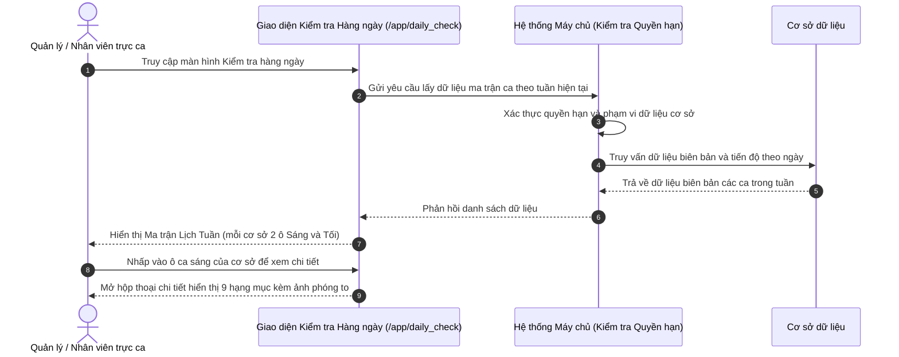

# US-QA-02-01: Quản lý Nhật ký Kiểm tra Hàng ngày và Danh mục Tiêu chuẩn Cơ sở

> **Tham chiếu:** `BF-QA-02` (Kiểm tra Cơ sở Vật chất) · `SR-PERSONA-OPS-RECEPTIONIST`  
> **Đường dẫn màn hình & Trạng thái liên quan:**  
> - `/app/daily_check` -> Trạng thái nộp ca: `on_time` (Đúng hạn), `late` (Nộp muộn), `missing` (Chưa nộp)  
> - Đánh giá Đầu ca: `pass` (Đạt), `fail` (Không đạt)  
> - Đánh giá Cuối ca: `done` (Đã xong), `not_done` (Chưa xong)  

---

## 1. NHẬT KÝ THAY ĐỔI & BỐI CẢNH (CHANGELOG & CONTEXT)

### Lịch sử cập nhật tài liệu (Changelog)

| Ngày cập nhật | Nội dung cập nhật | Lý do cập nhật |
|---|---|---|
| 28/10/2026 | Khởi tạo tài liệu đặc tả màn hình Quản lý Nhật ký Kiểm tra Hàng ngày và Danh mục Chuẩn 5 sao | Số hóa quy trình kiểm tra đầu ca và cuối ca từ Google Trang tính vào hệ thống trạm quản trị |
| 29/10/2026 | Tách Danh mục chuẩn thành Hộp thoại cấu hình riêng (thêm bớt tiêu chí, lịch sử phiên bản, đề xuất); tích hợp chế độ xem Ma trận Lịch theo Tuần và theo Tháng | Tối ưu hóa trải nghiệm giám sát ca trực tuyến, giúp quản lý phát hiện nhanh ca thiếu hoặc ca lỗi trên lịch |
| 29/10/2026 | Phân tách hai phân hệ người dùng độc lập: (1) Thực thi đánh giá theo cơ sở (Ma trận Tiêu chuẩn x Thứ trong tuần, đánh giá trực tiếp); (2) Tổng hợp & Thống kê toàn hệ thống (Giám sát đa cơ sở) | Đáp ứng trọn vẹn hai đối tượng: nhân sự trực ca cần checklist nhanh tại chỗ và cán bộ quản lý cần bức tranh tổng thể đa cơ sở |

### Bối cảnh & Vấn đề nghiệp vụ (Context & Problem)
* **Bối cảnh:** Hiện tại các cơ sở đào tạo của RinoEdu đang thực hiện kiểm tra cơ sở vật chất, setup lớp học, vệ sinh và tác phong nhân sự hàng ngày qua biểu mẫu khảo sát trực tuyến và tổng hợp về bảng tính với hơn 690 lượt gửi. Quy trình chia thành hai ca trọng tâm: Đầu ca (mở cửa sáng, kiểm tra 9 khu vực kèm hình ảnh minh chứng thực tế) và Cuối ca (đóng cửa tối, thực hiện 9 nhiệm vụ tắt thiết bị, điều hòa, gom sạc máy tính bảng và khóa cửa an toàn).
* **Vấn đề hiện tại:** Màn hình cần phục vụ đồng thời hai đối tượng người dùng có mục đích khác biệt:
  1. *Nhân sự trực ca tại cơ sở:* Cần chọn cơ sở của mình, nhìn thấy ma trận các tiêu chuẩn theo các thứ trong tuần và có thể trực tiếp chấm Đạt / Lỗi cho ca hôm nay ngay trên bảng mà không cần mở nhiều biểu mẫu phức tạp.
  2. *Cán bộ quản lý / Thanh tra chất lượng:* Cần nhìn bức tranh tổng hợp toàn hệ thống gồm các cơ sở x các ngày để nhận diện nhanh ca thiếu, ca muộn và tỷ lệ đạt chuẩn.
* **Mục tiêu & Giá trị mang lại:** Cung cấp thanh điều hướng 2 phân hệ độc lập: Phân hệ Thực thi đánh giá (chọn cơ sở, ma trận Tiêu chuẩn x Tuần để checklist trực tiếp) và Phân hệ Tổng hợp & Thống kê (ma trận đa cơ sở x ngày, lọc chỉ số và chuyển lỗi sang QC).

### Hiểu người dùng & Tình huống sử dụng (User Needs & Use Cases)
* **Người dùng chính (Persona):**
  - `[PERSONA-OPS-RECEPTIONIST]`: Nhân viên Tiếp tân / Trực ca cơ sở (Người thực thi đánh giá hàng ngày).
  - `[PERSONA-OPS-MANAGER]`: Quản lý cơ sở / Giám sát chất lượng / Giám đốc Vận hành (Người xem, thống kê và giám sát).
* **Nhu cầu thực tế (Needs):**
  - Nhân viên trực ca: Chọn cơ sở, mở ca sáng/tối, tích Đạt/Lỗi nhanh cho ngày hôm nay và bấm nộp ca.
  - Quản lý vận hành: Xem bảng ma trận lịch các cơ sở, phát hiện ca lỗi, mở xem ảnh minh chứng và bấm chuyển tiếp sang QC xử lý biên bản.
* **Câu phát biểu nghiệp vụ:** **Là một** nhân viên vận hành cơ sở hoặc quản lý chi nhánh, **tôi muốn** theo dõi nhật ký kiểm tra hàng ngày trên ma trận lịch tuần và tháng, **để** kiểm soát trọn vẹn chất lượng dịch vụ và kịp thời xử lý các ca vi phạm.

### Phạm vi kiểm soát (Scope)
* **Phạm vi hiển thị:** Quản lý ma trận lịch kiểm tra theo ca (Đầu ca / Cuối ca) theo tuần và theo tháng, bảng danh sách chi tiết, hộp thoại cấu hình danh mục tiêu chuẩn kèm cơ chế phiên bản và đề xuất cải tiến. Không bao gồm việc tính toán trừ tiền lương hoặc mua sắm trang thiết bị mới.

---

## 2. LUỒNG XỬ LÝ CHÍNH (MAIN FLOW - HAPPY PATH)

---

## 3. GIAO DIỆN & KIỂM SOÁT QUYỀN HẠN (UI & CAPABILITY GATING)

### 3.1. Cấu trúc các vùng giao diện & Ràng buộc Quyền hạn (Capability Gating)

Màn hình áp dụng cơ chế kiểm soát hiển thị theo Mã quyền động được định nghĩa tại `BF-QA-02`:

| Vùng Giao diện / Nút Thao Tác | Loại Hiển Thị | Mã Quyền Yêu Cầu (Required Capability) | Xử Lý Khi Không Đủ Quyền |
| :--- | :--- | :--- | :--- |
| **Truy cập Màn hình `/app/daily_check`** | Toàn bộ giao diện | `fcm.daily_check.view` | Chặn truy cập, hiển thị thông báo không đủ quyền hạn |
| **Chuyển đổi Khung nhìn Ma trận Tuần / Tháng / Bảng** | Thanh nút phân đoạn ở cạnh phải hàng thẻ lọc | `fcm.daily_check.view` | Mặc định cố định ở khung nhìn bảng cơ bản |
| **Nút [Danh mục đánh giá]** | Nút trên thanh công cụ hàng 1 | `fcm.daily_check.view_catalog` | Ẩn nút mở hộp thoại danh mục |
| **Thao tác Thêm / Xóa Tiêu chuẩn trong Hộp thoại** | Nút hành động trong hộp thoại | `fcm.daily_check.manage_catalog` | Chỉ hiển thị chế độ xem, ẩn nút thêm và xóa |
| **Nút [➕ Thực hiện Checklist]** | Nút hành động chính | `fcm.daily_check.submit` | Ẩn nút nộp biên bản ca |
| **Nút [Chuyển thành sự cố QC]** | Nút hành động ngoại lệ | `fcm.daily_check.escalate` | Ẩn nút chuyển tiếp sự cố sang phân hệ chất lượng |

### 3.2. Cấu trúc dữ liệu ma trận lịch và bảng chính

| Cột thông tin | Kiểu hiển thị | Nguồn dữ liệu | Quy tắc thị giác (Visual Mapping) |
|---|---|---|---|
| **Cơ sở / Điểm trường** | Chữ đậm (Cột cố định bên trái) | Danh sách cơ sở trong hệ thống | Cố định khi cuộn ngang ma trận |
| **Ô Ca Sáng (Đầu ca)** | Thẻ trạng thái bo góc | Kết quả đánh giá 9 khu vực sáng | Màu xanh lá nếu đạt toàn bộ, màu đỏ nếu có lỗi vi phạm |
| **Ô Ca Tối (Cuối ca)** | Thẻ trạng thái bo góc | Kết quả thực hiện 9 nhiệm vụ tối | Màu tím nếu hoàn tất toàn bộ, màu đỏ nếu còn việc chưa xong |
| **Ca nộp muộn** | Biểu tượng đồng hồ cảnh báo | Dữ liệu thời gian nộp biên bản | Kèm biểu tượng đồng hồ cảnh báo màu hổ phách |
| **Ca chưa nộp / Quên ca** | Nút viền nét đứt màu đỏ | Tình trạng thiếu biên bản trong quá khứ | Viền đỏ nhấp nháy, bấm vào để mở biểu mẫu nộp bù |

---

## 4. KHỐI CHỨC NĂNG CHI TIẾT: ACTION & LUỒNG KÍCH HOẠT (ACTIONS & EVENTS)

### Khối chức năng 1: Khung nhìn Ma trận Lịch (Calendar Matrix View)

#### Action 1.1: Chuyển đổi giữa Ma trận Tuần, Ma trận Tháng và Dạng Bảng
* **Luồng kích hoạt:** Khi người dùng nhấp chọn vào thanh phân đoạn trên thanh công cụ.
* **Tiêu chí nghiệm thu (Acceptance Criteria):**
  - **AC-1 (Happy Path - Chuyển sang Ma trận Tuần):**
    - **Giả sử:** Người dùng đang ở màn hình kiểm tra hàng ngày.
    - **Khi:** Người dùng chọn "Ma trận Tuần".
    - **Thì:** Giao diện hiển thị lưới lịch 7 ngày (Thứ 2 đến Chủ Nhật) với 2 thẻ Sáng và Tối cho từng cơ sở.
  - **AC-2 (Happy Path - Chuyển sang Ma trận Tháng):**
    - **Giả sử:** Người dùng đang ở màn hình kiểm tra hàng ngày.
    - **Khi:** Người dùng chọn "Ma trận Tháng".
    - **Thì:** Giao diện hiển thị bảng ma trận toàn diện 31 ngày của tháng hiện tại.
  - **AC-3 (Happy Path - Chuyển sang Dạng Bảng):**
    - **Giả sử:** Người dùng đang xem ma trận lịch.
    - **Khi:** Người dùng chọn "Dạng Bảng".
    - **Thì:** Giao diện chuyển về bảng danh sách truyền thống hỗ trợ phân trang và tìm kiếm chi tiết.

#### Action 1.2: Điều hướng Tuần trên Ma trận Lịch
* **Luồng kích hoạt:** Người dùng bấm nút "Tuần trước", "Tuần sau" hoặc "Tuần hiện tại".
* **Tiêu chí nghiệm thu:**
  - **AC-1 (Happy Path - Chuyển tuần thành công):**
    - **Giả sử:** Ma trận đang hiển thị tuần hiện tại (26/10 - 01/11/2026).
    - **Khi:** Người dùng bấm nút mũi tên chuyển sang tuần trước.
    - **Thì:** Ma trận tải lại dữ liệu của 7 ngày tuần trước đó.

---

### Khối chức năng 2: Hộp thoại Quản lý Danh mục Đánh giá

#### Action 2.1: Mở Hộp thoại Danh mục Đánh giá
* **Luồng kích hoạt:** Người dùng nhấp vào nút "Danh mục đánh giá" trên thanh công cụ.
* **Tiêu chí nghiệm thu:**
  - **AC-1 (Happy Path - Hiển thị hộp thoại dạng hai cột):**
    - **Giả sử:** Người dùng đang ở màn hình kiểm tra hàng ngày.
    - **Khi:** Người dùng nhấp vào nút "Danh mục đánh giá".
    - **Thì:** Hộp thoại xuất hiện với tiêu đề gọn "Danh mục đánh giá", gồm bảng điều khiển hai cột: cột trái hiển thị danh sách các đầu mục khu vực (kèm số lượng chỉ tiêu và chuyển ca Đầu ca / Cuối ca), cột phải hiển thị danh sách các chỉ tiêu kiểm tra chi tiết của đầu mục đang chọn.

#### Action 2.2: Thêm mới hoặc Loại bỏ Chỉ tiêu Đánh giá
* **Luồng kích hoạt:** Người dùng bấm nút "Thêm chỉ tiêu" ở bảng bên phải hoặc bấm nút biểu tượng thùng rác trên từng chỉ tiêu.
* **Tiêu chí nghiệm thu:**
  - **AC-1 (Happy Path - Thêm chỉ tiêu thành công):**
    - **Giả sử:** Người dùng đang chọn đầu mục khu vực ở cột trái.
    - **Khi:** Người dùng bấm nút "Thêm chỉ tiêu", nhập tên chỉ tiêu và yêu cầu đạt chuẩn, sau đó bấm "Lưu chỉ tiêu".
    - **Thì:** Hệ thống cập nhật chỉ tiêu mới vào đầu mục tương ứng và hiển thị thông báo thành công.
  - **AC-2 (Happy Path - Loại bỏ chỉ tiêu):**
    - **Giả sử:** Danh sách chỉ tiêu đang hiển thị ở cột phải.
    - **Khi:** Người dùng bấm nút biểu tượng thùng rác trên một chỉ tiêu.
    - **Thì:** Hệ thống loại bỏ chỉ tiêu đó khỏi danh mục và thông báo cho người dùng.

#### Action 2.3: Thêm mới Đầu mục Khu vực
* **Luồng kích hoạt:** Người dùng bấm nút "Thêm đầu mục" ở chân bảng điều khiển cột trái.
* **Tiêu chí nghiệm thu:**
  - **AC-1 (Happy Path - Thêm đầu mục thành công):**
    - **Giả sử:** Người dùng đang ở danh mục ca sáng (Đầu ca).
    - **Khi:** Người dùng nhập tên đầu mục mới và bấm "Thêm".
    - **Thì:** Hệ thống bổ sung đầu mục mới vào danh sách cột trái và tự động chuyển trọng tâm sang đầu mục vừa tạo.

---

### Khối chức năng 3: Thao tác Chi tiết & Chuyển tiếp Sự cố

#### Action 3.1: Nhấp vào Ô Ca trên Ma trận để Xem Chi tiết
* **Luồng kích hoạt:** Người dùng nhấp vào một thẻ ca kiểm tra (Sáng hoặc Tối) trên ma trận lịch.
* **Tiêu chí nghiệm thu:**
  - **AC-1 (Happy Path - Mở chi tiết biên bản):**
    - **Giả sử:** Ma trận đang hiển thị kết quả ngày 28/10 của cơ sở CS1 Linh Đàm.
    - **Khi:** Người dùng nhấp vào ô "Sáng: 8/9".
    - **Thì:** Hộp thoại chi tiết mở ra, hiển thị rõ hạng mục Sảnh lễ tân không đạt kèm ảnh chụp minh chứng.

#### Action 3.2: Chuyển tiếp Lỗi sang Phân hệ Kiểm soát Chất lượng (QC Check)
* **Luồng kích hoạt:** Người dùng nhấp vào nút "Chuyển thành sự cố QC" bên trong hộp thoại chi tiết.
* **Tiêu chí nghiệm thu:**
  - **AC-1 (Happy Path - Chuyển tiếp thành công):**
    - **Giả sử:** Biên bản kiểm tra có hạng mục phát hiện lỗi.
    - **Khi:** Người dùng bấm nút "Chuyển thành sự cố QC".
    - **Thì:** Hệ thống điều hướng sang phân hệ Kiểm tra & Khắc phục chất lượng, tự động mang theo cơ sở, mã biên bản gốc và nội dung lỗi để thanh tra xử lý.

---

## 5. CÁC TRƯỜNG HỢP GÓC CẠNH & LUỒNG NGOẠI LỆ (CORNER CASES & EXCEPTION FLOWS)

- **[CASE-01] Mất kết nối internet khi đang xem ma trận lịch:**
  - *Tình huống:* Người dùng đang điều hướng giữa các tuần hoặc bấm vào xem chi tiết ca nhưng đường truyền bị ngắt.
  - *Cách xử lý:* Hệ thống lưu tạm dữ liệu tuần đã tải vào bộ nhớ đệm, hiển thị thông báo gián đoạn đường truyền và cung cấp nút bấm thử lại.
- **[CASE-02] Cơ sở chưa đến giờ thực hiện ca (Ca tương lai):**
  - *Tình huống:* Người dùng xem ô ca tối của ngày hôm nay hoặc các ngày trong tương lai.
  - *Cách xử lý:* Hệ thống hiển thị ký hiệu trạng thái "Chờ ca" hoặc dấu gạch ngang mờ, không gắn cờ cảnh báo thiếu ca để tránh gây nhầm lẫn.
- **[CASE-03] Không đủ quyền quản trị danh mục tiêu chuẩn:**
  - *Tình huống:* Nhân viên tiếp tân mở hộp thoại danh mục tiêu chuẩn nhưng chỉ có quyền xem mà không có quyền thay đổi quy chuẩn hệ thống.
  - *Cách xử lý:* Hệ thống ẩn các nút thêm và xóa tiêu chuẩn, chỉ cho phép nhân viên xem danh mục chuẩn và gửi ý kiến tại tab Đề xuất cải tiến.
- **[CASE-04] Thời gian phản hồi của máy chủ bị trễ quá hạn mức:**
  - *Tình huống:* Yêu cầu tải dữ liệu ma trận toàn diện cả tháng kéo dài quá 10 giây do lượng dữ liệu lớn.
  - *Cách xử lý:* Hệ thống tự động ngắt yêu cầu quá hạn, hiển thị thông báo nhắc nhở kiểm tra lại kết nối và cung cấp nút bấm tải lại dữ liệu.
