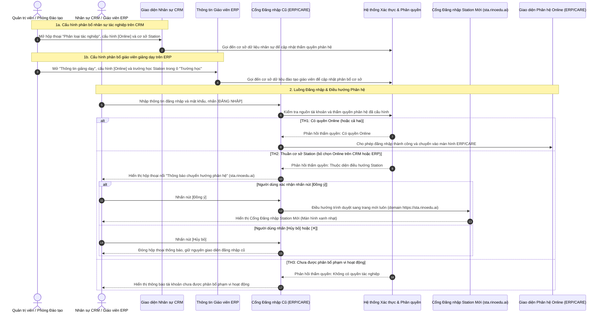

# US-SYS-04-07: Nâng cấp Phân bổ Cơ sở Phân hệ và Điều hướng Đăng nhập Nhân sự & Giáo viên (Subsystem Scope Allocation & Login Routing)

> **Tham chiếu:** `BF-SYS-04` · `SR-SYSTEM_ADMIN-001` · Giao diện Mẫu §4.4 (Hộp thoại cấu hình và Biểu mẫu tác nghiệp)  
> **Đường dẫn màn hình & Trạng thái liên quan:**  
> - `Quản lý nhân sự` (`/app/hr_employees` trên CRM) $\rightarrow$ Hộp thoại `Phân loại tác nghiệp` / `Chọn Trường`  
> - `Quản lý giáo viên` (`/tutor/teacher-info/[id]` trên ERP) $\rightarrow$ Khối `Thông tin giảng dạy`, trường `Trường học`  
> - `Cổng Đăng nhập Phân hệ Trực tuyến (Online)`: Cổng đăng nhập CRM / ERP / CARE  
> - `Cổng Đăng nhập Phân hệ Cơ sở (Station)`: Cổng đăng nhập Station mới (giao diện màu xanh nhạt tại domain `sta.rinoedu.ai`)  
> - **Phiên bản hệ thống:** `v2026.11.13.01.prod`

---

## 1. NHẬT KÝ THAY ĐỔI & BỐI CẢNH (CHANGELOG & CONTEXT)

### Lịch sử cập nhật tài liệu (Changelog)

| Ngày cập nhật | Nội dung cập nhật | Lý do cập nhật |
|---|---|---|
| 13/11/2026 | **Phát hành lần đầu**: Đặc tả toàn diện giải pháp phân bổ phân hệ Trực tuyến (`Online`) và Cơ sở (`Station`) đồng bộ trên cả CRM (`Quản lý nhân sự`) và ERP (`Quản lý giáo viên > Thông tin giáo viên > Trường học`), quy tắc mặc định tích chọn `Online`, cơ chế kiểm soát truy cập và hộp thoại thông báo chuyển hướng đăng nhập sang domain `sta.rinoedu.ai` khi người dùng bấm "Đồng ý". | Chuẩn hóa thẩm quyền phân hệ trên toàn hệ thống cho cả khối nhân sự vận hành (CRM) và khối giáo viên giảng dạy (ERP), ngăn chặn truy cập trái phép vào ERP/CARE và tự động điều hướng đúng cổng làm việc của cơ sở. |

### Bối cảnh & Vấn đề nghiệp vụ (Context & Problem)
* **Bối cảnh:** Hệ thống vận hành của tổ chức giáo dục hiện bao gồm 2 phân hệ lớn phục vụ hai mô hình đào tạo:
  1. **Phân hệ Trực tuyến (Online):** Bao gồm các ứng dụng tác nghiệp trung tâm như CRM, ERP và CARE, phục vụ đào tạo từ xa và khối vận hành tổng thể.
  2. **Phân hệ Cơ sở (Station):** Bao gồm giao diện chuyên biệt phục vụ công tác quản lý, giảng dạy, khảo thí và chăm sóc học viên trực tiếp tại các trường học / cơ sở đào tạo thực tế.
  Cả hai phân hệ này đều vận hành chung một hệ thống máy chủ và dùng chung cơ sở dữ liệu duy nhất.
* **Phân định phạm vi cấu hình phân bổ theo đối tượng người dùng:**
  1. **Nhân sự tác nghiệp & vận hành (Cấu hình trên CRM):** Được quản lý tại màn hình `Quản lý nhân sự` (`/app/hr_employees`). Quản trị viên cấu hình phân bổ phân hệ và cơ sở thông qua hộp thoại "Phân loại tác nghiệp" / "Chọn Trường".
  2. **Giáo viên giảng dạy (Cấu hình trên ERP):** Được quản lý tại màn hình `Quản lý giáo viên > Thông tin giáo viên` (`/tutor/teacher-info/[id]`). Phòng đào tạo hoặc người quản lý cấu hình phân bổ phân hệ và cơ sở trực tiếp tại khối "Thông tin giảng dạy", trường "Trường học".
  3. **Cơ chế tương đồng:** Cả hai màn hình đều được bổ sung tùy chọn `Online` lên dòng đầu tiên của danh sách chọn trường/cơ sở; tất cả tài khoản hiện có và tài khoản mới tạo đều mặc định được tích chọn `[x] Online`. Người quản trị có thể chủ động bỏ chọn `Online` và gán một hoặc nhiều cơ sở Station để chuyển thành nhân sự/giáo viên chuyên trách cơ sở.
* **Vấn đề hiện tại:** Trước đây, toàn bộ nhân sự và giáo viên mặc định hoạt động trên phân hệ Online. Khi xây dựng phân hệ Station và tiến hành phân bổ trường học/cơ sở cho nhân sự và giáo viên, phát sinh rủi ro nhân sự và giáo viên cơ sở vẫn có thể truy cập vào các phân hệ lõi như ERP và CARE vốn chỉ dành cho khối vận hành tổng thể hoặc giảng dạy trực tuyến. Hơn nữa, danh sách phân bổ cơ sở trên cả CRM và ERP đều chưa có tùy chọn phân định rõ ràng quyền hạn thuộc phân hệ Online.
* **Mục tiêu & Giá trị mang lại:**
  1. Thêm tùy chọn `Online` trực tiếp vào danh sách phân bổ tác nghiệp trên cả CRM và ERP để người quản trị dễ dàng kích hoạt hoặc thu hồi quyền truy cập phân hệ Online của từng nhân sự và giáo viên.
  2. Thiết lập quy tắc tự động hóa: Tất cả tài khoản hiện có và tài khoản tạo mới trên cả CRM và ERP luôn mặc định được chọn `Online`.
  3. Kiểm soát quyền truy cập chặt chẽ: Nhân sự và giáo viên không có `Online` sẽ bị từ chối truy cập vào ERP và CARE; người dùng không có cơ sở Station sẽ không được truy cập vào hệ thống Station mới; tài khoản có cả hai sẽ truy cập được cả hai.
  4. Hộp thoại thông báo chuyển hướng đăng nhập: Nhân sự và giáo viên chuyên trách Station (không có Online) khi đăng nhập tại cổng ERP/CARE cũ sẽ được hiển thị hộp thoại thông báo chuyển hướng sang domain `sta.rinoedu.ai`; khi người dùng nhấn "Đồng ý", trình duyệt sẽ điều hướng sang trang mới luôn (Cổng Đăng nhập Station Mới, nền xanh nhạt) để bắt đầu ca làm việc nhanh chóng.

### Phân loại Rủi ro & Phạm vi Kiểm soát (Risk & Scope)

| Tiêu chí đánh giá | Nội dung đối soát thực tế | Điểm số (0 / 1) |
|---|---|:---:|
| **Tiêu chí A: Phạm vi ảnh hưởng hệ thống** | Tác động đến cơ chế xác thực và phân định quyền truy cập giữa 2 phân hệ Online và Station trên cả CRM và ERP | 1 |
| **Tiêu chí B: Tác động tài chính** | Kiểm soát quyền truy cập hồ sơ học viên, tài chính và hợp đồng trên ERP | 0 |
| **Tiêu chí C1: Loại thay đổi nghiệp vụ** | Bổ sung tùy chọn phân bổ phân hệ mới trên giao diện CRM và ERP, kèm cơ chế chuyển hướng đăng nhập | 0 |
| **Tiêu chí C2: Độ mới nghiệp vụ** | Nghiệp vụ phân tách quyền truy cập dựa trên phạm vi hoạt động đã có tiền lệ | 0 |
| **Tiêu chí D: Phụ thuộc bên ngoài** | Vận hành hoàn toàn nội bộ, không phụ thuộc dịch vụ đối tác ngoài | 0 |

* **Tổng điểm đánh giá:** 1/5 điểm $\rightarrow$ 🔴 **Risk** (Yêu cầu Quản lý Dự án và Trưởng nhóm Kỹ thuật phê duyệt trước khi phát hành).

### Bảng Danh mục Chức năng (Feature Scope Matrix)

| Mã Yêu Cầu | Tên Chức Năng | Mức Độ Ưu Tiên | Phân Loại Rủi Ro | Ghi Chú Nghiệp Vụ |
|---|---|:---:|:---:|---|
| **FEAT-01** | Bổ sung tùy chọn `Online` vào danh sách phân bổ tác nghiệp trên CRM | Bắt buộc (Must) | 🔴 Risk | Đứng đầu danh sách, mặc định tích chọn cho tài khoản nhân sự |
| **FEAT-02** | Bổ sung tùy chọn `Online` vào danh sách chọn trường học trên ERP | Bắt buộc (Must) | 🔴 Risk | Đứng đầu danh sách trường học, mặc định tích chọn cho tài khoản giáo viên |
| **FEAT-03** | Mặc định tích chọn `Online` cho tài khoản hiện có và tài khoản mới | Bắt buộc (Must) | 🟢 Standard | Bảo đảm kế thừa thông suốt cho toàn bộ nhân sự và giáo viên |
| **FEAT-04** | Cơ chế phân quyền truy cập phân hệ (Online / Station) | Bắt buộc (Must) | 🔴 Risk | Chặn người dùng thuần Station vào ERP/CARE, chặn người dùng thuần Online vào Station |
| **FEAT-05** | Hộp thoại thông báo chuyển hướng sang domain `sta.rinoedu.ai` | Bắt buộc (Must) | 🔴 Risk | Hiển thị hộp thoại nổi, khi ấn Đồng ý thì điều hướng sang trang mới luôn |
| **FEAT-06** | Màn hình cảnh báo từ chối truy cập khi vào sai phân hệ | Bắt buộc (Must) | 🟢 Standard | Hiển thị thông báo và nút quay về cổng hợp lệ |

### Chỉ số Đo lường Hiệu quả (KPI Target)
* **Chỉ số Baseline:** 100% nhân sự cơ sở và giáo viên Station trước đây có nguy cơ truy cập chéo vào các màn hình quản trị ERP/CARE do chưa có bộ lọc phân hệ.
* **Mục tiêu Kỳ vọng (Target):** 0% trường hợp nhân sự và giáo viên Station truy cập trái phép vào ERP/CARE; 100% nhân sự và giáo viên Station được hiển thị hộp thoại thông báo chuyển hướng và điều hướng sang trang mới luôn tại domain `sta.rinoedu.ai` khi bấm Đồng ý ngay trong lần truy cập đầu tiên.
* **Cách thức đo lường:** Giám sát nhật ký truy cập hệ thống và số lượng yêu cầu bị chặn bởi bộ lọc kiểm soát phân hệ.

### Ràng buộc nghiệp vụ toàn cục (Global Rules):

* **[RULE-SYS-01] Mặc định tích chọn Online cho toàn bộ tài khoản:** Toàn bộ tài khoản nhân sự (trên CRM) và tài khoản giáo viên (trên ERP) hiện đang có trên hệ thống khi mở danh sách phân bổ trường/cơ sở đều được hệ thống tự động gán sẵn trạng thái tích chọn `[x] Online`. Đối với tất cả tài khoản tạo mới sau này, hệ thống luôn tự động đặt giá trị mặc định là đã chọn `[x] Online`.
* **[RULE-SYS-02] Ma trận kiểm soát truy cập phân hệ (Subsystem Access Control):**
  * **Trường hợp 1 (Chỉ có Online - Không có cơ sở Station):** Được phép đăng nhập và tác nghiệp trên hệ thống `ERP` và `CARE`. Bị chặn hoàn toàn khỏi hệ thống `Station`.
  * **Trường hợp 2 (Chỉ có cơ sở Station - Không có Online):** Được phép đăng nhập và tác nghiệp trên hệ thống `Station` (theo đúng danh sách cơ sở được gán). Tuyệt đối **KHÔNG** được truy cập vào hệ thống `ERP` và `CARE`.
  * **Trường hợp 3 (Có cả Online VÀ cơ sở Station):** Được phép truy cập đồng thời cả 2 phân hệ (`ERP`, `CARE` và `Station`).
  * **Trường hợp 4 (Không có Online VÀ Không có cơ sở Station):** Tài khoản bị vô hiệu hóa quyền tác nghiệp, không thể đăng nhập vào bất kỳ phân hệ nào.
* **[RULE-SYS-03] Cơ chế thông báo chuyển hướng khi đăng nhập:** Khi nhân sự hoặc giáo viên đã được gán cơ sở Station nhưng KHÔNG được gán Online thực hiện đăng nhập tại cổng ERP/CARE cũ, hệ thống tự động nhận diện thẩm quyền và lập tức hiển thị hộp thoại nổi "Thông báo chuyển hướng phân hệ". Khi người dùng nhấn nút "Đồng ý", hệ thống lập tức điều hướng trình duyệt sang trang mới luôn tại domain `sta.rinoedu.ai` (Cổng Đăng nhập Station Mới, nền xanh nhạt). Nếu người dùng nhấn "Hủy bỏ" hoặc biểu tượng đóng "✕", hộp thoại đóng lại và giữ nguyên giao diện đăng nhập cũ. Nếu nhân sự hoặc giáo viên này cố tình truy cập các đường dẫn chức năng của ERP/CARE, hệ thống lập tức hiển thị thông báo từ chối truy cập và chuyển hướng về cổng hợp lệ.
* **[RULE-SYS-04] Cơ sở dữ liệu dùng chung & Không phát sinh tiến trình chuyển giao trung gian:** Hai phân hệ vận hành trên cùng một cơ sở dữ liệu người dùng và phiên làm việc; mọi thao tác thay đổi phân bổ trên CRM hoặc ERP đều có hiệu lực tức thời mà không cần qua tiến trình đồng bộ dữ liệu trung gian.
* **[RULE-SYS-05] Che số điện thoại chống sao chép hàng loạt:** Trên bảng danh sách nhân sự chính, số điện thoại của nhân sự bắt buộc phải được che ẩn ở giữa theo định dạng `091****111` để phòng ngừa hành vi sao chép dữ liệu hàng loạt.
* **[RULE-SYS-06] Cơ chế phân bổ phân hệ tương đồng trên CRM và ERP:**
  * **Trên CRM (Quản lý nhân sự):** Áp dụng qua hộp thoại "Phân loại tác nghiệp" / "Chọn Trường". Tùy chọn `Online` nằm ở dòng đầu tiên, tiếp theo là danh sách các cơ sở đào tạo Station.
  * **Trên ERP (Quản lý giáo viên):** Áp dụng qua trường "Trường học" tại khối "Thông tin giảng dạy" trong hồ sơ chi tiết giáo viên. Tùy chọn `Online` nằm ở dòng đầu tiên của danh sách thả xuống, tiếp theo là các cơ sở đào tạo Station.
  * Cả hai nơi cấu hình đều tuân thủ nguyên tắc: Bỏ chọn `Online` đồng nghĩa với việc rút quyền truy cập ERP/CARE; chọn một hoặc nhiều cơ sở Station đồng nghĩa với việc cấp quyền tác nghiệp tại các cơ sở đó trên phân hệ Station.

---

## 2. MÔ TẢ GIAO DIỆN & CÁC THAY ĐỔI

### 2.1 Hộp thoại "Phân loại tác nghiệp" / "Chọn Trường" trên CRM - Các điều chỉnh

> **Hình ảnh minh họa trạng thái ĐÃ CHỌN Online (Mặc định):**
> 
> 

> **Hình ảnh minh họa trạng thái BỎ CHỌN Online (Nhân sự chuyên trách Station):**
> 
> 

| Thành phần giao diện | Loại hiển thị | Dữ liệu & Quy tắc | Diễn giải quy tắc | Nội dung điều chỉnh |
|---|---|---|---|---|
| **Tùy chọn Phân hệ Trực tuyến (`Online`)** | Hộp kiểm kèm nhãn văn bản | Nhãn `Online`, nằm ở dòng đầu tiên trong danh sách chọn trường/cơ sở | Cho phép tích chọn hoặc bỏ tích chọn. Khi được chọn, hàng hiển thị nổi bật với nền màu hồng nhạt, hộp kiểm màu hồng sen có dấu kiểm trắng và chữ màu hồng. Mặc định luôn được tích chọn cho tài khoản hiện có và tài khoản mới. | **Bổ sung:** Bổ sung dòng lựa chọn `Online` lên vị trí đầu tiên của danh sách để phân định thẩm quyền phân hệ trực tuyến. |
| **Danh sách Cơ sở Đào tạo (`Station`)** | Danh sách hộp kiểm có thanh cuộn | Tên các cơ sở thực tế: `CS1 Linh Đàm`, `CS3 Vinsmart SA`, `CS5 47 Nguyễn Tuân`, `CS6 Vinsmart Tonkin`, `CS7 170 Nguyễn Tuân`, `Trường Tech Test`... | Cho phép chọn một hoặc nhiều cơ sở đào tạo. Khi được chọn, hàng hiển thị nền hồng nhạt, hộp kiểm hồng sen và chữ màu hồng. Nhân sự được chọn cơ sở nào sẽ được cấp quyền tác nghiệp tại cơ sở đó trên phân hệ Station. | **Điều chỉnh:** Giữ nguyên danh sách các cơ sở hiện tại, hiển thị bên dưới dòng `Online` trong cùng khung cuộn. |
| **Khung nhập liệu & Thẻ lựa chọn (`Chips/Tags`)** | Hàng hiển thị các thẻ nhãn bo góc kiểu viên thuốc trên thanh viền | Hiển thị các thẻ xám bo góc tròn tương ứng các mục đã chọn: `Online`, `CS1 Linh Đàm`, `CS5 47 Nguyễn Tuân`... Kèm biểu tượng nút xóa tròn `⨂` trên từng thẻ, con trỏ nhấp nháy, nút xóa nhanh `✕` và nút mũi tên thu gọn `▲` trên đường viền hồng | Cho phép người dùng theo dõi trực quan các phân hệ và cơ sở đã chọn. Người dùng có thể nhấn biểu tượng xóa trực tiếp trên từng thẻ để bỏ chọn cơ sở một cách thuận tiện. | **Điều chỉnh:** Hiển thị trực quan danh sách thẻ lựa chọn bên dưới khung danh sách tương ứng với các mục đang được chọn. |
| **Nút bấm "LƯU LẠI"** | Nút bấm chính bo góc, màu xanh lá cây | Lưu các phân bổ cơ sở và phân hệ vừa chọn vào hồ sơ nhân sự | Kích hoạt lưu trữ các giá trị đã tích chọn vào cơ sở dữ liệu nhân sự và cập nhật quyền hạn tác nghiệp. | **Điều chỉnh:** Giữ nguyên vị trí và kiểu dáng nút thao tác chính. |
| **Nút bấm "HỦY BỎ"** | Nút bấm phụ bo góc, màu hồng sen | Đóng hộp thoại và hủy bỏ các thay đổi đang chọn | Đóng hộp thoại nổi, khôi phục lại các giá trị cấu hình ban đầu trước khi mở hộp thoại. | **Điều chỉnh:** Giữ nguyên vị trí và kiểu dáng nút thao tác phụ. |

---

### 2.2 Giao diện Cấu hình Giáo viên trên ERP: Quản lý giáo viên > Thông tin giáo viên > Trường học

> **Hình ảnh minh họa trạng thái ĐÃ CHỌN Online (Mặc định cho giáo viên):**
> 
> 
> 
> *(Tham khảo bản toàn màn hình ERP: [us-sys-04-07-erp-teacher-da-chon-online-full.png](file:///c:/Users/Jacky%20Tran/Documents/Rinov5/docs/00-business/images/us-sys-04-07-erp-teacher-da-chon-online-full.png))*

> **Hình ảnh minh họa trạng thái BỎ CHỌN Online (Giáo viên chuyên trách Station):**
> 
> 
> 
> *(Tham khảo bản toàn màn hình ERP: [us-sys-04-07-erp-teacher-bo-chon-online-full.png](file:///c:/Users/Jacky%20Tran/Documents/Rinov5/docs/00-business/images/us-sys-04-07-erp-teacher-bo-chon-online-full.png))*

| Thành phần giao diện | Loại hiển thị | Dữ liệu & Quy tắc | Diễn giải quy tắc | Nội dung điều chỉnh |
|---|---|---|---|---|
| **Tùy chọn Phân hệ Trực tuyến (`Online`) trên ERP** | Hộp kiểm kèm nhãn văn bản trong danh sách thả xuống | Nhãn `Online`, nằm ở dòng đầu tiên trong danh sách chọn trường học | Cho phép tích chọn hoặc bỏ chọn. Khi được chọn, hàng hiển thị nền màu hồng nhạt, hộp kiểm màu hồng sen có dấu kiểm trắng và chữ màu hồng. Mặc định luôn được tích chọn cho tài khoản giáo viên hiện có và tạo mới. | **Bổ sung:** Đưa tùy chọn `Online` lên dòng đầu tiên của danh sách chọn trường học để phân định giáo viên trực tuyến. |
| **Danh sách Cơ sở Đào tạo (`Station`) trên ERP** | Danh sách hộp kiểm có thanh cuộn trong danh sách thả xuống | Danh sách tên các trường học/cơ sở đào tạo: `CS7 170 Nguyễn Tuân`, `CS6 Vinsmart Tonkin`, `CS5 47 Nguyễn Tuân`... | Cho phép chọn một hoặc nhiều trường học/cơ sở đào tạo. Hàng được chọn có nền hồng nhạt, hộp kiểm hồng sen và chữ màu hồng. Giáo viên được gán cơ sở nào sẽ được phân công giảng dạy tại cơ sở đó trên phân hệ Station. | **Điều chỉnh:** Giữ nguyên danh sách các cơ sở hiện tại, hiển thị bên dưới tùy chọn `Online`. |
| **Ô hiển thị trường học & Nhãn đã chọn (`Trường học:`)** | Ô chọn thả xuống dạng dòng văn bản có gạch chân màu hồng | Khi chọn Online: hiển thị chữ `ONLINE` kèm con trỏ nhấp nháy. Khi chọn nhiều cơ sở: hiển thị danh sách tên cơ sở viết hoa cách nhau bằng dấu phẩy. Bên phải có biểu tượng xóa `✕` và biểu tượng thu gọn `▲`. | Cho phép người quản lý quan sát trực quan các trường học hoặc phân hệ mà giáo viên được phân bổ ngay trên biểu mẫu thông tin giảng dạy. | **Điều chỉnh:** Hiển thị nhãn `ONLINE` khi chọn phân hệ trực tuyến và danh sách cơ sở khi chọn Station. |
| **Nút bấm "Xác Nhận"** | Nút bấm chính bo góc, màu hồng sen | Nằm ở góc trên bên phải khối "Thông tin giảng dạy" | Kích hoạt lưu trữ các trường học và phân hệ đã chọn vào cơ sở dữ liệu đào tạo giáo viên. | **Điều chỉnh:** Giữ nguyên vị trí và kiểu dáng nút xác nhận trên ERP. |
| **Nút bấm "Hủy"** | Nút bấm phụ bo góc, màu xám | Nằm cạnh nút "Xác Nhận" | Hủy bỏ các thao tác chỉnh sửa chưa lưu và khôi phục lại cấu hình ban đầu. | **Điều chỉnh:** Giữ nguyên vị trí và kiểu dáng nút hủy thao tác trên ERP. |

---

### 2.3 Cổng Đăng nhập Phân hệ Trực tuyến (CRM / ERP / CARE) & Cổng Đăng nhập Station Mới

> **Hình ảnh minh họa Hộp thoại Thông báo Chuyển hướng sang Station (sta.rinoedu.ai):**
> 
> 

> **Hình ảnh minh họa Cổng Đăng nhập Station Mới (Màn hình nền xanh nhạt):**
> 
> 

> **Hình ảnh minh họa Cổng Đăng nhập Phân hệ Trực tuyến (Giao diện cũ):**
> 
> 

| Thành phần giao diện | Loại hiển thị | Dữ liệu & Quy tắc | Diễn giải quy tắc | Nội dung điều chỉnh |
|---|---|---|---|---|
| **Hộp thoại Thông báo Chuyển hướng (`sta.rinoedu.ai`)** | Hộp thoại thông báo nổi bo góc tròn, có lớp nền mờ tối | Tiêu đề "Thông báo chuyển hướng phân hệ", nội dung giải thích tài khoản thuộc phân hệ Station, khung hiển thị địa chỉ `sta.rinoedu.ai`, nút "Hủy bỏ" và nút "Đồng ý" | Hiển thị ngay khi nhân sự hoặc giáo viên cơ sở Station đăng nhập tại cổng ERP/CARE cũ. Nhấn "Đồng ý" sẽ lập tức điều hướng trình duyệt sang trang mới luôn tại domain `sta.rinoedu.ai` (Cổng Đăng nhập Station Mới). Nhấn "Hủy bỏ" hoặc biểu tượng đóng "✕" sẽ tắt hộp thoại và giữ nguyên màn hình đăng nhập. | **Bổ sung:** Thiết kế hộp thoại thông báo chuyển hướng trực quan, khi ấn Đồng ý thì điều hướng sang trang mới luôn. |
| **Cổng Đăng nhập Station Mới** | Màn hình đăng nhập đầy đủ tại domain `sta.rinoedu.ai`, nền xanh nhạt bo góc | Biểu tượng thương hiệu nhận diện mới, tiêu đề `Đăng nhập RinoEdu`, dòng phụ `Sử dụng tài khoản nội bộ để truy cập hệ thống` | Dành riêng cho nhân sự và giáo viên tác nghiệp tại cơ sở Station. Tiếp nhận thông tin định danh và mật khẩu nội bộ. | **Bổ sung:** Tiếp nhận luồng điều hướng sang trang mới luôn từ hộp thoại thông báo khi người dùng xác nhận Đồng ý. |
| **Cơ chế Chuyển hướng khi nhấn Đồng ý** | Luồng xử lý điều hướng của hệ thống | Dựa trên phân bổ phân hệ trong hồ sơ nhân sự hoặc giáo viên | Khi người dùng chỉ được gán cơ sở Station (không có Online) đăng nhập vào cổng chung ERP/CARE, hệ thống bật hộp thoại thông báo; khi người dùng nhấn "Đồng ý", hệ thống chuyển hướng ngay sang domain `sta.rinoedu.ai`. | **Bổ sung:** Luồng kiểm tra quyền phân hệ tại cổng đăng nhập, hiển thị thông báo và điều hướng sang trang mới ngay khi xác nhận. |
| **Màn hình Cảnh báo Từ chối Truy cập** | Bảng thông báo toàn trang bo góc | Tiêu đề cảnh báo quyền hạn, biểu tượng khóa bảo mật, nút quay lại cổng đăng nhập hợp lệ | Hiển thị khi người dùng cố tình truy cập trực tiếp bằng đường dẫn liên kết vào phân hệ không có quyền (ví dụ nhân sự/giáo viên Station vào ERP hoặc người dùng Online vào Station). | **Bổ sung:** Màn hình thông báo chuẩn mực ngăn chặn hành vi truy cập sai phân hệ được cấp phép. |

---

## 3. KHỐI CHỨC NĂNG CHI TIẾT: ACTION & LUỒNG KÍCH HOẠT (ACTIONS & EVENTS)

### Sơ đồ Luồng Nghiệp vụ (Mermaid Flow)

---

### Khối chức năng 1: Phân bổ Phân hệ và Cơ sở Tác nghiệp trên CRM & ERP

#### Action 1.1: Mở Hộp thoại Phân bổ Cơ sở Tác nghiệp trên CRM
* **Luồng kích hoạt:** Quản trị viên nhấn vào thao tác sửa hoặc cấu hình phân loại tác nghiệp của một nhân sự trên danh sách nhân sự CRM.
* **Tiêu chí nghiệm thu (Acceptance Criteria):**
  - **AC-1.1.1 (Happy Path - Mặc định tích chọn Online cho tài khoản hiện có):**
    - **Giả sử:** Quản trị viên mở hộp thoại cấu hình tác nghiệp cho một tài khoản nhân sự đang hoạt động trên hệ thống.
    - **Khi:** Hộp thoại "Phân loại tác nghiệp" / "Chọn Trường" hiển thị.
    - **Thì:** Tùy chọn `Online` nằm ngay tại dòng đầu tiên và ở trạng thái đã được tích chọn `[x] Online`; các cơ sở Station bên dưới giữ nguyên trạng thái phân bổ đã lưu trước đó.
  - **AC-1.1.2 (Happy Path - Mặc định tích chọn Online cho tài khoản mới tạo):**
    - **Giả sử:** Quản trị viên thực hiện tạo mới một hồ sơ nhân sự trên hệ thống.
    - **Khi:** Quản trị viên tiến hành cấu hình trường học/cơ sở tác nghiệp cho tài khoản mới.
    - **Thì:** Tùy chọn `Online` luôn tự động được tích chọn sẵn; quản trị viên có thể giữ nguyên hoặc chủ động nhấn bỏ chọn theo nhu cầu phân công.

#### Action 1.2: Lưu Cấu hình Phân bổ Phân hệ và Cơ sở trên CRM
* **Luồng kích hoạt:** Quản trị viên điều chỉnh tích chọn / bỏ chọn `Online` hoặc các cơ sở Station trên CRM, sau đó nhấn nút "LƯU LẠI".
* **Tiêu chí nghiệm thu:**
  - **AC-1.2.1 (Happy Path - Lưu thành công cấu hình phân hệ và cơ sở):**
    - **Giả sử:** Quản trị viên đã bỏ tích chọn `Online` và tích chọn cơ sở `CS1 Linh Đàm` cùng `CS5 47 Nguyễn Tuân` cho nhân sự chuyên trách cơ sở.
    - **Khi:** Quản trị viên nhấn nút "LƯU LẠI".
    - **Thì:** Hệ thống gửi yêu cầu cập nhật hồ sơ, gọi đến cơ sở dữ liệu nhân sự để ghi nhận các giá trị mới; hộp thoại đóng lại và hiển thị thông báo cập nhật thành công.
  - **AC-1.2.2 (Happy Path - Hủy bỏ thao tác cấu hình):**
    - **Giả sử:** Quản trị viên đã thay đổi một số ô tích chọn nhưng quyết định không lưu thay đổi.
    - **Khi:** Quản trị viên nhấn nút "HỦY BỎ" hoặc nhấn biểu tượng đóng hộp thoại.
    - **Thì:** Toàn bộ các thay đổi chưa lưu bị hủy bỏ; hệ thống giữ nguyên cấu hình cũ đã có trong cơ sở dữ liệu.

#### Action 1.3: Cấu hình Phân bổ Phân hệ và Cơ sở cho Giáo viên trên ERP
* **Luồng kích hoạt:** Người quản lý hoặc phòng đào tạo mở hồ sơ chi tiết giáo viên tại màn hình `Quản lý giáo viên > Thông tin giáo viên` (`/tutor/teacher-info/[id]`), nhấn nút "Chỉnh Sửa" tại khối "Thông tin giảng dạy" và mở danh sách thả xuống tại trường "Trường học".
* **Tiêu chí nghiệm thu:**
  - **AC-1.3.1 (Happy Path - Mặc định tích chọn Online cho giáo viên):**
    - **Giả sử:** Người quản lý mở danh sách chọn trường học cho một tài khoản giáo viên đang hoạt động hoặc mới tạo trên ERP.
    - **Khi:** Danh sách thả xuống mở ra.
    - **Thì:** Tùy chọn `Online` xuất hiện ngay tại dòng đầu tiên và ở trạng thái đã được tích chọn `[x] Online` (nền hồng nhạt, hộp kiểm hồng sen, chữ hồng); ô nhập hiển thị nhãn `ONLINE |`.
  - **AC-1.3.2 (Happy Path - Cấu hình giáo viên chuyên trách Station):**
    - **Giả sử:** Người quản lý bỏ tích chọn `Online` và tích chọn các cơ sở đào tạo Station (ví dụ `CS7 170 Nguyễn Tuân`, `CS6 Vinsmart Tonkin`, `CS5 47 Nguyễn Tuân`).
    - **Khi:** Người quản lý nhấn nút "Xác Nhận".
    - **Thì:** Hệ thống ghi nhận các cơ sở Station đã chọn và cập nhật cờ trực tuyến thành không được chọn trong cơ sở dữ liệu đào tạo giáo viên; hiển thị thông báo cập nhật thành công và hiển thị các tên cơ sở viết hoa trong ô nhập.
  - **AC-1.3.3 (Happy Path - Hủy bỏ thay đổi cấu hình trên ERP):**
    - **Giả sử:** Người quản lý đã thay đổi các ô tích chọn trong trường học nhưng nhấn nút "Hủy".
    - **Khi:** Thao tác hủy được kích hoạt.
    - **Thì:** Giao diện khôi phục lại các giá trị ban đầu trước khi chỉnh sửa và đóng danh sách thả xuống.

---

### Khối chức năng 2: Kiểm soát Thẩm quyền Truy cập Phân hệ & Điều hướng Đăng nhập

#### Action 2.1: Đăng nhập của Người dùng Thuần Phân hệ Trực tuyến (Chỉ có Online)
* **Luồng kích hoạt:** Nhân sự hoặc giáo viên chỉ được phân bổ `Online` (không được gán cơ sở Station nào) thực hiện đăng nhập vào hệ thống.
* **Tiêu chí nghiệm thu:**
  - **AC-2.1.1 (Happy Path - Đăng nhập thành công vào ERP / CARE):**
    - **Giả sử:** Người dùng được tích chọn `Online` và không có cơ sở Station.
    - **Khi:** Người dùng đăng nhập thông tin định danh hợp lệ tại cổng đăng nhập trực tuyến.
    - **Thì:** Hệ thống xác thực thành công và đưa người dùng vào giao diện làm việc của ERP / CARE theo đúng chức năng được cấp.
  - **AC-2.1.2 (Exception Path - Chặn truy cập hệ thống Station):**
    - **Giả sử:** Người dùng chỉ có `Online` cố tình đăng nhập hoặc mở đường dẫn của hệ thống Station mới.
    - **Khi:** Hệ thống kiểm tra thẩm quyền phân bổ cơ sở của phiên làm việc.
    - **Thì:** Hệ thống từ chối truy cập và hiển thị thông báo tài khoản chưa được gán cơ sở đào tạo nào thuộc hệ thống Station.

#### Action 2.2: Đăng nhập của Người dùng Chuyên trách Cơ sở (Chỉ có Cơ sở Station)
* **Luồng kích hoạt:** Nhân sự (trên CRM) hoặc giáo viên (trên ERP) đã được gán một hoặc nhiều cơ sở Station nhưng KHÔNG được gán `Online` thực hiện đăng nhập tại cổng ERP/CARE cũ.
* **Tiêu chí nghiệm thu:**
  - **AC-2.2.1 (Happy Path - Hiển thị hộp thoại thông báo và điều hướng sang trang mới luôn khi bấm Đồng ý):**
    - **Giả sử:** Người dùng chỉ có cơ sở Station và không có `Online` (ví dụ tài khoản giáo viên `gvratcluong` đã được bỏ chọn Online trên ERP) nhập tên đăng nhập và mật khẩu tại cổng ERP/CARE cũ.
    - **Khi:** Người dùng nhấn nút "ĐĂNG NHẬP".
    - **Thì:** Hệ thống nhận diện tài khoản thuộc diện chuyên trách Station và lập tức hiển thị hộp thoại nổi thông báo chuyển hướng phân hệ kèm địa chỉ `sta.rinoedu.ai`, gồm nút "Hủy bỏ" và nút "Đồng ý".
    - **Và:** Khi người dùng nhấn nút "Đồng ý", hệ thống lập tức điều hướng trình duyệt sang trang mới luôn tại domain `https://sta.rinoedu.ai` (Cổng Đăng nhập Station Mới nền xanh nhạt). Nếu người dùng nhấn "Hủy bỏ" hoặc biểu tượng đóng `✕`, hộp thoại đóng lại và giữ nguyên màn hình đăng nhập hiện tại.
  - **AC-2.2.2 (Exception Path - Chặn hoàn toàn khỏi ERP và CARE):**
    - **Giả sử:** Người dùng thuần Station cố tình truy cập vào các đường dẫn tác nghiệp của ERP hoặc CARE (bằng đường dẫn lưu sẵn hoặc lưu trong lịch sử duyệt web).
    - **Khi:** Hệ thống máy chủ kiểm tra phiên làm việc và thẩm quyền phân hệ.
    - **Thì:** Hệ thống lập tức chặn yêu cầu, không trả về dữ liệu nghiệp vụ và hiển thị hộp thoại thông báo chuyển hướng sang `sta.rinoedu.ai`, cho phép người dùng nhấn "Đồng ý" để điều hướng sang trang mới luôn.

#### Action 2.3: Đăng nhập của Người dùng Kiêm nhiệm Cả Hai Phân hệ (Có cả Online và Station)
* **Luồng kích hoạt:** Nhân sự hoặc giáo viên được gán đồng thời `Online` và một hoặc nhiều cơ sở Station thực hiện đăng nhập.
* **Tiêu chí nghiệm thu:**
  - **AC-2.3.1 (Happy Path - Tác nghiệp song song trên cả hai phân hệ):**
    - **Giả sử:** Người dùng được phân bổ cả `Online` lẫn cơ sở Station.
    - **Khi:** Người dùng đăng nhập vào ERP/CARE hoặc phân hệ Station.
    - **Thì:** Hệ thống xác thực hợp lệ trên cả hai cổng; người dùng có thể làm việc trên ERP/CARE để xử lý công việc tổng thể và mở phân hệ Station để giảng dạy hoặc kiểm tra công tác tại cơ sở mà không gặp bất kỳ trở ngại phân quyền nào.

---

## 4. CÁC TRƯỜNG HỢP GÓC CẠNH & LUỒNG NGOẠI LỆ (CORNER CASES & EXCEPTION FLOWS)

### **Nhóm 1: Kiểm soát Quyền hạn & Điều hướng Ngoại lệ**
* **[CASE-01] Tài khoản không được tích chọn bất kỳ phân hệ nào (Bỏ cả Online lẫn Station):**
  * **Tình huống:** Quản trị viên bỏ tích chọn `Online` đồng thời không tích chọn bất kỳ cơ sở Station nào cho nhân sự hoặc giáo viên.
  * **Xử lý:** Khi người dùng này đăng nhập, hệ thống hiển thị thông báo tài khoản chưa được phân bổ phạm vi hoạt động; từ chối cấp quyền truy cập vào cả hai phân hệ cho đến khi quản trị viên phân bổ lại.
* **[CASE-02] Người dùng Station truy cập trực tiếp bằng đường dẫn lưu trữ cá nhân (Bookmark / Direct URL) vào ERP/CARE:**
  * **Tình huống:** Nhân sự hoặc giáo viên Station đã từng làm việc trên hệ thống cũ và lưu các đường dẫn cụ thể của ERP hoặc CARE trong danh mục yêu thích trình duyệt, sau đó nhấp mở trực tiếp.
  * **Xử lý:** Bộ lọc kiểm soát thẩm quyền tại máy chủ nhận diện tài khoản không có quyền `Online`, lập tức chặn hiển thị nội dung trang và hiển thị hộp thoại thông báo chuyển hướng sang domain `sta.rinoedu.ai`; khi người dùng nhấn "Đồng ý", hệ thống điều hướng trình duyệt sang trang mới luôn (Cổng Đăng nhập Station Mới).
* **[CASE-03] Người dùng Online truy cập trực tiếp đường dẫn của phân hệ Station:**
  * **Tình huống:** Người dùng thuần trực tuyến mở liên kết đến phân hệ Station của cơ sở đào tạo.
  * **Xử lý:** Giao diện Station kiểm tra danh sách cơ sở được phân bổ, phát hiện danh sách rỗng nên hiển thị màn hình thông báo: "Tài khoản của bạn chưa được gán cơ sở hoạt động trên phân hệ Station. Vui lòng liên hệ quản trị viên".

---

### **Nhóm 2: Đồng bộ Phiên làm việc & Thao tác Quản trị**
* **[CASE-04] Thu hồi quyền Online khi người dùng đang trong phiên làm việc trên ERP/CARE:**
  * **Tình huống:** Nhân sự hoặc giáo viên đang mở giao diện ERP/CARE thao tác, cùng lúc đó người quản lý bỏ chọn `Online` của tài khoản này trên CRM hoặc ERP và bấm lưu lại.
  * **Xử lý:** Tại lần gửi yêu cầu thao tác hoặc tải lại trang tiếp theo, hệ thống máy chủ kiểm tra lại thẩm quyền trong cơ sở dữ liệu, nhận thấy quyền `Online` đã bị thu hồi; lập tức kết thúc phiên làm việc trên ERP/CARE và điều hướng người dùng sang cổng đăng nhập Station.
* **[CASE-05] Người dùng có cả hai phân hệ thực hiện đổi mật khẩu tài khoản:**
  * **Tình huống:** Người dùng được phân bổ cả hai phân hệ thực hiện đổi mật khẩu trên giao diện Station hoặc giao diện ERP.
  * **Xử lý:** Do hệ thống dùng chung một cơ sở dữ liệu người dùng, mật khẩu mới có hiệu lực tức thời cho cả hai cổng đăng nhập; người dùng sử dụng mật khẩu mới để đăng nhập vào bất kỳ phân hệ nào.
* **[CASE-06] Tạo mới tài khoản hàng loạt hoặc tạo mới đơn lẻ trên CRM hoặc ERP:**
  * **Tình huống:** Quản trị viên tiến hành tạo mới tài khoản nhân sự từ biểu mẫu CRM, hoặc phòng đào tạo tạo mới hồ sơ giáo viên trên ERP.
  * **Xử lý:** Cơ chế khởi tạo hồ sơ luôn tự động gán giá trị mặc định `Online = true` trong cơ sở dữ liệu, bảo đảm không làm gián đoạn quy trình tiếp nhận nhân sự và giáo viên mới.
* **[CASE-09] Điều chỉnh phân bổ giáo viên trên ERP từ Online sang Cơ sở Station:**
  * **Tình huống:** Giáo viên ban đầu được tích chọn `Online`, sau đó phòng đào tạo điều chuyển xuống cơ sở thực tế, vào màn hình `Thông tin giáo viên` trên ERP bỏ chọn `Online` và tích chọn các cơ sở Station tương ứng.
  * **Xử lý:** Thông tin phân bổ mới được lưu vào cơ sở dữ liệu đào tạo giáo viên; tại lần đăng nhập tiếp theo tại cổng cũ, quy tắc điều hướng lập tức được kích hoạt, hiển thị hộp thoại thông báo chuyển hướng sang domain `sta.rinoedu.ai`.
* **[CASE-10] Giáo viên Station được tích chọn bổ sung Online trên ERP:**
  * **Tình huống:** Giáo viên Station được phân công dạy thêm các lớp trực tuyến, người quản lý vào ERP tích chọn bổ sung `Online`.
  * **Xử lý:** Tài khoản chuyển sang trạng thái kiêm nhiệm cả hai phân hệ; giáo viên có thể đăng nhập và tác nghiệp bình thường trên cả hệ thống ERP/CARE và hệ thống Station mà không bị hạn chế.

---

### **Nhóm 3: Tương tác Giao diện & Hiển thị Danh sách**
* **[CASE-07] Tìm kiếm và cuộn danh sách trong hộp thoại và danh sách thả xuống khi số lượng cơ sở đào tạo lớn:**
  * **Tình huống:** Danh sách cơ sở Station mở rộng lên hàng chục cơ sở khiến khung danh sách phát sinh thanh cuộn dài.
  * **Xử lý:** Tùy chọn `Online` luôn được cố định ở vị trí hàng đầu tiên; thanh cuộn chỉ áp dụng cho danh sách các cơ sở bên dưới, giúp người quản trị dễ dàng quan sát và thao tác mà không bị trôi mất ô chọn `Online`.
* **[CASE-08] Gián đoạn kết nối mạng khi đang lưu phân bổ cơ sở:**
  * **Tình huống:** Quản trị viên bấm "LƯU LẠI" (trên CRM) hoặc "Xác Nhận" (trên ERP) nhưng đường truyền mạng bị ngắt kết nối.
  * **Xử lý:** Giao diện hiển thị thông báo lỗi kết nối tạm thời, không đóng hộp thoại hoặc danh sách và giữ nguyên toàn bộ các ô đã tích chọn để người quản trị có thể bấm thử lại ngay khi mạng phục hồi.

---

## 5. RÀNG BUỘC DỮ LIỆU & QUY TẮC KIỂM SOÁT (VALIDATION RULES)

| Tên trường dữ liệu | Kiểu dữ liệu | Bắt buộc | Giá trị mặc định | Quy tắc kiểm soát dữ liệu |
|---|---|:---:|---|---|
| `account_source` | Chuỗi ký tự | Có | `crm` | Nguồn gốc khởi tạo tài khoản (`crm` đối với nhân sự, `erp` đối với giáo viên). |
| `is_online` | Đúng / Sai (`boolean`) | Có | `true` (Đã chọn) | Xác định thẩm quyền phân hệ trực tuyến. Mặc định là `true` khi tạo mới tài khoản trên cả CRM và ERP. |
| `station_branch_ids` | Danh sách chuỗi ký tự | Không | Rỗng (`[]`) | Danh sách mã định danh các cơ sở Station mà nhân sự hoặc giáo viên được phép tác nghiệp / giảng dạy. |
| `selected_branches_count` | Số nguyên | Có | 0 | Tổng số lượng cơ sở được chọn; tự động tính toán lại khi người dùng tích chọn hoặc bỏ chọn. |

---

## 6. MA TRẬN PHÂN QUYỀN VAI TRÒ (PERMISSION MATRIX)

| Hành động tác nghiệp | Quản trị viên Hệ thống | Quản lý Cơ sở | Giáo viên Station (ERP) | Giáo viên Online (ERP) | Nhân sự Station (CRM) |
|---|:---:|:---:|:---:|:---:|:---:|
| **Xem danh sách phân bổ nhân sự trên CRM** | Có | Có (trong cơ sở) | Không | Không | Không |
| **Cấu hình gán / bỏ chọn Online trên CRM** | Có | Không | Không | Không | Không |
| **Cấu hình gán cơ sở Station trên CRM** | Có | Không | Không | Không | Không |
| **Cấu hình gán / bỏ chọn Online trên ERP** | Có | Có (cho giáo viên cơ sở) | Không | Không | Không |
| **Cấu hình gán trường học Station trên ERP** | Có | Có (cho giáo viên cơ sở) | Không | Không | Không |
| **Đăng nhập vào hệ thống ERP / CARE** | Có | Không (nếu không có Online) | Không | Có | Không |
| **Đăng nhập vào hệ thống Station** | Có | Có | Có | Không | Có |

---

## 7. YÊU CẦU PHI CHỨC NĂNG (NON-FUNCTIONAL REQUIREMENTS)
* **Thời gian phản hồi:** Thao tác lưu phân bổ cơ sở tác nghiệp hoàn tất trong thời gian dưới 1 giây đối với mạng nội bộ. Thời gian nhận diện thẩm quyền và chuyển hướng đăng nhập dưới 800 phần nghìn giây.
* **Tính toàn vẹn dữ liệu:** Toàn bộ thông tin phân bổ phân hệ và cơ sở được lưu trữ tập trung tại cơ sở dữ liệu dùng chung, bảo đảm tính nhất quán tức thì trên cả hai cổng đăng nhập.
* **Bảo mật phiên làm việc:** Mỗi yêu cầu truy cập từ giao diện gửi lên máy chủ đều phải được kiểm tra cờ thẩm quyền phân hệ; từ chối và ghi nhật ký cảnh báo đối với mọi nỗ lực truy cập vượt quyền.

---

## 8. KẾT NỐI VÀ ĐẶC TẢ GIAO TIẾP HỆ THỐNG (SYSTEM INTEGRATION SPEC)
* **Kế thừa kiến trúc:** Phân hệ Station và phân hệ Online sử dụng chung một cơ sở dữ liệu và chung máy chủ xác thực; không phát sinh cổng kết nối độc lập hay dịch vụ trung gian ngoài.
* **Gói dữ liệu cập nhật phân bổ (Cập nhật hồ sơ nhân sự & giáo viên):**
  - Thực thể tiếp nhận: Cơ sở dữ liệu nhân sự (`hr_employees`) hoặc cơ sở dữ liệu đào tạo giáo viên (`tutor_info`).
  - Dữ liệu gửi đi: Mã định danh tài khoản, cờ trạng thái phân hệ trực tuyến (`is_online`), danh sách mã cơ sở đào tạo (`station_branch_ids`).
  - Dữ liệu phản hồi: Trạng thái thành công, thời gian cập nhật và phiên bản hồ sơ mới.
