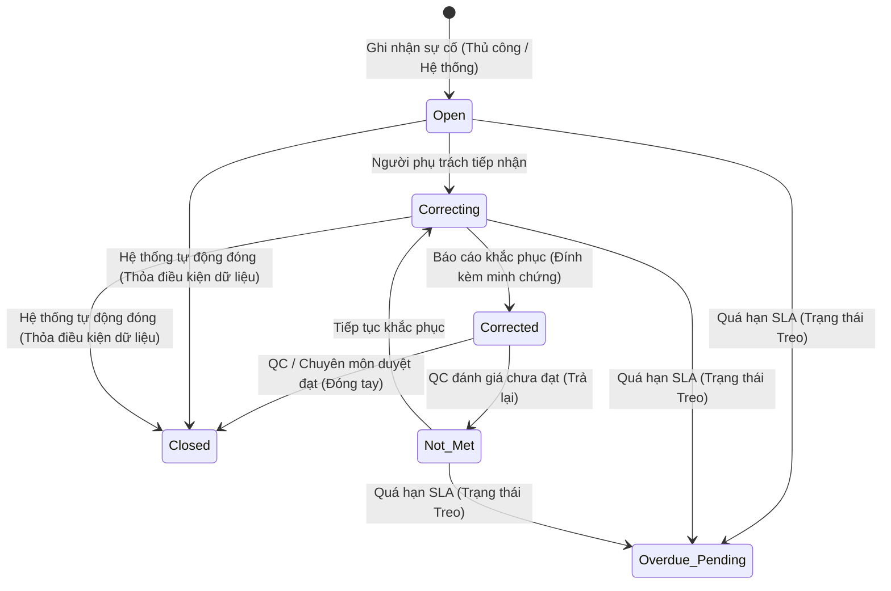

# BF-QA-02: Ghi nhận và Khắc phục Sự cố Chất lượng (Continuous QC & Incident Remediation)

> **Capability:** CAP-ACD (Năng lực Quản lý Học thuật & Đảm bảo Chất lượng)  
> **Giai đoạn:** 3 - Quản lý Học thuật & Vận hành Đào tạo  
> **Nhóm chức năng:** Kiểm soát & Cải tiến chất lượng (Quality Assurance & Improvement)  
> **Mã màn hình:** `qc_check`  
> **Mô hình vận hành:** Ghi nhận sự cố liên tục mọi lúc mọi nơi (Event-driven / Continuous Incidents), không phụ thuộc đợt kiểm tra hành chính.

---

## 1. Bản chất & Nguyên tắc Vận hành Cốt lõi

Hệ thống quản lý chất lượng Rinov5 chuyển đổi từ mô hình *Kiểm tra theo đợt hành chính định kỳ* sang mô hình **Quản lý sự cố chất lượng liên tục (Continuous Quality Incident Management)**:

1. **Ghi nhận tức thời mọi lúc mọi nơi:** Bất kỳ khi nào phát sinh vi phạm (trong giờ học, khi đi tuần cơ sở, khi phụ huynh phản ánh, hoặc hệ thống tự động quét), sự cố đều được ghi nhận trực tiếp vào hệ thống ngay tại thời điểm đó.
2. **Hỗ trợ Ghi nhận hàng loạt trong 1 lần thao tác:** Tại một phiên kiểm tra thực tế (ví dụ: đi thị sát cơ sở hoặc dự giờ ca học), người kiểm tra có thể phát hiện nhiều lỗi cùng lúc. Biểu mẫu (Form) cho phép ghi nhận N dòng lỗi đồng thời trong một lần gửi (Submit), giúp tiết kiệm thời gian và đảm bảo tính kịp thời.
3. **Đối tượng đánh giá đa chiều:** Gồm 3 nhóm đối tượng thực thể:
   - **Giáo viên:** Chuyên môn, tác phong, điểm danh học viên, nhận xét buổi học.
   - **Cơ sở vật chất (CSVC):** Phòng học, thiết bị giảng dạy, điều hòa, ánh sáng, vệ sinh, an toàn.
   - **Vận hành (CS / Chăm sóc khách hàng):** Điểm danh đầu giờ, gọi điện chăm sóc học viên mới sau buổi đầu, giải quyết khiếu nại, xử lý học bù/nghỉ học.
4. **Song hành 2 nguồn phát hiện:**
   - **Thủ công (Manual):** Do Kiểm tra viên QC hoặc Bộ phận chuyên môn trực tiếp ghi nhận.
   - **Tự động (System Bot):** Do máy chủ hệ thống tự động quét dữ liệu định kỳ (ví dụ: quá 30 phút sau giờ học chưa điểm danh, quá 24 giờ sau buổi đầu chưa có lịch sử chăm sóc).
5. **Cơ chế Đóng lỗi linh hoạt:**
   - Đóng bằng tay: Do QC / Chuyên môn nghiệm thu minh chứng và bấm Duyệt đạt.
   - Hệ thống tự đóng: Với lỗi tự động, máy chủ tự nhận diện khi dữ liệu đã được bổ sung hợp lệ (ví dụ: giáo viên đã hoàn thành điểm danh bù) để đóng lỗi tự động.
6. **Xử lý Trạng thái Treo (Overdue SLA):** Mọi sự cố đều có thời hạn khắc phục cam kết. Sự cố chưa được xử lý hoặc nghiệm thu khi quá hạn sẽ chuyển sang trạng thái cảnh báo **Treo / Quá hạn** để cấp quản lý can thiệp.

---

## 2. Kiến trúc 3 Thành phần: Biểu mẫu (Form) – Danh sách (List) – Chi tiết (Detail)

### 2.1. Biểu mẫu Ghi nhận Sự cố (Form)

- **Mục đích:** Cửa ngõ ghi nhận một hoặc hàng loạt sự cố chất lượng cùng lúc.
- **Điểm kích hoạt (Trigger Points):**
  1. *Thanh công cụ màn hình QC (`/app/qc_check`):* Bấm nút `[+ Ghi nhận sự cố]`.
  2. *Màn hình Chi tiết Buổi học (`Session Detail`):* Chuyên môn dự giờ bấm `[Ghi nhận lỗi buổi học]`, hệ thống tự điền sẵn Cơ sở, Lớp, Buổi học, Giáo viên.
  3. *Màn hình Quản lý Phòng học / CSVC:* Quản lý cơ sở bấm `[Báo lỗi phòng học]`, hệ thống tự điền sẵn Cơ sở, Mã phòng.
  4. *Cơ chế chạy nền tự động:* Máy chủ tự động tạo sự cố theo quy tắc hệ thống mà không cần mở biểu mẫu.
- **Lý do kích hoạt (Business Triggers):**
  - Kiểm tra đầu ngày/cuối ngày tại cơ sở.
  - Kiểm tra đột xuất không báo trước.
  - Dự giờ và đánh giá giảng dạy.
  - Sự cố thiết bị phát sinh đột xuất hoặc phụ huynh phản ánh trực tiếp.
  - Máy chủ quét phát hiện vi phạm mốc thời gian quy trình (SLA).
- **Cấu trúc Biểu mẫu:**
  - *Thông tin cơ sở & Người ghi nhận:* Chọn Cơ sở áp dụng và Tên kiểm tra viên.
  - *Khu vực nhập hàng loạt dòng sự cố:*
    - Nút chọn nhóm đối tượng: **Giáo viên**, **Cơ sở vật chất**, **Vận hành (CS)**.
    - Ngữ cảnh liên quan: Chọn Lớp học, Buổi học số X, hoặc Phòng học.
    - Tiêu chí vi phạm nhanh: Điểm danh, Chăm sóc, Nhận xét, CSVC, Giảng dạy, Vệ sinh.
    - Mức độ vi phạm: Thấp, Trung bình, Cao, Nghiêm trọng.
    - Mô tả sự cố và upload ảnh bằng chứng trực tiếp tại hiện trường.
    - Nút `[+ Thêm dòng sự cố khác]` để nhập N lỗi liên tiếp.

---

### 2.2. Bảng Danh sách Sự cố (List View)

- **Mục đích:** Trung tâm giám sát toàn bộ sự cố chất lượng, theo dõi tiến độ khắc phục và phát hiện lỗi treo quá hạn.
- **Dữ liệu hiển thị trên bảng:**
  1. **Mã sự cố:** Định danh duy nhất (VD: `QC-2026-001`).
  2. **Nguồn phát hiện:** Nhãn phân biệt `🤖 Hệ thống` vs `👤 Thủ công`.
  3. **Đối tượng & Ngữ cảnh:** Nhãn đối tượng kèm tên Lớp học, Buổi học số X, hoặc Phòng học.
  4. **Tiêu chí & Nội dung:** Tên tiêu chí lỗi và mô tả tóm tắt vi phạm.
  5. **Mức độ:** Thấp, Trung bình, Cao, Nghiêm trọng.
  6. **Bằng chứng:** Icon xem nhanh ảnh chụp hoặc link chứng cứ.
  7. **Người phụ trách:** Nhân sự được chỉ định khắc phục.
  8. **Hạn xử lý (SLA):** Ngày giờ phải hoàn thành, đổi màu cảnh báo nếu quá hạn.
  9. **Trạng thái vòng đời:** Mở, Đang khắc phục, Chờ duyệt, Đã đóng, Chưa đáp ứng.
  10. **Thao tác nhanh:** Tiếp nhận, Xem chi tiết, Duyệt đạt, Kiểm tra lại hệ thống.

---

### 2.3. Hộp thoại Chi tiết & Nghiệm thu (Detail View)

- **Mục đích:** Không gian tương tác hai chiều để người phụ trách nộp minh chứng khắc phục và người kiểm tra nghiệm thu đóng sự cố.
- **Nội dung hiển thị:**
  1. *Thông tin ngữ cảnh:* Mã sự cố, nguồn ghi nhận, đối tượng, lớp học, buổi học, cơ sở.
  2. *Vấn đề & Bằng chứng vi phạm lúc phát hiện:* Mô tả lỗi, ảnh chụp hiện trường phóng to, liên kết đính kèm.
  3. *Báo cáo phương án & Minh chứng sau khắc phục:* Người thực hiện, phương án xử lý, ảnh minh chứng sau khi sửa chữa/hoàn tất.
  4. *Bộ công cụ thao tác theo vai trò:*
     - Tiếp nhận khắc phục.
     - Nộp báo cáo khắc phục (chuyển sang Chờ duyệt).
     - Duyệt đạt (Đóng sự cố bằng tay).
     - Trả lại (Chưa đạt / yêu cầu khắc phục lại).
     - Kiểm tra lại hệ thống (dành cho sự cố tự động do bot quét).
  5. *Nhật ký thao tác (Audit Logs):* Vết lịch sử ghi nhận ai tạo, ai sửa, ai duyệt vào thời gian nào.
  6. *Trao đổi nội bộ (Comments):* Kênh thảo luận và giải trình giữa các bên liên quan.

---

## 3. Vòng đời Trạng thái Sự cố (Incident Lifecycle)

---

## 4. Danh mục Tiêu chí Đánh giá theo Từng Đối tượng

| Nhóm đối tượng | Hạng mục / Tiêu chí | Ngữ cảnh liên kết | Ví dụ vi phạm |
| :--- | :--- | :--- | :--- |
| **Giáo viên** | Điểm danh | Lớp học, Buổi học | Quên điểm danh trên phần mềm sau buổi học. |
| **Giáo viên** | Nhận xét học viên | Lớp học, Buổi học | Quá 48h chưa gửi nhận xét vào sổ liên lạc điện tử. |
| **Giáo viên** | Tác phong & Giáo án | Lớp học, Buổi học | Đi muộn 15 phút, không mang giáo án giảng dạy. |
| **Giáo viên** | Phương pháp giảng dạy | Lớp học, Buổi học | Không tương tác với học viên yếu, dạy sai giáo trình. |
| **Vận hành (CS)** | Điểm danh đầu giờ | Lớp học, Cơ sở | Không đón trả học viên, điểm danh thiếu học viên mới. |
| **Vận hành (CS)** | Chăm sóc buổi học đầu | Lớp học, Buổi học | Chưa gọi điện thoại hỏi thăm phụ huynh sau buổi 1. |
| **Vận hành (CS)** | Xử lý khiếu nại | Cơ sở | Phụ huynh phản ánh nhưng quá 24h chưa liên hệ lại. |
| **Cơ sở vật chất** | Thiết bị lớp học | Phòng học, Cơ sở | Máy chiếu mờ, máy tính phòng lab không mở được phần mềm. |
| **Cơ sở vật chất** | Nhiệt độ & Ánh sáng | Phòng học, Cơ sở | Điều hòa hỏng, nhiệt độ phòng 30 độ C, bóng đèn cháy. |
| **Cơ sở vật chất** | Vệ sinh & An toàn | Phòng học, Khu vực | Phòng bừa bộn, lối thoát hiểm bị thùng hàng che chắn. |
