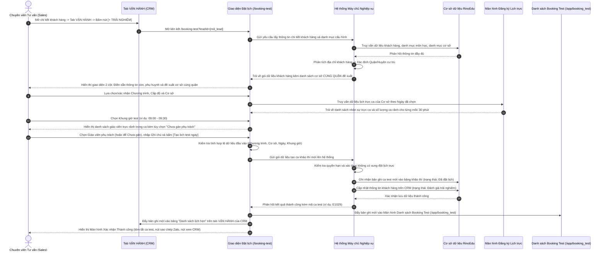

# US-ENR-01-08: Đặt lịch Booking Test từ CRM - Màn hình Khảo thí Năng lực học sinh từ Hệ thống CRM (Booking Test Creation from CRM)

> **Tham chiếu:** `BF-ENR-01` · `SR-PERSONA-STAFF` · Giao diện Mẫu §4.4 (Biểu mẫu & Hộp thoại chuẩn)  
> **Đường dẫn màn hình & Trạng thái liên quan:**  
> - `Điểm kích hoạt trên CRM:` Mở hộp thoại Chi tiết Khách hàng tại `https://crm.rinoedu.ai/contact/contact-list` $\rightarrow$ Chọn tab `VẬN HÀNH` $\rightarrow$ Nhấp nút `+ TRẢI NGHIỆM`  
> - `Màn hình Đặt lịch khảo thí:` `/booking-test?leadId=[mã_khách_hàng]` $\rightarrow$ Trạng thái sau tạo: `Đã đặt lịch` (`booked_assessment`)  
> - `Màn hình tiếp nhận dữ liệu:` Đẩy trực tiếp vào Màn hình Danh sách Booking Test `/app/booking_test` (US-ENR-01-07) và Bảng Danh sách lịch hẹn trên tab VẬN HÀNH của CRM

---

## 1. NHẬT KÝ THAY ĐỔI & BỐI CẢNH (CHANGELOG & CONTEXT)

### Lịch sử cập nhật tài liệu (Changelog)

| Ngày cập nhật | Nội dung cập nhật | Lý do cập nhật |
|---|---|---|
| 05/11/2026 | **Phiên bản phát hành lần đầu (v1.0.0):** Khởi tạo tài liệu đặc tả chức năng hoàn chỉnh cho Màn hình Đặt lịch Khảo thí Năng lực (Booking Test) từ hệ thống CRM: tích hợp điểm kích hoạt từ nút `+ TRẢI NGHIỆM` tại tab Vận hành của CRM, tự động nạp hồ sơ khách hàng, cơ chế đề xuất cơ sở cùng Quận/Huyện, lưới chọn ca 30 phút tích hợp lịch trực ca (Shift Roster), nút sao chép mẫu tin Zalo và quy trình đẩy dữ liệu hai chiều về ERP & CRM. | Chuẩn hóa quy trình đặt lịch trải nghiệm và đánh giá năng lực học sinh đồng bộ giữa CRM và trung tâm giáo dục RinoEdu. |

### Bối cảnh & Vấn đề nghiệp vụ (Context & Problem)

* **Bối cảnh vận hành:**
  - Trên hệ thống quản lý quan hệ khách hàng CRM (`https://crm.rinoedu.ai/contact/contact-list`), khi chuyên viên tư vấn mở hộp thoại "Thông tin cơ bản" của một khách hàng, tại cột bên phải có cụm tab nghiệp vụ (`TRAO ĐỔI`, `VẬN HÀNH`, `LOG`, `VẬN ĐƠN LOG`, `ĐƠN HÀNG`, `LỊCH SỬ HỖ TRỢ`, `ĐIỀU KHOẢN`).
  - Trong tab **`VẬN HÀNH`**, hệ thống bố trí 3 nút chức năng cốt lõi:
    1. `+ LỊCH PHỎNG VẤN` (màu cam)
    2. **`+ TRẢI NGHIỆM`** (màu xanh dương đậm) — *Điểm kích hoạt mở màn hình đặt lịch khảo thí*
    3. `+ HỌC THỬ` (màu trắng viền xám)
  - Phía dưới 3 nút trên là bảng **"Danh sách lịch hẹn"** (gồm các cột `User`, `Thời gian`, `Mô tả`, `Thao tác`) dùng để lưu vết toàn bộ các lịch hẹn khảo thí và học thử của khách hàng.
* **Vấn đề cần giải quyết & Giải pháp chuẩn hóa:**
  1. *Quy trình mở màn hình đặt lịch từ nút `+ TRẢI NGHIỆM`:* Khi bấm nút `+ TRẢI NGHIỆM`, hệ thống điều hướng mở màn hình chuyên dụng `/booking-test?leadId=[mã_khách_hàng]` với đầy đủ hồ sơ học sinh và phụ huynh được nạp sẵn.
  2. *Cơ chế đề xuất cơ sở theo CÙNG QUẬN / HUYỆN:* Hệ thống bóc tách thông tin Quận/Huyện trong chuỗi địa chỉ của phụ huynh (ví dụ: "Phường Võ Thị Sáu, **Quận 3**, TP.HCM" $\rightarrow$ nhận diện từ khóa `Quận 3`) để lọc và đề xuất ưu tiên các cơ sở của RinoEdu nằm trên cùng Quận 3 (ví dụ: `RinoEdu Võ Thị Sáu (Quận 3)`). Không hiển thị số km đo khoảng cách.
  3. *Liên kết chặt chẽ với Màn hình Đăng ký Lịch trực:* Danh sách giáo viên trực ca được lấy trực tiếp từ bảng phân bổ nhân sự trực ca đã được quản lý cơ sở duyệt tại Màn hình Đăng ký Lịch trực (`/app/hr_shift_roster` / US-HR-02-08 / US-HR-02-09).
  4. *Đẩy dữ liệu hai chiều sau khi hoàn tất:* Sau khi bấm "Tạo lịch test ngay", ca test được ghi nhận vào cơ sở dữ liệu và tự động:
     - Đẩy về Màn hình Danh sách Booking Test của trung tâm (`/app/booking_test` - US-ENR-01-07) để quản lý cơ sở và giáo viên tiếp nhận, check-in và chấm điểm.
     - Đẩy vào bảng `Danh sách lịch hẹn` trên tab VẬN HÀNH của CRM để tư vấn viên theo dõi quá trình chăm sóc.
* **Mục tiêu & Giá trị mang lại:**
  - Giảm thiểu thời gian tạo lịch khảo thí từ 3 phút xuống dưới 45 giây nhờ cơ chế điền tự động hồ sơ từ CRM.
  - Triệt tiêu 100% tình trạng gán giáo viên bị trùng lịch hoặc đặt ca vào giờ không có nhân sự trực tại cơ sở.
  - Tự động hóa soạn thảo tin nhắn xác nhận lịch hẹn gửi qua Zalo cho phụ huynh với độ chính xác tuyệt đối.
* **Chỉ số đo lường hiệu quả (KPI Target):**
  - Thời gian hoàn tất 1 ca đặt lịch từ nút `+ TRẢI NGHIỆM`: Dưới 45 giây.
  - Tỷ lệ ca test được đẩy thành công đồng thời về CRM và ERP: Đạt 100%.
  - Tỷ lệ sai lệch địa chỉ hoặc chọn nhầm cơ sở khác quận: Giảm trên 90%.

### Hiểu người dùng & Tình huống sử dụng (User Needs & Use Cases)

* **Người dùng chính (Persona):**
  - `PERSONA-SALES` (Chuyên viên Tư vấn tuyển sinh): Nhấp nút `+ TRẢI NGHIỆM` từ tab Vận hành trên CRM khi phụ huynh đồng ý cho con tham gia trải nghiệm/khảo thí trình độ.
  - `PERSONA-BRANCH-MANAGER` (Quản lý Cơ sở / Trưởng chi nhánh): Đăng ký phân bổ lịch trực cho giáo viên tại Màn hình Đăng ký Lịch trực; tiếp nhận ca test mới tạo trên Màn hình Danh sách Booking Test.
  - `PERSONA-CSM` (Quản lý Học vụ / Khảo thí): Theo dõi lịch hẹn tại cơ sở, tiếp nhận học sinh tại quầy lễ tân để check-in và hướng dẫn vào phòng khảo thí.
* **Nhu cầu thực tế (Needs):**
  - Tư vấn viên cần mở màn hình đặt lịch với thông tin khách hàng điền sẵn, thấy ngay các cơ sở cùng quận với phụ huynh và chọn khung giờ có giáo viên đang trực rảnh.
  - Quản lý chi nhánh cần nắm được ngay ca test mới tạo trên màn hình danh sách cơ sở để chuẩn bị phòng máy tính bảng và giáo viên.
* **Câu phát biểu nghiệp vụ:** **Là một** Chuyên viên Tư vấn tuyển sinh (Sales), **tôi muốn** từ tab Vận hành trên CRM nhấp nút `+ TRẢI NGHIỆM` để mở biểu mẫu đặt lịch với thông tin khách hàng điền sẵn, thấy ngay các cơ sở cùng quận với phụ huynh và chọn khung giờ có giáo viên đang trực rảnh, **để** đặt lịch khảo thí nhanh gọn, chính xác, không bị trùng lịch giáo viên và ca test được đẩy ngay về màn hình danh sách của trung tâm cơ sở.

### Phạm vi kiểm soát & Ràng buộc nghiệp vụ (Scope & Business Rules)

* **Phạm vi kiểm soát (Feature Scope):**

| Mã Yêu Cầu | Hạng mục chức năng | Mức ưu tiên | Phạm vi hiển thị | Mô tả chi tiết |
|---|---|---|---|---|
| **REQ-FORM-01** | Kế thừa dữ liệu hồ sơ từ CRM qua tham số liên kết | Bắt buộc (Must) | Toàn bộ giao diện | Nạp tự động thông tin phụ huynh, học sinh, môn học quan tâm và ghi chú từ mã khách hàng |
| **REQ-FORM-02** | Đề xuất cơ sở CÙNG QUẬN / HUYỆN với phụ huynh | Bắt buộc (Must) | Nhóm 1 cột trái | So khớp chuỗi quận/huyện từ địa chỉ khách hàng để đề xuất danh sách cơ sở cùng quận |
| **REQ-FORM-03** | Lưới chọn ca 30 phút kèm số lượng ca trực rảnh | Bắt buộc (Must) | Nhóm 2 cột trái | Hiển thị 4 ngày chọn nhanh, nút ngày khác, tab lọc buổi và lưới các ca 30 phút |
| **REQ-FORM-04** | Tích hợp nhân sự từ Màn hình Đăng ký Lịch trực | Bắt buộc (Must) | Nhóm 3 cột trái | Nạp danh sách giáo viên trực ca theo ngày/giờ, hỗ trợ tùy chọn Chưa gán phụ trách |
| **REQ-FORM-05** | Thẻ tóm tắt lịch hẹn và nút sao chép tin nhắn Zalo | Bắt buộc (Must) | Sidebar cột phải | Hiển thị tóm tắt đầy đủ, nút sao chép mẫu tin Zalo 1 chạm và nút Tạo lịch test ngay |
| **REQ-FORM-06** | Đẩy dữ liệu hai chiều về ERP và CRM sau khi tạo | Bắt buộc (Must) | Hệ thống sau lưu | Đẩy ca test mới về Màn hình Danh sách Booking Test (/app/booking_test) và bảng lịch hẹn CRM |
| **REQ-FORM-07** | Màn hình Xác nhận Thành công và điều hướng | Bắt buộc (Must) | Màn hình sau lưu | Hiển thị mã ca test, các nút điều hướng về CRM, về danh sách hoặc tạo thêm ca mới |

* **Ràng buộc nghiệp vụ toàn cục (Global Rules):**
  - **[RULE-BT-01] Khóa cứng thời lượng ca khảo thí 30 phút:** Mỗi ca đánh giá năng lực được ấn định cố định thời lượng 30 phút (bắt đầu từ các mốc :00 hoặc :30 như 08:00 - 08:30, 08:30 - 09:00). Không cho phép tùy biến thời lượng để tránh xô lệch lịch trực ca của giáo viên tại cơ sở.
  - **[RULE-BT-02] Che số điện thoại chống sao chép dữ liệu khách hàng:** Trên thẻ tóm tắt và các khu vực xem trước thông tin, số điện thoại phụ huynh bắt buộc phải che 4 chữ số ở giữa theo định dạng `095****322` để đảm bảo an toàn thông tin khách hàng. Chỉ hiển thị số điện thoại đầy đủ ở khối thông tin chỉnh sửa dành riêng cho người dùng có thẩm quyền.
  - **[RULE-BT-03] Cơ chế đề xuất cơ sở CÙNG QUẬN / HUYỆN (Không dùng GPS):** Hệ thống quét chuỗi văn bản địa chỉ của khách hàng để nhận diện tên Quận/Huyện. Khi phát hiện quận tương ứng, dải gợi ý nhanh sẽ hiển thị các cơ sở có cùng Quận/Huyện kèm nhãn chỉ dẫn (ví dụ: `Cơ sở Võ Thị Sáu (Cùng Quận 3)`). Tuyệt đối không hiển thị số km giả lập.
  - **[RULE-BT-04] Ràng buộc nhân sự theo Màn hình Đăng ký Lịch trực:** Hệ thống chỉ tải danh sách giáo viên có ca trực hợp lệ tại cơ sở trong ngày theo dữ liệu phân bổ từ phân hệ Đăng ký lịch trực. Giáo viên đã có lịch dạy lớp hoặc có ca test khác trong khung giờ 30 phút sẽ bị khóa chọn và hiển thị trạng thái "Bận".
  - **[RULE-BT-05] Đẩy dữ liệu đồng thời về ERP và CRM:** Khi ca test được tạo thành công, bản ghi mới lập tức xuất hiện trên Màn hình Danh sách Booking Test (`/app/booking_test`) ở trạng thái `Đã đặt lịch test`, đồng thời hiển thị trong bảng `Danh sách lịch hẹn` trên tab VẬN HÀNH của CRM và chuyển trạng thái khách hàng sang `danh_gia_trai_nghiem`.

---

## 2. LUỒNG XỬ LÝ CHÍNH (MAIN FLOW - HAPPY PATH)

---

## 3. GIAO DIỆN, CẤU TRÚC BIỂU MẪU & PHÂN QUYỀN (DATA, UI STATE & PERMISSION MATRIX)

**Bố cục tổng thể 2 cột:**
- **Cột Trái (Thao tác chính):** Quy trình 4 bước: (1) Chọn chương trình, cấp độ, cơ sở (có dải đề xuất cơ sở cùng quận); (2) Chọn ngày & khung giờ test 30 phút; (3) Phân bổ nhân sự trực ca; (4) Nhập ghi chú ca test.
- **Cột Phải (Thanh bên cố định):** (1) Thông tin phụ huynh & học sinh kế thừa từ CRM; (2) Thẻ tóm tắt lịch hẹn kèm nút sao chép tin nhắn Zalo và nút hành động "Tạo lịch test ngay".

### 3.1. Cấu trúc các trường nhập liệu & Ràng buộc kiểm tra (Validation Rules)

| Tên trường thông tin | Kiểu hiển thị | Bắt buộc | Nguồn dữ liệu | Định dạng & Giới hạn | Diễn giải quy tắc kiểm duyệt dữ liệu |
|---|---|:---:|---|---|---|
| **Chương trình** | Ô chọn thả xuống | **Có (*)** | Danh mục chương trình đào tạo của hệ thống | Danh sách lựa chọn đơn | Chọn chương trình khảo thí. Tự động điền theo môn học quan tâm trên CRM nếu có. Khi thay đổi: tự động xóa giá trị Cấp độ dự kiến và tải danh mục cấp độ tương ứng. |
| **Level dự kiến** | Ô chọn thả xuống | Không | Danh mục cấp độ theo chương trình | Danh sách lựa chọn đơn | Cấp độ học tập dự kiến của học sinh. Bị vô hiệu hóa khi chưa chọn Chương trình. Nếu học sinh $\le 6$ tuổi, hệ thống tự động gợi ý cấp độ mẫu giáo tương ứng. |
| **Cơ sở / Trung tâm** | Ô chọn thả xuống | **Có (*)** | Danh mục chi nhánh cơ sở trung tâm đang hoạt động | Danh sách lựa chọn đơn | Chọn cơ sở nơi diễn ra ca khảo thí. Mỗi dòng hiển thị tên cơ sở kèm thông tin Quận/Huyện và địa chỉ chi tiết. |
| **Đề xuất cơ sở Cùng Quận** | Dải liên kết văn bản nhanh | Không | So khớp từ khóa Quận/Huyện giữa địa chỉ phụ huynh và cơ sở | Danh sách các cơ sở cùng quận | Hiển thị các cơ sở có cùng Quận/Huyện với địa chỉ của học sinh (ví dụ: `Võ Thị Sáu (Cùng Quận 3)`). Nhấp vào liên kết sẽ tự động chọn ngay cơ sở đó vào ô Cơ sở. Nếu không tìm thấy cơ sở cùng quận, dải đề xuất tự động ẩn. |
| **4 Ngày chọn nhanh** | Hàng 4 nút bấm chọn | **Có (*)** | 4 ngày liên tiếp bắt đầu từ ngày hiện tại | Định dạng `[Thứ, Ngày/Tháng]` | Nút hiển thị ngắn gọn (ví dụ: `T5, 05/11`, `T6, 06/11`). Nhấp chọn 1 ngày sẽ kích hoạt ngày đó và tải lại bảng khung giờ tương ứng. |
| **Nút Ngày khác** | Nút bấm mở bảng lịch | Không | Bộ chọn lịch (Calendar Popover) | Định dạng `YYYY-MM-DD` | Dành cho trường hợp phụ huynh đặt lịch xa hơn 4 ngày. Khóa toàn bộ các ngày trong quá khứ và 4 ngày đã hiển thị ở hàng chọn nhanh. |
| **Phân đoạn Buổi** | Dải nút chuyển tab | Không | Cấu hình buổi: Sáng, Chiều, Tối, Tất cả | 4 lựa chọn đơn | Cho phép lọc nhanh các ca test theo buổi: `☀️ Sáng` (08:00 - 11:30), `🌤 Chiều` (14:00 - 17:30), `🌙 Tối` (18:00 - 20:30) hoặc `Tất cả`. Mặc định chọn Buổi sáng hoặc theo ca đang chọn. |
| **Lưới Khung giờ test** | Lưới các nút ca 30 phút (4 cột) | **Có (*)** | Danh mục khung giờ chuẩn 30 phút | Danh sách các ca 30 phút | Mỗi nút hiển thị giờ bắt đầu. Kèm huy hiệu trạng thái: Nếu có giáo viên trực rảnh hiển thị `X rảnh` (xanh lá); nếu hết giáo viên rảnh hiển thị `Hết chỗ` (đỏ viền đứt); khi chọn hiển thị `Đã chọn`. Báo lỗi nếu bấm gửi mà chưa chọn giờ. |
| **Chưa gán Phụ trách** | Thẻ lựa chọn ưu tiên | Không | Mặc định hệ thống | Thẻ chọn có biểu tượng | Cho phép lưu lịch test mà chưa cần chỉ định giáo viên cụ thể. Thích hợp khi đặt lịch trước nhiều ngày hoặc để quản lý cơ sở phân công sau. |
| **Danh sách Nhân sự trực ca** | Lưới các thẻ nhân sự (2 cột) | Không | Dữ liệu từ Màn hình Đăng ký Lịch trực theo cơ sở và ngày | Danh sách nhân viên trực | Hiển thị các giáo viên / trợ giảng có ca trực tại cơ sở trong ngày và khung giờ đã chọn. Khóa không cho chọn nhân sự đang bị trùng ca dạy hoặc ca test khác. |
| **Ghi chú ca test** | Ô nhập văn bản nhiều dòng | Không | Người dùng nhập hoặc kế thừa từ CRM | Tối đa 500 ký tự | Ghi nhận các yêu cầu đặc biệt của phụ huynh hoặc các lưu ý chuyên môn cho giáo viên khảo thí. Mặc định tự động nạp ghi chú gần nhất từ CRM (`lastNote`). |
| **Họ tên Phụ huynh** | Văn bản hiển thị kèm vai trò | **Có (*)** | Hồ sơ khách hàng trên CRM | Văn bản chữ | Hiển thị họ tên đầy đủ của phụ huynh kèm vai trò trong ngoặc (ví dụ: `Bùi Phương Thảo (Mẹ)`). |
| **Số điện thoại Phụ huynh** | Văn bản kèm nút sao chép | **Có (*)** | Hồ sơ khách hàng trên CRM | Chuỗi 10 chữ số | Hiển thị số điện thoại liên lạc. Có nút bấm sao chép nhanh 1 chạm kèm biểu tượng thông báo sao chép thành công. |
| **Địa chỉ & Liên kết Bản đồ** | Văn bản kèm liên kết ngoài | Không | Hồ sơ khách hàng trên CRM | Chuỗi văn bản địa chỉ | Hiển thị địa chỉ cư trú của phụ huynh kèm biểu tượng định vị đỏ và liên kết mở Google Maps trong tab mới. Dùng làm căn cứ so khớp đề xuất cơ sở cùng quận. |
| **Họ tên Con / Học sinh** | Văn bản in đậm nổi bật | **Có (*)** | Hồ sơ học sinh trên CRM | Văn bản chữ | Hiển thị họ tên của học sinh sẽ tham gia đánh giá năng lực (ví dụ: `Bé Hà`). |

### 3.2. Nút hành động biểu mẫu

| Tên nút | Kiểu hiển thị | Logic xử lý nghiệp vụ | Mã Quyền Yêu Cầu (Required Capability) |
|---|---|---|---|
| **Sao chép tin nhắn Zalo** | Nút bấm phụ trên tiêu đề thẻ tóm tắt | Tổng hợp toàn bộ thông tin ca test vào bản mẫu tin Zalo chuẩn mực $\rightarrow$ Sao chép vào bộ nhớ tạm $\rightarrow$ Đổi nhãn `Đã chép` trong 2.5 giây | `admissions.booking_test.create` |
| **Quay lại CRM** | Nút viền nhạt góc trên màn hình | Hủy bỏ phiên đặt lịch, không lưu thông tin, quay trở lại màn hình quản lý liên hệ CRM | `admissions.booking_test.view` |
| **Tạo lịch test ngay** | Nút màu nhấn xanh lục (Emerald) | Kiểm tra dữ liệu bắt buộc $\rightarrow$ Gửi lưu máy chủ $\rightarrow$ Đẩy dữ liệu về Danh sách Booking Test (/app/booking_test) & CRM $\rightarrow$ Chuyển màn hình thành công | `admissions.booking_test.create` |

### 3.3. Bảng Phân quyền Năng lực Động (Permission Matrix)

Biểu mẫu áp dụng cơ chế kiểm soát theo **Mã Quyền Động (Atomic Capabilities)** được cấp phát từ hệ thống CRM:

| Vùng Giao diện / Nút Thao Tác | Loại Hiển Thị | Mã Quyền Yêu Cầu (Required Capability) | Xử Lý Khi Không Đủ Quyền |
|---|---|---|---|
| **Truy cập Màn hình Đặt lịch khảo thí** | Toàn bộ giao diện `/booking-test` | `admissions.booking_test.create` | Chặn truy cập, hiển thị thông báo không có quyền |
| **Lựa chọn Chi nhánh Cơ sở trung tâm** | Ô chọn Cơ sở | `admissions.branch.switch` | Cố định ở cơ sở được chỉ định, khóa danh sách chọn cơ sở khác |
| **Chỉ định Giáo viên phụ trách trực ca** | Thẻ chọn nhân sự trực ca | `admissions.booking_test.assign` | Khóa chọn giáo viên cụ thể, tự động chuyển về tùy chọn "Chưa gán Phụ trách" |
| **Thực thi Tạo lịch khảo thí** | Nút "Tạo lịch test ngay" | `admissions.booking_test.create` | Vô hiệu hóa nút tạo lịch, hiển thị thông báo chỉ xem |

---

## 4. KHỐI CHỨC NĂNG CHI TIẾT: ACTION & LUỒNG KÍCH HOẠT (ACTIONS & EVENTS)

### Khối chức năng 1: Kế thừa Dữ liệu Khách hàng từ Nút Trải nghiệm CRM

#### Action 1.1: Nhấp nút `+ TRẢI NGHIỆM` trên tab VẬN HÀNH của CRM
* **Luồng kích hoạt:** Người dùng đang xem hồ sơ khách hàng tại `https://crm.rinoedu.ai/contact/contact-list`, chuyển sang tab `VẬN HÀNH` và nhấp nút `+ TRẢI NGHIỆM`.
* **Tiêu chí nghiệm thu (Acceptance Criteria):**
  - **AC-1 (Happy Path - Mở màn hình đặt lịch và kế thừa dữ liệu đầy đủ):**
    - **Giả sử:** Chuyên viên tư vấn đang mở hồ sơ khách hàng hợp lệ trên CRM (ví dụ: `lead-010` - Bé Hà, Phụ huynh Bùi Phương Thảo).
    - **Khi:** Người dùng nhấp vào nút `+ TRẢI NGHIỆM` tại tab VẬN HÀNH.
    - **Thì:** Hệ thống mở đường dẫn `/booking-test?leadId=lead-010`, tự động điền sẵn toàn bộ thông tin phụ huynh (Bùi Phương Thảo), vai trò (Mẹ), SĐT, địa chỉ cư trú; tự động điền thông tin học sinh (Bé Hà, 5 tuổi, trường học, học lực); tự động ánh xạ môn học sang Chương trình đào tạo và cấp độ phù hợp, đồng thời nạp ghi chú gần nhất vào ô Ghi chú ca test.
  - **AC-2 (Luồng xử lý khi mở trực tiếp không qua nút CRM):**
    - **Giả sử:** Người dùng truy cập màn hình `/booking-test` mà không truyền tham số `leadId` hoặc truyền mã không tìm thấy.
    - **Khi:** Giao diện hiển thị.
    - **Thì:** Hệ thống hiển thị ô tìm kiếm phụ huynh (Contact Searchable Select) cho phép tìm kiếm khách hàng hiện có hoặc bấm nút "+ Thêm phụ huynh mới" để tạo khách hàng trực tiếp trên giao diện.

---

### Khối chức năng 2: Thiết lập Chương trình, Cấp độ & Đề xuất Cơ sở Cùng Quận

#### Action 2.1: Đề xuất và chọn cơ sở khảo thí theo Quận/Huyện
* **Luồng kích hoạt:** Hệ thống phân tích địa chỉ của khách hàng hoặc người dùng nhấp chọn ô Cơ sở.
* **Tiêu chí nghiệm thu (Acceptance Criteria):**
  - **AC-3 (Happy Path - Đề xuất nhanh cơ sở CÙNG QUẬN với địa chỉ khách hàng):**
    - **Giả sử:** Khách hàng có địa chỉ cư trú ghi nhận "Phường Võ Thị Sáu, Quận 3, TP.HCM".
    - **Khi:** Màn hình hoàn tất nạp thông tin.
    - **Thì:** Hệ thống nhận diện từ khóa "Quận 3" và hiển thị dải liên kết các cơ sở của RinoEdu nằm trên Quận 3 (ví dụ: `RinoEdu Võ Thị Sáu (Cùng Quận 3)`), không hiển thị số km đo khoảng cách; khi người dùng nhấp vào liên kết, ô Cơ sở lập tức được chọn sang cơ sở đó và hệ thống tự động tải lịch trực ca tương ứng.
  - **AC-4 (Luồng xử lý khi địa chỉ khách hàng không có cơ sở cùng quận):**
    - **Giả sử:** Khách hàng cư trú tại một quận/huyện mà trung tâm chưa có chi nhánh cơ sở.
    - **Khi:** Hệ thống kiểm tra địa chỉ.
    - **Thì:** Dải đề xuất cùng quận tự động ẩn, ô chọn Cơ sở hiển thị danh sách toàn bộ các chi nhánh trung tâm theo thứ tự bảng chữ cái để tư vấn viên và phụ huynh chủ động lựa chọn cơ sở thuận tiện nhất.

---

### Khối chức năng 3: Lựa chọn Ngày & Khung giờ Khảo thí 30 phút

#### Action 3.1: Chọn ngày và khung giờ khảo thí
* **Luồng kích hoạt:** Người dùng nhấp vào nút ngày hoặc một khung giờ trong lưới giờ test.
* **Tiêu chí nghiệm thu (Acceptance Criteria):**
  - **AC-5 (Happy Path - Đổi ngày và tải lại trạng thái khung giờ):**
    - **Giả sử:** Người dùng đã chọn Cơ sở và đang xem danh sách khung giờ của ngày hiện tại.
    - **Khi:** Người dùng nhấp sang một nút ngày khác (ví dụ: ngày mai `T6, 06/11`).
    - **Thì:** Hệ thống kích hoạt nút ngày được chọn, truy vấn lại số lượng giáo viên trực ca của ngày mới tại cơ sở đó từ Màn hình Đăng ký Lịch trực, hiển thị số ca rảnh trên từng nút giờ và đặt lại lựa chọn khung giờ nếu khung giờ đó không còn hợp lệ.
  - **AC-6 (Happy Path - Chọn khung giờ test và hiển thị trạng thái):**
    - **Giả sử:** Người dùng nhấp chọn ca test `09:00` (khung thời gian 09:00 - 09:30) đang có trạng thái `2 rảnh`.
    - **Khi:** Thao tác nhấp hoàn tất.
    - **Thì:** Nút ca test chuyển sang màu nhấn chủ đạo, hiển thị nhãn `Đã chọn`, Thẻ tóm tắt ở cột phải lập tức cập nhật mốc thời gian `T5, 05/11 • 09:00 - 09:30`, đồng thời khu vực Phân bổ nhân sự bên dưới tự động tải danh sách các nhân sự đang trực trong khung giờ đó.

---

### Khối chức năng 4: Phân bổ Nhân sự Phụ trách từ Màn hình Đăng ký Lịch trực

#### Action 4.1: Chỉ định giáo viên khảo thí từ lịch trực ca
* **Luồng kích hoạt:** Người dùng nhấp chọn thẻ nhân sự trong danh sách hoặc nhấp chọn "Chưa gán Phụ trách".
* **Tiêu chí nghiệm thu (Acceptance Criteria):**
  - **AC-7 (Happy Path - Chọn giáo viên trực rảnh và khóa giáo viên bận):**
    - **Giả sử:** Danh sách nhân sự trực ca được tải từ Màn hình Đăng ký Lịch trực hiển thị cả nhân viên rảnh và nhân viên bận ca dạy.
    - **Khi:** Người dùng nhấp chọn một giáo viên đang ở trạng thái "Rảnh".
    - **Thì:** Thẻ giáo viên đó nhận đường viền nhấn nổi bật kèm biểu tượng tích xanh, tên giáo viên lập tức xuất hiện tại Thẻ tóm tắt ở cột phải; đồng thời nếu người dùng cố ý nhấp vào giáo viên đang có trạng thái "Bận", hệ thống sẽ vô hiệu hóa thao tác và giữ nguyên lựa chọn hiện tại.
  - **AC-8 (Happy Path - Lựa chọn lưu ở chế độ Chưa gán phụ trách):**
    - **Giả sử:** Chưa xác định được giáo viên khảo thí cụ thể hoặc muốn quản lý học vụ phân công sau.
    - **Khi:** Người dùng nhấp chọn thẻ "Chưa gán Phụ trách".
    - **Thì:** Hệ thống đánh dấu chọn thẻ này, Thẻ tóm tắt ở cột phải hiển thị nhãn cam `Chưa gán (Phân công sau)` và biểu mẫu vẫn hoàn toàn đủ điều kiện để lưu thành công.

---

### Khối chức năng 5: Tóm tắt, Sao chép Tin Zalo & Đẩy Dữ liệu về Danh sách

#### Action 5.1: Sao chép mẫu tin Zalo gửi phụ huynh
* **Luồng kích hoạt:** Người dùng nhấp nút "Sao chép" trên tiêu đề Thẻ tóm tắt.
* **Tiêu chí nghiệm thu (Acceptance Criteria):**
  - **AC-9 (Happy Path - Sao chép nội dung tin nhắn Zalo chuẩn mực):**
    - **Giả sử:** Các thông tin ca test (học sinh, phụ huynh, ngày giờ, cơ sở, chương trình) đã được chọn đầy đủ.
    - **Khi:** Người dùng nhấp vào nút "Sao chép".
    - **Thì:** Hệ thống tự động tổng hợp đoạn văn bản xác nhận chuẩn mực có đầy đủ lời chào kính gửi phụ huynh, tên học sinh, chương trình học, thời gian thi, cơ sở và địa chỉ cụ thể, tên giáo viên phụ trách cùng lời dặn phụ huynh đưa con đến trước 10-15 phút; sao chép nội dung vào bộ nhớ tạm của máy tính, nút chuyển sang biểu tượng tích xanh với chữ `Đã chép` trong 2.5 giây và hiển thị thông báo thành công nổi.

#### Action 5.2: Bấm nút Tạo lịch test ngay và đẩy dữ liệu hai chiều
* **Luồng kích hoạt:** Người dùng nhấp nút "Tạo lịch test ngay" ở chân Thẻ tóm tắt.
* **Tiêu chí nghiệm thu (Acceptance Criteria):**
  - **AC-10 (Happy Path - Tạo lịch test thành công và đẩy dữ liệu về ERP & CRM):**
    - **Giả sử:** Người dùng đã điền đầy đủ các trường thông tin bắt buộc (Chương trình, Cơ sở, Ngày test, Khung giờ test).
    - **Khi:** Người dùng nhấp nút "Tạo lịch test ngay".
    - **Thì:** Hệ thống kiểm tra dữ liệu hợp lệ, lưu bản ghi mới với mã tự sinh (ví dụ: `E1029`) ở trạng thái `Đã đặt lịch`; lập tức đẩy bản ghi mới vào Màn hình Danh sách Booking Test (`/app/booking_test`), đẩy dòng lịch hẹn mới vào bảng `Danh sách lịch hẹn` trên tab VẬN HÀNH của CRM, cập nhật trạng thái khách hàng sang `Đánh giá trải nghiệm`, hiển thị thông báo thành công và chuyển sang màn hình Xác nhận Thành công.
  - **AC-11 (Luồng lỗi - Chặn lưu khi thiếu trường thông tin bắt buộc):**
    - **Giả sử:** Người dùng chưa chọn Khung giờ test hoặc chưa chọn Cơ sở trung tâm.
    - **Khi:** Người dùng nhấp nút "Tạo lịch test ngay".
    - **Thì:** Hệ thống chặn hành động lưu, giữ nguyên toàn bộ dữ liệu trên màn hình và hiển thị thông báo cảnh báo lỗi cụ thể (ví dụ: "Vui lòng chọn khung giờ test" hoặc "Vui lòng chọn trung tâm / cơ sở test").

---

### Khối chức năng 6: Điều hướng Sau khi Đặt lịch Thành công

#### Action 6.1: Thao tác trên Màn hình Xác nhận Thành công
* **Luồng kích hoạt:** Người dùng nhấp vào các nút điều hướng trên màn hình thành công.
* **Tiêu chí nghiệm thu (Acceptance Criteria):**
  - **AC-12 (Happy Path - Điều hướng về danh sách hoặc xem hồ sơ CRM):**
    - **Giả sử:** Màn hình Xác nhận Thành công đang hiển thị sau khi tạo lịch xong.
    - **Khi:** Người dùng nhấp nút "Về danh sách Booking test".
    - **Thì:** Hệ thống điều hướng chuyển trang về màn hình quản trị danh sách ca test `/app/booking_test` với danh sách đã được tự động làm mới để hiển thị ngay ca test vừa tạo ở đầu danh sách.

---

## 5. CÁC TRƯỜNG HỢP GÓC CẠNH & LUỒNG NGOẠI LỆ (CORNER CASES & EXCEPTION FLOWS)

- **[CASE-01] Học sinh đang có ca khảo thí khác chưa hoàn tất (Duplicate Active Booking):**
  - *Tình huống:* Chuyên viên tư vấn bấm nút `+ TRẢI NGHIỆM` cho một học sinh đang có sẵn một ca khảo thí đã đặt trước đó nhưng chưa đến ngày thi hoặc chưa có kết quả đánh giá cuối cùng.
  - *Cách xử lý:* Hệ thống cảnh báo thông báo nổi rõ ràng: "Học sinh [Tên học sinh] hiện đang có một ca khảo thí chưa hoàn tất vào ngày [Ngày - Giờ] tại cơ sở [Tên cơ sở]. Vui lòng hủy hoặc hoàn tất ca hiện tại trước khi tạo lịch mới." Đồng thời cung cấp nút bấm nhanh để mở xem ca test hiện tại.
- **[CASE-02] Giáo viên bị xung đột ca trực đột xuất tại thời điểm bấm lưu (Concurrency / Shift Conflict):**
  - *Tình huống:* Trong lúc tư vấn viên đang chọn giáo viên A, quản lý học vụ tại cơ sở vừa phân công giáo viên A vào một ca dạy chính khóa đột xuất trên màn hình Đăng ký Lịch trực hoặc một tư vấn viên khác vừa xếp lịch cho giáo viên A trước đó vài giây.
  - *Cách xử lý:* Tại bước bấm "Tạo lịch test ngay", hệ thống máy chủ kiểm tra lại điều kiện rảnh lần cuối từ dữ liệu lịch trực ca. Nếu phát hiện xung đột, hệ thống từ chối lưu ca với giáo viên đó, hiển thị thông báo: "Giáo viên [Tên GV] vừa phát sinh lịch dạy trong khung giờ này. Lịch hẹn của bạn sẽ được lưu ở trạng thái 'Chưa gán phụ trách' để quản lý cơ sở phân công nhân sự khác." Biểu mẫu vẫn ghi nhận thành công ca test để không làm mất dữ liệu đã nhập.
- **[CASE-03] Ca test không còn giáo viên nào rảnh (All Teachers Busy in Slot):**
  - *Tình huống:* Người dùng chọn một khung giờ cao điểm mà tất cả giáo viên trực ca đều đã có ca dạy hoặc ca phỏng vấn (số ca rảnh bằng 0).
  - *Cách xử lý:* Nút khung giờ hiển thị nhãn đỏ `Hết chỗ` kèm đường viền nét đứt. Nếu tư vấn viên vẫn nhấp chọn ca đó vì phụ huynh chỉ có thể đến vào giờ đó, danh sách nhân sự tự động chuyển sang tùy chọn bắt buộc "Chưa gán Phụ trách (Phân công sau)", cho phép ghi nhận lịch hẹn để cơ sở chủ động điều phối thêm giáo viên tăng cường từ màn hình đăng ký lịch trực.
- **[CASE-04] Địa chỉ của khách hàng không nhận diện được Quận/Huyện hoặc quận không có cơ sở:**
  - *Tình huống:* Trường địa chỉ của khách hàng ghi chung chung (ví dụ: "Hồ Chí Minh") hoặc khách hàng ở quận/huyện mà trung tâm chưa có chi nhánh.
  - *Cách xử lý:* Hệ thống tự động ẩn dải liên kết đề xuất cùng quận, không cố tình suy đoán sai lệch. Danh sách cơ sở trong ô chọn thả xuống vẫn hiển thị đầy đủ toàn bộ các chi nhánh đang hoạt động để tư vấn viên trao đổi và chọn cơ sở phù hợp theo nhu cầu của phụ huynh.
- **[CASE-05] Hồ sơ khách hàng trên CRM thiếu số điện thoại hoặc định dạng sai:**
  - *Tình huống:* Khách hàng tiềm năng được tiếp nhận từ kênh mạng xã hội chỉ có tên và đường dẫn liên hệ, trường số điện thoại bị bỏ trống hoặc chỉ có ký tự không hợp lệ.
  - *Cách xử lý:* Khu vực số điện thoại hiển thị nhãn cảnh báo `--- (Chưa có SĐT)`. Hệ thống vẫn cho phép tư vấn viên tiến hành đặt lịch khảo thí, nhưng checkbox "Tự động gửi SMS / Zalo ZNS xác nhận" tự động bị vô hiệu hóa kèm ghi chú nhắc nhở nhân viên bổ sung số điện thoại trước ngày diễn ra ca test.
- **[CASE-06] Mất kết nối mạng hoặc phiên đăng nhập hết hạn khi đang tạo lịch:**
  - *Tình huống:* Người dùng đã chọn xong toàn bộ thông tin và bấm "Tạo lịch test ngay" đúng thời điểm đường truyền mạng chập chờn hoặc phiên làm việc hết hạn.
  - *Cách xử lý:* Toàn bộ dữ liệu biểu mẫu và các lựa chọn đã nhập được giữ nguyên vẹn trên màn hình (không bị xóa trắng). Hệ thống hiển thị hộp thoại thông báo lỗi kết nối kèm nút "Thử lại". Sau khi đường truyền phục hồi, người dùng chỉ cần bấm lại nút để tiếp tục hoàn tất quy trình lưu.
- **[CASE-07] Người dùng thay đổi Cơ sở khi đã chọn Ngày và Khung giờ test:**
  - *Tình huống:* Sau khi đã chọn xong Ngày `05/11` và Khung giờ `09:00`, tư vấn viên nhận thấy phụ huynh đổi ý muốn đổi sang cơ sở khác nên chọn lại ô Cơ sở.
  - *Cách xử lý:* Hệ thống giữ nguyên ngày test nhưng tự động xóa lựa chọn khung giờ và người phụ trách hiện tại, đồng thời tải lại toàn bộ trạng thái số ca rảnh theo lịch trực của cơ sở mới để tránh việc mang dữ liệu nhân sự của cơ sở cũ gán sang cơ sở mới.
- **[CASE-08] Khách hàng chưa có mã khách hàng trên CRM:**
  - *Tình huống:* Khách hàng đến trực tiếp tại quầy hoặc gọi điện thoại mà tư vấn viên chưa kịp tạo hồ sơ trên CRM.
  - *Cách xử lý:* Giao diện hiển thị nút "+ Thêm phụ huynh mới" cho phép nhập họ tên phụ huynh, số điện thoại và tên bé trực tiếp trên màn hình đặt lịch mà không bắt buộc phải quay lại CRM tạo lead trước.

---

## 6. RÀNG BUỘC & QUY TẮC KIỂM SOÁT DỮ LIỆU (VALIDATION RULES)

| Thành phần nhập liệu / Bộ lọc | Điều kiện kiểm soát | Định dạng dữ liệu | Thông báo xử lý |
|---|---|---|---|
| **Chương trình đào tạo** | Bắt buộc chọn 1 chương trình | Mã chương trình đào tạo hợp lệ | Báo lỗi nếu bỏ trống khi bấm tạo lịch |
| **Cơ sở / Trung tâm** | Bắt buộc chọn đúng 1 cơ sở | Mã chi nhánh đang hoạt động | Báo lỗi: "Vui lòng chọn trung tâm / cơ sở test" |
| **Ngày đánh giá** | Không được chọn ngày trong quá khứ | Định dạng `YYYY-MM-DD` | Tự động khóa toàn bộ các ngày đã qua |
| **Khung giờ khảo thí** | Bắt buộc chọn 1 ca 30 phút | Khoảng giờ chuẩn `HH:mm - HH:mm` | Báo lỗi: "Vui lòng chọn khung giờ test" |
| **Ghi chú ca test** | Chiều dài tối đa 500 ký tự | Ký tự văn bản tự do | Cảnh báo khi vượt quá độ dài quy định |
| **Số điện thoại phụ huynh** | Đúng định dạng số điện thoại Việt Nam | 10 chữ số bắt đầu bằng số 0 | Báo lỗi nếu nhập sai định dạng khi tạo mới |

---

## 7. YÊU CẦU PHI CHỨC NĂNG (NON-FUNCTIONAL REQUIREMENTS)

- **Hiệu năng hiển thị:** Thời gian nạp dữ liệu khách hàng từ CRM và hiển thị hoàn chỉnh màn hình đặt lịch $\le 1.0$ giây.
- **Tốc độ phản hồi lịch trực:** Thao tác chọn ngày và tải lại trạng thái các khung giờ rảnh từ Màn hình Đăng ký Lịch trực diễn ra trong $\le 400$ phần nghìn giây.
- **Bảo mật dữ liệu:** Số điện thoại phụ huynh trên thẻ tóm tắt và tin nhắn gửi hiển thị dạng che bảo mật `095****322` để chống sao chép trái phép.
- **Tính khả dụng:** Hỗ trợ hoạt động tốt trên các trình duyệt máy tính tiêu chuẩn; thiết kế co giãn thích ứng khi thu nhỏ cửa sổ.

---

## 8. GIAO THỨC TRUYỀN DỮ LIỆU & KẾT NỐI HỆ THỐNG (DATA CONNECTION)

- **Yêu cầu nạp thông tin khách hàng CRM:** Gọi đến cơ sở dữ liệu khách hàng với tham số `leadId` để trích xuất thông tin phụ huynh, học sinh, địa chỉ và ghi chú.
- **Yêu cầu truy vấn lịch trực ca:** Gọi đến cơ sở dữ liệu lịch trực ca theo mã cơ sở và ngày để lấy danh sách giáo viên có ca trực rảnh.
- **Yêu cầu ghi nhận ca khảo thí mới:** Gọi đến cơ sở dữ liệu khảo thí với gói dữ liệu gồm: mã học sinh, chương trình, cơ sở, ngày thi, khung giờ, mã giáo viên phụ trách (hoặc trống) và ghi chú.
- **Đẩy dữ liệu cập nhật CRM:** Gọi đến nghiệp vụ cập nhật khách hàng CRM để chuyển trạng thái lead sang `danh_gia_trai_nghiem` và bổ sung dòng lịch hẹn vào bảng VẬN HÀNH.
- **Xử lý trạng thái phản hồi:**
  - Thành công (200): Ghi nhận thành công, máy chủ trả về mã ca test tự sinh (ví dụ: `E1029`), giao diện điều hướng sang màn hình thành công.
  - Không có quyền truy cập (403): Người dùng không có quyền tạo ca test; giao diện hiển thị thông báo từ chối quyền.
  - Lỗi hệ thống (500): Xảy ra sự cố kết nối máy chủ; hiển thị thông báo lỗi kèm nút thử lại mà không xóa dữ liệu người dùng đã nhập.
