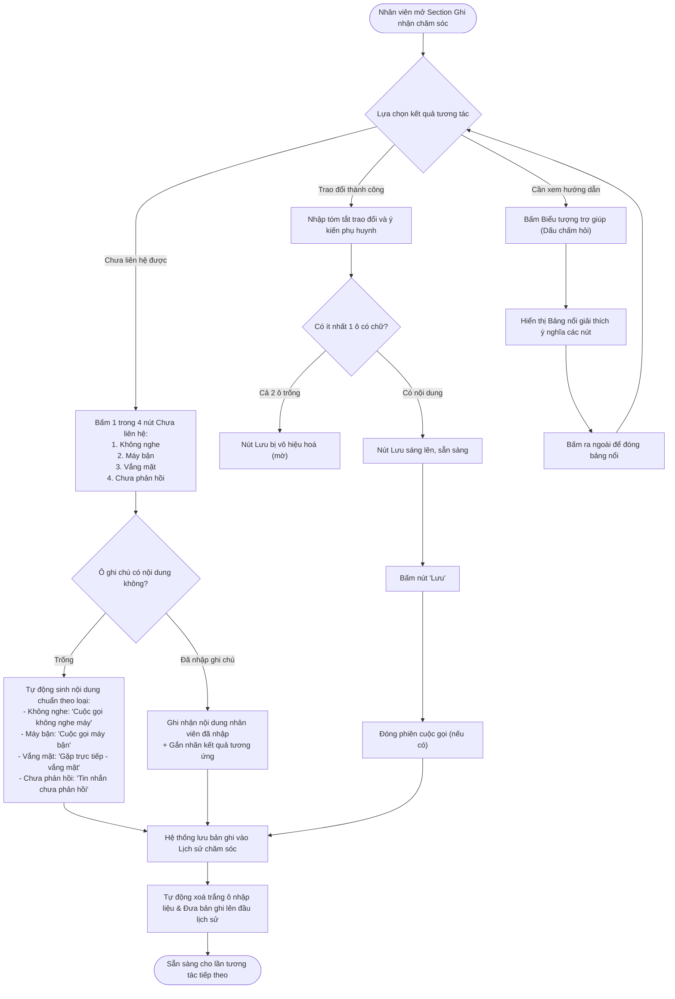

# ĐẶC TẢ TIÊU CHÍ NGHIỆM THU & TRƯỜNG HỢP BIÊN
## SECTION GHI NHẬN CHĂM SÓC - TAB CHĂM SÓC (MÀN HÌNH CHI TIẾT CHĂM SÓC)

> **Mã đặc tả:** `SPEC-CARE-SECTION-GHI-NHAN-CHAM-SOC-AC`  
> **Màn hình đối chiếu:** Chi tiết chăm sóc học viên (`/app/student_operations_alert`)  
> **Vị trí áp dụng:** Tab Chăm sóc $\rightarrow$ Section Ghi nhận chăm sóc  
> **Phân hệ nghiệp vụ:** Chăm sóc & Duy trì Học viên  
> **Mục tiêu thay đổi:** Chuẩn hóa luồng ghi nhận tương tác nhanh cho trường hợp chưa liên hệ được phụ huynh, tinh gọn nút lưu cho tương tác thành công và cung cấp bảng giải thích thao tác trực quan.  
> **Phạm vi hiệu lực:** Giới hạn duy nhất trong phạm vi Section Ghi nhận chăm sóc (không mở rộng sang các khối khác như Mốc chăm sóc, Thẻ lớp học hay Đơn hàng liên kết).

---

## 1. MÔ TẢ TỔNG QUAN & BỐI CẢNH THAY ĐỔI

### 1.1. Bối cảnh và vấn đề cần giải quyết
Trước đây, giao diện ghi nhận tương tác chăm sóc học viên sử dụng hai nút thao tác chung là `Lưu` và `Lưu & Đóng` (hoặc `Lưu & Hoàn thành`). Cấu trúc này bộc lộ các bất cập:
- Khi nhân viên gọi điện hoặc gửi tin nhắn nhưng phụ huynh không nghe máy, máy bận hoặc chưa phản hồi, nhân viên vẫn phải gõ tay tóm tắt nội dung vào ô ghi chú rồi mới ấn lưu, gây tốn thời gian và giảm năng suất chăm sóc hàng ngày.
- Nút `Lưu & Đóng` dễ gây nhầm lẫn với việc kết thúc toàn bộ ca chăm sóc hoặc đóng giao diện khi chưa cần thiết.
- Nhân viên mới chưa hiểu rõ quy tắc khi nào dùng nút lưu và các hình thức ghi nhận trạng thái chưa liên lạc.

### 1.2. Giải pháp cập nhật trên giao diện
1. **Đổi nút Lưu cũ thành Cụm nút "Chưa liên hệ" (hiển thị nhãn "Chưa liên lạc"):**
   - Phân tách thành 4 nút hành động tương ứng với 4 loại kết quả chưa tiếp cận được:
     + `Không nghe`: Áp dụng cho kênh Cuộc gọi khi phụ huynh không nhấc máy.
     + `Máy bận`: Áp dụng cho kênh Cuộc gọi khi thuê bao bận hoặc từ chối cuộc gọi.
     + `Vắng mặt`: Áp dụng cho kênh Gặp mặt trực tiếp tại cơ sở khi phụ huynh không có mặt.
     + `Chưa phản hồi`: Áp dụng cho kênh Tin nhắn (Zalo) khi đã gửi tin nhưng phụ huynh chưa trả lời.
   - Cơ chế tự động ghi nhận: Khi bấm từng nút, hệ thống tự động sinh nội dung tương ứng theo từng loại mà không bắt buộc nhân viên phải nhập tay vào ô ghi chú.
2. **Sửa nút "Lưu & Đóng" cũ thành nút `Lưu` duy nhất:**
   - Dành riêng cho việc ghi nhận các cuộc trao đổi / tương tác thành công.
   - Có cơ chế kiểm soát: Nút chỉ kích hoạt khi nhân viên có nhập nội dung vào ô Ghi chú trao đổi hoặc ô Ý kiến phụ huynh.
3. **Bổ sung Biểu tượng diễn giải (Biểu tượng trợ giúp):**
   - Đặt ngay cạnh nút `Lưu`. Khi nhấn vào, hệ thống mở bảng nổi giải thích chi tiết mục đích và ý nghĩa của từng nút thao tác.

---

## 2. SƠ ĐỒ LUỒNG THAO TÁC NGHIỆP VỤ (USER FLOW)

---

## 3. TIÊU CHÍ NGHIỆM THU CHỨC NĂNG (ACCEPTANCE CRITERIA)

### AC-01: Ghi nhận nhanh Chưa liên hệ khi ô nội dung để trống (Tự động sinh nội dung chuẩn)
* **Giả sử:** Nhân viên đang ở Section Ghi nhận chăm sóc, ô Ghi chú tóm tắt và ô Ý kiến phụ huynh đang để trống.
* **Khi:** Nhân viên bấm vào một trong các nút thuộc cụm Chưa liên hệ:
  1. Bấm nút `Không nghe`.
  2. Bấm nút `Máy bận`.
  3. Bấm nút `Vắng mặt`.
  4. Bấm nút `Chưa phản hồi`.
* **Thì:**
  1. Hệ thống không bắt buộc nhập liệu và không báo lỗi thiếu thông tin.
  2. Hệ thống tự động tạo bản ghi lịch sử tương tác mới với nội dung mặc định chuẩn hóa theo từng loại:
     - Với `Không nghe`: Kênh tự động chuyển thành Cuộc gọi, kết quả là `Không nghe máy`, nội dung ghi nhận là `Cuộc gọi không nghe máy`, mã xác nhận hiển thị là `KNM`.
     - Với `Máy bận`: Kênh tự động chuyển thành Cuộc gọi, kết quả là `Máy bận`, nội dung ghi nhận là `Cuộc gọi máy bận`, mã xác nhận hiển thị là `Đã gọi`.
     - Với `Vắng mặt`: Kênh tự động chuyển thành Gặp trực tiếp, kết quả là `Vắng mặt`, nội dung ghi nhận là `Gặp trực tiếp - vắng mặt`, mã xác nhận hiển thị là `Đã gặp trực tiếp`.
     - Với `Chưa phản hồi`: Kênh tự động chuyển thành Zalo, kết quả là `Chưa phản hồi`, nội dung ghi nhận là `Tin nhắn chưa phản hồi`, mã xác nhận hiển thị là `Đã nhắn Zalo`.
  3. Hệ thống hiển thị thông báo góc màn hình: `Đã ghi nhận: [Tên kết quả]` (ví dụ: `Đã ghi nhận: Không nghe máy`).
  4. Bản ghi mới xuất hiện ngay trên cùng danh sách Lịch sử chăm sóc với đầy đủ thông tin: người thực hiện, thời gian, người nhận, kênh, kết quả và nội dung.

---

### AC-02: Ghi nhận Chưa liên hệ khi nhân viên có nhập sẵn ghi chú hoặc ý kiến phụ huynh
* **Giả sử:** Nhân viên đã nhập sẵn văn bản vào ô Ghi chú tóm tắt trao đổi hoặc ô Ý kiến phụ huynh trước khi bấm nút.
* **Khi:** Nhân viên bấm vào một trong các nút Chưa liên hệ (`Không nghe`, `Máy bận`, `Vắng mặt`, `Chưa phản hồi`).
* **Thì:**
  1. Hệ thống sử dụng trực tiếp nội dung văn bản mà nhân viên đã gõ thay thế cho câu mặc định.
  2. Hệ thống vẫn tự động gắn đúng nhãn Kênh, nhãn Kết quả tương ứng của nút đã chọn vào bản ghi lịch sử.
  3. Nếu có nội dung trong ô Ý kiến phụ huynh, thông tin này được lưu kèm theo bản ghi với phần phân tách rõ ràng.
  4. Hệ thống hoàn tất lưu trữ, hiển thị thông báo thành công và xóa trắng toàn bộ dữ liệu trong các ô nhập để sẵn sàng cho lần tác nghiệp tiếp theo.

---

### AC-03: Ràng buộc trạng thái và hành vi của nút Lưu (Ghi nhận tương tác thành công)
* **Giả sử:** Nhân viên chuẩn bị ghi nhận một phiên trao đổi thành công với phụ huynh.
* **Khi:** Quan sát và thao tác trên nút `Lưu`:
* **Thì:**
  1. **Khi cả 2 ô đều trống:** Nếu cả ô Ghi chú tóm tắt và ô Ý kiến phụ huynh không có chữ (hoặc chỉ có khoảng trắng), nút `Lưu` ở trạng thái mờ (vô hiệu hóa), không thể nhấp chuột và con trỏ chuột hiển thị trạng thái cấm.
  2. **Khi có ít nhất 1 ô có chữ:** Chỉ cần một trong hai ô có nội dung hợp lệ, nút `Lưu` lập tức sáng lên với màu xanh dương chủ đạo, cho phép nhấp chuột để lưu.
  3. **Khi nhân viên bấm nút `Lưu`:**
     - Hệ thống ghi nhận toàn bộ nội dung đã nhập vào lịch sử chăm sóc của học viên.
     - Nếu đang có phiên cuộc gọi thoại mở trên giao diện, hệ thống tự động đóng banner cuộc gọi.
     - Bản ghi lịch sử được tạo mới kèm theo thông tin kênh liên hệ đang chọn, kết quả trao đổi, thời gian hẹn gọi lại (nếu có cài đặt) và người nhận liên hệ.
     - Hệ thống hiển thị thông báo thành công: `Đã ghi nhận chăm sóc thành công!`.

---

### AC-04: Hiển thị và tương tác với Biểu tượng diễn giải (Biểu tượng trợ giúp)
* **Giả sử:** Nhân viên đang làm việc tại Section Ghi nhận chăm sóc.
* **Khi:** Nhân viên bấm vào Biểu tượng trợ giúp (biểu tượng dấu chấm hỏi hình tròn nằm bên phải nút `Lưu`).
* **Thì:**
  1. Hệ thống mở một bảng nổi nhỏ gọn phía trên nút bấm mà không làm che khuất các ô nhập liệu quan trọng.
  2. Bảng nổi hiển thị tiêu đề `Ý nghĩa nút thao tác` đi kèm biểu tượng trợ giúp màu xanh.
  3. Nội dung bảng nổi mô tả rõ ràng hai nhóm hành động:
     - `Lưu`: Lưu nội dung trao đổi vào lịch sử chăm sóc (dành cho các phiên liên lạc có trao đổi thực tế).
     - `Không nghe / Máy bận / Vắng mặt / Chưa phản hồi`: Bấm để ghi nhận nhanh lịch sử chưa liên lạc được mà không cần nhập ghi chú.
  4. Khi nhân viên bấm chuột ra ngoài bảng nổi hoặc bấm lại vào biểu tượng trợ giúp, bảng nổi tự động đóng lại nhẹ nhàng.

---

### AC-05: Tự động dọn dẹp dữ liệu biểu mẫu và cập nhật nhật ký sau khi lưu
* **Giả sử:** Nhân viên vừa bấm thành công nút `Lưu` hoặc bất kỳ nút nào trong cụm `Chưa liên hệ`.
* **Khi:** Hệ thống xác nhận lưu bản ghi thành công vào cơ sở dữ liệu.
* **Thì:**
  1. Toàn bộ chữ trong ô Ghi chú tóm tắt trao đổi và ô Ý kiến phụ huynh tự động được làm rỗng.
  2. Chiều cao ô ghi chú tự động co về kích thước ban đầu (không bị kéo giãn bất thường).
  3. Nút `Lưu` tự động chuyển về trạng thái vô hiệu hóa (do biểu mẫu đã trống).
  4. Danh sách dòng thời gian Lịch sử chăm sóc ở phần dưới tự động làm mới và cập nhật bản ghi vừa tạo ở vị trí trên cùng mà không cần người dùng tải lại trang.

---

## 4. CÁC TRƯỜNG HỢP BIÊN & NGOẠI LỆ (CORNER CASES)

*(Phần này chỉ mô tả các tình huống biên, rìa dữ liệu và ngoại lệ kỹ thuật nghiệp vụ; hoàn toàn không lặp lại các kịch bản chuẩn đã nêu trong Tiêu chí nghiệm thu).*

### CASE-01: Bấm nút Chưa liên hệ khi đang trong phiên cuộc gọi đang kết nối
* **Tình huống:** Nhân viên vừa bấm nút `Gọi` từ giao diện, banner kết nối cuộc gọi đang hiển thị đếm giây hoặc đổ chuông, nhưng thực tế đầu dây bên kia chuông reo không có người nhấc máy hoặc nghe tín hiệu máy bận, nhân viên bấm luôn nút `Không nghe` hoặc `Máy bận`.
* **Xử lý:**
  1. Hệ thống lập tức dừng trạng thái cuộc gọi hiện tại, tự động chuyển trạng thái kết nối về đã kết thúc.
  2. Hệ thống vẫn lưu đúng kết quả chưa liên lạc được (`Không nghe máy` hoặc `Máy bận`) vào lịch sử.
  3. Biểu mẫu được làm sạch và đưa giao diện về trạng thái tĩnh bình thường, không để treo banner gọi.

---

### CASE-02: Nhập toàn bộ ký tự khoảng trắng (Space / Tab / Xuống dòng) vào ô nhập liệu
* **Tình huống:** Nhân viên nhấn phím cách nhiều lần hoặc nhấn enter xuống dòng tạo các khoảng trống vô nghĩa trong ô Ghi chú hoặc ô Ý kiến phụ huynh.
* **Xử lý:**
  1. Bộ kiểm tra dữ liệu của hệ thống tự động cắt bỏ khoảng trắng hai đầu khi đánh giá điều kiện.
  2. Do không có ký tự thực, nút `Lưu` vẫn tiếp tục duy trì trạng thái mờ (vô hiệu hóa), ngăn chặn nhân viên tạo các bản ghi rỗng vào lịch sử.
  3. Nếu nhân viên bấm vào một nút trong cụm Chưa liên hệ khi chỉ có khoảng trắng, hệ thống xem như ô ghi chú để trống và tự động điền câu mặc định chuẩn hóa theo loại.

---

### CASE-03: Thao tác bấm nút liên tiếp nhiều lần trong tích tắc (Spam Double-click)
* **Tình huống:** Nhân viên nhấp chuột liên tục 2 đến 3 lần vào nút `Lưu` hoặc nút Chưa liên hệ do thói quen thao tác nhanh hoặc chuột bị lỗi nút bấm.
* **Xử lý:**
  1. Sau lần nhấp đầu tiên, nút bấm tự động kích hoạt cờ xử lý tạm thời và khóa nhận sự kiện nhấp tiếp theo trong chu kỳ ghi dữ liệu.
  2. Hệ thống chỉ ghi nhận duy nhất 1 bản ghi lịch sử tương tác, tuyệt đối không tạo ra các bản ghi trùng lặp nội dung và cùng mốc thời gian.

---

### CASE-04: Kích hoạt tổ hợp phím tắt Ctrl + Enter khi cả hai ô nội dung đều rỗng
* **Tình huống:** Con trỏ chuột đang nằm trong ô Ghi chú hoặc ô Ý kiến phụ huynh nhưng không có chữ nào, nhân viên vô tình bấm tổ hợp phím `Ctrl + Enter` (hoặc `Cmd + Enter` trên macOS).
* **Xử lý:**
  1. Trình nhận phím tắt kiểm tra điều kiện dữ liệu trước khi gửi lệnh.
  2. Do nội dung đang rỗng, sự kiện phím tắt bị chặn đứng hoàn toàn, không thực thi lưu dữ liệu và không phát sinh thông báo lỗi.

---

### CASE-05: Số điện thoại người liên hệ không hợp lệ hoặc để trống khi thao tác
* **Tình huống:** Học viên chưa được gán số điện thoại người liên hệ (hiển thị ký hiệu `--` hoặc ô trống).
* **Xử lý:**
  1. Nút `Gọi` chính bị khóa và hiển thị cảnh báo yêu cầu cập nhật số điện thoại nếu bấm vào.
  2. Tuy nhiên, các nút trong cụm Chưa liên hệ (như `Không nghe`, `Máy bận`, `Vắng mặt`, `Chưa phản hồi`) **vẫn cho phép bấm hoạt động bình thường** nhằm giúp nhân viên ghi nhận nhật ký nghiệp vụ (ví dụ: đã cố gắng liên hệ theo kênh khác hoặc ghi nhận vắng mặt tại lớp).

---

### CASE-06: Nội dung ghi chú có độ dài lớn, chứa ký tự đặc biệt hoặc biểu tượng cảm xúc
* **Tình huống:** Nhân viên dán một đoạn văn bản dài từ tin nhắn mạng xã hội có chứa nhiều biểu tượng cảm xúc (emoji), dấu ngắt dòng đặc biệt hoặc ký tự ngoặc vuông `[ ]`.
* **Xử lý:**
  1. Ô ghi chú tự động co giãn thanh cuộn dọc mà không làm vỡ chiều rộng hay xô lệch các nút bên dưới.
  2. Khi lưu vào lịch sử, các ký tự ngoặc vuông được bảo toàn nguyên vẹn văn bản của nhân viên, không gây xung đột với các nhãn hệ thống như `[Kênh: ...]`, `[Đến: ...]`.
  3. Dòng thời gian lịch sử hiển thị đầy đủ văn bản và bẻ dòng an toàn.

---

### CASE-07: Đang nhập dở dang thì mở và đóng Bảng nổi diễn giải
* **Tình huống:** Nhân viên đã gõ dở một đoạn văn bản dài trong ô Ghi chú, sau đó bấm vào Biểu tượng trợ giúp để đọc ý nghĩa nút, rồi bấm ra ngoài để đóng lại.
* **Xử lý:**
  1. Thao tác bật/tắt bảng nổi trợ giúp hoàn toàn độc lập, không kích hoạt sự kiện làm mới biểu mẫu.
  2. Toàn bộ nội dung văn bản nhân viên đang gõ dở được giữ nguyên vẹn 100%, con trỏ nhập liệu không bị mất hoặc reset.

---

### CASE-08: Hiển thị co giãn trên màn hình hẹp (Giao diện co nhỏ hoặc chia đôi cửa sổ)
* **Tình huống:** Người dùng thu nhỏ chiều rộng cửa sổ trình duyệt hoặc thao tác trên màn hình máy tính bảng có độ phân giải thấp.
* **Xử lý:**
  1. Hàng nút tác vụ tự động kích hoạt cơ chế xuống dòng mềm mại: Cụm nhãn `Chưa liên lạc` và 4 nút hành động tự động xếp gọn sang dòng đầu, nút `Lưu` và biểu tượng trợ giúp dịch chuyển hợp lý xuống góc phải bên dưới.
  2. Các nút bấm duy trì khoảng cách lề tối thiểu, không bị chèn lấn, không bị tràn viền ngang và không làm xuất hiện thanh cuộn ngang cục bộ gây khó chịu.

---

## 5. BẢNG TỔNG HỢP KIỂM SOÁT PHẠM VI (SCOPE MATRIX)

| Thành phần kiểm soát | Phạm vi trong tài liệu này (In-Scope) | Phạm vi loại trừ (Out-of-Scope) |
| :--- | :--- | :--- |
| **Cụm nút Chưa liên hệ** | 4 nút: `Không nghe`, `Máy bận`, `Vắng mặt`, `Chưa phản hồi` | Các quy trình điều kiện tự động kích hoạt tác vụ CSKH nâng cao |
| **Nút Lưu** | Ghi nhận tương tác thành công, ràng buộc dữ liệu, xóa trắng sau lưu | Cơ chế đổi trạng thái mốc khóa học sang Hoàn thành (nằm ở khối khác) |
| **Biểu tượng diễn giải** | Hiển thị bảng nổi giải thích ý nghĩa các nút của Section này | Diễn giải quy tắc tính SLA hay trạng thái thẻ học viên toàn trang |
| **Khối nhập liệu** | Ô Ghi chú trao đổi, ô Ý kiến phụ huynh, liên kết người nhận | Lịch sử chi tiết học tập, bảng điểm danh hay danh sách gói học |
